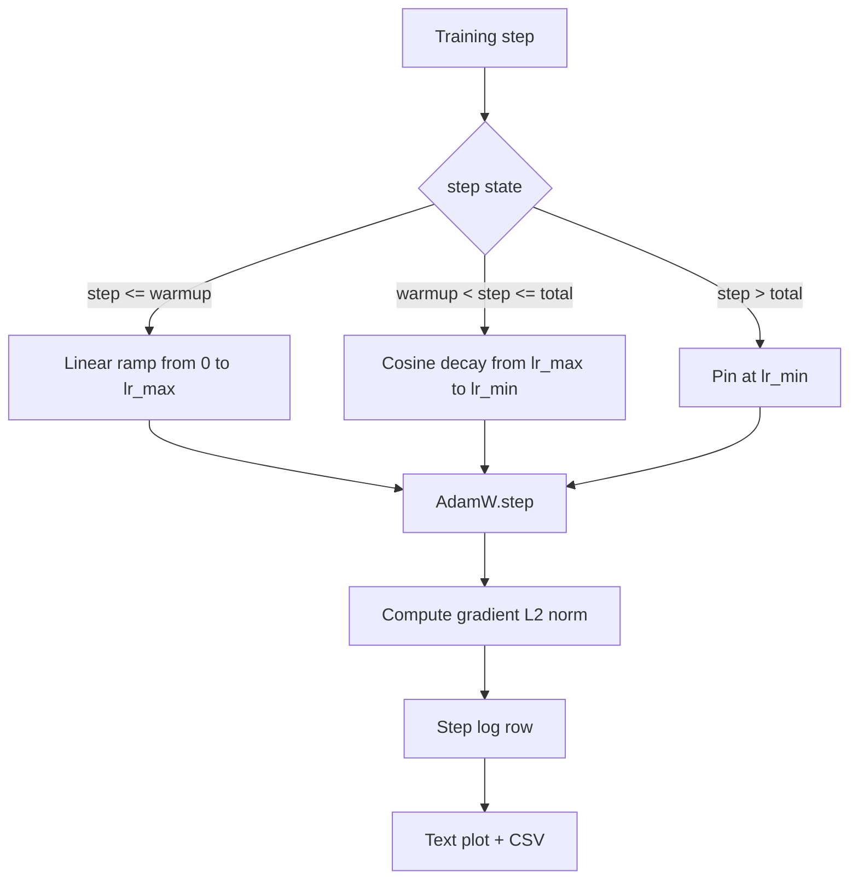

# Cosine LR with Linear Warmup · 余弦学习率与线性预热

> 学习率调度（learning-rate schedule）是仅次于损失函数的第二重要决策。AdamW 加余弦衰减（cosine decay）和线性预热（linear warmup）是当今语言模型训练的默认配置：它让模型在最脆弱的前一千次更新里看到较小的有效步长，爬升到配置好的峰值，再平滑地衰减回零。本课构建这套调度，把曲线随训练步画出来，把梯度范数与调度并排记录，并证明调度遵守预热、峰值和衰减的边界。

> The learning-rate schedule is the second most important decision after the loss function. AdamW with a cosine decay and a linear warmup is the modern default for language-model training because it lets the model see a small effective step size during the brittle first thousand updates, ramps up to a configured peak, and decays smoothly back toward zero. This lesson builds that schedule, plots the curve over training steps, logs gradient norms next to the schedule, and proves the schedule honors warmup, peak, and decay boundaries.

**类型：** 构建（Build）
**语言：** Python
**前置课程：** Phase 19 第 30-37 课
**时间：** 约 90 分钟

## Learning Objectives · 学习目标

- 实现一个接了带线性预热的余弦学习率调度的 AdamW 优化器。
- 在任意步数计算调度的精确值，跨运行不引入浮点漂移。
- 把梯度 L2 范数与学习率并排记录，让训练健康状态可观测。
- 把调度渲染成肉眼可读的文本图和任何工具都能消费的 CSV。

> Implement an AdamW optimizer wired to a cosine learning-rate schedule with linear warmup.
> Compute the schedule's exact value at any step without floating-point drift across runs.
> Log gradient L2 norm side by side with the learning rate so training health is observable.
> Render the schedule to a text plot the eye can read and a CSV any tool can consume.

## The Problem · 问题在哪

最初的一千次训练更新最吵闹。模型的权重还接近初始化状态，优化器的二阶矩滑动估计还没稳定，梯度范数又大又噪。如果学习率在这些更新里处于峰值，模型要么直接发散，要么掉进一个再也爬不出来的损失平台。两个众所周知的补救：一是梯度裁剪（gradient clipping），它是 Phase 19 第 45 课的主题；二是从小值起步、逐渐爬升的学习率调度。

带预热的余弦调度有三个区间。从第 0 步到第 `warmup_steps` 步，学习率从零线性放大到配置的峰值 `lr_max`。从第 `warmup_steps` 步到第 `total_steps` 步，学习率沿余弦曲线的上半段从 `lr_max` 衰减到 `lr_min`。`total_steps` 之后，学习率被钉在 `lr_min`，这样配置错误而超步的训练器不会悄悄滑出调度。

构建上的难题是调度极易出「差一」（off-by-one）错误。这个差一会在训练六小时后显形：恰好在模型开始过拟合的时刻，学习率偏高或偏低 1%——除非在边界上穷尽地测试过调度，否则根本看不见。

> The first thousand training updates are the loudest. If the learning rate is at its peak during these updates the model either diverges outright or settles into a loss plateau it never escapes. The two well-known fixes are gradient clipping, which is the subject of Phase 19 lesson 45, and a learning-rate schedule that starts small and ramps up.
> The cosine-with-warmup schedule has three regions. After `total_steps` the learning rate is pinned at `lr_min` so a misconfigured trainer that overshoots does not silently exit the schedule.
> The build problem is that schedules are easy to get wrong off by one. The off-by-one shows up six hours into a training run as a learning rate that is 1 percent too high or too low at the moment the model starts overfitting, which is invisible unless the schedule is exhaustively tested at boundaries.

## The Concept · 概念



### Warmup formula · 预热公式

当 `step` 在 `[0, warmup_steps]` 且 `warmup_steps > 0` 时，学习率为 `lr_max * step / warmup_steps`。退化情形 `warmup_steps = 0` 按「无预热」处理：调度在第 0 步直接从 `lr_max` 起步，立即进入余弦衰减。有些测试框架会传 `warmup_steps = 0`，检查调度仍能产出可用的曲线。

> For `step` in `[0, warmup_steps]` with `warmup_steps > 0`, the learning rate is `lr_max * step / warmup_steps`. The degenerate `warmup_steps = 0` case is treated as "no warmup": the schedule starts directly at `lr_max` at step zero and immediately enters cosine decay. Some test harnesses pass `warmup_steps = 0` to check the schedule still produces a usable curve.

### Cosine formula · 余弦公式

当 `step` 在 `(warmup_steps, total_steps]` 时，学习率为 `lr_min + 0.5 * (lr_max - lr_min) * (1 + cos(pi * progress))`，其中 `progress = (step - warmup_steps) / max(1, total_steps - warmup_steps)`。在 `step = warmup_steps` 处，余弦算出 `cos(0) = 1`，得到 `lr_max`，与预热终点严丝合缝。在 `step = total_steps` 处，余弦算出 `cos(pi) = -1`，得到 `lr_min`，与衰减终点严丝合缝。

两个端点上的连续性不是巧合。这正是调度被实现为关于 `step` 的单一函数、而不是三个函数拼起来的原因。拼接式调度会在第一次修改 `lr_max` 时丢掉一个边界。

> For `step` in `(warmup_steps, total_steps]` the learning rate is `lr_min + 0.5 * (lr_max - lr_min) * (1 + cos(pi * progress))` where `progress = (step - warmup_steps) / max(1, total_steps - warmup_steps)`. At `step = warmup_steps` the cosine evaluates to `cos(0) = 1`, which gives `lr_max`, matching the warmup endpoint exactly. At `step = total_steps` the cosine evaluates to `cos(pi) = -1`, which gives `lr_min`, matching the decay endpoint exactly.
> The continuity at both endpoints is not an accident. It is the reason the schedule is implemented as a single function over `step`, not as three different functions glued together. A glued schedule loses one boundary the first time `lr_max` is changed.

### Floor after total steps · 总步数之后的地板

当 `step > total_steps` 时，学习率停在 `lr_min`。契约是显式的：调度不报错、不外推，钉在地板上，让训练器去记一条警告。需要延长训练的训练器改的是调度的 `total_steps`，而不是循环。

> For `step > total_steps` the learning rate stays at `lr_min`. The contract is explicit: the schedule does not error out and does not extrapolate; it pins at the floor and lets the trainer log a warning. Trainers that need to extend training change the schedule's `total_steps`, not the loop.

### Gradient norm logging alongside the rate · 梯度范数与学习率并排记录

调度只是训练健康的一半，梯度范数是另一半。训练循环每步记录两者。发散的运行会在损失飙升之前先看到梯度范数飙升；调得好的预热让范数随学习率线性上升；过于激进的峰值表现为预热结束后范数仍然居高不下。磁盘上的数据集是 `step, lr, grad_l2_norm, loss`。CSV 是唯一的持久记录。

```figure
cap-cosine-warmup
```

> The schedule is half of training health. The gradient norm is the other half. The training loop logs both per step. A divergent training run shows the gradient norm spike before the loss does; a well-tuned warmup keeps the norm rising linearly with the rate; a too-aggressive peak shows up as a norm that stays high after warmup. The dataset on disk is `step, lr, grad_l2_norm, loss`. The CSV is the only durable record.

## Build It · 动手造

`code/main.py` 实现了：

- `CosineWithWarmup` —— 关于配置调度的无状态函数 `lr(step) -> float`。
- `TrainState` —— 把模型、一个 `AdamW` 优化器和调度包成单一 step 函数。
- `TrainState.step` —— 跑一次前向、一次反向，记录梯度 L2 范数，并把 `lr(step)` 应用到优化器。
- `plot_schedule_ascii` —— 把调度渲染成肉眼可读的文本图。
- `write_schedule_csv` —— 每步写一行，内含学习率。

文件底部有一个演示：构建一个微型 `nn.Linear` 模型，在固定输入批次上训练 20 步，打印每步的学习率、梯度范数和损失。调度同时被渲染成文本图，供肉眼做合理性检查。

运行：

```bash
python3 code/main.py
```

脚本以零退出码结束，打印逐步训练日志和调度图。

> `CosineWithWarmup` - a stateless function `lr(step) -> float` over the configured schedule.
> `TrainState.step` - runs one forward pass, one backward pass, logs gradient L2 norm, and applies `lr(step)` to the optimizer.
> A demo at the bottom of the file builds a tiny `nn.Linear` model, trains for 20 steps over a fixed input batch, and prints the per-step learning rate, gradient norm, and loss. The schedule is also rendered as a text plot for the visual sanity check.
> The script exits zero and prints a per-step training log plus the schedule plot.

## Production Patterns · 生产模式

四个模式把这套调度提升为生产级工件（artifact）。

**调度活在配置里，不活在代码里。** 训练器从提交进 git 的 YAML 或 JSON 配置读取 `warmup_steps`、`total_steps`、`lr_max`、`lr_min`。调度可复现，因为配置有内容寻址；调度可审计，因为配置出现在 PR diff 里。

**步数计数器单调递增，且与 epoch 解耦。** 有些框架在数据集被分片或 dataloader 重启时会把 step 和 epoch 搞混。调度从训练器的检查点读 `global_step`，而不是从本地计数器读。恢复的运行落在正确的调度位置上，因为步数计数器是持久的轴。

**调度图放进运行目录。** 每次训练运行都往自己的运行目录写 `outputs/lr_schedule.png`（本课则是文本图）。翻目录的评审者不用重跑任何东西就能对调度做合理性检查。这能在 PR 阶段抓住「调度配错」这一整类 bug。

**日志行模式（schema）固定。** `step, lr, grad_l2_norm, loss`，顺序不变。下游的 notebook 或仪表盘依赖这个模式；不改版本号就重命名一列，会让所有现存仪表盘失效。

> **Schedule lives in a config, not in code.** The schedule is reproducible because the config is content-addressed; the schedule is auditable because the config is part of the PR diff.
> **Step counter is monotonic and decoupled from epochs.** The schedule reads `global_step` from the trainer's checkpoint, not from a local counter. A resumed run continues at the right schedule position because the step counter is the durable axis.
> **Schedule plot in the run directory.** A reviewer who skims the directory can sanity-check the schedule without re-running anything. This catches the misconfigured-schedule class of bugs at PR time.
> **Log row schema is fixed.** `step, lr, grad_l2_norm, loss` in that order. Renaming a column without bumping a version invalidates every existing dashboard.

## Use It · 实战用法

生产模式：

- **先扫峰值，再扫别的。** `lr_max` 是最敏感的旋钮。先在小模型上扫它；最优 `lr_max` 随模型尺寸只是弱相关变化，所以小模型的扫描是很强的先验。
- **预热是总步数的比例，不是绝对数。** 一段 2 亿步的运行配 2,000 步预热，几乎立即到达峰值；20,000 步的运行配同样数量，预热占 10%。把预热配置成比例（典型：1-3%），调度就能随训练时长伸缩。
- **`lr_min` 故意非零。** 取 `lr_max` 的 10% 作地板，让优化器在漫长的尾部仍在学习。`lr_min = 0` 的调度产出一条图上好看的曲线，和一个其实没训完的模型。

> **Sweep peak before sweeping anything else.** `lr_max` is the most sensitive knob. Sweep it on a small model first; the optimal `lr_max` scales weakly with model size, so the small-model sweep is a strong prior.
> **Warmup is a fraction of total steps, not an absolute count.** Configure warmup as a fraction (typical: 1-3 percent) so the schedule scales with training duration.
> **`lr_min` is non-zero on purpose.** A `lr_min = 0` schedule produces a training curve that looks great on a plot and a model that has not actually finished training.

## Ship It · 交付

`outputs/skill-cosine-warmup.md` 在真实项目里会描述：哪个配置携带调度、全局计数器从训练器的哪一步读出、是哪次 `lr_max` 扫描产出了部署值。本课交付的是引擎。

> `outputs/skill-cosine-warmup.md` would, on a real project, describe which config carries the schedule, which trainer step the global counter is read from, and what `lr_max` sweep produced the deployed value. This lesson ships the engine.

## Exercises · 练习

1. 加一个逆平方根（inverse-square-root）变体的调度，在 200 步的玩具训练上与余弦版对比。哪条曲线的最终损失更低？
2. 加一个 `--restart` 旗标，在 `total_steps / 2` 处加第二次预热。为「热重启在玩具运行上是改善还是伤害」辩护。
3. 加一个单元测试证明调度连续：对 `[0, total_steps]` 中每一步，`|lr(step+1) - lr(step)|` 不超过 `lr_max / warmup_steps`。
4. 把调度接进 `torch.optim.lr_scheduler.LambdaLR`，让它与框架代码组合。本课用的是普通 step 函数；包装器改变了什么？
5. 加一个 `--plot-png` 旗标，用 `matplotlib` 写出真图。为本课的文本图和 PNG 哪个更适合做 CI 默认辩护。

> Add an inverse-square-root variant of the schedule and compare it on a 200-step toy training run. Which curve produces the lower final loss?
> Add a `--restart` flag that adds a second warmup at `total_steps / 2`. Defend whether warm restarts improve or hurt on the toy run.
> Add a unit test that the schedule is continuous: for every step in `[0, total_steps]` the difference `|lr(step+1) - lr(step)|` is bounded by `lr_max / warmup_steps`.
> Wire the schedule into a `torch.optim.lr_scheduler.LambdaLR` so it composes with framework code. The lesson uses a plain step function; what does the wrapper change?
> Add a `--plot-png` flag that writes a real plot via `matplotlib`. Defend whether the lesson's text plot or the PNG is the better default for CI runs.

## Key Terms · 术语表

| 术语 | 人们怎么说 | 实际含义 |
|------|-----------|---------|
| Warmup（预热） | 「慢启动」 | 前 `warmup_steps` 次更新内从零到 `lr_max` 的线性爬升 |
| Cosine decay（余弦衰减） | 「平滑下降」 | 剩余步数上从 `lr_max` 到 `lr_min` 的上半段余弦曲线 |
| Floor（地板） | 「训练结束之后」 | `total_steps` 之后调度钉住的固定值 `lr_min` |
| Gradient norm（梯度范数） | 「梯度的 L2」 | 拼接后的梯度向量的欧几里得范数，每步记录 |
| Global step（全局步） | 「调度的轴」 | 一个能在重启后存活的单调步数计数器，驱动整个调度 |

## Further Reading · 延伸阅读

- [Loshchilov and Hutter, SGDR: Stochastic Gradient Descent with Warm Restarts (arXiv 1608.03983)](https://arxiv.org/abs/1608.03983) —— 余弦调度的参考论文
- [Loshchilov and Hutter, Decoupled Weight Decay Regularization (arXiv 1711.05101)](https://arxiv.org/abs/1711.05101) —— AdamW 的参考论文
- [PyTorch torch.optim.lr_scheduler](https://docs.pytorch.org/docs/stable/optim.html#how-to-adjust-learning-rate) —— step 函数如何与框架调度器组合
- Phase 19 · 42 —— 本调度消费其语料的下载器
- Phase 19 · 43 —— 与本调度协同演化的 dataloader
- Phase 19 · 45 —— 循环里的下一层：梯度裁剪与 AMP
