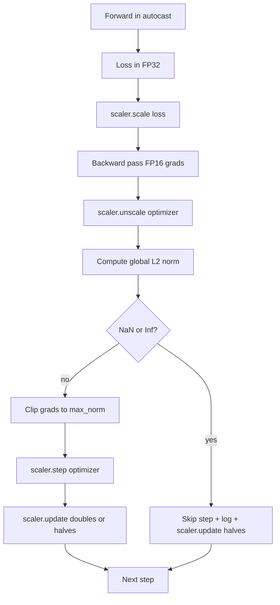

# Gradient Clipping and Mixed Precision · 梯度裁剪与混合精度

> 上一课的优化器和调度假设梯度是正常的。它们通常不正常。一个坏批次就能让梯度范数飙升三个数量级。混合精度（mixed-precision）训练又通过在损失一侧引入 FP16 溢出放大了这个问题。本课构建生产训练离不开的两条安全带：把梯度裁剪（gradient clipping）到配置好的全局 L2 范数，以及一个带 autocast 和 GradScaler 的混合精度循环——检测 NaN 和 Inf，干净地跳过该步，并记录缩放因子（scaling factor）供事后取证。

> The optimizer and schedule from the previous lesson assume gradients are sane. They usually are not. A single bad batch can spike the gradient norm by three orders of magnitude. Mixed-precision training amplifies this by introducing FP16 overflow on the loss side. This lesson builds the two safety belts that production training cannot ship without: gradient clipping to a configured global L2 norm, and a mixed-precision loop with autocast and GradScaler that detects NaN and Inf, skips the step cleanly, and logs the scaling factor for forensics.

**类型：** 构建（Build）
**语言：** Python
**前置课程：** Phase 19 第 30-37 课
**时间：** 约 90 分钟

## Learning Objectives · 学习目标

- 对所有参数梯度计算全局 L2 范数，超过配置阈值时就地裁剪。
- 用 autocast 加 GradScaler 包住训练步，让 FP16 前向和反向传播扛得住溢出。
- 在损失或梯度中检测 NaN 和 Inf，跳过优化器步并记录跳过。
- 每步报告 GradScaler 的缩放因子，让长时间的连续跳过立刻可见。

> Compute the global L2 norm over all parameter gradients and clip in place when it exceeds a configured threshold.
> Wrap a training step in autocast plus a GradScaler so FP16 forward and backward passes survive overflow.
> Detect NaN and Inf in the loss or gradient, skip the optimizer step, and log the skip.
> Report the GradScaler's scaling factor every step so a long sequence of skips is visible immediately.

## The Problem · 问题在哪

昨天还跑得好好的训练，损失曲线在第 8,217 步变成了竖直线。罪魁祸首是单个批次：它的梯度范数是 4,200，是之前峰值的二十倍。不裁剪的话，优化器会应用一步更新，把模型前一个小时学到的所有东西清零。换成语范数 1.0 的全局 L2 裁剪，同一个批次只贡献一个单位范数的更新，损失曲线待在它的趋势线上，运行活了下来。

混合精度训练用 FP16 计算前向传播和大部分反向传播，把吞吐量提高 2-3 倍。代价是 FP16 的指数范围很窄。一个在 FP16 里溢出的典型梯度会算出 Inf，Inf 穿过后续层变成 NaN，下一次优化器步就把每个权重都变成 NaN。PyTorch 的 GradScaler 这样解决：反向传播前把损失乘上一个很大的缩放因子，优化器步之前把梯度除以同一个因子。如果反缩放（unscale）时有任何梯度是 Inf 或 NaN，scaler 跳过这一步并把缩放因子减半；如果前 N 步都干净，scaler 把因子翻倍。整个训练过程中，因子会找到 FP16 范围允许的最高值。

构建上的难点是把两者正确地接起来。在反缩放之前裁剪，阈值作用在缩放后的梯度上；在反缩放之后裁剪，操作顺序又必须严格。正确顺序是：`scaler.scale(loss).backward()`，然后 `scaler.unscale_(optimizer)`，然后 `clip_grad_norm_`，然后 `scaler.step(optimizer)`，最后 `scaler.update()`。任何其他顺序都产出一个悄悄坏掉的循环。

> A training run that ran clean yesterday produces a loss curve that goes vertical at step 8,217. The culprit is a single batch whose gradient norm is 4,200, twenty times the previous peak.
> PyTorch's GradScaler solves this by multiplying the loss by a large scaling factor before the backward pass and dividing the gradients by the same factor before the optimizer step. If any gradient is Inf or NaN at unscale time, the scaler skips the step and halves the scaling factor; if the previous N steps were clean, the scaler doubles the factor.
> The right order is: `scaler.scale(loss).backward()`, then `scaler.unscale_(optimizer)`, then `clip_grad_norm_`, then `scaler.step(optimizer)`, then `scaler.update()`. Any other order produces a silently broken loop.

## The Concept · 概念



### Global L2 norm · 全局 L2 范数

全局 L2 范数是拼接后的梯度向量的欧几里得范数，不是逐参数范数。PyTorch 把它实现为 `torch.nn.utils.clip_grad_norm_(parameters, max_norm)`。该函数返回裁剪前的范数，所以本课能把自然值和裁剪后的值都记录下来——这是诊断「我们每一步都在裁剪」所必需的。

> The global L2 norm is the Euclidean norm of the concatenated gradient vector, not the per-parameter norm. PyTorch implements this as `torch.nn.utils.clip_grad_norm_(parameters, max_norm)`. The function returns the pre-clip norm so the lesson can log both the natural and the clipped value, which is necessary for the "we are clipping at every step" diagnosis.

### autocast and GradScaler · autocast 与 GradScaler

`torch.amp.autocast(device_type)` 是上下文管理器，把符合条件的操作（大多数 matmul 类操作）选择性地放进 FP16 执行。`torch.amp.GradScaler(device_type)` 是辅助器：反向传播前缩放损失，优化器步之前对梯度做逆缩放。两者是配套设计的；只用其一而不配另一个，是测试应当抓住的配置错误。

本课用 CPU autocast，因为那是 CI 里能跑的；把 `device_type="cpu"` 改成 `device_type="cuda"`，同一套模式原封不动地迁到 CUDA。CPU 上的 GradScaler 是个桩（stub）（CPU autocast 默认已经以 BF16 运行，不需要损失缩放），但本课保留了调用点，让接线与 GPU 循环完全一致。

> `torch.amp.autocast(device_type)` is the context manager that selectively runs eligible operations (most matmul-class operations) in FP16. `torch.amp.GradScaler(device_type)` is the helper that scales the loss before backward and inverse-scales the gradients before the optimizer step. The two are designed together; using one without the other is a configuration error the test should catch.
> The lesson uses CPU autocast because that is what runs in CI; the same pattern transfers verbatim to CUDA by changing `device_type="cpu"` to `device_type="cuda"`.

### NaN and Inf detection · NaN 与 Inf 检测

检测发生在两处。第一，反向传播之前先用 `torch.isfinite` 检查损失本身；Inf 或 NaN 的损失产不出有用的梯度，直接跳过、不进优化器。第二，`scaler.unscale_(optimizer)` 之后，本课用 `has_non_finite_grad(...)` 扫描反缩放后的梯度，把任何 Inf 或 NaN 当作跳过。两处检查合起来，覆盖了前向和反向两种失败模式。

> The detection happens in two places. First, the loss itself is checked with `torch.isfinite` before backward; an Inf or NaN loss does not produce useful gradients and is skipped without entering the optimizer. Second, after `scaler.unscale_(optimizer)` the lesson scans the unscaled gradients with `has_non_finite_grad(...)` and treats any Inf or NaN as a skip. The two checks together cover both the forward-pass and the backward-pass failure modes.

### Scaling factor diagnostics · 缩放因子诊断

缩放因子是 GradScaler 的内部状态。本课每步读取 `scaler.get_scale()`，把它与学习率、梯度范数并排记录。健康的运行里，缩放因子按 2 的幂攀升，直到在 `2^17` 或 `2^18` 附近饱和。行为异常的运行里，因子在高值和低值之间来回振荡——这正是模型梯度有时在范围内、有时不在的信号。不记录日志，这个诊断就不可见。

```figure
grad-clip-monitor
```

> The scaling factor is the GradScaler's internal state. Every step the lesson reads `scaler.get_scale()` and logs it next to the learning rate and gradient norm. A healthy run shows the scaling factor climbing in powers of two until it saturates near `2^17` or `2^18`. A misbehaving run shows the factor oscillating between high and low values, which is the signal that the model's gradients are sometimes in range and sometimes not. The diagnostic is invisible without logging.

## Build It · 动手造

`code/main.py` 实现了：

- `clip_global_l2_norm` —— 包住 `torch.nn.utils.clip_grad_norm_` 的包装器，同时返回裁剪前和裁剪后的范数。
- `has_non_finite_grad` —— 扫描梯度中的 NaN 与 Inf 的辅助函数。
- `AmpTrainState` —— 包住模型、一个 `AdamW` 优化器、一个 GradScaler 和一个 autocast 设备。暴露 `step(inputs, targets)`，跑完整的裁剪、缩放和遇 NaN 跳过流水线。
- `StepLog` 和 `SkipLog` —— 结构化的每步记录。
- 一个演示：训练一个小 `nn.Linear` 模型 20 步，在第 5 步往梯度里注入一个 Inf 以演练跳过路径，然后打印得到的日志。

运行：

```bash
python3 code/main.py
```

脚本以零退出码结束，打印逐步日志，每行标记 `STEP` 或 `SKIP`；至少有一行是 `SKIP`。

> `clip_global_l2_norm` - a wrapper around `torch.nn.utils.clip_grad_norm_` that returns both the pre-clip and post-clip norm.
> `AmpTrainState` - wraps a model, an `AdamW` optimizer, a GradScaler, and an autocast device. Exposes a `step(inputs, targets)` that runs the full clipping, scaling, and skip-on-NaN pipeline.
> A demo that trains a small `nn.Linear` model for 20 steps, injects an Inf into the gradient on step 5 to exercise the skip path, and prints the resulting log.
> The script exits zero and prints a per-step log with each row tagged `STEP` or `SKIP`; at least one row is a `SKIP`.

## Production Patterns · 生产模式

四个模式把这个循环提升为生产级训练步。

**跳过计数器是告警，不是一行日志。** 一次训练里偶尔几步跳过是健康的。每个 epoch 几百次跳过是硬性告警：模型落入了 FP16 撑不住的状态，循环在悄悄失败。本课跟踪 1,000 步的滚动跳过率；在生产里，比率超过 5% 就应当呼叫值班。

**裁剪阈值活在配置里。** `max_norm = 1.0` 是当今语言模型训练的默认值。先在小模型上扫它；更大的阈值让模型能从真正困难的批次里恢复；更小的阈值把最坏情况封顶，代价是损失曲线更噪。阈值和第 44 课的调度放同一个 YAML 或 JSON 配置里。

**范数日志与调度一起进 CSV。** CSV 的列是 `step, lr, grad_l2_pre_clip, grad_l2_post_clip, loss, skipped, skip_reason, scaler_scale`。打开文件的评审者在一行里同时看到调度、梯度的故事、缩放因子和跳过结果（带原因）。把列拆到多个文件里，是分析错位的配方。

**`scaler.update()` 每步都跑，跳过也不例外。** 干净的一步里，scaler 读它的无 Inf 计数器、递增、并可能把因子翻倍。跳过的一步里，scaler 把因子减半并把计数器清零。在跳过路径上忘掉 `update()`，就是「缩放因子从来没变过」这个 bug 的来源。

> **Skip counter as an alert, not a log line.** Hundreds of skips per epoch are a hard alert: the model is in a regime FP16 cannot hold and the loop is silently failing.
> **Clip threshold lives in the config.** `max_norm = 1.0` is the modern default for language-model training. The threshold belongs in the same YAML or JSON config as the schedule from lesson 44.
> **Norm log goes to a CSV with the schedule.** A reviewer who opens the file sees the schedule, the gradient story, the scaling factor, and the skip outcome (with its reason) in one row.
> **`scaler.update()` runs every step, even on skip.** Forgetting `update()` on the skip path is the bug that produces "the scaling factor never changed."

## Use It · 实战用法

生产模式：

- **autocast 设备与优化器设备一致。** GPU 训练用 `torch.amp.autocast(device_type="cuda")`；CPU 用 `torch.amp.autocast(device_type="cpu")`。混用设备会产生一个静默的类型错误，表面上是损失曲线看着正常、模型却没在学。
- **反向传播前检查损失。** `torch.isfinite(loss).all()` 是一次张量归约；代价可以忽略，而在 NaN 损失上省下的是整个训练步。永远跑它。
- **`zero_grad` 里用 `set_to_none=True`。** 把梯度设成 `None` 而不是零，让优化器跳过未受影响参数组的计算。这个设置是免费的吞吐量提升，还略微缩小了 bug 面。

> **Autocast device matches optimizer device.** Mixing devices produces a silent type error that surfaces as a loss curve that looks fine but a model that is not learning.
> **Loss check before backward.** `torch.isfinite(loss).all()` is one tensor reduction; the cost is negligible and the savings on a NaN loss are an entire training step. Always run it.
> **`set_to_none=True` in `zero_grad`.** Sets gradients to `None` instead of zero, which lets the optimizer skip computation for unaffected parameter groups.

## Ship It · 交付

`outputs/skill-clip-amp.md` 在真实项目里会描述：训练步用哪个裁剪阈值和哪个 autocast 设备、逐步 CSV 在版本控制里的位置、生产环境的跳过率告警阈值是多少。本课交付的是引擎。

> `outputs/skill-clip-amp.md` would, on a real project, describe which clip threshold and autocast device the training step uses, where the per-step CSV lives in version control, and what the production skip-rate alert threshold is. This lesson ships the engine.

## Exercises · 练习

1. 把合成的 Inf 注入换成真实的损失尖峰（把一个批次的目标乘以 1e8），验证跳过路径被触发。
2. 加一个 `--bf16` 模式，把 autocast 从 FP16 切到 BF16。BF16 的指数范围比 FP16 宽，几乎不需要损失缩放；验证同一个演示上跳过率降到零。
3. 加一个单元测试：在未发生裁剪时，梯度裁剪包装器正确返回裁剪前和裁剪后的范数。
4. 加滚动窗口跳过率计算和一个 CLI 旗标：该比率连续 100 步超过配置阈值就让运行失败。
5. 把循环接上规范 CSV（`step, lr, grad_l2_pre_clip, grad_l2_post_clip, loss, skipped, skip_reason, scaler_scale`），并每写一行就 flush，确认文件在 Ctrl-C 之后仍然完好。

> Replace the synthetic Inf injection with a real loss spike (multiply one batch's target by 1e8) and verify the skip path triggers.
> Add a `--bf16` mode that switches autocast to BF16 instead of FP16. BF16 has a wider exponent range than FP16 and rarely needs loss scaling; verify the skip rate drops to zero on the same demo.
> Add a unit test that the gradient-clip wrapper returns the pre-clip and post-clip norm correctly when no clipping occurs.
> Add a rolling-window skip-rate computation and a CLI flag that fails the run if the rate exceeds a configured threshold for 100 consecutive steps.
> Wire the loop to write the canonical CSV (`step, lr, grad_l2_pre_clip, grad_l2_post_clip, loss, skipped, skip_reason, scaler_scale`) and confirm the file survives a Ctrl-C by flushing after every row.

## Key Terms · 术语表

| 术语 | 人们怎么说 | 实际含义 |
|------|-----------|---------|
| Global L2 norm（全局 L2 范数） | 「裁剪目标」 | 所有可训练参数上拼接的梯度向量的欧几里得范数 |
| autocast | 「混合精度」 | 在 `with` 块内对符合条件的操作选择性执行 FP16（或 BF16） |
| GradScaler | 「损失缩放器」 | 反向传播前乘损失、优化器步前对梯度逆缩放的辅助器 |
| Skip（跳过） | 「坏步」 | 因梯度或损失非有限而被拒绝的优化器步；scaler 把因子减半 |
| Scaling factor（缩放因子） | 「scaler 状态」 | GradScaler 当前的乘数；干净一段时间后翻倍，每次跳过减半 |

## Further Reading · 延伸阅读

- [Micikevicius et al., Mixed Precision Training (arXiv 1710.03740)](https://arxiv.org/abs/1710.03740) —— 损失缩放的原始提案
- [Pascanu, Mikolov, Bengio, On the difficulty of training recurrent neural networks (arXiv 1211.5063)](https://arxiv.org/abs/1211.5063) —— 梯度裁剪的参考论文
- [PyTorch torch.amp.GradScaler](https://docs.pytorch.org/docs/stable/amp.html) —— 本课包装的 scaler API
- [PyTorch torch.nn.utils.clip_grad_norm_](https://docs.pytorch.org/docs/stable/generated/torch.nn.utils.clip_grad_norm_.html) —— 本课使用的裁剪原语
- Phase 19 · 42 —— 语料喂给本循环的下载器
- Phase 19 · 43 —— 本循环消费的 dataloader
- Phase 19 · 44 —— 与本循环组合的调度
