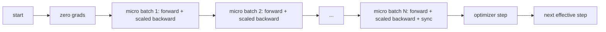
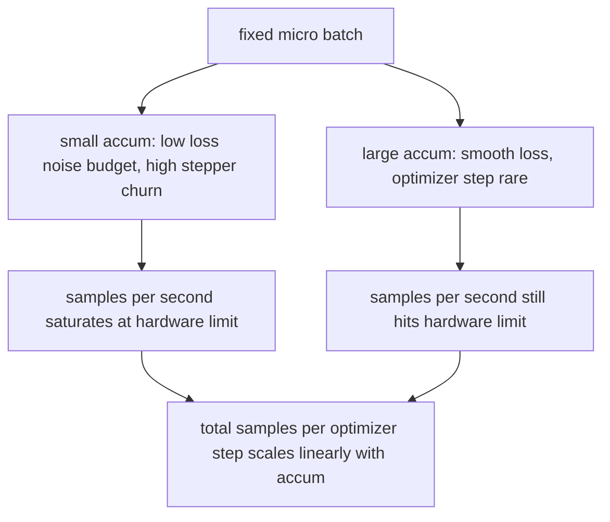

# Gradient Accumulation · 梯度累积

> 在你负担不起的有效批次（effective batch）上训练，一次一个微批次（micro-batch）。缩放损失，按住优化器不动，让梯度堆积起来。

> Train at an effective batch you cannot afford, one micro-batch at a time. Scale the loss, hold the optimizer step, and let the gradients pile up.

**类型：** 构建（Build）
**语言：** Python
**前置课程：** Phase 19 第 42 至 45 课
**时间：** 约 90 分钟

## Learning Objectives · 学习目标

- 推导有效批次恒等式：`effective_batch = micro_batch * accum_steps`。
- 实现按微批次的损失缩放，让累积出的梯度等价于一次全批次反向传播。
- 把优化器同步推迟到最后一个微批次（sync-on-last-step，末批同步）。
- 读懂「吞吐量对有效批次」曲线，并解释其边际收益递减。

> Derive the effective batch identity: `effective_batch = micro_batch * accum_steps`.
> Implement loss-per-micro-batch scaling so the accumulated gradient matches a single full-batch backward.
> Skip optimizer synchronization until the last micro-batch (sync-on-last-step).
> Read a throughput against effective batch curve and explain the diminishing return.

## The Problem · 问题在哪

你想在 512 的有效批次上训练，因为损失曲线更平滑，优化器步在那个尺度上也更有意义。桌上的加速卡装下 32 个样本就内存耗尽。批次翻倍不是一个选项，模型砍半也不是一个选项。业界在 2017 年就想到了并且再没放下的技巧是：跑 16 次反向传播，让梯度在参数缓冲区里累积，只在计数达到目标时才走一步优化器。

风险在于，损失不再是大批次下原来的那个数。16 个 mini-batch 的交叉熵若朴素相加，是一次全批次损失的 16 倍。不缩放的话，梯度方向是对的，幅度是错的，优化器步会大出 16 倍。修复只除一次法。这个修复也很容易被忘掉。

> You want to train at an effective batch of 512 because the loss curve is smoother and the optimizer step makes more sense at that scale. The trick the field reached for in 2017 and never stopped using is to run 16 backward passes, let the gradients accumulate inside the parameter buffers, and only step the optimizer when the count reaches the target.
> Without scaling, the gradient direction is correct but the magnitude is wrong, and the optimizer step is 16 times too big. The fix is one division. The fix is also easy to forget.

## The Concept · 概念



契约很短：

- 每个微批次的损失在 `backward()` 之前除以 `accum_steps`。PyTorch 默认把梯度累加进 `param.grad`；除法把运行总和压回正确的尺度。
- 优化器步每个有效批次只触发一次，在最后一个微批次的反向传播之后。在累积中途走步，会歪曲这次运行其余部分所依赖的每一个参数。
- 优化器的状态（动量缓冲、Adam 矩）每个有效步前进一次，而不是每个微批次一次。否则指数滑动平均会看到错误的频率，把调度烧穿。
- 在单设备上这只是记账。在多 rank 集群上，同一模式把非末尾的微批次包进 `no_sync` 上下文，跳过梯度 all-reduce；最后一个微批次一次性归约完整的累积梯度，而不是把网络开销付 N 次。

> The contract is short: Loss for each micro-batch is divided by `accum_steps` before `backward()`... The optimizer step fires once per effective batch, after the last micro-batch's backward.
> The optimizer's state (momentum buffers, Adam moments) advances once per effective step, not once per micro-batch. The exponential moving averages would otherwise see the wrong frequency and burn through the schedule.
> On a multi-rank cluster the same pattern wraps the non-final micro-batches in a `no_sync` context that skips the gradient all-reduce; the last micro-batch reduces the full accumulated gradient in one pass instead of paying the network cost N times.

### The equivalence proof in code · 代码里的等价性证明

```python
loss = criterion(model(x_full), y_full)
loss.backward()
opt.step()
```

等价于

```python
for x, y in chunks(x_full, y_full, n):
    scaled = criterion(model(x), y) / n
    scaled.backward()
opt.step()
```

误差只在浮点求和顺序。循环结束时累积的梯度缓冲区，与一次全批次反向传播产出的张量相同。本课代码在 `equivalence_check` 中用小于 1e-4 的最大绝对差断言这一点。

> is equivalent to ... up to floating point summation order. The accumulated gradient buffer at the end of the loop is the same tensor that a single full-batch backward would produce. The lesson code asserts this with a max-abs difference under 1e-4 in `equivalence_check`.

### Where the cost goes · 成本去哪了

每个微批次花一次前向加一次反向。有了累积，你用时间换内存。`outputs/accum-curve.json` 里的吞吐量曲线展示了固定微批次、增大有效批次时会发生什么：



没有免费的午餐。`accum_steps` 翻倍，每个优化器步的墙上时间（wall time）也翻倍。变化的是梯度估计的方差：同样的时间预算下，你做的优化器步更少了，但每一步平均了更多样本。文献把大批次和小批次当作不同的优化问题；本课的教训是机械层面的，不是统计层面的。

```figure
cc-grad-accumulation
```

> There is no free lunch. Doubling `accum_steps` doubles the wall time per optimizer step. What changes is the variance of the gradient estimate: at the same wall budget you have made fewer optimizer steps but each one was averaged over more samples. The literature treats large batch and small batch as different optimization problems; the lesson here is mechanical, not statistical.

## Build It · 动手造

`code/main.py` 是可运行的工件（artifact）。它做三件事。

### Step 1: equivalence check · 等价性检查

`equivalence_check()` 用相同种子构建同一网络的两份拷贝。一份在一次前向里看到一个 16 样本批次；另一份看到四个 4 样本分块，损失除以四。该函数在优化器步之前比较梯度缓冲区，在步之后比较参数。断言是 `max_abs_diff < 1e-4`。

> `equivalence_check()` builds two copies of the same network with the same seed. One sees a 16-sample batch in one forward pass. The other sees four 4-sample chunks with the loss divided by four. The function compares the gradient buffers before the optimizer step and the parameters after. The assertion is `max_abs_diff < 1e-4`.

### Step 2: sync-on-last-step pattern · 末批同步模式

`train_one_optimizer_step` 遍历微批次。除最后一个外，每个微批次都进入 `no_sync_context(model)`。单进程里这个上下文是空操作；在 DDP 上，这里跳过的就是梯度 all-reduce。记账方式与平台无关。一个 `sync_counter` 记录我们离开 no_sync 作用域的次数：N 个微批次对应每个有效步计数为一，而不是 N。

> `train_one_optimizer_step` walks micro-batches. For every micro-batch except the last it enters `no_sync_context(model)`. On a single process the context is a no-op; on DDP this is where the gradient all-reduce is skipped. A `sync_counter` records how many times we left the no_sync scope; for N micro-batches the count is one per effective step, not N.

### Step 3: the throughput curve · 吞吐量曲线

`sweep_effective_batches` 用固定微批次和一组累积步数运行同一模型。对每个配置记录：

- `samples_per_sec`：看到的总样本数除以墙上时间
- `median_step_ms`：每个有效步的第 50 百分位耗时
- `sync_calls`：被实际执行的集合通信点
- `avg_loss`：扫描中各优化器步的平均损失

输出落在 `outputs/accum-curve.json`，可从 notebook 复用。

运行：

```bash
python3 code/main.py
```

脚本先打印等价性差值，再打印扫描表，最后打印 JSON 路径。退出码为零。

> `sweep_effective_batches` runs the same model with a fixed micro-batch and a list of accumulation steps. The output lands in `outputs/accum-curve.json` and is reusable from a notebook.
> The script prints the equivalence diff, then the sweep table, then the JSON path. Exit code zero.

## Use It · 实战用法

在生产训练里，梯度累积藏在唯一一个旋钮后面。PyTorch 的公式是 `accumulation_steps = effective_batch // (micro_batch * world_size)`。这里不允许你用的那些框架包着同一个循环，但步骤是一样的：缩放损失，非末尾微批次跳过同步，累积，走一步。

业界的三个模式：

- 微批次大小按装满设备内存来选。更小浪费加速卡周期，更大直接崩溃。
- 有效批次从学习率调度出发来选。大的有效批次需要配套的学习率缩放和预热；这就是 2017 年以来常谈的线性缩放规则（linear scaling rule）。
- 累积次数是两者之间的桥，也是运行时唯一不用重写数据加载器就能自由调的旋钮。

> In production training, gradient accumulation lives behind one knob. PyTorch's pattern is `accumulation_steps = effective_batch // (micro_batch * world_size)`.
> The micro-batch size is chosen to saturate device memory. The effective batch is chosen from a learning rate schedule. The accumulation count is the bridge between the two and the only knob you are free to tune at runtime without rewriting the data loader.

## Ship It · 交付

`outputs/skill-gradient-accumulation.md` 把配方记录下来，让同事可以直接投进新仓库：损失除以 `accum_steps`，非末尾微批次跳过优化器同步，每个有效批次只走一次优化器，把吞吐量对有效批次的关系记成 JSON 让权衡可见。

> `outputs/skill-gradient-accumulation.md` captures the recipe so a peer can drop it into a new repo: scale loss by `accum_steps`, skip optimizer sync on non-final micros, step the optimizer once per effective batch, log throughput against effective batch as JSON so the trade is visible.

## Exercises · 练习

1. 用 `--num-steps 100` 重跑扫描，画出每秒样本数对有效批次的曲线。曲线在哪里变平？
2. 加一个错误缩放的变体（不除法），展示第 1 步相对参考实现的参数差异。
3. 把 SGD 换成 AdamW，确认优化器状态每个有效步前进一次，而不是每个微批次一次。
4. 引入真正的 `DistributedDataParallel` 包装器，把 `no_sync_context` 路由到它的方法。确认每个有效批次的 sync_calls 减少 N-1。
5. 修改等价性检查，比较两种不同的微批切分（2×8 与 4×4），并解释你需要放宽到什么容差。

> Re-run the sweep with `--num-steps 100` and plot samples per second against effective batch. Where does the curve flatten?
> Add a wrong scaling variant (no division) and show the parameter diff at step 1 against the reference.
> Swap SGD for AdamW and confirm the optimizer state advances once per effective step, not once per micro-batch.
> Introduce a real `DistributedDataParallel` wrapper and route the `no_sync_context` to its method. Confirm sync_calls drops by N-1 per effective batch.
> Modify the equivalence check to compare two different micro splits (2 by 8 vs 4 by 4) and explain any tolerance you need to relax.

## Key Terms · 术语表

| 术语 | 人们怎么说 | 实际含义 |
|------|-----------|---------|
| Micro batch（微批次） | 你做前向的批次 | 一次前向传播装得进内存的切片 |
| Accum steps（累积步数） | 每步的反向次数 | 一次优化器步之前累加的反向传播数 |
| Effective batch（有效批次） | 「那个批次」 | 微批次 × 累积步数 × 数据并行 world size |
| Loss scaling（损失缩放） | 「除以 N」 | 按微批次除法，让累加的梯度匹配全批次 |
| Sync on last（末批同步） | 「跳过其余」 | 只在窗口内最后一次反向传播上运行梯度集合通信 |

## Further Reading · 延伸阅读

- PyTorch 文档中 `DistributedDataParallel.no_sync` 的条目——末批同步技巧的生产版本。
- Goyal 等人 2017 年关于大批次训练线性缩放的工作——关心有效批次的经典理由。
- PyTorch issue 跟踪器上关于梯度累积与混合精度逆缩放相互作用的讨论。
- Phase 19 第 42 至 45 课覆盖本课假设的模型、数据加载器、优化器和训练器脚手架。
- Phase 19 第 47 课覆盖检查点与恢复，让长时间的累积运行扛得住墙上时钟上限。
