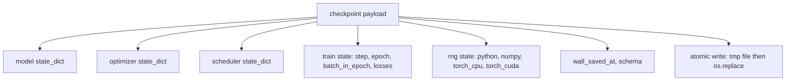
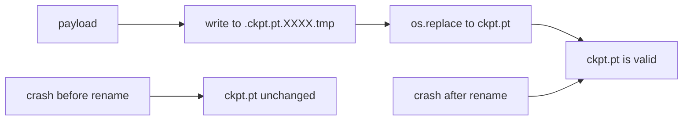
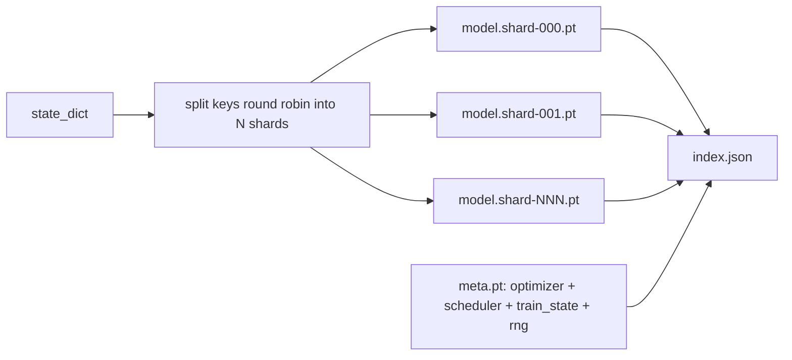

# Checkpoint Save and Resume · 检查点保存与恢复

> 训练被打断，运行就报废；有了检查点（checkpoint）就能继续。把模型、优化器、调度器、损失历史、步数计数器和 RNG 状态以原子方式保存，让任何时刻的 kill 都在磁盘上留下一个有效文件。

> Train interrupts kill runs; checkpoints let them continue. Save model, optimizer, scheduler, loss history, step counter, and RNG state, atomically, so a kill at any moment leaves a valid file on disk.

**类型：** 构建（Build）
**语言：** Python
**前置课程：** Phase 19 第 42 至 45 课
**时间：** 约 90 分钟

## Learning Objectives · 学习目标

- 把完整训练状态捕获进单个载荷（payload），能重新加载进一个全新进程。
- 用「写临时文件再重命名」实现原子保存，让崩溃永远不留下半个文件。
- 恢复 Python、NumPy 和 PyTorch 的 RNG 状态，让恢复后的损失与不中断的基线一致。
- 为装不进单个文件的大模型构建分片（sharded）检查点布局，带哈希校验分片和 JSON 索引。

> Capture the full training state into a single payload that can be reloaded into a fresh process.
> Implement atomic save with write-to-temp then rename so a crash never leaves a half-written file.
> Restore the RNG state for Python, NumPy, and PyTorch so the post-resume loss matches the uninterrupted baseline.
> Build a sharded checkpoint layout for models that no longer fit in a single file, with hash-verified shards and a JSON index.

## The Problem · 问题在哪

你给训练作业排了 18 小时，集群的墙上时钟上限是 4 小时，第 11 小时时集群重启——因为你管不着的人批准了一次内核升级。没有检查点，你从头再来。没有恢复，你还丢掉了优化器花前 11 小时学到的状态；就算模型权重活了下来，AdamW 的矩也没了，下一步会朝一个训练轨迹早已越过的方向猛扑。

正确的工件是单个文件，装着继续所需的一切：模型参数、优化器状态、调度器状态、画图用的损失历史、当前的 step 和 epoch 和批内计数器（batch-in-epoch），以及每一个随机性来源的 RNG 状态。没有 RNG 状态，恢复出来的损失曲线就是另一条曲线。同一个模型，同一份数据，不同的洗牌、不同的 dropout 掩码、仪表盘上不同的数字。

原子保存是契约的另一半。直接写进最终文件名意味着写到一半崩溃会留下损坏的文件，恢复读到的就是垃圾。写进同目录的临时文件再重命名，意味着写到一半崩溃时上一个完好的文件毫发无损。重命名在 POSIX 文件系统上是原子的。

> Without checkpoints you start over. Without resume you also lose the optimizer state that took the first 11 hours to learn, so even if the model weights survived, the AdamW moments are gone and the next step lurches in a direction the training trajectory had already moved past.
> The right artifact is a single file that holds everything needed to continue... Without the RNG state the resumed loss curve is a different curve.
> Writing into a temporary file in the same directory and then renaming means a crash mid-write leaves the previous good file untouched. The rename is atomic on POSIX file systems.

## The Concept · 概念



### The five state buckets · 五个状态桶

| 桶 | 为什么重要 |
|----|-----------|
| 模型（Model） | 权重与缓冲区；模型之所是。 |
| 优化器（Optimizer） | 动量与自适应矩；没有它们，下一步就是一个不同的优化问题。 |
| 调度器（Scheduler） | 学习率在曲线上的位置；余弦调度尤其在意。 |
| 训练计数器（Train counters） | Step、epoch、批内进度，加上画出仪表盘的损失历史。 |
| RNG 状态 | dropout、数据洗牌和模型内任何采样的确定性。 |

> | Bucket | Why it matters |
> | Model | Weights and buffers; what the model is. |
> | Optimizer | Momentum and adaptive moments; without these the next step is a different optimization problem. |
> | Scheduler | Where the learning rate is on its curve; cosine schedules in particular care. |
> | Train counters | Step, epoch, batch-in-epoch, plus the loss history that draws the dashboard. |
> | RNG state | Determinism for dropout, data shuffling, and any sampling inside the model. |

### Atomic save · 原子保存



两条规则。第一，临时文件必须与目标同目录，重命名才能留在同一个文件系统内；跨设备的重命名不是原子的。第二，临时名每次尝试都要唯一，两个写入者才不会互相踩踏。

> Two rules. First, the temporary file lives in the same directory as the target so the rename stays within the same file system; cross-device renames are not atomic. Second, the temporary name is unique per attempt so two writers do not stomp.

### Sharded checkpoints · 分片检查点

模型变大之后，单文件载荷变得太大、加载太慢、检查太麻烦，网络共享在读到一半时打个嗝就让人痛苦不堪。修复的办法是把参数状态拆成分片（shard），再写一个把它们系在一起的小索引。



索引记录分片数、每个分片的 sha256，以及 meta 文件的 sha256。任何哈希不匹配，加载器都大声失败。分片可以落在不同的物理磁盘上；meta 很小，先读。

> When the model gets large the single-file payload becomes too big to load fast, too big to inspect, and too painful when a network share hiccups mid-read. The fix is to split the parameter state into shards and write a small index that ties them together.
> The index records the shard count, the sha256 of each shard, and the sha256 of the meta file. The loader fails loudly when any hash mismatches.

### Resume continues mid epoch · 恢复从 epoch 中段继续

恢复时直接跳到下一个 epoch 开头，浪费从几分钟到一整天不等。修复是 `(epoch, batch_in_epoch)` 加 RNG 状态。加载之后，训练循环把随机数生成器快进越过当前 epoch 已消费的批次，从 `batch_in_epoch` 继续。本课代码正是这样做的；断言是恢复后的损失轨迹与不中断的基线在 1e-4 以内吻合。

```figure
cc-atomic-checkpoint
```

> A resume that snaps to the start of the next epoch wastes anywhere from minutes to a day. The fix is `(epoch, batch_in_epoch)` plus the RNG state. After load, the training loop fast-forwards the random number generator past the batches already consumed in the current epoch and continues from `batch_in_epoch`. The lesson code does this exactly; the assertion is that the loss trajectory after resume matches the uninterrupted baseline within 1e-4.

## Build It · 动手造

`code/main.py` 提供四个原语和一个演示驱动。

### Step 1: capture and restore RNG state · 捕获与恢复 RNG 状态

`capture_rng_state` 返回一个 dict，内含 Python 的 `random.getstate`、NumPy 的 `np.random.get_state`，以及 PyTorch CPU 和 CUDA 的 RNG 字节。每一项都以纯 Python 数字、元组和列表存储（NumPy 的关键数组经过 `tolist()`），这样 Step 3 的加载器不用反序列化任意对象就能读回。`restore_rng_state` 是它的逆。CPU 张量是一个 uint8 字节缓冲区，PyTorch 的 RNG 知道怎么消费它。

> `capture_rng_state` returns a dict with Python's `random.getstate`, NumPy's `np.random.get_state`, and PyTorch CPU and CUDA RNG bytes. Every piece is stored as plain Python numbers, tuples, and lists (NumPy's key array goes through `tolist()`), so the loader in Step 3 can read it back without unpickling arbitrary objects. `restore_rng_state` reverses it.

### Step 2: atomic save · 原子保存

`atomic_save` 把载荷写进目标目录里的临时文件，然后 `os.replace` 把它换成最终名字。`atomic_write_json` 对分片索引做同样的事。

> `atomic_save` writes the payload to a temp file in the target directory, then `os.replace` swaps it into the final name. `atomic_write_json` does the same for the sharded index.

### Step 3: full checkpoint round trip · 完整检查点往返

`save_checkpoint` 把模型、优化器、调度器、训练状态和 RNG 打包进一个 dict。`load_checkpoint` 是它的逆，返回一个 `TrainState`。schema 字段是升级钩子：未来的格式变更递增版本字符串，加载器据此分发。

`load_checkpoint` 调用 `torch.load(..., weights_only=True)`。`.pt` 文件是 pickle，用 `weights_only=False` 反序列化一个不受信任的文件，会执行文件点名的任何代码。只权重的加载器只接受张量和原始容器，拒绝其余一切——这正是 Step 1 把 RNG 状态存成纯列表的原因。完整性检查抛 `ValueError` 而不用 `assert`，因为 `python -O` 会剥掉断言。用 torch 2.6 或更新版本：在此之前 `weights_only=True` 有已知绕过（CVE-2025-32434），本课依赖的保证只在 2.6 起成立。

> `save_checkpoint` packages the model, optimizer, scheduler, train state, and RNG into one dict. `load_checkpoint` reverses it and returns a `TrainState`. The schema field is the upgrade hook.
> `load_checkpoint` calls `torch.load(..., weights_only=True)`. A `.pt` file is a pickle, and unpickling an untrusted file with `weights_only=False` runs whatever code the file names. Integrity checks raise `ValueError` instead of using `assert`, because `python -O` strips asserts. Use torch 2.6 or newer: before that release `weights_only=True` had a known bypass (CVE-2025-32434), so the guarantee this lesson relies on holds only from 2.6 on.

### Step 4: sharded variant · 分片变体

`save_sharded_checkpoint` 把参数键轮转（round-robin）分到 N 个分片，每个分片用自己的原子保存写出，写出带优化器和调度器和训练状态的 meta 文件，再写出带各分片 sha256 的 JSON 索引。`load_sharded_checkpoint` 在合并前校验每个分片，并拒绝任何解析到检查点目录之外的分片路径。

> `save_sharded_checkpoint` round-robins the parameter keys across N shards, writes each shard with its own atomic save, writes a meta file with optimizer and scheduler and train state, and writes the JSON index with shard sha256s. `load_sharded_checkpoint` verifies every shard before merging and refuses any shard path that resolves outside the checkpoint directory.

### Step 5: resume demo · 恢复演示

`run_resume_demo` 训练一个小模型 `total_steps` 步，在 `interrupt_at` 处保存检查点，然后继续。第二个进程恢复检查点并跑完剩余步数。该函数返回中断点之后两条损失轨迹的最大绝对差。RNG 恢复之后，这个差是零或浮点噪声。

运行：

```bash
python3 code/main.py
```

单文件与分片两个演示都断言最大差小于 1e-4。摘要落在 `outputs/resume-demo.json`。

> `run_resume_demo` trains a small model for `total_steps`, saves a checkpoint at `interrupt_at`, then continues. A second process restores the checkpoint and runs the remaining steps. The function returns the max absolute difference between the two loss trajectories after the interruption point. With RNG restored, the difference is zero or floating-point noise.
> The single-file and sharded demos both assert max-diff under 1e-4. The summary lands in `outputs/resume-demo.json`.

## Use It · 实战用法

生产训练栈把检查点能力作为训练器的一部分交付。形状都一样：模型 + 优化器 + 调度器 + 计数器 + RNG，原子写入，按 step 命名让最新的最容易找。分片布局用并行读取支撑大模型加载；让这一切成立的是 index.json。

四条要强制执行的模式：

- **用 `weights_only=True` 加载。** 从共享盘或下载拉来的检查点是不受信任的输入。只权重的加载器防止恶意文件在执行恢复的那台机器上运行代码。
- **schema 是载荷里的字符串。** 迁移靠它分支。没有它，你无法在不破坏旧运行的前提下演化格式。
- **每个分片都算 sha256。** 静默截断的下载是最恶劣的 bug；加载器要么失败得早，要么失败得晚。
- **保持检查点节奏诚实。** 每 N 步和每墙钟分钟各存一次，取更短者。否则一次崩溃在长步上会浪费整整一个窗口的工作量。

> Production training stacks ship checkpointing as part of the trainer. The shape is the same: model + optimizer + scheduler + counters + RNG, written atomically, named by step so the latest is easy to find.
> **Load with `weights_only=True`.** A checkpoint pulled from a shared drive or a download is untrusted input.
> **Schema is a string in the payload.** Migrations branch on it. Without it you cannot evolve the format without breaking old runs.
> **Sha256 every shard.** A silently truncated download is the worst kind of bug; the loader fails fast or it fails late.
> **Keep checkpoint cadence honest.** Save every N steps and every wallclock-minute, whichever is shorter.

## Ship It · 交付

`outputs/skill-checkpoint-save-resume.md` 是任何新训练脚本的配方：载荷形状、原子写入、RNG 捕获、分片索引。把技能投进仓库，在定期保存的位置接上 `save_checkpoint`，在启动处接上 `load_checkpoint`，运行就能扛住 kill。

> `outputs/skill-checkpoint-save-resume.md` is the recipe for any new training script: payload shape, atomic write, RNG capture, sharded index. Drop the skill into a repo, wire `save_checkpoint` at the periodic save site, wire `load_checkpoint` at startup, and the run survives kills.

## Exercises · 练习

1. 把轮转分片换成按参数组分片（`.weight` 结尾的层与 `.bias` 结尾的层）。哪种布局在什么情况下更可取？
2. 扩展保存循环，保留最近 K 个检查点并清理更老的。磁盘很小时，合适的 K 是多少？
3. 加一个 `--ckpt-every-seconds` 旗标，按墙钟间隔触发保存，而不只按步数。
4. 加一个启动时运行的校验路径，扫描目录里每个检查点，报告哪些已损坏。
5. 实现一个 `migrate_v1_to_v2` 函数：给载荷加一个新字段并递增 schema 字符串。让加载同时容忍两个版本。

> Replace round-robin sharding with sharding by parameter group (layers ending in `.weight` vs `.bias`). When is each layout preferable?
> Extend the save loop to keep the last K checkpoints and prune older ones. What is the right K when the disk is small?
> Add a `--ckpt-every-seconds` flag that triggers a save on a wallclock interval, not just step count.
> Add a checksum verification path that runs at startup, scans every checkpoint in the directory, and reports which ones are corrupt.
> Implement a `migrate_v1_to_v2` function that adds a new field to the payload and bumps the schema string. Make load tolerate both versions.

## Key Terms · 术语表

| 术语 | 人们怎么说 | 实际含义 |
|------|-----------|---------|
| Atomic save（原子保存） | 「写完祈祷」 | 写进同目录的临时文件，再 os.replace 成目标名 |
| State dict | 「那些权重」 | 按参数名键控的模型参数与缓冲区 |
| Sharded checkpoint（分片检查点） | 「大模型文件」 | 每分片一个文件，外加 meta 文件和带 sha256 的 JSON 索引 |
| RNG state | 「随机种子」 | python random、numpy、torch CPU、torch CUDA 的捕获状态；不只是种子 |
| Mid-epoch resume（epoch 中段恢复） | 「重启」 | 快进 RNG，从同一 epoch 的下一个批次继续 |

## Further Reading · 延伸阅读

- POSIX `rename` 语义——`os.replace` 的原子性主张所依赖的根据。
- PyTorch 关于 `torch.save` 与 `torch.load` 的文档，包括跨设备恢复的 `map_location` 和加载不受信文件的 `weights_only`。
- Phase 19 第 46 课覆盖梯度累积——本课的检查点载荷要跨它存活。
- Phase 19 第 48 课覆盖分布式包装器——本方案所容纳的正是它们的 state dict 格式。
- Linux 内核 `fsync` 文档——原子重命名背后的持久性保证。
