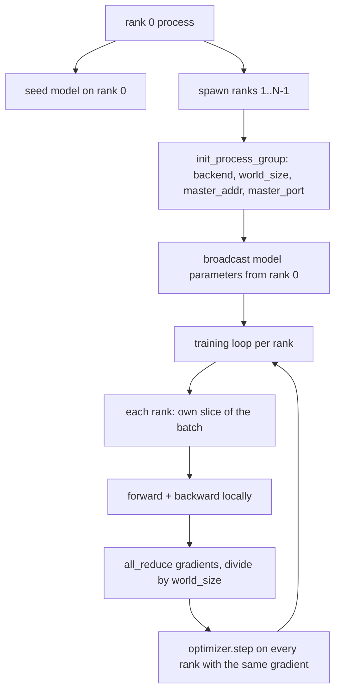
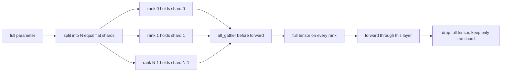

# Distributed Data Parallel and FSDP from Scratch · 从零实现分布式数据并行与 FSDP

> 多 rank 训练是两个集合通信（collective）加一条规则。启动时广播参数，反向传播后平均梯度，永远不让各个 rank 对「自己在第几步」产生分歧。

> Multi-rank training is two collectives and one rule. Broadcast the parameters at startup, average the gradients after backward, never let the ranks disagree about what step they are on.

**类型：** 构建（Build）
**语言：** Python
**前置课程：** Phase 19 第 42 至 45 课
**时间：** 约 90 分钟

## Learning Objectives · 学习目标

- 用 `gloo` 后端在 N 个 rank 间拉起进程组（process group），不需要任何特殊硬件。
- 实现一个最小 DDP 包装器：构造时广播参数，反向传播后 all-reduce 梯度。
- 证明各 rank 梯度做 all-reduce 的结果，与单进程在拼接输入上算出的梯度一致。
- 勾勒 FSDP 参数分片：每个 rank 持有一片，前向传播时 gather 出完整张量，用完即弃。

> Bring up a process group across N ranks with the `gloo` backend, no special hardware.
> Implement a minimal DDP wrapper that broadcasts parameters at construction and all-reduces gradients after backward.
> Prove that the all-reduce of per-rank gradients matches a single-process gradient on the concatenated input.
> Sketch FSDP parameter sharding: each rank holds a slice, the full tensor is gathered for the forward pass and dropped after.

## The Problem · 问题在哪

模型装得进一块设备，数据集装不进。优化预算说你想在每秒墙钟时间里看到 N 倍的样本。第一个杠杆是数据并行（data parallel）：每个 rank 在批的不同切片上跑同一个模型，然后在优化器步之前平均梯度。第二个杠杆是 FSDP：模型也装不进一块设备，于是每个 rank 持有每个参数的一小部分，在前向传播中逐层重建完整张量。

痛点是记账。参数在 rank 之间漂移，运行就悄悄损坏。平均了梯度却没平均损失，仪表盘就在说谎。集合通信后端对拓扑无法达成一致，运行就永远挂起。修复的办法是亲手把集合通信写一遍，从此不再信任你复现不出来的包装器。

本课跑在 CPU 上，不假设有 CUDA。`gloo` 后端随每个 PyTorch 构建发行，接受 `torch.multiprocessing` worker；同一套代码在多 GPU 节点上换成 `nccl`，结构不用动。

> The first lever is data parallel: each rank runs the same model on a different slice of the batch, then averages gradients before the optimizer step. The second lever is FSDP: the model does not fit on one device either, so each rank holds a fraction of every parameter and reconstructs the full tensors layer by layer during the forward pass.
> If parameters drift across ranks the run is silently corrupt. If you average gradients but not the loss the dashboard lies. The fix is to write the collectives by hand once and never trust a wrapper you cannot reproduce.
> This lesson runs on CPU. CUDA is not assumed. The `gloo` backend ships with every PyTorch build and accepts `torch.multiprocessing` workers; the same code switches to `nccl` on a multi-GPU node without changing structure.

## The Concept · 概念



### The two collectives that matter · 两个真正要紧的集合通信

| 集合通信 | 它做什么 | 什么时候用 |
|----------|---------|-----------|
| `broadcast` | 把一个张量从一个 rank 拷贝到其他所有 rank | 参数初始化、调度器状态、任何一对多的同步 |
| `all_reduce` | 对张量在所有 rank 上求和（或均值、最大值），每个 rank 都拿到结果 | 反向传播后的梯度平均 |
| `all_gather` | 每个 rank 贡献一个张量，每个 rank 都拿到拼接结果 | logits 汇总、FSDP 参数 unshard |

DDP 的契约是：构造时 `broadcast`，反向传播后 `all_reduce`。FSDP 草图在每个层的前向传播前再加一个 `all_gather`。

> | Collective | What it does | When |
> | `broadcast` | Copy a tensor from one rank to all others | Parameter init, scheduler state, any one-to-all sync |
> | `all_reduce` | Sum (or mean, or max) a tensor across all ranks, every rank gets the result | Gradient averaging after backward |
> | `all_gather` | Each rank contributes a tensor, every rank gets the concatenation | Logits collection, FSDP parameter unshard |
> The DDP contract is `broadcast` at construction and `all_reduce` after backward. The FSDP sketch adds `all_gather` before each layer's forward pass.

### Gradient averaging matches single-process gradient · 梯度平均与单进程梯度一致

一个模型在 N 个 rank 上训练 B 个样本的批次，必须与单进程在 N*B 的批次上训练产出相同的梯度。诀窍在于：把各 rank 的梯度求和再除以 N，得到的是平均损失的梯度——这正是 cross entropy 以 mean 归约时在整个批次上会产出的东西。本课代码用 `max-abs-diff < 1e-3` 断言手动 all-reduce 的梯度与参考单进程梯度一致。

> A model trained on a batch of B examples across N ranks must produce the same gradient as a single process training on a batch of N*B. The trick is that summing per-rank gradients and dividing by N gives the average loss gradient, which is what cross entropy with mean reduction would produce on the full batch. The lesson code asserts this with `max-abs-diff < 1e-3` between the manual all-reduce gradient and the reference single-process gradient.

### FSDP sketch · FSDP 草图



内存收益是精确的：每 rank 的参数内存降到 1/N。代价是那次 gather，每次前向都要付。生产级 FSDP 把 gather 与上一层的计算重叠起来，所以墙钟成本远小于朴素账本的预估。本课对每个参数做完整往返，并断言重建结果与原张量逐位相等（bit-equal）。

> The memory win is exact: per-rank memory for parameters drops to 1/N. The cost is the gather, which is paid every forward pass. Production FSDP overlaps the gather with the previous layer's compute so the wallclock cost is much smaller than the naive accounting predicts. The lesson does the round-trip on every parameter and asserts the reconstruction is bit-equal to the original.

### CPU and the gloo backend · CPU 与 gloo 后端

CUDA 是生产目标，但同样的代码路径在 CPU 上也存在。`gloo` 是 CPU 集合通信后端，在 GPU 上比 `nccl` 慢几个数量级，但 API 表面完全相同。本课的进程组以 `backend="gloo"` 初始化，rank 用 `torch.multiprocessing` 而不是 `torchrun` 拉起；两者最终都落到同样的 `torch.distributed` 调用。在多 GPU 节点上，要改的只有 `backend="nccl"`、设备张量，以及用 `torchrun` 启动。

```figure
cg-allreduce-ring
```

> CUDA is the production target, but the same code paths exist on CPU. `gloo` is the CPU collective backend. It is slower than `nccl` on GPUs by orders of magnitude, but the API surface is identical. On a multi-GPU node, the only changes are `backend="nccl"`, device tensors, and `torchrun` to launch.

## Build It · 动手造

`code/main.py` 是可运行的工件（artifact）。

### Step 1: bring up the process group · 拉起进程组

```python
os.environ["MASTER_ADDR"] = "127.0.0.1"
os.environ["MASTER_PORT"] = str(port)
dist.init_process_group(backend="gloo", rank=rank, world_size=world_size)
```

`MASTER_ADDR` 与 `MASTER_PORT` 是会合点（rendezvous）：每个 rank 都拨同一家主机的同一个端口。本课用「先 bind 再 close」的技巧选一个空闲端口，避免多个运行共享一台机器时撞端口。

> `MASTER_ADDR` and `MASTER_PORT` are the rendezvous: every rank dials the same port on the same host. The lesson picks a free port via a bind-and-close trick to avoid collisions when several runs share a machine.

### Step 2: broadcast at construction · 构造时广播

`MinimalDDP.__init__` 遍历每个参数和缓冲区，调用 `dist.broadcast(tensor, src=0)`。rank 0 的值成为规范的初始化。没有这一步，各 rank 用自己的种子初始化，从第一步起就分道扬镳。

> `MinimalDDP.__init__` walks every parameter and buffer and calls `dist.broadcast(tensor, src=0)`. Rank 0's values become the canonical init. Without this, each rank initializes with its own seed and the ranks diverge from step one.

### Step 3: all-reduce gradients after backward · 反向传播后 all-reduce 梯度

```python
def all_reduce_grads_(module, world_size):
    for p in module.parameters():
        if p.grad is None:
            p.grad = torch.zeros_like(p.data)
        dist.all_reduce(p.grad.data, op=dist.ReduceOp.SUM)
        p.grad.data.div_(world_size)
```

每个 rank 最终拿到同一个平均后的梯度。优化器步从此在每个 rank 上都是同一个输入的函数——这正是参数在整个运行期间保持同步的原因。

> Every rank ends up with the same averaged gradient. The optimizer step is now a function of the same input on every rank, which is why the parameters stay in sync across the run.

### Step 4: prove the equivalence · 证明等价性

`manual_all_reduce_matches_single_process` 在 rank 0 上构建同一模型，把 all-reduce 之后的梯度与单进程在拼接输入上算出的梯度比较。最大绝对差在 1e-8 上下。

> `manual_all_reduce_matches_single_process` builds the same model on rank 0 and compares the post-all-reduce gradient against the gradient a single process would compute on the concatenated input. The max-abs-diff is around 1e-8.

### Step 5: FSDP round trip · FSDP 往返

`fsdp_round_trip_sketch` 把每个参数展平、填充到 `world_size` 的倍数、切片、all-gather、再去填充。每个 rank 的重建都等于原参数。这就是 unshard 步；它的逆（前向之后重新分片，re-shard）就是从 gather 出的张量上切一片。

运行：

```bash
python3 code/main.py
```

默认 world size 是 2。两个 CPU 进程被拉起，通过 `gloo` 互相对话，以零退出。输出 `outputs/ddp-demo.json` 记录每个 rank 的参数和、all-reduce 之后的梯度范数、FSDP 往返结果，以及手动梯度对参考梯度的差值。

> `fsdp_round_trip_sketch` flattens each parameter, pads to a multiple of `world_size`, slices, all-gathers, and unpads. Every rank's reconstruction equals the original. This is the unshard step; the inverse (re-shard after the forward) is one slice off the gathered tensor.
> Default world size is 2. Two CPU processes spawn, talk to each other through `gloo`, and exit zero. The output `outputs/ddp-demo.json` captures parameter sums per rank, the gradient norm after all-reduce, the FSDP round-trip result, and the manual-vs-reference gradient diff.

## Use It · 实战用法

生产训练栈调用同样的原语。PyTorch 的 `DistributedDataParallel` 额外提供：反向传播后的梯度钩子，让 all-reduce 与 backward 重叠；分桶（bucketed）all-reduce，把若干小梯度合并成一次集合通信；以及第 46 课用过的 `no_sync` 上下文。

PyTorch 的 FSDP 额外提供：每层一个扁平参数视图，让每个 rank 只持有一个连续缓冲区；把下一层的 unshard 与当前层的计算重叠；以及可选的分片 CPU offload。

形状始终不变：启动时广播，反向传播后归约，装不下时分片参数。

> Production training stacks call the same primitives. PyTorch's `DistributedDataParallel` adds: post-backward gradient hooks that overlap all-reduce with backward, bucketed all-reduce that combines several small gradients into one collective, and the `no_sync` context lesson 46 used.
> PyTorch's FSDP adds: a flat parameter view per layer so each rank holds one contiguous buffer, overlap of the next layer's unshard with the current layer's compute, and optional CPU offload for the shards.
> The shape stays the same: broadcast at startup, reduce after backward, shard parameters when they no longer fit.

## Ship It · 交付

`outputs/skill-distributed-fsdp-ddp.md` 携带新训练脚本的配方：CPU 用 `gloo`、GPU 用 `nccl` 拉起进程组，把模型包进构造时广播、反向传播后归约的 DDP 外壳，可选地用 FSDP 草图里的 all_gather 模式分片参数。

> `outputs/skill-distributed-fsdp-ddp.md` carries the recipe for a new training script: spin up the process group with `gloo` for CPU and `nccl` for GPU, wrap the model in a DDP shell that broadcasts at construction and reduces after backward, optionally shard parameters with the all_gather pattern from the FSDP sketch.

## Exercises · 练习

1. 用 `--world-size 4` 运行，确认整个运行期间参数散度保持在 1e-3 以内。
2. 把手动平均换成 `dist.all_reduce(op=dist.ReduceOp.AVG)`，测量耗时差异。
3. 给 DDP 包装器加一个反向传播后的钩子，让 all-reduce 与 backward 的其余部分重叠；测量墙钟改进。
4. 实现 FSDP 的 re-shard 步：前向传播之后，把完整张量换回本地分片。确认每 rank 内存下降。
5. 在 CUDA 机器上把后端换成 `nccl`。记录哪些环境变量变了，哪些没变。

> Run with `--world-size 4` and confirm the param spread stays under 1e-3 across the run.
> Replace the manual averaging with `dist.all_reduce(op=dist.ReduceOp.AVG)` and time the difference.
> Add a post-backward hook to the DDP wrapper so the all-reduce overlaps with the rest of the backward; measure the wallclock improvement.
> Implement the FSDP re-shard step: after the forward pass, replace the full tensor with the local shard again. Confirm per-rank memory drops.
> Switch the backend to `nccl` on a CUDA box. Note which environment variables change and which stay the same.

## Key Terms · 术语表

| 术语 | 人们怎么说 | 实际含义 |
|------|-----------|---------|
| Backend（后端） | 「gloo 或 nccl」 | 实现集合通信的库；gloo 管 CPU，nccl 管 GPU |
| World size | 「总 rank 数」 | 组内的进程数；组是集合通信操作的单位 |
| Rank | 「worker 编号」 | 组内进程标识符，从零开始 |
| All-reduce | 「把梯度加起来」 | 对张量在所有 rank 上求和，每个 rank 都以相同结果收尾 |
| Unshard | 「把参数聚回来」 | 通过 all_gather 从各 rank 的切片重建完整张量 |

## Further Reading · 延伸阅读

- PyTorch `torch.distributed` 文档——本课依赖的集合通信语义。
- `gloo` 库的集合通信清单——与 CUDA 后端的 `nccl` 原语形状完全相同。
- Phase 19 第 46 课——把 DDP 的 all-reduce 包进 `no_sync` 的梯度累积模式。
- Phase 19 第 47 课——能在 DDP 与 FSDP 运行中存活的检查点布局。
- PyTorch FSDP 文档——这里勾勒的参数分片的生产实现。
