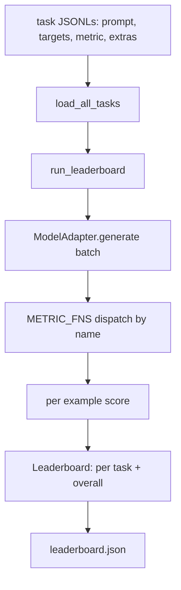
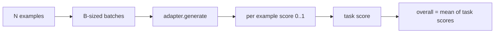

# Language Model Evaluation Harness · 语言模型评测框架

> 一个在你无法定义的任务上表现好的模型，是碰巧表现好。评测框架（harness）就是任务定义、指标、运行器和排行榜，装在一个简短、可替换的形状里。

> A model that does well on a task you cannot define is a model that does well by accident. The harness is the task definition, the metric, the runner, and the leaderboard, in one short, swappable shape.

**类型：** 构建（Build）
**语言：** Python
**前置课程：** Phase 19 第 42 至 45 课
**时间：** 约 90 分钟

## Learning Objectives · 学习目标

- 把任务定义成 JSONL 文件，每个样例带 `prompt`、`targets`、`metric` 和可选的 `extras`。
- 实现五个指标：精确匹配（exact match）、rouge-l F1、可执行检查（executable check）、多选题（multiple choice）、子串包含（substring contains）。
- 构建一个按任务分批派发给可替换模型适配器（adapter）的运行器（runner）。
- 输出带每任务得分、延迟和可复现总均分的排行榜 JSON。

> Define a task as a JSONL file with `prompt`, `targets`, `metric`, and optional `extras` per example.
> Implement five metrics: exact match, rouge-l F1, executable check, multiple choice, and substring contains.
> Build a runner that batches examples per task and dispatches to a swappable model adapter.
> Emit a leaderboard JSON with per-task scores, latency, and an overall average that is reproducible.

## The Problem · 问题在哪

每周都有一款新语言模型问世。营销的说法是它表现好。诚实的问题是：在什么上面表现好？诚实的答案是你自己写的排行榜，因为厂商的排行榜正是他们调参时对着的那块。

仓库里没有评测框架，你靠感觉比较两个模型。有了评测框架，你按固定任务集、固定指标上的得分来比较，落在一份可以 diff 的 JSON 输出上。评测框架是昨天的运行与今天的运行之间的契约。没有它，退化就会悄悄上线。

陷阱是把评测框架过拟合到单一模型上。解法是把同一个陷阱反着来：框架小到十五分钟能读完，任务小到能随仓库一起发布，指标从零写起让同事可以审计，适配器是唯一放模型相关代码的地方。换适配器，排行榜会动；换任务，排行榜会动。除此之外的任何东西都不该动。

> The honest question is: well at what? The honest answer is the leaderboard you wrote yourself, because the vendor's leaderboard is the one they tuned to.
> With a harness you compare them by score on a fixed task set with a fixed metric, on a JSON output you can diff. The harness is the contract between yesterday's run and today's run. Without it, regressions ship.
> The trap is over-fitting the harness to a single model. The adapter is the only place model-specific code lives. Swap the adapter, the leaderboard moves; swap the tasks, the leaderboard moves. Nothing else should move.

## The Concept · 概念



### Task spec · 任务规格

每个样例是一行 JSONL：

```json
{"id": "arith-00", "prompt": "compute: 2 + 2", "targets": ["4"], "metric": "exact_match"}
```

需要打分辅助的指标，`extras` 携带附带载荷：

```json
{
  "id": "code-00",
  "prompt": "python: write a function f that doubles its input",
  "targets": ["ok"],
  "metric": "code_exec",
  "extras": {"io_pairs": [[1, 2], [3, 6]]}
}
```

一个任务就是 `outputs/tasks/` 下的一个 `.jsonl` 文件。文件名就是任务名。一个文件里的所有样例共享同一个指标。

> Every example is one JSONL line... For metrics that need scoring helpers, `extras` carries the side payload.
> A task is a `.jsonl` file under `outputs/tasks/`. The file name is the task name. All examples in a file share a metric.

### The five fixture tasks · 五个固定任务

| 任务 | 指标 | 它测什么 |
|------|------|---------|
| arithmetic | exact_match | 确定性答案上的 token 级正确性 |
| summary | rouge_l | 对一行参考摘要的最长公共子序列 F1 |
| code-exec | code_exec | 可执行测试：预测出的函数必须满足一组输入输出对 |
| multiple-choice | multiple_choice | 预测的首字母必须匹配一个允许的字母 |
| generation | substring_contains | 自由格式文本必须包含至少一个目标子串 |

> | Task | Metric | What it tests |
> | arithmetic | exact_match | Token-level correctness on a deterministic answer |
> | summary | rouge_l | Longest common subsequence F1 against a one-line reference summary |
> | code-exec | code_exec | Executable test: the predicted function must satisfy a list of input-output pairs |
> | multiple-choice | multiple_choice | First letter of the prediction must match an allowed letter |
> | generation | substring_contains | Free-form text must contain at least one target substring |

### The metric contract · 指标契约

每个指标都是从 `(prediction, targets, extras) -> float in [0.0, 1.0]` 的函数。评测框架把每样例得分平均成任务得分，再把任务得分平均成总分。指标函数都很小：

- `exact_match`：转小写、折叠空白、判等。
- `substring_contains`：同样的归一化，做子串测试。
- `multiple_choice`：首字符转大写。
- `rouge_l`：LCS 长度除以预测与参考的长度，取精确率与召回率的 F1。
- `code_exec`：在受限命名空间里执行预测，对每个输入输出对调用 `f(x)`，统计匹配数。

code_exec 指标在一个剥空的内置命名空间里运行预测。本课的测试断言 `import os` 会炸掉，因为 `os` 不在命名空间里——从代码预测里你摸不到文件系统。

> Every metric is a function from `(prediction, targets, extras) -> float in [0.0, 1.0]`. The harness averages the per-example scores to get a task score, then averages task scores to get the overall.
> The code_exec metric runs the prediction in a stripped builtins namespace. The lesson's test asserts that `import os` blows up because `os` is not in the namespace; you cannot reach the filesystem from a code prediction.

### The model adapter · 模型适配器

```python
class ModelAdapter(Protocol):
    def generate(self, prompts: Sequence[str]) -> List[str]: ...
    @property
    def name(self) -> str: ...
```

适配器是接缝（seam）。本课自带 `ToyAdapter`，一个确定性模式匹配器，对五个固定任务里的每个提示都返回正确答案。真实的适配器去调模型并返回其输出。评测框架不关心是哪种。

> The adapter is the seam. The lesson ships `ToyAdapter`, a deterministic pattern matcher that returns the right answer for every prompt in the five fixture tasks. A real adapter calls the model and returns its output. The harness does not care which.

### The runner · 运行器

`run_task` 每次按 `batch_size` 个提示分批，派发给指标函数。`run_leaderboard` 遍历所有任务并求平均。`write_leaderboard` 输出带 schema 字符串的 JSON，让未来的格式变更不会悄悄弄坏仪表盘。



```figure
eval-harness-matrix
```

> `run_task` batches `batch_size` prompts at a time and dispatches to the metric function. `run_leaderboard` walks every task and averages. `write_leaderboard` emits JSON with a schema string so future format changes do not silently break dashboards.

## Build It · 动手造

`code/main.py` 是可运行的工件（artifact）。

### Step 1: seed fixture tasks · 播种固定任务

`seed_fixture_tasks(target_dir)` 写出五个 `.jsonl` 文件。`main.py` 的首次运行会在目录为空时播种它们。

> `seed_fixture_tasks(target_dir)` writes the five `.jsonl` files. The first run of `main.py` seeds them when the directory is empty.

### Step 2: load tasks · 加载任务

`load_all_tasks(task_dir)` 读取每个 `.jsonl`，返回任务名到 `Example` 记录列表的 dict。以 `#` 开头的注释行和空行会被跳过，方便贡献者在文件里写注解。

> `load_all_tasks(task_dir)` reads every `.jsonl` and returns a dict from task name to a list of `Example` records. Comment lines starting with `#` and blank lines are skipped so contributors can annotate the files.

### Step 3: implement metrics · 实现指标

每个指标都是一个带单元测试的小函数。本课的测试套件包含 13 个用例，覆盖归一化、部分重叠、代码执行和不安全代码拒绝。

> Each metric is a small function with a unit test. The lesson's test suite includes 13 cases covering normalization, partial overlap, code execution, and unsafe code rejection.

### Step 4: write the runner · 编写运行器

`run_task` 迭代批次，产出带得分、正确数、总数和延迟的 `TaskResult`。`run_leaderboard` 遍历所有任务，产出带总均分的 `Leaderboard`。

> `run_task` iterates batches and produces a `TaskResult` with score, correct count, total count, and latency. `run_leaderboard` walks all tasks and produces a `Leaderboard` with the overall average.

### Step 5: emit JSON · 输出 JSON

`write_leaderboard` 序列化排行榜。`--include-per-example` 旗标会倾倒每样例记录，得分变动时你可以把预测与上一次运行做 diff。

运行：

```bash
python3 code/main.py
```

脚本首次运行时播种固定任务，用玩具适配器给它们打分（它把每个固定任务都答对），并写出 `outputs/leaderboard.json`。玩具适配器下总分是 1.0；`test_main.py` 里的桩适配器测试表明，同一个评测框架在适配器答不上来时产出 0.0。

> `write_leaderboard` serializes the board. The `--include-per-example` flag dumps the per-example records so you can diff predictions against the previous run when scores move.
> The script seeds the fixtures on first run, scores them with the toy adapter (which gets every fixture right), and writes `outputs/leaderboard.json`. Overall score is 1.0 with the toy adapter; the stub adapter test in `test_main.py` shows the same harness produces 0.0 when the adapter cannot answer.

## Use It · 实战用法

要接一个真实模型，就写一个适配器。形状如下：

```python
class HttpAdapter:
    name = "vendor.v1"

    def __init__(self, endpoint, api_key):
        self.endpoint = endpoint
        self.api_key = api_key

    def generate(self, prompts):
        out = []
        for prompt in prompts:
            response = http_post(self.endpoint, prompt, self.api_key)
            out.append(response["text"])
        return out
```

在 `main()` 顶部把 `ToyAdapter` 换成 `HttpAdapter`。评测框架、任务、指标和排行榜都保持不变。

在真实项目里发布评测框架时要强制执行的三条模式：

- **钉住任务文件。** leaderboard.json 要么携带哈希钉死的任务内容，要么把 JSONL 一并携带；否则任务文件一动分数就动，而且你说不清是哪个在动。
- **diff 预测，而不只是分数。** `--include-per-example` 旗标让你看到分数下跌那天模型说了什么。
- **限制批大小。** 真实适配器有速率限制。小批大小让评测框架在各厂商之间保持兼容。

> Swap `ToyAdapter` for `HttpAdapter` at the top of `main()`. The harness, the tasks, the metrics, and the leaderboard stay the same.
> **Pin the task files.** The leaderboard.json carries hash-pinned task content or it carries the JSONLs alongside; otherwise the score moves when the task file does, and you cannot tell which.
> **Diff predictions, not just scores.** The `--include-per-example` flag lets you see what the model said the day the score dropped.
> **Cap the batch size.** Real adapters have rate limits. A small batch size keeps the harness compatible across vendors.

## Ship It · 交付

`outputs/skill-lm-eval-harness.md` 携带配方：JSONL 任务规格、五个指标、可替换适配器、分批运行器、带 schema 字符串的排行榜 JSON。`outputs/tasks/` 里的任务文件就是固定装置（fixture）；把它们复制进真实项目当起点。

> `outputs/skill-lm-eval-harness.md` carries the recipe: JSONL task spec, five metrics, swappable adapter, batched runner, leaderboard JSON with schema string. The task files in `outputs/tasks/` are the fixtures; copy them into a real project as starters.

## Exercises · 练习

1. 加第六个任务，配一个你从零写的自定义指标（类 BLEU 的重叠、类 BLEURT 的参考打分，任何契约清晰的都行）。
2. 扩展 `code_exec`，捕获 stdout 并接受一列期望 stdout 作为 targets。
3. 加一个排行榜 diff 命令：给定两个 `leaderboard.json` 文件，打印哪些任务动了、动了多少。
4. 限制每样例延迟。把适配器调用包进超时；在排行榜里单独暴露一列 `timeouts`。
5. 在排行榜里用 sha256 钉住任务内容，让未来的读者能验证自己打分的是同一批任务。

> Add a sixth task with a custom metric you write from scratch (BLEU-like overlap, BLEURT-like reference scoring, anything with a clear contract).
> Extend `code_exec` to capture stdout and accept a list of expected stdouts as targets.
> Add a leaderboard diff command: given two `leaderboard.json` files, print which tasks moved and by how much.
> Cap latency per example. Wrap the adapter call in a timeout; surface a separate `timeouts` column in the leaderboard.
> Pin task content with a sha256 in the leaderboard so a future reader can verify they scored the same tasks.

## Key Terms · 术语表

| 术语 | 人们怎么说 | 实际含义 |
|------|-----------|---------|
| Task spec（任务规格） | 「评测格式」 | JSONL 文件，每样例带 prompt、targets、metric 和可选 extras |
| Metric（指标） | 「你怎么打分」 | 从 (prediction, targets, extras) 到 [0, 1] 内浮点数的函数 |
| Adapter（适配器） | 「模型客户端」 | 带 generate(prompts) -> list[str] 方法的对象；唯一放模型相关代码的地方 |
| Leaderboard（排行榜） | 「记分板」 | 带 per-task 得分、总数、延迟和总均分的 JSON |
| Code exec metric | 「跑一下检查」 | 在受限命名空间里执行预测，与输入输出对比较 |

## Further Reading · 延伸阅读

- 原版 lm-evaluation-harness——生产参考实现，体量大得多但形状相同。
- HuggingFace 的 lighteval——同一契约的另一种实现。
- Phase 19 第 46 课——评测框架所打分的训练栈用到的梯度累积模式。
- Phase 19 第 47 课——你打分时面对的检查点格式；把检查点哈希钉进排行榜。
- Phase 19 第 48 课——产出被测模型的分布式训练栈。
