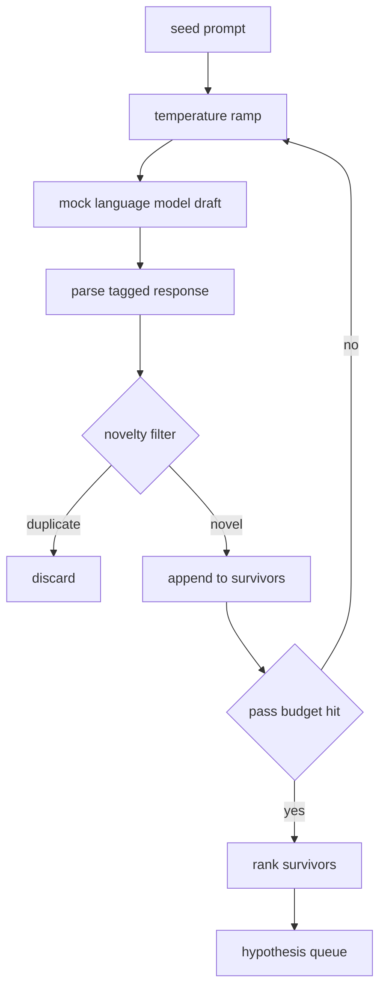

# Hypothesis Generator · 假设生成器

> 同一个问题问两遍的研究 agent 是在浪费 token。诀窍在于逼着每一版草稿都落在一个新的地方。

**Type:** Build
**Languages:** Python
**Prerequisites:** Phase 19 Track A lessons 20-29
**Time:** ~90 minutes

> A research agent that asks the same question twice is wasting tokens. The trick is forcing each draft to land somewhere new.

## Learning Objectives · 学习目标
- 用一个种子提示（seed prompt）驱动采样器（sampler），并把它的输出变成带类型的假设（hypothesis）记录。
- 每经过采样器一轮就把温度（temperature）调高一档，让下一版草稿离上一版更远。
- 用一个小型嵌入模型（embedding model）加余弦距离（cosine distance）阈值过滤近似重复项。
- 用一个融合新颖性（novelty）、具体性（specificity）和可测性（testability）的评分函数给幸存者排序。
- 让每一步都保持确定性，同一个种子永远产出同一条队列。

> Drive a sampler from a seed prompt and turn its outputs into typed hypothesis records
> Ramp the sampler temperature on each pass so the next draft drifts further from the last
> Filter near duplicates with a small embedding model and a cosine distance threshold
> Rank the survivors with a scoring function that blends novelty, specificity, and testability
> Hold every step deterministic so the same seed always produces the same queue

## Why generate, then filter · 为什么先生成、再过滤

一个只让模型采样一次的规划器只能得到一个假设。对教学示例来说够用了，但对一个研究循环（research loop）来说这个形状不对。循环要的是一条有深度、排好序的队列，这样当第一个假设失败时，runner 手里已经有下一个可用，而不必再为一次完整的采样买单。

两个想法组合出这条队列。第一个是温度爬升（temperature ramping）：每经过采样器一轮就把温度调高一档，鼓励后面的草稿更敢「乱跑」。第二个是新颖度过滤（novelty filtering）：每产生一份草稿，生成器就度量它与每一个先前幸存者的嵌入距离（embedding distance），拒绝任何落在已有簇内的候选。

本课附带一个 mock 语言模型，对固定的提示返回脚本化的 token 序列。这个 mock 足以走通全流程：种子提示进去、施加温度爬升、解析候选、跑新颖度过滤、输出排序后的队列。

> A planner that asks one model one time gets one hypothesis. That is fine for a worked example. For a research loop it is the wrong shape. The loop wants a ranked queue with depth, so when the first hypothesis fails the runner has the next one ready without paying for another full sampling pass.
> Two ideas combine to produce that queue. The first is temperature ramping: each pass through the sampler raises the temperature a notch, so later drafts are encouraged to wander. The second is novelty filtering: after each draft, the generator measures the embedding distance from every prior survivor and rejects anything inside the cluster.
> The lesson ships a mock language model that returns scripted token sequences for fixed prompts. The mock is enough to exercise the full path: seed prompt in, temperature ramp applied, candidates parsed, novelty filter run, ranked queue out.

## The Hypothesis shape · Hypothesis 数据结构

```text
Hypothesis
  id             : int           (monotonic within a run)
  text           : str           (the claim)
  variables      : list[str]     (what changes between conditions)
  metric         : str           (what the runner will measure)
  baseline_ref   : str | None    (which paper or run the comparison cites)
  draft_pass     : int           (which sampler pass produced this)
  temperature    : float         (the sampler setting at draft time)
  novelty_score  : float         (distance from prior survivors, 0..1)
  rank_score     : float         (weighted sum used for ordering)
```

`variables` 和 `metric` 不是自由文本。解析器从带标签的响应里把它们抽出来。第五十二课的 runner 在构建实验配置时会直接读这些字段。

`baseline_ref` 是可选的但推荐填写。第五十三课的 evaluator 需要一个基线（baseline）来做对比。如果假设省略了它，evaluator 会退回到同一指标上一次运行的结果。

```figure
cg-novelty-ramp
```

> `variables` and `metric` are not free text. The parser pulls them from a tagged response. The runner in lesson fifty-two reads these fields directly when it builds the experiment config.
> `baseline_ref` is optional but recommended. The evaluator in lesson fifty-three needs a baseline to compare against. If the hypothesis omits one, the evaluator falls back to the previous run on the same metric.

## Architecture · 架构



这个循环本身很直白。有意思的地方在于每个框都有一份硬性契约（contract）。

> The loop is straight forward. The interesting part is each box has a hard contract.

## Temperature ramp · 温度爬升

从 `t_min` 出发，到 `t_max` 结束，步长为 `(t_max - t_min) / (n_passes - 1)`。每一轮都以当前温度调用采样器，`GeneratorConfig.schedule()` 由此产出 `n_passes` 个等距值。mock 模型通过在一小组脚本化响应之间切换来体现温度，响应按 `(prompt, temp_bucket)` 索引。桶（bucket）是开区间，所以温度的微小变化就会换到不同的桶、产出不同的草稿。在生产环境中，采样器会是一个真实的模型，把 `temperature=t` 透传进去。

默认调度是六轮，从 `0.2` 到 `1.2`。六轮足以填满队列，又不必为那些反正会被新颖度过滤拒绝的采样买单。低于 `0.2` 时模型只会鹦鹉学舌地复述种子；高于 `1.2` 时响应往往跑题、通不过解析器。

> Start at `t_min`, end at `t_max`, step `(t_max - t_min) / (n_passes - 1)`. Each pass calls the sampler at the current temperature, producing `n_passes` evenly spaced values from `GeneratorConfig.schedule()`. The mock model honors temperature by switching between a small set of scripted responses keyed on `(prompt, temp_bucket)`. The buckets are open intervals so a small change in temperature picks a different bucket and produces a different draft. In production the sampler would be a real model with `temperature=t` passed through.
> The default schedule is six passes from `0.2` to `1.2`. Six is enough to fill the queue without paying for samples that the novelty filter will reject anyway. Below `0.2` the model parrots the seed back. Above `1.2` the responses tend to drift off topic and fail the parser.

## Novelty filter · 新颖度过滤

每份草稿解析完成后，生成器会对文本计算嵌入，并与每一条已接受的假设比较。这个嵌入是一个小型哈希词袋（hashed bag of word tokens），归一化到单位长度。两个单位向量之间的余弦距离是 `1 - dot(a, b)`。如果一份草稿到所有先前幸存者的最小距离高于 `novelty_threshold`，它就通过。默认值是 `0.25`。

这个哈希嵌入并不花哨。它确定性强、零依赖，而且足以抓住最显然的情形：两份共享大部分名词的草稿。生产部署会换成一个小型句子模型（sentence model），接口保持不变。

> After each draft is parsed, the generator embeds the text and compares against every accepted hypothesis. The embedding is a small hashed bag of word tokens, normalised to unit length. Cosine distance between two unit vectors is `1 - dot(a, b)`. A draft passes if its minimum distance to any prior survivor is above `novelty_threshold`. Default is `0.25`.
> The hashed embedding is not fancy. It is deterministic, has zero dependencies, and is enough to catch the obvious case: two drafts that share most of their nouns. A production deployment would swap in a small sentence model. The interface stays the same.

## Rank score · 排序分

```text
rank_score = w_novelty * novelty_score
           + w_specificity * specificity_score
           + w_testability * testability_score
```

三个子分数。`novelty_score` 是到先前幸存者的最小嵌入距离。`specificity_score` 是假设中具体变量的数量除以目标数量。`testability_score` 在假设同时指定了指标和基线时为 1，只有指标时为 0.5，否则为 0。

默认权重是 `0.4`、`0.3`、`0.3`。权重放在生成器配置里，下游课程不需要分叉代码就能调整它们。

> Three sub scores. `novelty_score` is the minimum embedding distance from prior survivors. `specificity_score` is the count of concrete variables in the hypothesis divided by a target count. `testability_score` is one if the hypothesis specifies both a metric and a baseline, half if it only has a metric, zero otherwise.
> Default weights are `0.4`, `0.3`, `0.3`. The weights live in the generator config so a downstream lesson can shift them without forking the code.

## Mock language model · Mock 语言模型

```python
class MockLLM:
    def sample(self, prompt: str, temperature: float, seed: int) -> str:
        ...
```

给定一个 `(prompt, temperature, seed)` 三元组，采样器是确定性的。mock 维护一张按 `(prompt_signature, temperature_bucket)` 索引的脚本化响应表。如果表里没有某个键的条目，采样器返回一个通不过解析器的兜底（fallback）响应。其中一条测试专门覆盖这个兜底路径。

种子（seed）被混入响应，所以同一对 `(prompt, temperature)` 配不同种子会产出不同草稿。测试里我们把种子钉死以保证结果可复现。真实部署中，种子会来自系统时钟或计数器。

> The sampler is deterministic given a `(prompt, temperature, seed)` triple. The mock keeps a scripted response table keyed on `(prompt_signature, temperature_bucket)`. If the table has no entry for a key, the sampler returns a fallback that fails the parser. The fallback path is exercised by one of the tests.
> The seed is mixed into the response so the same `(prompt, temperature)` pair with different seeds produces different drafts. In tests we pin the seed to keep results reproducible. In a real deployment the seed would come from a system clock or a counter.

## Output queue · 输出队列

输出是一个按 `rank_score` 降序排列的 `Hypothesis` 记录列表。第五十二课的 runner 弹出队首、跑实验，第五十三课的 evaluator 写回一个裁决（verdict）。如果裁决说假设错了，runner 就弹出下一条。

队列是有限的。队列空了以后，编排器（orchestrator）可以扩大种子提示再跑一次生成器，也可以停下来报告预算耗尽。

> The output is a list of `Hypothesis` records sorted by `rank_score` descending. The runner in lesson fifty-two pops the head, runs the experiment, and the evaluator in lesson fifty-three writes a verdict back. If the verdict says the hypothesis was wrong, the runner pops the next one.
> The queue is finite. When it is empty the orchestrator can either widen the seed prompt and run the generator again or stop and report the budget exhausted.

## How to read the code · 怎么读代码

`code/main.py` 定义了 `Hypothesis`、`MockLLM`、`HypothesisGenerator` 和一个确定性演示。生成器只暴露一个 `run(seed_prompt)` 方法，返回排好序的队列；轮数从 `GeneratorConfig.n_passes` 读取，而不是作为参数传入。嵌入是哈希词袋。新颖度过滤是单个函数。排序分是单个函数。什么都不依赖 `numpy`；嵌入数学是纯标准库，本课因此保持可移植。

`code/tests/test_generator.py` 覆盖线性路径、重复拒绝路径、解析失败路径、温度爬升边界，以及排序顺序。

> `code/main.py` defines `Hypothesis`, `MockLLM`, `HypothesisGenerator`, and a deterministic demo. The generator exposes a single `run(seed_prompt)` method that returns a sorted queue; the pass count is read from `GeneratorConfig.n_passes` rather than passed as an argument. The embedding is a hashed bag of tokens. The novelty filter is a single function. The rank score is a single function. Nothing depends on `numpy`; the embedding math is pure stdlib so the lesson stays portable.
> `code/tests/test_generator.py` covers the linear path, the duplicate rejection path, the parser failure path, the temperature ramp boundaries, and the rank ordering.

## Where this slots in · 它接在哪里

第五十课产出队列。第五十一课取队首并跑一次文献检索（literature retrieval），确认或推翻它。第五十二课取同一个队首跑一次真正的实验。第五十三课读两边的输出并写出裁决。四门课组合成一个没有人类参与的研究循环；人类可以在任何边界介入。

> Lesson fifty produces the queue. Lesson fifty-one takes the head of the queue and runs a literature search to confirm or refute it. Lesson fifty-two takes the same head and runs an actual experiment. Lesson fifty-three reads both outputs and writes a verdict. The four lessons compose into a research loop with no human in it; a human can step in at any boundary.
