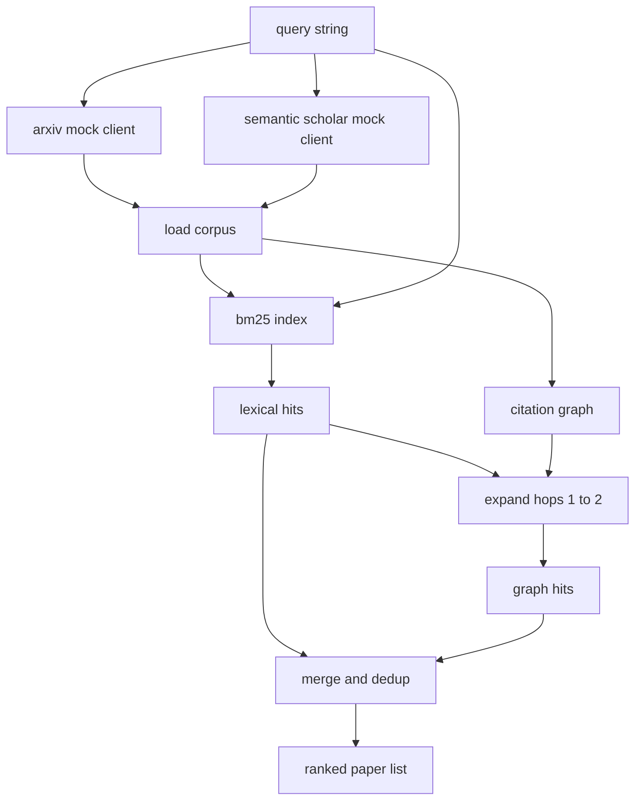

# Literature Retrieval · 文献检索

> 假设很便宜。知道是否已经有人证明过它，才是贵的部分。在 runner 启动沙箱之前，先把回答这个问题的检索层建出来。

**Type:** Build
**Languages:** Python
**Prerequisites:** Phase 19 Track A lessons 20-29
**Time:** ~90 minutes

> A hypothesis is cheap. Knowing whether someone already proved it is the expensive part. Build the retrieval layer that answers that question before the runner spins up a sandbox.

## Learning Objectives · 学习目标
- 用循环下游要读的字段为小型论文记录（paper record）建模。
- 仅用标准库数据结构在摘要（abstract）上构建 BM25 索引。
- 遍历引文图（citation graph），找出词汇检索漏掉的论文。
- 用稳定的论文 id 对词汇通道与图通道的命中去重。
- 把两个 mock 外部 API 包在同一个客户端（client）后面，这样接入真实端点时上游调用点保持不变。

> Model a small paper record with the fields the loop will read downstream
> Build a BM25 index over abstracts with stdlib data structures only
> Walk a citation graph to surface papers the lexical search missed
> Deduplicate hits across the lexical and graph passes by stable paper id
> Wrap two mock external APIs behind a single client so the upstream call site stays the same when real endpoints land

## Why two retrieval passes · 为什么要两趟检索

对摘要做关键词搜索，返回的是与查询共享词汇的论文。这覆盖了大部分表面，但会漏掉两种情况。第一种是奠基性论文用了不同的词汇：例如查询 "sparse attention" 会漏掉一篇题为 "block selection in transformer routing" 的论文。第二种是相关论文是一篇引用了已知锚点（anchor）的后续工作：此时先找到锚点再向前走，比暴力扫描整个摘要池更高效。

本课把两趟都建出来。摘要上的 BM25 抓住词汇命中。一次引文图遍历以种子集合为起点，向前、向后各扩展一到两跳（hop）。并集按论文 id 去重，再用一个小型组合分数排序。

> A keyword search over abstracts returns papers that share vocabulary with the query. That covers most of the surface. It misses two cases. The first is when the foundational paper uses different vocabulary; for example a query for "sparse attention" misses a paper titled "block selection in transformer routing." The second is when the relevant paper is a follow up that cites a known anchor; it is more efficient to find the anchor and walk forward than to brute force the abstract pool.
> The lesson builds both passes. BM25 over abstracts catches the lexical hits. A citation graph traversal expands a seed set forward and backward by one or two hops. The union is deduplicated by paper id and ranked by a small combined score.

## The Paper shape · Paper 数据结构

```text
Paper
  id          : str           (stable identifier, "p001" for the mock corpus)
  title       : str
  abstract    : str
  year        : int
  authors     : list[str]
  references  : list[str]     (paper ids this paper cites)
  citations   : list[str]     (paper ids that cite this paper)
  source      : str           (which mock api supplied it, "arxiv" or "s2")
```

`references` 和 `citations` 字段构成有向引文图。两个 mock API 返回的字段重叠但不完全相同，所以语料加载器按 `id` 对它们取并集。

```figure
cg-citation-hops
```

> The references and citations fields form the directed citation graph. The two mock APIs return overlapping but not identical fields, so the corpus loader unions them on `id`.

## Architecture · 架构



检索客户端同时拥有两趟检索和合并。调用方交给它一个查询，拿回一个排序列表，其中每个条目带着解释排序依据的逐论文分数字段（`bm25_score`、`graph_distance`、`recency_score`、`final_score`）。

> The retrieval client owns both passes and the merge. The caller hands it a query and gets back a ranked list where each entry carries per paper score fields (`bm25_score`, `graph_distance`, `recency_score`, `final_score`) that explain the ranking.

## BM25 from scratch · 从零实现 BM25

实现是标准 Okapi BM25，默认参数 `k1=1.5`、`b=0.75`。索引是两个字典：`term -> doc_frequency` 和 `term -> list of (doc_id, term_count)`。文档长度是摘要的 token 数。平均文档长度在建索引时计算一次。对查询打分是对查询词求和 `idf * tf_norm`，其中 `tf_norm` 是标准 BM25 长度归一化词频。

分词器（tokeniser）先 `lower` 再按非字母数字切分。不做词干化（stemming）。生产系统会换上一个小型词干还原器，接口保持不变。

```text
idf(t)      = log((N - df + 0.5) / (df + 0.5) + 1.0)
tf_norm(t)  = (f * (k1 + 1)) / (f + k1 * (1 - b + b * dl / avgdl))
score(d, q) = sum over t in q of idf(t) * tf_norm(t)
```

> The implementation is the standard Okapi BM25 with default parameters `k1=1.5`, `b=0.75`. The index is two dictionaries: `term -> doc_frequency` and `term -> list of (doc_id, term_count)`. The document length is the token count of the abstract. The average document length is computed once at index build time. Scoring a query is a sum over query terms of `idf * tf_norm` where `tf_norm` is the standard BM25 length normalised term frequency.
> The tokeniser is `lower` then split on non alphanumeric. It is not stemmed. A production system would swap in a small stemmer. The interface stays the same.

## Citation graph traversal · 引文图遍历

图从语料构建一次。前向边从论文指向它的参考文献。后向边从论文指向引用它的论文。遍历是一次广度优先搜索（breadth first search），以 BM25 top 命中为种子，上限两跳。

两跳是刻意设置的上限。一跳太浅，agent 常常想要直接的祖先或后代。三跳会在连通图上把结果规模炸开，而且容易跑题。本课把跳数上限暴露成配置项，让下游循环可以收紧它。

> The graph is built once from the corpus. Forward edges go from a paper to its references. Backward edges go from a paper to its citations. The traversal is a breadth first search seeded by the top BM25 hits, capped at two hops.
> Two hops is a deliberate ceiling. One hop is too shallow; the agent often wants the immediate ancestor or descendant. Three hops blows up the result size on a connected graph and tends to drift off topic. The lesson exposes the hop limit as a config knob so a downstream loop can tighten it.

## Dedup and ranking · 去重与排序

两趟返回的集合有重叠。合并按论文 id 作为键。对每篇论文，最终分数是一个加权混合。

```text
final_score = w_bm25 * bm25_score_norm
            + w_graph * graph_score
            + w_recency * recency_score
```

`bm25_score_norm` 是 BM25 分数除以合并集合中的最大 BM25 分数（所以该字段落在 0 到 1 之间）。`graph_score` 对直接词汇命中为 1，一跳为 `0.6`，两跳为 `0.3`，否则为 0。`recency_score` 是从语料最小年份处的 0 线性爬升到最大年份处的 1。

默认权重是 `0.5`、`0.3`、`0.2`。权重是配置：过时的主题可以调低 recency，快速演化的主题可以调高它。

> The two passes return overlapping sets. The merge keys on paper id. For each paper the final score is a weighted blend.
> `bm25_score_norm` is the BM25 score divided by the maximum BM25 score in the merged set (so the field lives in zero to one). `graph_score` is one for direct lexical hits, then `0.6` for one hop, `0.3` for two hops, zero otherwise. `recency_score` is a linear ramp from zero at the corpus minimum year to one at the maximum.
> Default weights are `0.5`, `0.3`, `0.2`. The weights are config; a stale topic might tune recency down while a fast moving topic raises it.

## Mock corpus · Mock 语料

语料是一百篇论文，由 `build_corpus()` 生成。每篇论文都有手写的标题和摘要，分属五个主题之一：attention sparsity、retrieval augmentation、low rank adapters、dataset distillation、evaluation harnesses。references 和 citations 的连线方式让每个主题形成连通子图，另有少量跨主题边。

两个 mock API 客户端（`ArxivMockClient`、`SemanticScholarMockClient`）读同一份语料，但暴露不同的字段。Arxiv 返回 title、abstract、year、authors。Semantic Scholar 额外返回 references 和 citations。检索客户端按 id 取并集；跨客户端字段不一致的处理留到后续课程。

> The corpus is one hundred papers, generated by `build_corpus()`. Each paper has a hand written title and abstract on one of five topics: attention sparsity, retrieval augmentation, low rank adapters, dataset distillation, and evaluation harnesses. References and citations are wired so each topic forms a connected sub graph with a few cross topic edges.
> The two mock API clients (`ArxivMockClient`, `SemanticScholarMockClient`) read from the same corpus but expose different fields. Arxiv returns title, abstract, year, authors. Semantic Scholar adds references and citations. The retrieval client unions on id; cross client field disagreement handling is deferred to a follow up lesson.

## What lessons 52 and 53 read · 第 52、53 课读什么

第五十二课的 runner 读 `paper.id`、`paper.title`，以及摘要的前三句话作为实验上下文。第五十三课的 evaluator 读 `paper.year` 和 `paper.references`，把基线归因到具体论文。

检索客户端返回一个 `RetrievalResult`，同时携带排序列表和逐查询指标：命中数、平均分、最高分、总耗时。runner 会记录这些指标，让下游的可观测性（observability）环节能画出质量随时间的变化。

> The runner in lesson fifty-two reads `paper.id`, `paper.title`, and the top three sentences of the abstract as context for the experiment. The evaluator in lesson fifty-three reads `paper.year` and `paper.references` to attribute a baseline to a specific paper.
> The retrieval client returns a `RetrievalResult` with both the ranked list and the per query metrics: hit count, average score, top score, total wall time. The runner logs these so a downstream observability pass can plot quality over time.

## How to read the code · 怎么读代码

`code/main.py` 定义了 `Paper`、`ArxivMockClient`、`SemanticScholarMockClient`、`BM25Index`、`CitationGraph`、`RetrievalClient` 和一个确定性演示。mock 客户端和语料在同一个文件里，本课因此保持可移植。BM25 实现是一个类、六十行。图遍历是一个方法。

`code/tests/test_retrieval.py` 覆盖词汇路径、图路径、合并、去重和空查询。

> `code/main.py` defines `Paper`, `ArxivMockClient`, `SemanticScholarMockClient`, `BM25Index`, `CitationGraph`, `RetrievalClient`, and a deterministic demo. The mock clients and the corpus are in the same file so the lesson stays portable. The BM25 implementation is one class, sixty lines. The graph traversal is one method.
> `code/tests/test_retrieval.py` covers the lexical path, the graph path, the merge, the dedup, and the empty query.

## Where this slots in · 它接在哪里

第五十课产出假设。第五十一课检索文献，看该假设是否已被解决。第五十二课对没被解决的跑实验。第五十三课读检索结果和实验指标，写出裁决。检索客户端是四个阶段里最便宜的一个，在编排器中最先运行。

> Lesson fifty produces a hypothesis. Lesson fifty-one searches the literature to see whether that hypothesis is already settled. Lesson fifty-two runs the experiment if it is not. Lesson fifty-three reads both the retrieval result and the experiment metrics to write the verdict. The retrieval client is the cheapest of the four stages and runs first in the orchestrator.
