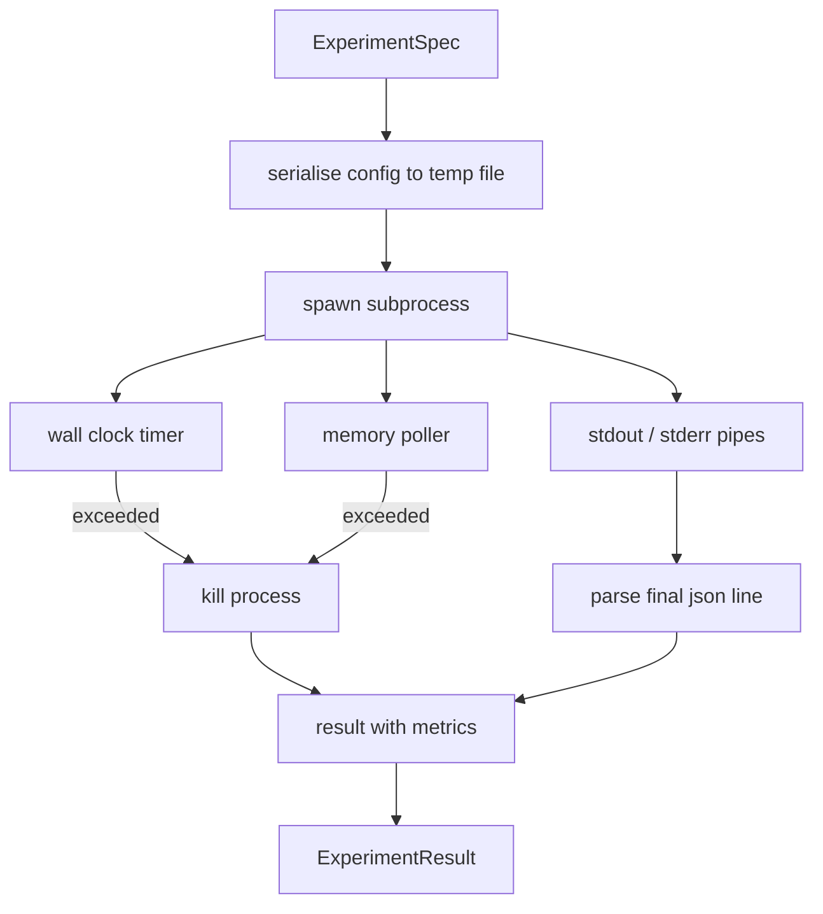

# Experiment Runner · 实验执行器

> 这个循环有多诚实，取决于它的测量有多诚实。建一个 runner：接收一份 spec，在沙箱化的子进程里执行它，输出 evaluator 可以信任的 json 指标块。

**Type:** Build
**Languages:** Python
**Prerequisites:** Phase 19 Track A lessons 20-29
**Time:** ~90 minutes

> The loop is only as honest as its measurements. Build the runner that takes a spec, executes it in a sandboxed subprocess, and emits a json metrics blob the evaluator can trust.

## Learning Objectives · 学习目标
- 把实验编码成带类型的 spec（规格），runner 能把它序列化给子进程。
- 以硬性墙钟超时（wall clock timeout）加软性内存上限（soft memory cap）启动子进程，并把两者都作为终止条件呈现。
- 把 stdout、stderr 和结构化指标块捕获进同一条结果记录。
- 在固定的基础 spec 上一次扫一个配置旋钮（knob），构建消融（ablation）表。
- 给定种子时保持每个结果确定性，让 evaluator 跨运行看到同样的数字。

> Encode an experiment as a typed spec the runner can serialise to a subprocess
> Launch a subprocess with a hard wall clock timeout and a soft memory cap, and surface both as terminal conditions
> Capture stdout, stderr, and the structured metrics blob into a single result record
> Build an ablation table that sweeps one configuration knob at a time over a fixed base spec
> Keep every result deterministic given a seed so the evaluator sees the same numbers across runs

## Why a subprocess · 为什么要子进程

研究循环运行的是不受信任的代码。假设来自采样器，实验脚本也来自同一条路径；把任何一方当作进程内的安全代码来对待，就是在等一次把编排器（orchestrator）一起拖垮的崩溃。子进程是这门语言自带的最简单的隔离：独立进程、独立地址空间、父侧的信号句柄。

这里的 runner 不实现完整沙箱。没有 cgroup，没有 seccomp 过滤器，没有命名空间重映射。它有的是一个墙钟超时、一个轮询内存增长的循环，以及任一限制触发时的终止路径。这是所有更精细的沙箱都在扩展的那份运行时契约。本课把契约保持在一口气能读完的规模。

> A research loop runs untrusted code. The hypothesis came from a sampler, the experiment script came from the same path; treating either as safe in-process is asking for a crash that takes the orchestrator down. Subprocesses are the simplest isolation the language ships: a separate process, an independent address space, a signal handle on the parent side.
> The runner here does not implement full sandboxing. There is no cgroup, no seccomp filter, no namespace remapping. What it does have is a wall clock timeout, a polling loop for memory growth, and a kill path that terminates the process on either limit. That is the runtime contract every more elaborate sandbox extends. The lesson keeps the contract small enough to read in one sitting.

## The ExperimentSpec shape · ExperimentSpec 数据结构

```text
ExperimentSpec
  spec_id        : str            (stable id, "exp_001")
  hypothesis_id  : int            (link back to the queue from lesson 50)
  script_path    : str            (path to the python script to run)
  config         : dict           (passed to the script as one json arg)
  seed           : int            (deterministic seed for the experiment)
  wall_timeout_s : float          (hard timeout, killed on exceed)
  memory_cap_mb  : int            (soft cap, polled; killed on exceed)
  metric_keys    : list[str]      (which fields the evaluator will read)
```

脚本放在磁盘上；runner 把配置写到脚本读取的一个临时文件路径。脚本要在 stdout 上打印一行 json，其键是 `metric_keys` 的超集。stdout 上的其他内容会被捕获，但被指标解析器忽略。

```figure
cg-runner-limits
```

> The script lives on disk; the runner writes the config to a temp file path that the script reads. The script is expected to print a single json line on stdout whose keys are a superset of `metric_keys`. Anything else on stdout is captured but ignored by the metrics parser.

## Architecture · 架构



runner 是一个类加一个主方法。轮询器（poller）是一个小线程，每个轮询间隔醒来一次，平台支持时从 proc 文件系统读取子进程的 `psutil` 等价物，平台不暴露时退化为空操作。

> The runner is one class with one main method. The poller is a small thread that wakes once every poll interval and reads the subprocess `psutil` equivalent from the proc filesystem when available, falling back to no op when the platform does not expose it.

## Why a soft memory cap · 为什么用软性内存上限

硬性内存上限需要 `resource.setrlimit`，而且只在 POSIX 上可用。本课给的是一个可移植方案：轮询平台上的常驻内存（resident set size），子进程超过上限就杀掉。上限之所以是软的，是因为轮询器有非零间隔；进程可能在两次轮询之间冲破上限、随后又落回来。runner 记录观测到的最大 RSS，让 evaluator 能看到这次运行离上限有多近。

在没有进程检查支持的系统上，轮询器记录一次性警告并自我禁用。墙钟超时仍然生效。本课的测试覆盖两条路径。

> Hard memory caps need `resource.setrlimit` and only work on POSIX. The lesson ships a portable approach: poll the resident set size from the platform and kill the subprocess if it exceeds the cap. The cap is soft because the poller has a non zero interval; a process can spike above the cap between polls and then drop back. The runner records the maximum observed RSS so the evaluator can see how close the run came to the limit.
> On systems without process inspection support, the poller logs a one time warning and disables itself. The wall clock timeout still applies. The lesson tests cover both paths.

## Capturing stdout and stderr · 捕获 stdout 与 stderr

runner 把两条管道读到完成、排干为止。stdout 逐行扫描；最后一行能解析为 json 且包含全部所需 `metric_keys` 的行被当作指标块。更早的 json 行作为 `intermediate_metrics` 保留在结果里，evaluator 可以用它们画学习曲线。

stderr 原样捕获进结果。runner 对非零退出码从不抛异常，而是把退出码记进结果。任何非零退出都标记为 `"crash"`，哪怕脚本打印了指标也一样，这样 evaluator 默认把部分完成的运行当作失败。

> The runner reads both pipes drained on completion. Stdout is scanned line by line; the last line that parses as json with all required `metric_keys` is taken as the metrics blob. Earlier json lines are kept in the result as `intermediate_metrics`; the evaluator can use these for learning curves.
> Stderr is captured verbatim into the result. The runner never raises on a non zero exit code; instead it records the code in the result. Any non zero exit is labelled `"crash"` even when the script printed metrics, so the evaluator treats partial runs as failures by default.

## Ablation table · 消融表

```python
def ablate(base: ExperimentSpec, knob: str, values: list[Any]) -> list[ExperimentSpec]:
    ...
```

给定基础 spec 和一个旋钮名，这个辅助函数对每个值返回一个覆盖了 `config[knob]` 的 spec。每个 spec 得到一个派生的 `spec_id`（`f"{base.spec_id}_{knob}_{value}"`）。runner 附带一个 `AblationRunner`，按顺序运行它们，返回按旋钮值索引的 `AblationTable`。

为什么一次只动一个旋钮。全因子扫描（full factorial sweep）会指数爆炸，产出的结果 evaluator 无法解读。一次一个旋钮产生一条 evaluator 能画出来的干净坐标轴。本课对多旋钮扫描的支持只是「重复的单旋钮消融」，由调用方自行组合。

> Given a base spec and a knob name, the helper returns one spec per value with `config[knob]` overridden. Each spec gets a derived `spec_id` (`f"{base.spec_id}_{knob}_{value}"`). The runner ships an `AblationRunner` that runs them in order and returns an `AblationTable` keyed by knob value.
> Why one knob at a time. Full factorial sweeps blow up exponentially and produce results the evaluator cannot interpret. One knob at a time produces a clean axis the evaluator can plot. The lesson supports multi knob sweeps only as repeated single knob ablations, composed by the caller.

## Determinism · 确定性

每个 spec 带一个种子。runner 通过 config 字典把种子转发给脚本（`config["__seed"] = spec.seed`）。`code/experiments/` 里的 mock 实验脚本遵守种子，跨运行产出完全相同的指标。第五十三课的 evaluator 依赖这一点；没有确定性，一次「回归」可能只是另一组随机初始化。

> Every spec carries a seed. The runner forwards the seed to the script via the config dict (`config["__seed"] = spec.seed`). The mock experiment scripts in `code/experiments/` honour the seed and produce identical metrics across runs. The evaluator in lesson fifty-three depends on this; without determinism a "regression" might be a different random initialisation.

## The mock experiment script · mock 实验脚本

本课附带一个实验脚本：`code/experiments/sparsity_experiment.py`。它是一个真脚本：读自己的配置文件，用一次 numpy 随机过程模拟一个小型训练运行，打印一行 json 指标块。脚本支持用于测试超时的 `sleep_s` 旋钮，以及用于测试内存轮询器的 `allocate_mb` 旋钮。

这个模拟没有训练任何真东西。它只是一段模仿训练循环形状的数值计算：一条 loss 曲线、一个最终困惑度（perplexity）、一段墙钟时间。本课的主角是 runner，不是模拟。真实的实验脚本会 import 一个模型。

> The lesson ships one experiment script: `code/experiments/sparsity_experiment.py`. It is a real script that reads its config file, simulates a small training run with a numpy random pass, and prints a json metrics blob. The script honours a `sleep_s` knob for testing timeouts and an `allocate_mb` knob for testing the memory poller.
> The simulation is not training anything real. It is a numerical computation that mimics the shape of a training loop: a loss curve, a final perplexity, a wall time. The point of the lesson is the runner, not the simulation. A real experiment script would import a model.

## Result shape · Result 数据结构

```text
ExperimentResult
  spec_id              : str
  hypothesis_id        : int
  exit_code            : int
  terminal             : "ok" | "timeout" | "oom" | "crash"
  wall_time_s          : float
  peak_rss_mb          : float | None
  metrics              : dict
  intermediate_metrics : list[dict]
  stdout_tail          : str
  stderr_tail          : str
```

evaluator 先读 `metrics` 和 `terminal`。只要 terminal 不是 `"ok"`，这次实验就算一次失败运行，evaluator 的裁决（verdict）自动生成。否则指标进入显著性检验（significance test）。

> The evaluator reads `metrics` and `terminal` first. If terminal is anything other than `"ok"` the experiment counts as a failed run and the evaluator's verdict is automatic. Otherwise the metrics are passed through the significance test.

## How to read the code · 怎么读代码

`code/main.py` 定义了 `ExperimentSpec`、`ExperimentResult`、`ExperimentRunner`、`AblationRunner` 和一个确定性演示。子进程管理是一个类。内存轮询器是一个小线程。消融辅助函数是单个函数。

`code/experiments/sparsity_experiment.py` 是测试用的 mock 实验。它从 argv 读自己的配置文件路径，结束时在 stdout 打印一行 json 指标。

`code/tests/test_runner.py` 覆盖成功路径、超时路径、崩溃路径、消融表，以及跨两次运行的确定性检查。

> `code/main.py` defines `ExperimentSpec`, `ExperimentResult`, `ExperimentRunner`, `AblationRunner`, and a deterministic demo. The subprocess management is one class. The memory poller is a small thread. The ablation helper is a single function.
> `code/experiments/sparsity_experiment.py` is the mock experiment used in tests. It reads its config file path from argv and writes a single json metrics line on completion.
> `code/tests/test_runner.py` covers the success path, the timeout path, the crash path, the ablation table, and the determinism check across two runs.

## Where this slots in · 它接在哪里

第五十课生成假设。第五十一课过滤掉文献已经解决的。第五十二课对剩下的跑实验。第五十三课读结果、跑显著性检验、写出编排器按假设 id 存储的裁决。

> Lesson fifty generates the hypothesis. Lesson fifty-one filters out anything the literature already settled. Lesson fifty-two runs the experiment for what is left. Lesson fifty-three reads the result, runs the significance test, and writes the verdict the orchestrator stores against the hypothesis id.
