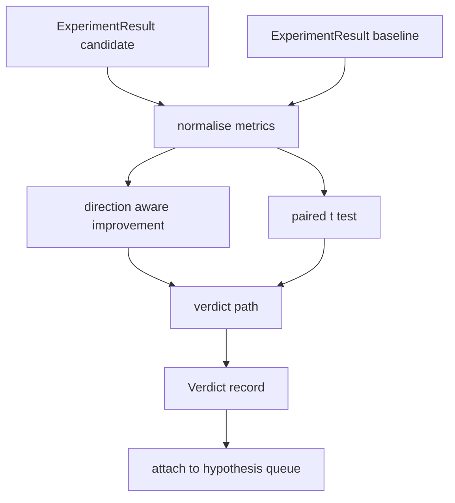

# Result Evaluator · 结果评估器

> runner 产出了数字。evaluator 要判断这些数字是提升、回归还是噪声。把指标变成一行结论的裁决路径，就交给你来建。

**Type:** Build
**Languages:** Python
**Prerequisites:** Phase 19 Track A lessons 20-29
**Time:** ~90 minutes

> The runner produced numbers. The evaluator decides whether those numbers are an improvement, a regression, or noise. Build the verdict path that turns metrics into a one line conclusion.

## Learning Objectives · 学习目标
- 用方向感知的提升（direction aware improvement）加固定阈值，把候选运行与基线（baseline）比较。
- 在逐种子（per seed）指标上从零实现配对 t 检验（paired t test），并读出得到的 p 值。
- 对对数尺度指标做归一化，让下游报告能把它们与线性指标混合。
- 输出逐假设的裁决（verdict），编排器（orchestrator）可以把它挂到第五十课的队列上。
- 让每一步保持纯函数，同样的输入永远产出同样的裁决。

> Compare a candidate run against a baseline using direction aware improvement and a fixed threshold
> Run a paired t test from scratch over per seed metrics and read the resulting p value
> Normalise log scaled metrics so a downstream report can blend them with linear metrics
> Emit a per hypothesis verdict that the orchestrator can attach to the queue from lesson fifty
> Keep every step pure so the same inputs always produce the same verdict

## Why a paired test · 为什么要配对检验

runner 给出的单个数字说明不了变化是不是真的。同一配置换个种子就得到不同的困惑度。这个变化可能只是噪声。正确的比较是配对的：同一批种子、同一份数据，候选跑一次、基线跑一次。每个种子贡献一个差值。差值的均值就是效应（effect）。差值的标准误就是噪声地板（noise floor）。

本课从零实现这个检验。没有 `scipy.stats`。数学小到一屏读完。

```text
diffs    = [a_i - b_i for i in seeds]
mean     = sum(diffs) / n
variance = sum((d - mean) ** 2 for d in diffs) / (n - 1)
t_stat   = mean / sqrt(variance / n)
df       = n - 1
p_value  = two_sided_p(t_stat, df)
```

双侧 p 值用到正则化不完全贝塔函数（regularised incomplete beta function）。本课附带一个使用 Lentz 连分式（continued fraction）的小实现。整个东西是六十行纯标准库数学。

> A single number from the runner does not say whether the change is real. The same configuration with a different seed gives a different perplexity. The change might be noise. The right comparison is paired: the same seeds with the same data, ran once with the candidate and once with the baseline. Each seed contributes a difference. The mean of those differences is the effect. The standard error of those differences is the noise floor.
> The lesson implements the test from scratch. There is no `scipy.stats`. The math is small enough to read in one screen.
> The two sided p value uses a regularised incomplete beta function. The lesson ships a small implementation that uses the Lentz continued fraction. The whole thing is sixty lines of stdlib math.

## Direction aware improvement · 方向感知的提升

有的指标升了才算好（accuracy、throughput）。有的指标降了才算好（loss、perplexity、wall time）。evaluator 在每个指标上携带一个 `direction` 字段。

```text
if direction == "higher_is_better":
    improvement = (candidate - baseline) / abs(baseline)
elif direction == "lower_is_better":
    improvement = (baseline - candidate) / abs(baseline)
```

提升是带符号的。在高者为优的指标上出现负提升，意味着候选更差。裁决路径把符号和幅度一起读。

一个平坦阈值（`improvement_threshold=0.02`，百分之二）决定变化是否大到可以下结论。低于它的裁决一律是 "noise"，不管 p 值如何；这个循环对用户测不出来的变化不感兴趣。

```figure
cg-paired-verdict
```

> Some metrics improve when they go up (accuracy, throughput). Others improve when they go down (loss, perplexity, wall time). The evaluator carries a `direction` field on each metric.
> Improvement is signed. A negative improvement on a higher is better metric means the candidate is worse. The verdict path reads the sign and the magnitude together.
> A flat threshold (`improvement_threshold=0.02`, two percent) decides whether the change is large enough to call. Below that the verdict is "noise" regardless of the p value; the loop is not interested in changes the user could not measure.

## Architecture · 架构



evaluator 跑三个相互独立的计算，在裁决路径里汇合。每个计算都是没有共享状态的纯函数。

> The evaluator runs three independent computations and joins them in the verdict path. Each computation is a pure function with no shared state.

## Log normalisation · 对数归一化

困惑度（perplexity）对 loss 是指数关系。loss 降 0.1，困惑度降得多得多。在两个配置之间直接比较困惑度没问题，但要在同一份报告里把它与线性指标混合，就需要归一化。

本课对 `scale` 字段为 `"log"` 的指标，在计算提升之前先取自然对数，然后在对数空间里应用阈值。困惑度从 32 降到 28，在低者为优的指标上是 `log(28) - log(32) = -0.133`，远高于百分之二阈值。

```text
if scale == "log":
    a = log(candidate)
    b = log(baseline)
else:
    a = candidate
    b = baseline
```

`scale="linear"`（默认）的指标跳过这个变换。同一条代码路径处理两者。

> Perplexity is exponential in loss. A 0.1 drop in loss is a much larger drop in perplexity. Comparing perplexity directly across two configurations is fine, but blending it with linear metrics in a single report requires normalisation.
> The lesson normalises any metric whose `scale` field is `"log"` by taking the natural log before computing the improvement. The threshold is then applied in log space. A perplexity drop from 32 to 28 is `log(28) - log(32) = -0.133` on a lower is better metric, which is well above the two percent threshold.
> Metrics with `scale="linear"` (default) skip the transform. The same code path handles both.

## Per seed paired test · 逐种子配对检验

第五十二课的 runner 每次运行输出一个最终指标块。配对检验需要候选每个种子一个指标块、基线每个种子一个指标块。编排器在一份种子列表上以两种配置运行同一实验，把两个 `ExperimentResult` 记录列表交给 evaluator。

evaluator 按种子配对（种子在 `result.metrics["seed"]` 里），沿指定指标走一遍。两个列表的种子对不上时，evaluator 抛出 `PairingError`。编排器应该重跑。

> The runner from lesson fifty-two emits one final metrics blob per run. For the paired test the evaluator needs one blob per seed for the candidate and one per seed for the baseline. The orchestrator runs the same experiment under both configurations across a list of seeds and hands the evaluator two lists of `ExperimentResult` records.
> The evaluator pairs them by seed (the seed lives in `result.metrics["seed"]`) and walks the requested metric. If the seeds do not match across the two lists, the evaluator raises a `PairingError`. The orchestrator should re run.

## The Verdict shape · Verdict 数据结构

```text
Verdict
  hypothesis_id          : int
  metric                 : str
  direction              : "higher_is_better" | "lower_is_better"
  scale                  : "linear" | "log"
  candidate_mean         : float
  baseline_mean          : float
  improvement            : float       (signed, fraction; see direction rules)
  p_value                : float | None  (None if n < 2)
  significance_threshold : float
  improvement_threshold  : float
  verdict                : "improved" | "regressed" | "noise" | "failed"
  rationale              : str
```

裁决路径是一张小决策表：

```text
1. If any candidate result has terminal != "ok": verdict = "failed"
2. else if |improvement| < improvement_threshold:  verdict = "noise"
3. else if p_value is None or p_value > significance: verdict = "noise"
4. else if improvement > 0:                          verdict = "improved"
5. else:                                             verdict = "regressed"
```

rationale 是一行人类可读的句子，编排器可以按假设 id 记录它。

> The verdict path is a small decision table:
> Rationale is a one line human readable sentence the orchestrator can log against the hypothesis id.

## How to read the code · 怎么读代码

`code/main.py` 定义了 `MetricSpec`、`Verdict`、`Evaluator`、t 统计量和不完全贝塔辅助函数，以及一个确定性演示。t 检验用纯标准库数学实现；numpy 只用来读指标列表、计算均值和方差。

`code/tests/test_evaluator.py` 覆盖提升路径、回归路径、噪声路径（小幅提升）、噪声路径（n 太小）、failed 终止路径、对数归一化路径、对照已知参考值的 t 检验，以及配对错误。

> `code/main.py` defines `MetricSpec`, `Verdict`, `Evaluator`, the t statistic and incomplete beta helpers, and a deterministic demo. The t test is implemented in pure stdlib math; numpy is used only to read the metrics list and compute means and variances.
> `code/tests/test_evaluator.py` covers the improved path, the regressed path, the noise path (small improvement), the noise path (low n), the failed terminal path, the log normalised path, the t test against a known reference value, and the pairing error.

## Where this slots in · 它接在哪里

第五十课产出假设队列。第五十一课过滤掉文献已解决的。第五十二课在候选和基线配置下跨种子跑实验。第五十三课读这些运行并写出裁决。编排器把四者缝合起来：

```text
for hypothesis in queue:
    literature = retrieval.search(hypothesis.text)
    if literature_settles(hypothesis, literature):
        attach(hypothesis, verdict="settled")
        continue
    candidates = runner.run_all(specs_for(hypothesis))
    baselines  = runner.run_all(baseline_specs_for(hypothesis))
    metric_spec = MetricSpec("perplexity", direction=LOWER, scale=LOG)
    verdict = evaluator.evaluate(hypothesis.id, metric_spec, candidates, baselines)
    attach(hypothesis, verdict)
```

那个编排器不在本课里；四门课直接组合成它，除各自定义的 dataclass 之外不需要任何胶水。

> Lesson fifty produced the hypothesis queue. Lesson fifty-one filtered out anything the literature settled. Lesson fifty-two ran the experiment under candidate and baseline configurations across seeds. Lesson fifty-three reads those runs and writes the verdict. The orchestrator stitches the four together:
> That orchestrator is not in this lesson; the four lessons compose into it without any glue beyond the dataclasses each one defines.
