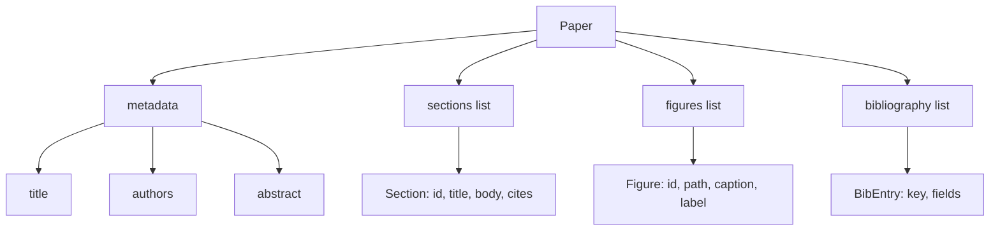
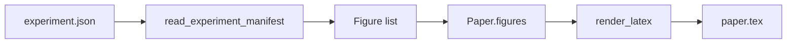
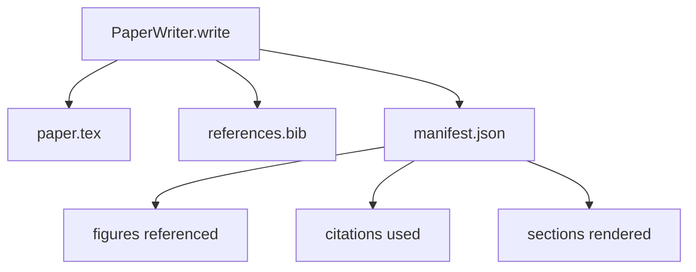

# Paper Writer · 论文写作器

> LaTeX 骨架是研究者与排版器之间的一份契约。契约一破，文档就编译不过，而且失败得很响。先立骨架，再填内容。

**Type:** Build
**Languages:** Python
**Prerequisites:** Phase 19 lessons 50-53
**Time:** ~90 minutes

> A LaTeX skeleton is a contract between the researcher and the typesetter. If the contract is broken the document does not compile, and the failure is loud. Build the skeleton first, then fill it.

## Learning Objectives · 学习目标

- 把研究论文当成一个有明确 section 图（section graph）的结构化工件，而不是自由格式的文档。
- 生成一个 LaTeX 骨架，在任何正文写出之前就声明它的摘要（abstract）、各 section、插图槽位（figure slots）和参考文献键（bibliography keys）。
- 通过一个确定性的槽位机制，把实验输出（路径与图注）注入骨架。
- 接一个 mock 的正文生成器，从结构化大纲填充每个 section，让整个 harness 在没有模型的情况下也可测。
- 输出一份 `paper.tex`、一份 `references.bib`，外加一份列出每个被引用插图和每个被使用引文的 manifest。

```figure
ch-paper-skeleton
```

> Treat a research paper as a structured artifact with a known section graph, not a freeform document
> Generate a LaTeX skeleton that declares its abstract, sections, figure slots, and bibliography keys before any prose is written
> Inject figures from experiment outputs (paths and captions) into the skeleton through a deterministic slot mechanism
> Wire a mocked prose generator that fills each section from a structured outline so the harness is testable without a model
> Emit a single `paper.tex` plus a `references.bib` plus a manifest that lists every figure referenced and every citation used

## Why a skeleton first · 为什么先立骨架

以正文起笔的草稿会积累结构债。引言里长出三段本该属于 related work 的内容。某张插图在被定义之前就被引用了。参考文献最后落得同一篇论文有三个键。等作者注意到的时候，重写的成本已经高于写作的成本。

骨架把这个顺序倒过来。结构作为数据被预先声明。section 是带名字和顺序的槽位（slot）。插图是带 id 和图注的槽位。参考文献键在顶部连同它们指向的条目一起声明。正文逐个生成进这些槽位。harness 可以在任何正文写出之前验证：每个插图都有槽位、每条引文都有条目、每个 section 都出现在目录里。

这正是 earlier lessons 应用在计划、工具调用和 trace 上的同一种纪律。结构就是契约。

> A draft that starts as prose accumulates structural debt. The introduction grows three paragraphs that should be in related work. A figure gets referenced before it is defined. The bibliography ends up with three keys for the same paper. By the time the author notices, the rewriting cost is higher than the writing cost.
> A skeleton inverts that. The structure is declared up front as data. Sections are slots with names and order. Figures are slots with ids and captions. Bibliography keys are declared at the top with the entries they point at. Prose is generated into those slots one at a time. The harness can validate, before any prose is written, that every figure has a slot, every citation has an entry, and every section appears in the table of contents.
> This is the same discipline that earlier lessons applied to plans, tool calls, and traces. The structure is the contract.

## The Paper shape · Paper 数据结构



每个字段都是普通的 Python 数据。渲染器是从 `Paper` 到 LaTeX 字符串的纯函数。harness 可以在渲染之前内省这篇论文：数 section、列出缺失的插图文件、检查每个 `\cite{key}` 是否有匹配的 `BibEntry`。

> Every field is plain Python data. The renderer is a pure function from `Paper` to a LaTeX string. The harness can introspect the paper before rendering: count sections, list missing figure files, check that every `\cite{key}` has a matching `BibEntry`.

## The render contract · 渲染契约

渲染器保证三条性质。第一，骨架里的每个插图槽位输出一个 `\begin{figure}` 块，带形如 `fig:<id>` 的稳定标签。第二，每个 section 输出一个带形如 `sec:<id>` 稳定标签的 `\section{}`，交叉引用因此可用。第三，参考文献输出的 `\bibliography` 块对应的 `references.bib` 恰好包含论文上声明的条目，不多也不少。

违反任何一条都是渲染错误，不是警告。骨架是契约；一个悄悄丢掉一张插图的渲染就是违约。

> The renderer guarantees three properties. First, every figure slot in the skeleton emits a `\begin{figure}` block with a stable label of the form `fig:<id>`. Second, every section emits a `\section{}` with a stable label of the form `sec:<id>` so cross-references work. Third, the bibliography emits a `\bibliography` block whose `references.bib` contains exactly the entries declared on the paper, no more and no fewer.
> Violating any of these is a render error, not a warning. The skeleton is the contract; a render that silently drops a figure is a contract break.

## Figure injection from experiments · 从实验注入插图

本 track 之前的课程把实验输出产出为 JSON manifest。每个 manifest 携带一个 artifact 列表，含路径和简短图注。论文写作器读那个 manifest，生成 `Figure` 记录。



注入是确定性的。插图 id 由实验名加一个单调计数器派生。图注来自 manifest。路径相对论文的输出目录做归一化，这样即使实验输出在磁盘的其他地方，LaTeX 也能编译。

> The earlier lessons in this track produced experiment outputs as JSON manifests. Each manifest carries a list of artifacts with paths and short captions. The paper writer reads that manifest and produces `Figure` records.
> The injection is deterministic. Figure ids are derived from the experiment name plus a monotonic counter. Captions come from the manifest. Paths are normalised relative to the paper's output directory so the LaTeX compiles even when the experiment outputs sit elsewhere on disk.

## The mocked prose generator · mock 正文生成器

本课不调用模型。`MockProseGenerator` 读一个大纲形状，确定性地输出正文。大纲形状是每个 section 一个短字符串。生成器把那个字符串展开成两个短段落，并把 section 标题织进去。生成正文提到插图和引文的时机，与大纲声明的完全一致。

这足以测试写作器的每一个行为。真实实现会把生成器换成一次模型调用。它周围的 harness 不变。这就是把正文生成器声明为可调用对象（callable）的价值：测试替换成确定性的，生产替换成模型的，流水线的其余部分完全相同。

> The lesson does not call a model. A `MockProseGenerator` reads an outline shape and emits prose deterministically. The outline shape is one short string per section. The generator expands that string into two short paragraphs with the section title woven in. The generated prose name-drops figures and citations exactly when the outline declares them.
> This is enough to test every behaviour of the writer. A real implementation would swap the generator for a model call. The harness around it does not change. That is the value of declaring the prose generator as a callable: the test substitutes a deterministic one, production substitutes a model one, the rest of the pipeline is identical.

## The manifest output · manifest 输出

写作器向输出目录写出三个文件。



manifest 是下游 evaluator 或批评循环（critic loop）读的东西。它不解析 LaTeX；它读 manifest。下一课（critic loop）拿这个 manifest 作为输入，产出一份反馈列表。这就是为什么 manifest 是契约的一部分，而 LaTeX 不是。

> The writer emits three files into the output directory.
> The manifest is what a downstream evaluator or critic loop reads. It does not parse LaTeX; it reads the manifest. The next lesson, the critic loop, takes this manifest as input and produces a feedback list. That is why the manifest is part of the contract and the LaTeX is not.

## Validation gates · 校验门

写作器在写任何文件之前跑四道门。

1. 每个插图 id 在论文内唯一。
2. 每个 section 的 `cites` 字段引用的参考文献键都在论文上声明过。
3. 摘要非空。
4. 标题非空。

任何一道门失败都会抛出带精确原因的 `PaperValidationError`。harness 把原因作为失败模式呈现。没有部分写入：要么三个文件全部产出，要么一个都不写。

> The writer runs four gates before writing any file.
> 1. Every figure id is unique within the paper.
> 2. Every section's `cites` field references a bibliography key that is declared on the paper.
> 3. The abstract is non-empty.
> 4. The title is non-empty.
> A failed gate raises `PaperValidationError` with a precise reason. The harness surfaces the reason as the failure mode. There is no partial write: either all three files are emitted, or none.

## How to read the code · 怎么读代码

`code/main.py` 定义了 `Paper`、`Section`、`Figure`、`BibEntry`、`PaperValidationError`、`MockProseGenerator`、`PaperWriter` 和一个 `render_latex` 函数。`write` 方法接收一个输出目录，产出 `paper.tex`、`references.bib` 和 `manifest.json`。`read_experiment_manifest` 辅助函数把实验 manifest 列表转换成 `Figure` 记录。

`code/tests/test_paper_writer.py` 覆盖：无 section 的骨架渲染、两个 section 两张插图的全量渲染、缺引文门、重复插图 id 门、manifest 内容，以及 LaTeX 字符串契约（每个 section 输出一个 `\section{}`，每个插图输出一个 `\begin{figure}`）。

> `code/main.py` defines `Paper`, `Section`, `Figure`, `BibEntry`, `PaperValidationError`, `MockProseGenerator`, `PaperWriter`, and a `render_latex` function. The `write` method takes an output directory and emits `paper.tex`, `references.bib`, and `manifest.json`. The `read_experiment_manifest` helper converts a list of experiment manifests into `Figure` records.
> `code/tests/test_paper_writer.py` covers: skeleton render with no sections, full render with two sections and two figures, missing-citation gate, duplicate-figure-id gate, manifest content, and the LaTeX-string contract (every section emits a `\section{}`, every figure emits a `\begin{figure}`).

## Going further · 走得更远

真实实现会想要两个扩展。第一，多格式渲染：同一个 `Paper` 形状编译成博客用的 Markdown 和预览用的 HTML。渲染器变成 `Paper` 上的一个策略（strategy）。第二，引文富化（citation enrichment）：给定一个本地 DOI 缓存，写作器按引文键取回 BibTeX 条目。两个都有价值，也都可以在不碰骨架契约的情况下加入。

骨架就是那个赌注。section、插图、引文都作为数据声明，正文生成进槽位，manifest 与 LaTeX 一同产出。其他一切改进都叠加在它之上。

> Two extensions a real implementation will want. First, multi-format render: the same `Paper` shape compiles to Markdown for blog posts and HTML for previews. The renderer becomes a strategy on `Paper`. Second, citation enrichment: the writer fetches BibTeX entries from a citation key, given a local cache of DOIs. Both add value, both can be added without touching the skeleton contract.
> The skeleton is the bet. Sections, figures, and citations declared as data, prose generated into slots, manifest emitted alongside the LaTeX. Every other improvement composes on top.
