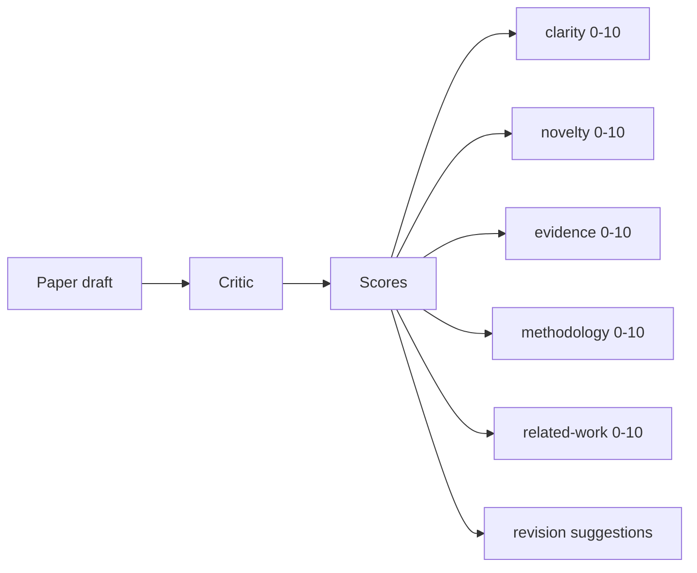
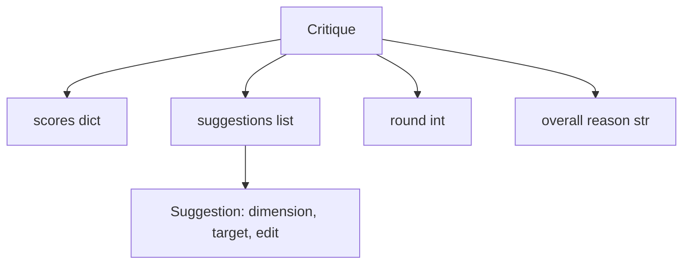
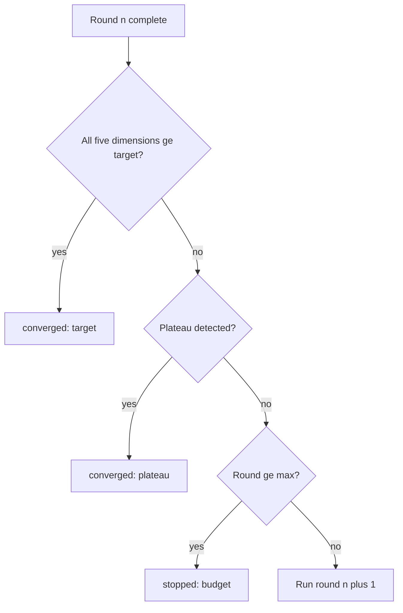
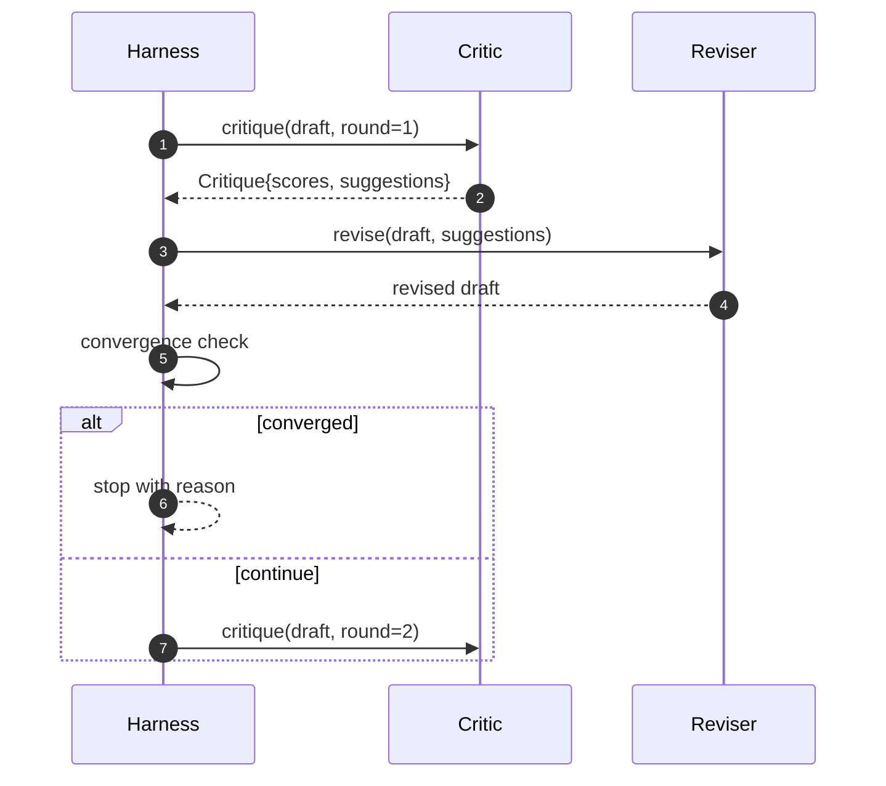

# Critic Loop · 批评循环

> 第一次就说「看起来不错」的批评家（critic）是坏的。永远说「还需要改」的批评家也是坏的。有意思的批评家是会收敛的那个，而收敛是要靠工程手段实现的。

**Type:** Build
**Languages:** Python
**Prerequisites:** Phase 19 lessons 50-53
**Time:** ~90 minutes

> A critic that returns "looks good" the first time is broken. A critic that always returns "needs work" is broken. The interesting critic is the one that converges, and you have to engineer convergence.

## Learning Objectives · 学习目标

- 在五个固定维度上给论文草稿打分：clarity、novelty、evidence、methodology、related-work。
- 把每一轮的批评应用为结构化的修订 diff（revision diff），而不是自由改写。
- 通过跨轮比较分数检测收敛（convergence）；在平台期（plateau）、达标或预算耗尽时停止。
- 用 max-iteration 预算限制轮数，让不收敛的批评家不会永远跑下去。
- 输出逐轮 trace，让仪表盘或下一阶段能渲染分数轨迹。

```figure
ch-critic-converge
```

> Score a paper draft across five fixed dimensions: clarity, novelty, evidence, methodology, related-work
> Apply each round's critique as a structured revision diff rather than a freeform rewrite
> Detect convergence by comparing scores across rounds; stop on plateau, target met, or budget exhausted
> Cap rounds with a max-iteration budget so a non-converging critic does not run forever
> Emit a per-round trace so the dashboard or the next stage can render the score trajectory

## Why five fixed dimensions · 为什么是五个固定维度

自由发挥的批评家是一个返回建议段落的模型。下一轮修订把那段话当成环境上下文（ambient context）。改写有没有回应批评无从验证，因为批评从来没有结构。

五个维度给 harness 一份契约。



分数是一个向量。harness 跨轮观察每个维度。一次提高了 clarity 却砸了 evidence 的修订，在 evidence 上就是一次回归，收敛检查能看到它。纯模型的批评家给不出这种保证。

> A freeform critic is a model that returns a paragraph of suggestions. The next round's revision treats the paragraph as ambient context. Whether the rewrite addresses the criticism is unverifiable because the criticism never had structure.
> Five dimensions give the harness a contract.
> The score is a vector. The harness watches each dimension across rounds. A revision that raises clarity but tanks evidence is a regression on evidence, and the convergence check sees it. A model-only critic cannot offer that guarantee.

## The Critique shape · Critique 数据结构



每条建议都携带它改进的维度、它指向的 section，以及一条修订者（reviser）可以应用的 `edit` 指令。修订者同样是一个 callable。本课附带的确定性修订者把 `edit` 指令解释为一次向 section 追加内容的操作。模型驱动的修订者会把同一个字段解释成提示词。契约不变。

> Every suggestion carries the dimension it improves, the section it targets, and an `edit` instruction the reviser can apply. The reviser is also a callable. The lesson ships a deterministic reviser that interprets the edit instruction as an append-to-section operation. A model-driven reviser would interpret the same field as a prompt. The contract does not change.

## Convergence rules, in order · 收敛规则（按顺序）

三个条件中任意一个触发，批评循环（critic loop）就终止。



目标（target）是最严格的情形：五个维度（clarity、novelty、evidence、methodology、related_work）每一个都必须达到 `>= target_score`（默认 `8.0`），循环才返回成功。均值很高但有一个弱维度是不够的。平台期检测把当前轮的均值与上一轮的均值比较。如果提升连续两轮低于 `plateau_epsilon`（默认 `0.1`），循环以 `plateau` 退出。预算是轮数的硬上限（默认 `5`），触发时以 `budget` 退出。

顺序很重要。target 优先于 plateau，plateau 优先于 budget。如果第三轮在达成 target 的同一轮里也会触发平台期，结果是 `target`，不是 `plateau`。

> The target is the strictest case: every one of the five dimensions (clarity, novelty, evidence, methodology, related_work) must hit `>= target_score` (default `8.0`) before the loop returns success. A high mean with one weak dimension is not enough. Plateau detection compares the current round's mean to the previous round's mean. If the improvement is below `plateau_epsilon` (default `0.1`) for two consecutive rounds, the loop exits with `plateau`. The budget is a hard cap on rounds (default `5`) and exits with `budget`.
> The order matters. Target wins over plateau wins over budget. If round three hits the target on the same iteration that would also trigger a plateau, the result is `target`, not `plateau`.

## Why plateau detection runs over two rounds · 为什么平台期检测要看两轮

单轮平台期是噪声。真实的批评家即使面对固定草稿，每轮也会返回略有差异的分数，因为确定性打分仍然取决于哪些建议被应用、以什么顺序应用。要求连续两轮平台期可以把这种噪声滤掉。harness 一旦报告平台期，草稿就真的停止改进了。

> A one-round plateau is noise. A real critic returns a slightly different score each iteration even on a fixed draft, because deterministic scoring still depends on which suggestions were applied and in what order. Requiring two consecutive plateau rounds filters that noise out. If the harness reports a plateau, the draft has genuinely stopped improving.

## The deterministic critic in this lesson · 本课的确定性批评家

本课不调用模型。附带的批评家是一个 callable，基于三个信号给草稿打分：平均 section 正文长度（clarity）、插图数和引文数（evidence），以及论文元数据上的 `originality_tag` 字段（novelty）。修订者知道怎么把每个分数推上去。

```text
clarity      grows when the average section body length increases
novelty      grows when originality_tag is set to "high"
evidence     grows when a section's figure_refs is non-empty
methodology  grows when a section titled "Method" exists with body
related-work grows when a section titled "Related Work" exists with body
```

修订者把每条建议解释为一次定向追加。第一轮之后，harness 就能观察到分数上行。测试利用这个性质断言循环在缩小差距。

> The lesson does not call a model. The shipped critic is a callable that scores a draft based on three signals: average section body length (clarity), figure count and citation count (evidence), and an `originality_tag` field on the paper metadata (novelty). The reviser knows how to push each score upward.
> The reviser interprets each suggestion as a targeted append. After round one, the harness can observe the score going up. The tests use this property to assert the loop reduces the gap.

## The full loop contract · 完整循环契约



harness 拥有轮计数器、trace 和收敛检查。批评家拥有分数。修订者拥有 diff。三者互不触碰对方的状态。

> The harness owns the round counter, the trace, and the convergence check. The critic owns the score. The reviser owns the diff. None of the three touches the others' state.

## The Trace output · Trace 输出

每一轮输出一个 trace 事件，携带轮数、分数向量、建议数量和收敛判定。完整 trace 与最终草稿一起返回。下游仪表盘可以渲染逐轮分数图。下一课（iteration scheduler）读 trace 来决定这个分支值不值得保留。

> Every round emits one trace event with the round number, the score vector, the suggestion count, and the convergence verdict. The full trace is returned alongside the final draft. A downstream dashboard can render the score-per-round chart. The next lesson, the iteration scheduler, reads the trace to decide whether the branch is worth keeping.

## Budgets that protect against bad critics · 防坏批评家的预算

一个产出的建议永远推不高分数的批评家，会把循环锁死在 max-iteration 上限上。trace 让这一点可见：五轮、分数平坦、判定 `budget`。用户读到的是批评家的 bug，不是草稿的 bug。另一种做法——只呈现最终草稿——把诊断藏了起来。trace 优先的设计把诊断摆出来。

> A critic that produces suggestions that never improve the score will lock the loop into the max-iteration ceiling. The trace makes that visible: five rounds, scores flat, verdict `budget`. The user reads that as a critic bug, not a draft bug. The alternative, surfacing only the final draft, hides the diagnosis. Trace-first design surfaces it.

## How to read the code · 怎么读代码

`code/main.py` 定义了 `Critique`、`Suggestion`、`Critic` 协议（protocol）、`Reviser` 协议、`CriticLoop`，以及一个返回确定性批评家和配套修订者的 `make_deterministic_critic_pair` 工厂。附带一个最小 `Paper` 形状，本课因此自成一体。

`code/tests/test_critic_loop.py` 覆盖：第一轮后的单调改进、调好的草稿上的 target 收敛、两轮平坦后的平台期检测、没有建议改进时的预算耗尽、修订者对建议的应用，以及 trace 形状。

> `code/main.py` defines `Critique`, `Suggestion`, `Critic` protocol, `Reviser` protocol, `CriticLoop`, and a `make_deterministic_critic_pair` factory that returns the deterministic critic and a matching reviser. A minimal `Paper` shape is included so the lesson stands alone.
> `code/tests/test_critic_loop.py` covers: monotone improvement after round one, target convergence on a tuned draft, plateau detection after two flat rounds, budget exhaustion when no suggestion improves, suggestion application by the reviser, and trace shape.

## Going further · 走得更远

真实实现会想要两个扩展。第一，维度权重：workshop 论文对 novelty 的权重高于 methodology；期刊正相反。收敛检查变成加权平均。第二，配对批评家（paired critics）：一个批评家打分，另一个批评家在修订者看到之前裁决那些建议。两个都有价值，也都叠加在同一个 `Critique` 形状上。

赌注是分数向量。批评一旦结构化，其他一切改进——收敛规则、仪表盘、配对批评家——都无需改动循环就能插入。

> Two extensions a real implementation will want. First, dimension weights: a paper for a workshop weights novelty higher than methodology; a journal weights the inverse. The convergence check becomes a weighted mean. Second, paired critics: one critic scores, a second critic adjudicates the suggestions before the reviser sees them. Both add value, both compose on the same `Critique` shape.
> The bet is the score vector. Once the critique is structured, every other improvement, convergence rule, dashboard, paired critic, drops in without changing the loop.
