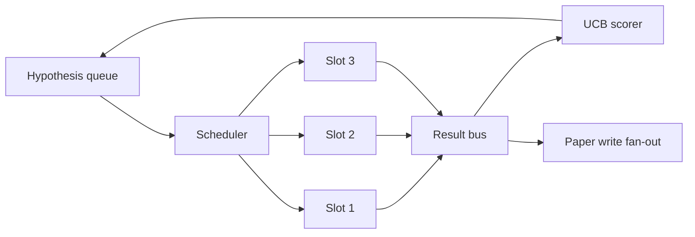
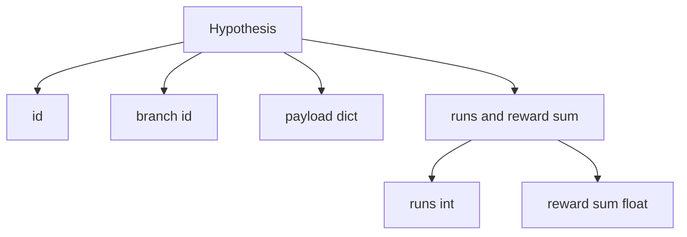
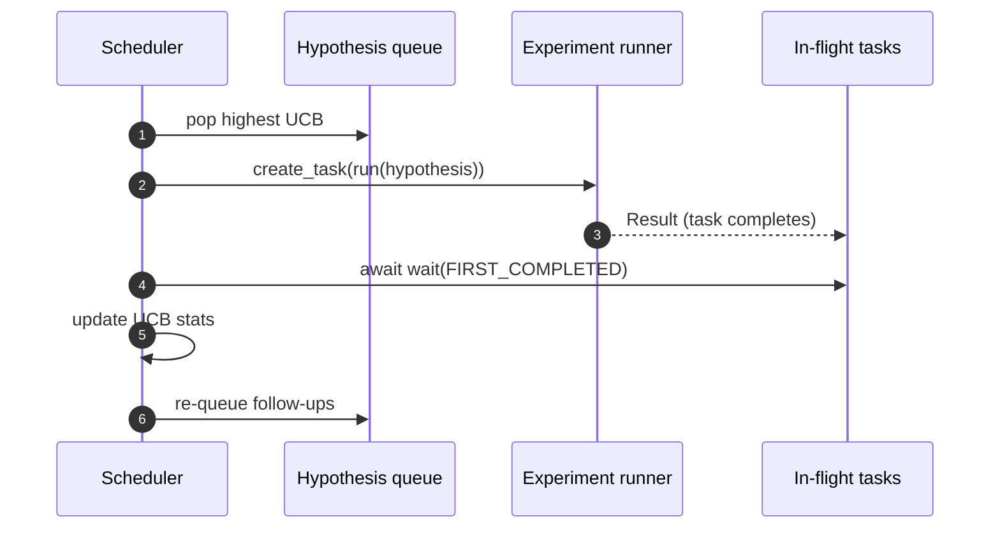

# Iteration Scheduler · 迭代调度器

> 没有调度器（scheduler）的研究循环只是一个产生了幻觉的队列。调度器是循环决定在哪停止探索的地方，而这个决定就是整场游戏。

**Type:** Build
**Languages:** Python
**Prerequisites:** Phase 19 lessons 50-53
**Time:** ~90 minutes

> A research loop without a scheduler is a queue with delusions. The scheduler is where the loop decides what to stop exploring, and that decision is the whole game.

## Learning Objectives · 学习目标

- 把研究工作流建模成一条假设队列喂给并行实验槽位（slots）、结果再回流（fan back in）的结构。
- 用 asyncio 并发跑多个实验，让调度器能让所有槽位保持忙碌。
- 用 UCB 给每条假设分支（branch）打分，让调度器能在不放弃探索的前提下剪掉低产分支。
- 把完成的结果扇出（fan out）到论文写作阶段和重新入队阶段，让高产分支孵化后续假设。
- 呈现逐迭代 trace：分支分数、槽位占用、剪枝决策。

```figure
ch-ucb-scheduler
```

> Model a research workflow as a hypothesis queue feeding parallel experiment slots whose results fan back in
> Run multiple experiments concurrently with asyncio so the scheduler can keep all slots busy
> Score each hypothesis branch with UCB so the scheduler can prune low-yield branches without abandoning exploration
> Fan out finished results to a paper-write stage and a re-queue stage so a high-yield branch spawns follow-up hypotheses
> Surface a per-iteration trace with branch scores, slot occupancy, and pruning decisions

## Why a scheduler, not a worklist · 为什么是调度器而不是工作清单

扁平的工作清单（worklist）按提交顺序跑任务。任务彼此独立时没问题。研究不独立：实验三的一个发现会改变实验四和实验五的优先级。一个读取结果回流并给队列重排的调度器，在单位算力上能完成更多有用的工作。

有意思的设计选择是打分规则。贪心打分器永远选当前领先者、从不探索。均匀打分器从不利用（exploit）。UCB（upper confidence bound，置信上界）是中间道路：利用领先者，同时为试得少的分支保留容量。

> A flat worklist runs jobs in submission order. That is fine when each job is independent. Research is not independent: a finding from experiment three changes the priority of experiments four and five. A scheduler that reads the result fan-in and reorders the queue gets more useful work done per unit of compute.
> The interesting design choice is the scoring rule. A greedy scorer always picks the current leader and never explores. A uniform scorer never exploits. UCB (upper confidence bound) is the middle path: exploit the leader while reserving capacity for branches that have been tried less.

## The system shape · 系统结构



队列装假设。一个槽位空出来时，调度器挑 UCB 最高的假设。每个槽位异步跑一个实验。完成的实验把结果扇到结果总线（result bus）上。总线更新来源分支的 UCB 统计，并在某分支的产出（yield）越过阈值时向论文写作阶段扇出。

> The queue holds hypotheses. The scheduler picks the highest-UCB hypothesis when a slot frees. Each slot runs an experiment asynchronously. Finished experiments fan their result onto the bus. The bus updates UCB statistics on the originating branch and fans out to the paper-write stage when a branch's yield crosses a threshold.

## The Hypothesis shape · Hypothesis 数据结构



`branch` 是 UCB 统计的键。多条假设可以共享一个分支（分支是研究方向，假设是其中的一次试验）。`runs` 是该分支完成实验的计数，`reward_sum` 是累计奖励。UCB 两者都读。

> `branch` is the key for UCB statistics. Multiple hypotheses may share a branch (the branch is the research direction; the hypothesis is one trial within it). `runs` is the count of completed experiments for that branch, `reward_sum` is the cumulative reward. UCB reads both.

## UCB scoring · UCB 打分

本课用的 UCB 公式是经典的 UCB1。

```text
ucb(branch) = mean_reward(branch) + c * sqrt( ln(total_runs) / runs(branch) )
```

`total_runs` 是所有分支完成的实验总数。`c` 是探索权重；本课默认 `sqrt(2)`。零运行的分支得到 `+inf`，所以未试过的分支永远最先被调度。平均奖励高的分支保持高分，直到其他分支追上来；跑了很多次却没什么奖励的分支，会被试得少的备选压过去。

剪枝门（pruning gate）与选择器（picker）分离。当一个分支的平均奖励在至少 `prune_after_runs` 次试验（默认 `3`）之后低于绝对下限（默认 `0.2`），剪枝把它从未来调度中移除。这让队列保持有界。

> The UCB formula used in this lesson is the classic UCB1.
> `total_runs` is the count of all experiments completed across all branches. `c` is the exploration weight; the lesson defaults to `sqrt(2)`. A branch with zero runs gets `+inf` so untried branches are always scheduled first. A branch with high mean reward keeps a high score until other branches catch up; a branch that runs many times without much reward gets eclipsed by less-run alternatives.
> The pruning gate is separate from the picker. Pruning removes a branch from future scheduling when its mean reward falls below an absolute floor (default `0.2`) after at least `prune_after_runs` trials (default `3`). This keeps the queue bounded.

## Parallel slots with asyncio · asyncio 并行槽位

调度器用 `asyncio.create_task` 驱动实验。每个任务运行实验 runner（一个 `async def` callable），返回一个 `Result`。主循环用 `asyncio.wait(..., return_when=asyncio.FIRST_COMPLETED)` 等待在飞（in-flight）任务集合，并在每次完成时触发打分更新。



三个槽位并发运行。主循环从不在单个实验上阻塞。槽位一空出来，调度器就立刻启动新任务，直到队列空了且没有在飞任务为止。

> The scheduler drives experiments with `asyncio.create_task`. Each task runs the experiment runner (an `async def` callable) that returns a `Result`. The main loop waits on the set of in-flight tasks with `asyncio.wait(..., return_when=asyncio.FIRST_COMPLETED)` and fires the scoring update on each completion.
> Three slots run concurrently. The main loop never blocks on a single experiment. The scheduler keeps starting new tasks as soon as a slot frees, until both the queue is empty and no tasks are in flight.

## Fan-out: paper triggers · 扇出：论文触发

当某分支的平均奖励越过 `paper_threshold`（默认 `0.7`）且该分支还没有产出过论文时，调度器把一个 `paper.trigger` 事件扇到输出列表上。下游，第五十四课的论文写作器会接住它。本课把触发捕获成一个列表，方便测试断言。

> When a branch's mean reward crosses `paper_threshold` (default `0.7`) and that branch has not yet produced a paper, the scheduler fans a `paper.trigger` event onto an output list. Downstream the paper writer from lesson fifty-four would pick this up. In this lesson the trigger is captured as a list so tests can assert it.

## Fan-out: follow-up hypotheses · 扇出：后续假设

当一个高产结果落地时，调度器可以调用用户提供的 `expander`，在同一分支上产出一条或多条后续假设。expander 是一个从 `Result` 到 `list[Hypothesis]` 的纯函数。本课附带的确定性 expander 对任何奖励超过论文阈值的结果产出两条后续。

> When a high-yield result lands, the scheduler can call the user-supplied `expander` to produce one or more follow-up hypotheses on the same branch. The expander is a pure function from `Result` to `list[Hypothesis]`. The lesson ships a deterministic expander that produces two follow-ups for any result whose reward exceeds the paper threshold.

## Budgets · 预算

两个预算保护调度器不会跑飞。

```text
max_experiments    : total count of experiments run across all branches
max_seconds        : wall-clock cap (asyncio time)
```

任一预算触发时，调度器停止调度新任务，等待在飞的那些，并返回最终 trace。trace 带 `stop_reason`。

> Two budgets protect the scheduler from runaway loops.
> When either fires, the scheduler stops scheduling new tasks, awaits the in-flight ones, and returns the final trace. The trace includes a `stop_reason`.

## The Trace and final report · Trace 与最终报告

每个调度决策（pick、dispatch、result、prune、fan-out）输出一个事件。最终报告汇总每分支统计、总运行数、总墙钟时间和已触发的论文触发。下一课（end-to-end demo）读这份报告来驱动论文写作器。

> Each scheduling decision (pick, dispatch, result, prune, fan-out) emits one event. The final report summarises per-branch stats, total runs, total wall-clock, and the paper triggers fired. The next lesson, the end-to-end demo, reads this report to drive the paper writer.

## How to read the code · 怎么读代码

`code/main.py` 定义了 `Hypothesis`、`Result`、`BranchStats`、`IterationScheduler`，以及一个返回带可预测奖励的 asyncio 实验 runner 的 `make_deterministic_runner` 工厂。runner 睡固定的 `delay_ms`（默认 `5ms`），让并发可观察。

`code/tests/test_scheduler.py` 覆盖：UCB 先挑未试分支、并行槽位占用、越过阈值时的论文触发、低产试验后的分支剪枝、扇出后续假设，以及预算退出（实验数和墙钟都测）。

> `code/main.py` defines `Hypothesis`, `Result`, `BranchStats`, `IterationScheduler`, and a `make_deterministic_runner` factory that returns an asyncio experiment runner with predictable rewards. The runner sleeps for a fixed `delay_ms` (default `5ms`) so concurrency is observable.
> `code/tests/test_scheduler.py` covers: UCB picks untried branches first, parallel slot occupancy, paper triggers when threshold is crossed, branch pruning after low-yield trials, fan-out follow-up hypotheses, and budget exit (both experiment count and wall clock).

## Going further · 走得更远

真实实现会想要三个扩展。第一，跨会话持久化 UCB 统计：当前统计在内存里；真实调度器会把它们存档（checkpoint），让重启保留已经花掉的探索预算。第二，多目标打分：每个结果输出一个向量而不是标量奖励，UCB 变成 Pareto 式选择器。第三，上下文老虎机（contextual bandits）：选择器以假设特征（长度、复杂度）为条件，相似假设共享探索。

调度器是研究超越工作清单的地方。UCB 一接上、槽位一并行，其他一切改进都叠加在它之上。

> Three extensions a real implementation will want. First, persistent UCB stats across sessions: the current statistics live in memory; a real scheduler would checkpoint them so a restart preserves the exploration budget already spent. Second, multi-objective scoring: instead of a scalar reward, each result emits a vector and UCB becomes a Pareto-style picker. Third, contextual bandits: the picker conditions on hypothesis features (length, complexity) so similar hypotheses share exploration.
> The scheduler is the place where research becomes more than a worklist. Once UCB is wired and the slots run in parallel, every other improvement composes on top.
