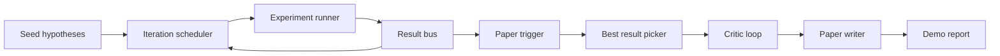
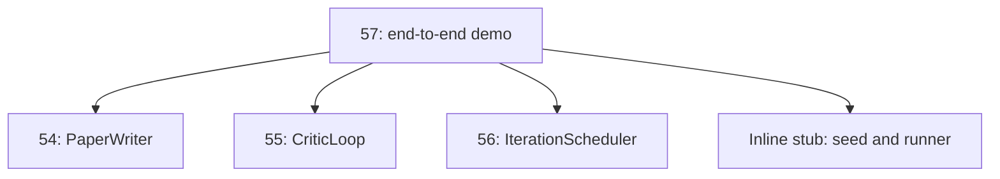
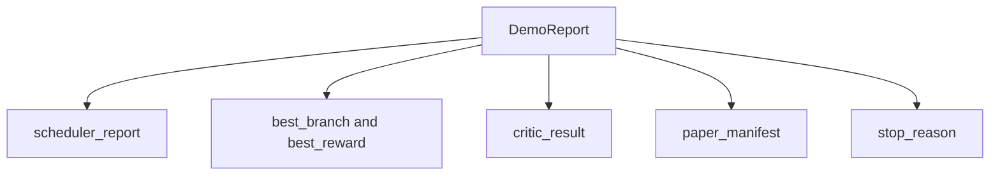

# End-to-End Research Demo · 端到端研究演示

> 演示就是你先前写下的每一份契约都必须组合起来的地方。任何一份泄漏，演示就是抓住它的那节课。

**Type:** Build
**Languages:** Python
**Prerequisites:** Phase 19 lessons 50-53
**Time:** ~90 minutes

> A demo is the place where every contract you wrote earlier has to compose. If any one of them leaks, the demo is the lesson that catches it.

## Learning Objectives · 学习目标

- 端到端把自动研究循环接线：假设种子、实验 runner、调度器、批评循环（critic loop）、论文写作器。
- 用普通的 Python import（而不是框架）组合前四门 Track D 课程的原语（primitives）。
- 把循环跑到自终止（self-terminating）的终点，输出一份列出每个阶段产出的演示报告。
- 保持演示确定性，让测试套件能断言最终形状。
- 在任一阶段契约破裂时呈现清晰的失败模式，让下一阶段不会带着坏输入继续跑。

```figure
ch-research-pipeline
```

> Wire the auto-research loop end to end: hypothesis seed, experiment runner, scheduler, critic loop, paper writer
> Compose the primitives from the four earlier Track D lessons through plain Python imports, not a framework
> Run the loop to a self-terminating end and emit a single demo report that lists every stage's output
> Keep the demo deterministic so the test suite can assert the final shape
> Surface a clear failure mode when any stage's contract breaks, so the next stage does not run with a broken input

## What composes here · 这里组合了什么



五个阶段。种子是三条假设的列表。调度器用三个并行槽位在它们上面跑六个实验。总线报告一或多个论文触发。选择器挑出唯一最好的结果。批评循环在那份结果建出的草稿上迭代。论文写作器输出最终的 LaTeX、BibTeX 和 manifest。

> Five stages. The seed is a list of three hypotheses. The scheduler runs six experiments across them with three parallel slots. The bus reports one or more paper triggers. The picker selects the single best result. The critic loop iterates on a draft built from that result. The paper writer emits the final LaTeX, BibTeX, and manifest.

## Why import, not copy · 为什么 import 而不是复制

之前的每门课都带一个 `main.py`，里面有公开的 dataclass 和函数。演示通过把 `sys.path` 调整到每门课的父目录来 import 它们。这不是框架接线；这就是之前课程里测试文件已经在用的同一种 import。



内联 stub 替代第五十到五十三课：一个小型种子假设生成器和一个同步奖励函数。用户调整两个 import，就能把内联 stub 换成那几课的真原语。

> Each earlier lesson ships a `main.py` with public dataclasses and functions. The demo imports them by adjusting `sys.path` to the parent directory of each lesson. This is not framework wiring; it is the same import the test files in the earlier lessons already use.
> The inline stub stands in for lessons fifty through fifty-three: a small generator of seed hypotheses and a synchronous reward function. The user can swap the inline stub for the real primitives from those lessons by adjusting two imports.

## Determinism guarantees · 确定性保证

演示在构造上是确定性的。实验 runner 是带种子的 numpy。批评循环的修订者按固定顺序走固定维度。论文写作器的正文生成器是第五十四课那个 mock。调度器的 UCB 选择器按迭代顺序打破平局，不做随机选择。

给定同一种子，演示输出同一份报告。测试把演示跑两遍、比对 manifest，以此断言这个性质。

> The demo is deterministic by construction. The experiment runner is seeded numpy. The critic loop's reviser walks fixed dimensions in fixed order. The paper writer's prose generator is the mocked one from lesson fifty-four. The scheduler's UCB picker breaks ties on iteration order, not random choice.
> Given the same seed, the demo emits the same report. The test asserts this property by running the demo twice and comparing the manifest.

## The demo report shape · 演示报告结构



每个字段都原封不动来自上游阶段。演示不变换任何输出；它只组合它们。这就是这个演示所是的那个测试。

> Each field comes verbatim from the upstream stage. The demo does not transform any output; it composes them. That is the test the demo is.

## Failure mode handling · 失败模式处理

每个阶段要么成功，要么抛出一个带类型的错误。

```text
Scheduler ........ returns SchedulerReport with stop_reason
                   in {queue_empty, max_experiments, deadline}
Best-result pick . raises NoTriggerError if no paper trigger fired
Critic loop ...... returns LoopResult with status converged or stopped
Paper writer ..... raises PaperValidationError on contract break
```

任何阶段失败都会以一个带类型的异常短路整个演示。测试钉住这个契约：`test_no_triggers_raises_typed_error` 和 `test_best_picker_raises_when_no_triggers` 断言当没有分支触发时，选择器抛出 `NoTriggerError` / `BestResultError`，且写作器从不被调用。

> Each stage either succeeds or raises a typed error.
> A failure in any stage short-circuits the demo with a typed exception. The tests pin this contract: `test_no_triggers_raises_typed_error` and `test_best_picker_raises_when_no_triggers` assert the picker raises `NoTriggerError` / `BestResultError` when no branch fired a trigger, and the writer is never invoked.

## The best-result picker · 最佳结果选择器

调度器按分支发出论文触发。选择器挑出在所有触发上平均奖励最高的分支。平局按分支 id 的字母序打破，所以演示是确定性的。选择器是一个小的纯函数；测试在一个固定的调度器报告上钉住它。

> The scheduler emits paper triggers per branch. The picker selects the branch with the highest mean reward across all triggers. Ties break alphabetically by branch id so the demo is deterministic. The picker is a small pure function; the test pins it on a fixed scheduler report.

## Wiring the critic loop · 接线批评循环

第五十五课的批评循环操作一个 `MiniPaper`。演示从选中的分支构建 `MiniPaper`：用分支 id 填充摘要、播种两个 section（Introduction 和 Results）、并按分支的平均奖励设置 `originality_tag`（`>= 0.8` 为 high，`>= 0.6` 为 medium，否则 low）。

修订者随后把草稿迭代到收敛。输出进入论文写作器。

> The critic loop in lesson fifty-five operates on a `MiniPaper`. The demo builds a `MiniPaper` from the picked branch by populating the abstract with the branch id, seeding two sections (Introduction and Results), and setting `originality_tag` from the branch's mean reward (high if `>= 0.8`, medium if `>= 0.6`, low otherwise).
> The reviser then iterates the draft to convergence. The output goes into the paper writer.

## Wiring the paper writer · 接线论文写作器

第五十四课的论文写作器操作带插图和参考文献的完整 `Paper` 形状。演示通过 `mini_to_full_paper` 升级收敛的 `MiniPaper`：为选中的分支附一张插图，并附上一个小型合成参考文献，由批评家建议的 cite 键的并集构建。演示添加的每个 cite 也都加进参考文献列表，所以校验通过。

> The paper writer in lesson fifty-four operates on the full `Paper` shape with figures and bibliography. The demo upgrades the converged `MiniPaper` via `mini_to_full_paper`, which attaches one figure for the selected branch and a small synthetic bibliography built from the union of cite keys the critic suggested. Every cite the demo adds is also added to the bibliography list, so validation passes.

## How to read the code · 怎么读代码

`code/main.py` 定义了 `BestResultError`、`NoTriggerError`、`DemoReport`、`pick_best_branch`、`build_mini_paper`、`mini_to_full_paper` 和 `run_demo`。顶部的 import 调整一次 `sys.path`，然后从各自的课程拉入 `PaperWriter`、`CriticLoop` 和 `IterationScheduler`。

`code/tests/test_e2e.py` 覆盖：演示端到端跑通且报告的五个字段全部填充、跨两次运行的确定性、没有分支越过阈值时的 NoTriggerError、写作器契约破裂时的 PaperValidationError、论文 manifest 包含选中分支的插图，以及调度器停止原因是期望值之一。

> `code/main.py` defines `BestResultError`, `NoTriggerError`, `DemoReport`, `pick_best_branch`, `build_mini_paper`, `mini_to_full_paper`, and `run_demo`. The imports at the top adjust `sys.path` once and pull `PaperWriter`, `CriticLoop`, and `IterationScheduler` from their lessons.
> `code/tests/test_e2e.py` covers: demo runs end to end and emits a report with all five fields populated, determinism across two runs, NoTriggerError when no branch crosses the threshold, PaperValidationError when the writer's contract breaks, paper manifest contains the picked branch's figure, and the scheduler stop reason is one of the expected values.

## Going further · 走得更远

演示变绿之后值得接上的三个扩展。第一，持久状态：每个阶段的结果写进一个小型 JSON 存储，重启时可以恢复而不必重跑便宜的阶段。第二，仪表盘：调度器和批评循环的 trace 事件渲染成一条时间线。第三，真实模型调用：把 mock 正文生成器和确定性批评家换成模型驱动的；接线不变。

演示的职责是证明组合就是架构。五门课、四个 import、一份报告。下次你加一个阶段，接线正好长一行。

> Three extensions worth wiring once the demo is green. First, persistent state: each stage's result writes to a small JSON store so a restart can resume without re-running the cheap stages. Second, a dashboard: the trace events from the scheduler and critic loop render as a single timeline. Third, real model calls: swap the mocked prose generator and the deterministic critic for model-driven ones; the wiring does not change.
> The demo's job is to prove that composition is the architecture. Five lessons, four imports, one report. The next time you add a stage, the wiring grows by exactly one line.
