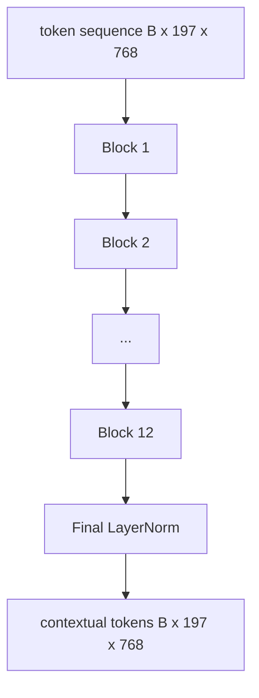
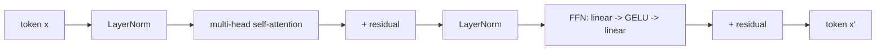

# Vision Transformer Encoder · 视觉 Transformer 编码器

只靠图块自己是「看」不见东西的。一个 12 层、12 个注意力头的 pre-LN transformer，把图块 token 序列变成上下文 token（contextual token）序列，CLS token 在自己的最终隐藏态里池化出整张图的特征。本课是每个现代视觉-语言模型的机房。

> Patches alone do not see. A 12-layer pre-LN transformer with 12 attention heads turns the sequence of patch tokens into a sequence of contextual tokens, with the CLS token pooling whole-image features in its final hidden state. This lesson is the engine room of every modern vision-language model.

**Type:** Build
**Languages:** Python
**Prerequisites:** Phase 19 lessons 30-37 (Track B foundations)
**Time:** ~90 minutes

## Learning Objectives · 学习目标

- 实现带多头自注意力（multi-head self-attention）和前馈子层的 pre-LN transformer 块。
- 用 12 个块、每块 12 个头，堆叠出 ViT-Base 编码器。
- 把第 58 课的图块前端接入编码器，跑一次前向传播。
- 验证 CLS token 聚合了来自每个图块的信息。

> Implement a pre-LN transformer block with multi-head self-attention and a feed-forward sub-layer.
> Stack 12 blocks with 12 heads to form a ViT-Base encoder.
> Wire the patch front end from lesson 58 into the encoder and run a forward pass.
> Verify that the CLS token aggregates information from every patch.

## The Problem · 问题在哪

图块嵌入产出的是 197 个 token 的序列，每个都是对其他图块一无所知的向量。一张猫的图，需要每个图块知道哪些图块里有胡须、哪些是背景、哪些是眼睛。transformer 就是建立这种「知晓」的机制，一次加一层注意力。没有它，图块前端只是一个聪明却毫无理解力的分词器。

标准配方是：深度 12 个块、宽度 12 个头，pre-LayerNorm 放置、GELU 激活、前馈层 4 倍扩展。这个配方是 CLIP ViT-L、SigLIP、DINOv2、Qwen-VL 系列、InternVL 以及 2025-2026 年所有其他开源权重（open-weight）视觉编码器的脊柱。这个配方足够稳定，你读这些论文时可以默认就是这个块形状，除非论文明确说不是。

> The patch embedding produces a sequence of 197 tokens, each one a vector with no awareness of any other patch. ... The transformer is the mechanism that builds that awareness, one attention layer at a time. Without it, the patch front end is a clever tokenizer with no understanding.
> The standard recipe is twelve blocks deep, twelve heads wide, with pre-LayerNorm placement, GELU activation, and a feed-forward expansion of 4x. That recipe is the spine of CLIP ViT-L, SigLIP, DINOv2, the Qwen-VL family, InternVL, and every other open-weight vision encoder of 2025-2026.

## The Concept · 概念





### Pre-LN vs post-LN · Pre-LN 还是 post-LN

原始 Transformer 把 LayerNorm 放在残差之后。pre-LN（LayerNorm 放在每个子层之前）是每个现代视觉-语言模型都在用的版本，因为它不需要学习率预热（warm-up）技巧就能稳定训练。两者只差前向传播里的一行代码，但在 12 层以上的深度，梯度流有天壤之别。

> Original Transformer placed LayerNorm after the residual. Pre-LN (LayerNorm before each sub-layer) is the version every modern vision-language model uses, because it trains stably without learning-rate warm-up tricks. The difference is one line in the forward pass, and the gradient flow at depth 12+ is night and day.

### Multi-head self-attention · 多头自注意力

每个头把 token 向量投影成自己的 `(query, key, value)` 三元组，维度为 `head_dim = hidden / num_heads`。`hidden = 768`、`heads = 12` 时，每个头 `dim = 64`。12 个头并行做注意力，输出拼接回 768 维，再过一个输出投影。多头的意义在于：一个头可以学「看向猫眼」，另一个头学「看向背景渐变」，互不干扰。

> Each head projects the token vector to its own `(query, key, value)` triple with dimension `head_dim = hidden / num_heads`. With `hidden = 768` and `heads = 12`, each head has `dim = 64`. ... The point of multi-head is that one head can learn "attend to the cat eye" while another learns "attend to the background gradient" without interference.

### Why the 4x feed-forward expansion · 为什么前馈层要扩展 4 倍

FFN 走 `hidden -> 4 * hidden -> hidden`，中间夹 GELU。系数 4 是经验值，从 2017 年起在语言和视觉 transformer 里一直成立。更小（2 倍）欠拟合；更大（8 倍）在固定数据预算下过拟合。MLP 是模型存储大部分已学事实的地方，更宽的中间层就是它们待的位置。

> The FFN goes `hidden -> 4 * hidden -> hidden` with GELU in the middle. The factor 4 is empirical and has held across language and vision transformers since 2017. ... The MLP is where the model stores most of its learned facts, and the wider middle is where they sit.

| 组件 | ViT-Base 规模下的参数量 |
|------|------------------------|
| 每块 qkv 投影 | `3 * 768 * 768 = 1.77M` |
| 每块输出投影 | `768 * 768 = 590K` |
| 每块 FFN（4 倍扩展） | `2 * 768 * 4 * 768 = 4.72M` |
| 每块 LayerNorm | `4 * 768 = 3K` |
| 每块合计 | 约 7.1M |
| 12 个块 | 约 85M |
| 加上前端 | 总计约 86M |

ViT-Base 是一个 86M 参数的编码器。按 2026 年的标准这很小（SigLIP-So400M 是 400M，Qwen-VL 的 ViT 是 675M），但除去宽度和深度，架构完全相同。

### Causal mask or not? · 要不要因果掩码？

视觉 Transformer 是 encoder-only、双向的：token `i` 可以对任意 token `j` 做注意力。不加掩码。第 61 课解码器侧的交叉注意力（cross-attention）会用到因果掩码（causal mask），但在视觉编码器内部，注意力是全连接的。

> Vision Transformers are encoder-only and bidirectional: token `i` may attend to token `j` for any pair. No mask. The decoder-side cross-attention in lesson 61 will use a causal mask, but inside the vision encoder, attention is fully connected.

### What the CLS token learns · CLS token 学到了什么

CLS token 以一个可学习参数的身份出发，自己没有任何图块内容，通过每一层的注意力不断积累信息。到最后一层，CLS 那一行就是整张图的向量摘要；下游的头把这个单一向量投影成类别 logits、对比嵌入（contrastive embedding），或给文本解码器用的交叉注意力键（key）。

> The CLS token starts as a learned parameter, has no patch content of its own, and accumulates information through attention across every block. By the final layer, the CLS row is a vector summary of the whole image; downstream heads project this single vector into class logits, contrastive embeddings, or cross-attention keys for a text decoder.

```figure
ch-cls-funnel
```

## Build It · 动手造

`code/main.py` 实现了：

- `MultiHeadSelfAttention`：带 `qkv` 和输出投影、缩放点积注意力的数学，以及形状断言。
- `FeedForward`：4 倍扩展的 GELU MLP。
- `Block`：用残差把注意力和前馈子层组合起来的 pre-LN 块。
- `ViT`：12 个块的堆叠，最后跟一个 LayerNorm。
- `VisionEncoder`：把第 58 课的 `VisionFrontEnd` 接到 `ViT` 堆叠上，暴露的 `forward()` 返回上下文序列和池化后的 CLS 向量。
- 一个演示：把合成的 224x224 测试图送进完整编码器，打印输入形状、输出形状、参数量，以及每隔一层打印一次 CLS 范数。

运行：

```bash
python3 code/main.py
```

输出：测试图被编码成 `(1, 197, 768)` 张量。随着层叠组合，CLS 范数逐步上漂，最后在最终 LayerNorm 处稳定下来。总参数量报告约 86M。

> Output: the fixture is encoded to a `(1, 197, 768)` tensor. The CLS norm drifts upward as the layers compose, then stabilizes at the final LayerNorm. Total parameters report at about 86M.

## Use It · 实战用法

这里定义的编码器，除去宽度和深度的差异，就是 2025-2026 年每个开源权重 VLM 内置的那一套块堆叠。差异在于：

- **宽度与深度。** ViT-Large 是 `hidden=1024, depth=24, heads=16`；SigLIP So400M 是 `hidden=1152, depth=27, heads=16`。同一个块。
- **池化头。** CLS 池化（本课） vs 平均池化（SigLIP） vs 注意力池化（更晚的 VLM）。
- **位置处理。** 固定正弦（第 58 课） vs 可学习 1D vs ALiBi vs 2D RoPE。块的数学不变。
- **Register token。** DINOv2 前置 4 个额外的可学习 token。一行代码的事。

这套块堆叠是基座。接下来的课（60-63）都站在它上面。

> The encoder defined here is, up to width and depth, the same block stack that ships inside every open-weight VLM in 2025-2026. Differences live in:
> - **Width and depth.** ViT-Large is `hidden=1024, depth=24, heads=16`; SigLIP So400M is `hidden=1152, depth=27, heads=16`. Same block.
> - **Pooling head.** CLS pooling (this lesson) vs average pooling (SigLIP) vs attention pooling (later VLMs).
> - **Position handling.** Fixed sinusoidal (lesson 58) vs learned 1D vs ALiBi vs 2D RoPE. The block math is unchanged.
> - **Register tokens.** DINOv2 prepends 4 extra learned tokens. One line of code.
> This block stack is the substrate. The next lessons (60-63) stand on top of it.

## Tests · 测试

`code/test_main.py` 覆盖：

- 单个块保持形状，且对输入 batch 大小不变
- 注意力分数沿 key 轴求和为 1（softmax 健全性）
- 残差路径连接正确（零输入仍能通过 CLS token 产生非零输出）
- 4 层堆叠的前向传播产生正确形状
- 梯度能从 CLS 输出流回图块投影

运行：

```bash
python3 -m unittest code/test_main.py
```

## Exercises · 练习

1. 加入 register token（CLS 之后前置 4 个可学习向量）并重跑。用最后一层 softmax 分布的熵来比较注意力图的平滑度。

2. 把 pre-LN 换成 post-LN，在一个合成形状分类器上训练一个 epoch。观察哪个不需要学习率预热就能稳定训练。

3. 把因果掩码实现为 `attn_mask` 参数，让同一个块可以复用为解码器块。掩码形状是 `(seq, seq)`，下三角。

4. 用 `torch.profiler` 在 batch size 1、8、64 下分析前向传播。占墙钟时间的是 MLP 层，不是注意力。

5. 把一个注意力头的 q-k-v 投影换成低秩 LoRA 适配器，冻结其余部分，验证梯度只流向你预期的位置。

## Key Terms · 术语表

| 术语 | 含义 |
|------|------|
| Pre-LN | LayerNorm 放在每个子层之前而不是之后 |
| Self-attention（自注意力） | 同一序列中每个 token 对其余所有 token 做注意力 |
| Multi-head（多头） | 隐藏维度被拆分到 `H` 个独立的注意力头上 |
| FFN expansion（FFN 扩展） | 前馈层先放宽到 `4 * hidden` 再收缩回去 |
| CLS pooling（CLS 池化） | 用第一个 token 的最终隐藏态作为图像摘要 |

## Further Reading · 延伸阅读

- An Image is Worth 16x16 Words（ViT, 2021）—— 编码器配方的出处。
- DINOv2（2023）—— register token 与自监督预训练目标。
- SigLIP（2023）—— 平均池化变体，以及第 62 课会用到的 sigmoid 对比损失。
