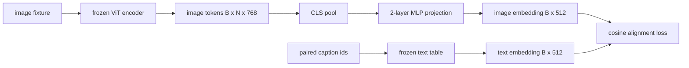

# Projection Layer for Modality Alignment · 模态对齐的投影层

视觉编码器产出图像 token，文本解码器消费文本 token，两者活在不同的向量空间里。一个小的两层 MLP 把图像 token 投影进文本嵌入空间，再用配对字幕（caption）上的余弦对齐损失（cosine alignment loss）把两个空间拉到一致。这个投影是视觉-语言模型里最小的部件，却是对迁移（transfer）最重要的部件。

> A vision encoder produces image tokens. A text decoder consumes text tokens. The two live in different vector spaces. A small two-layer MLP projects image tokens into the text embedding space, and a cosine alignment loss against a paired caption pulls the two spaces into agreement. That projection is the smallest piece of a vision-language model and the one that matters most for transfer.

**Type:** Build
**Languages:** Python
**Prerequisites:** Phase 19 lessons 30-37 (Track B foundations)
**Time:** ~90 minutes

## Learning Objectives · 学习目标

- 构建一个两层 MLP 投影，把图像特征映射进文本嵌入空间。
- 构建一个模拟（mock）文本嵌入表（不用预训练分词器，不用真实语料）。
- 在投影后的图像 token 与配对字幕嵌入之间计算余弦对齐损失。
- 在冻结视觉编码器、冻结文本表的前提下，只训练投影层。

> Build a two-layer MLP projection that maps image features into the text embedding space.
> Construct a mock text embedding table (no pretrained tokenizer, no real corpus).
> Compute a cosine alignment loss between projected image tokens and a paired caption embedding.
> Train the projection alone with a frozen vision encoder and a frozen text table.

## The Problem · 问题在哪

你有一个视觉编码器（第 58-59 课），产出维度为 `vision_hidden = 768` 的 token；你还有一个想接上去的文本解码器，嵌入维度是 `text_hidden = 512`（换成别的数照样成立）。解码器期望的是「文本形状」的 token，而图像 token 不是：它们活在编码器在纯视觉预训练中学到的一组基（basis）里，与解码器的词向量毫无关系。

两层 MLP 投影（linear、GELU、linear）架起了这座桥。它足够小（约 `768 * 1024 + 1024 * 512 = 1.3M` 参数），单张 GPU 几分钟就能训完，而且它是对齐（alignment）阶段唯一必须学习的部件。视觉编码器保持冻结，文本嵌入表保持冻结，只有投影在动。这就是 LLaVA 在 2023 年发布的配方，BLIP-2 把它重构成 Q-Former，此后的每个开源权重（open-weight）VLM 都以某种形式采纳了它。

> You have a vision encoder (lessons 58-59) producing tokens of dimension `vision_hidden = 768`. ... The decoder expects text-shaped tokens. The image tokens are not text-shaped: they live in a basis the encoder learned during vision-only pretraining, with no relationship to the decoder's word vectors.
> Two-layer MLP projection (linear, GELU, linear) bridges the gap. ... The vision encoder stays frozen. The text embedding table stays frozen. Only the projection moves. This is the recipe LLaVA shipped in 2023, that BLIP-2 reframed as a Q-Former, and that every open-weight VLM since has adopted in some form.

## The Concept · 概念



### Pooling before projection · 投影前先池化

视觉编码器输出 197 个 token，而文本侧只有一个字幕级嵌入。要对齐，每个样本需要一个图像级向量。CLS 池化最简单：取编码器的第一个 token 去投影。对全部 197 个 token 做平均池化（mean pooling）是另一个选项，SigLIP 用的就是它。两种方式都是把 197 个向量池成一个。

> The vision encoder emits 197 tokens. The text side has a single caption-level embedding. To align them you need one image-level vector per sample. CLS pooling is the simplest: take the first token from the encoder and project it. Mean pooling over all 197 tokens is another option and is what SigLIP uses. Either pools 197 vectors down to one.

### Why two layers and not one · 为什么两层而不是一层

单个线性投影能旋转、能缩放，但当两个空间存在曲率失配时，它修不好基。两个线性层之间的 GELU 给了投影一次非线性弯折，经验上足以把 CLIP 风格的特征对齐到语言模型嵌入。更深的投影（LLaVA-NeXT 用了 GLU；Qwen-VL 用了一叠注意力层）属于扩展；两层 MLP 是教科书基线，也是 BLIP-2 的 Q-Former 投影头底层实际搭载的形态。

> A single linear projection can rotate and rescale but cannot fix the basis if the two spaces have curvature mismatches. GELU between two linear layers gives the projection one non-linear bend, which is empirically enough to align CLIP-style features to language model embeddings. ... two-layer MLP is the canonical baseline and is what BLIP-2's Q-Former projection head ships with under the hood.

| 层 | 形状 | 参数量 |
|----|------|--------|
| fc1 | `(vision_hidden, projection_hidden)` | `768 * 1024 + 1024` |
| 激活 | GELU | 0 |
| fc2 | `(projection_hidden, text_hidden)` | `1024 * 512 + 512` |

一个 `768 -> 1024 -> 512` 的头大约 1.3M 参数。

### Cosine alignment loss · 余弦对齐损失

「对齐」不等于 `image_emb == text_emb`。对齐的意思是：在联合空间里，`image_emb` 与 `text_emb` 指向同一个方向。余弦损失是 `1 - cos_sim(image, text)`，取值从 0（完全对齐）到 2（方向相反）。训练把每一对的这个值推向零。第 62 课会推广到批内对比的 InfoNCE：每张图都要比批里其他任何字幕更接近自己的字幕；本课用逐对（per-pair）版本，好让动力学看得见。

> Align does not mean `image_emb == text_emb`. Align means `image_emb` points in the same direction as `text_emb` in the joint space. The cosine loss is `1 - cos_sim(image, text)`, ranging from 0 (perfectly aligned) to 2 (opposite). ... Lesson 62 generalizes to a contrastive batch (InfoNCE) where every image must be closer to its own caption than to any other caption in the batch; this lesson uses the per-pair version so the dynamics are visible.

### Frozen encoder is the trick · 冻结编码器才是关键

视觉编码器有 86M 参数，文本表又有几百万。用模拟语料把它们从头全训是不可能的。把两者都冻结，意味着投影的 1.3M 参数是唯一在变的东西，在合成配对上跑几百步就足以把损失压下去。这正是每个基于适配器（adapter）的 VLM 的运行形态：重的部分冻结，轻的桥在训练。

> The vision encoder has 86M parameters. The text table has another few million. Training all of them from a mock corpus is a non-starter. Freezing both means the projection's 1.3M parameters are the only thing changing, and a few hundred steps on synthetic pairs is enough to drive the loss down. This is exactly the operational shape of every adapter-based VLM: the heavy parts stay frozen, the light bridge trains.

```figure
ch-projection-bridge
```

## Build It · 动手造

`code/main.py` 实现了：

- `MLPProjector(in_dim, hidden_dim, out_dim)`：带 GELU 激活的两层线性 MLP。
- `MockTextEmbedding(vocab_size, dim)`：由种子确定性初始化的冻结嵌入表。
- `make_pair(seed, vocab_size)`：合成一个（图像, 字幕）配对样本。字幕是短的 id 序列；字幕嵌入是对 token 嵌入做平均池化得到。
- `cosine_alignment_loss(image_emb, text_emb)`：逐对的 `1 - cos_sim` 目标。
- 一个训练循环：在 32 个合成配对上（循环使用）把投影训 200 步，视觉编码器和文本表冻结，每 25 步打印一次损失。

运行：

```bash
python3 code/main.py
```

输出：训练日志显示损失从初始的约 1.07 在 200 步内降到约 0.80，证明仅靠投影就能把图像 token 拉向文本空间。最后还会打印每一对的最终余弦相似度。

> Output: training reports drop from initial loss around 1.07 down to about 0.80 within 200 steps, demonstrating that the projection alone can pull image tokens toward the text space. The final cosine similarity per pair is also printed.

## Use It · 实战用法

同样的模式出现在每个开源权重 VLM 里：

- **LLaVA 1.5。** 两层 GELU MLP 投影，从 CLIP-ViT-L 的 hidden 到 LLaMA 的嵌入维度。冻结视觉编码器、冻结 LLM，只训练投影（第二阶段再解冻 LLM）。
- **BLIP-2。** Q-Former 让 32 个可学习 query token 对图像 token 做交叉注意力，再投影到 LLM 嵌入维度。Q-Former 最末端的投影头就是本课 MLP 的对应物。
- **MiniGPT-4。** 单层线性投影，从 BLIP-2 Q-Former 的输出到 Vicuna 的嵌入维度。
- **Qwen-VL。** 多层交叉注意力适配器，但最后一块同样是投影到 LM 嵌入维度。

形状各异，角色相同：池化图像 token，投影到文本嵌入维度，单独训练。

> The same pattern shows up in every open-weight VLM:
> - **LLaVA 1.5.** Two-layer GELU MLP projection from CLIP-ViT-L hidden to LLaMA embedding dim. Frozen vision encoder, frozen LLM, train only the projection (then unfreeze the LLM in stage two).
> - **BLIP-2.** Q-Former takes 32 learned query tokens through cross-attention against image tokens, then projects to the LLM embedding dim. The projection head at the very end of Q-Former is the analog of this lesson's MLP.
> The shape varies but the role is identical: pool image tokens, project to text embedding dim, train alone.

## Tests · 测试

`code/test_main.py` 覆盖：

- 投影器输出形状符合配置的 `out_dim`
- 冻结的文本嵌入表中 `requires_grad` 参数为零
- 余弦损失在相同向量上为 0，在反平行向量上为 2
- 一次反向传播后投影器有梯度流动
- 训练循环在 step 0 到 step 200 之间降低了损失

运行：

```bash
python3 -m unittest code/test_main.py
```

## Exercises · 练习

1. 把 CLS 池化换成对 196 个图块 token 的平均池化，比较 200 步后的最终损失。合成数据上平均池化通常收敛更快；自然图像上 CLS 更省样本。

2. 给余弦损失加一个可学习的标量温度（`cos / tau`），观察 `tau` 太小（梯度噪声）或太大（损失停在高位平台）时会发生什么。

3. 把两层 MLP 换成单个线性层，量化损失差距。非线性在自然图像特征上影响更大，在合成特征上影响较小。

4. 给投影器权重加一个小的 L2 惩罚，观察它与余弦对齐的相互作用（余弦对尺度不变，所以惩罚主要是收缩没在用的方向）。

5. 把投影器权重持久化，然后重新加载，在不跑视觉编码器反向传播的情况下做推理，验证部署时只需要投影器。

## Key Terms · 术语表

| 术语 | 含义 |
|------|------|
| Modality alignment（模态对齐） | 让图像嵌入与文本嵌入在同一个共享空间里可比较 |
| Projection head（投影头） | 把一个空间映射到另一个空间的小模块，通常是两层 MLP |
| Cosine similarity（余弦相似度） | 点积除以 L2 范数的乘积 |
| Frozen encoder（冻结编码器） | 视觉（或文本）模型的所有参数都设为 `requires_grad=False` |
| Mock corpus（模拟语料） | 用合成配对让训练不依赖数据集下载 |

## Further Reading · 延伸阅读

- LLaVA 论文 —— 两阶段训练（先投影，再解冻 LM）。
- BLIP-2 论文 —— Q-Former 作为可学习的投影替代方案。
- Qwen-VL 技术报告 —— 用交叉注意力适配器当更深的投影头。
