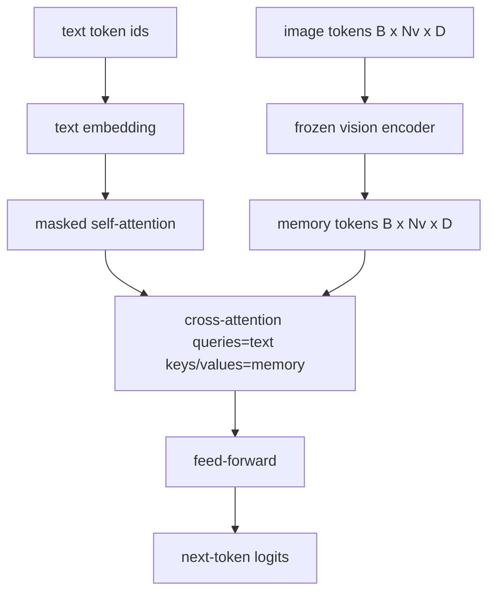
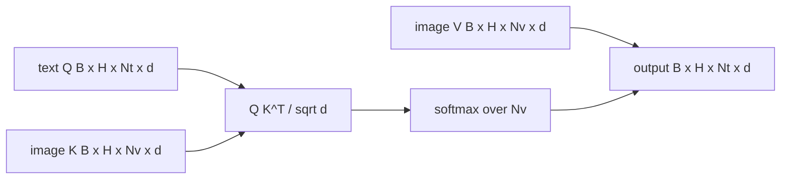

# Cross-Attention Fusion · 交叉注意力融合

投影层对齐的是「一个图像向量对一个字幕向量」。真正的视觉-语言解码器需要每个文本 token 都能注意到每个图块 token，让模型把每个词落到（ground）一个区域上。交叉注意力（cross-attention）就是这种落地发生的方式：文本发查询（query），视觉的键（key）和值（value）作答。本课构建交叉注意力块、因果文本自注意力，以及让两者都合法的掩码形状。

> The projection layer aligns one image vector with one caption vector. A real vision-language decoder needs every text token to attend to every patch token, so the model can ground each word in a region. Cross-attention is how that grounding happens. The text queries; the vision keys and values answer. This lesson builds the cross-attention block, the causal text self-attention, and the mask shapes that keep both legal.

**Type:** Build
**Languages:** Python
**Prerequisites:** Phase 19 lessons 30-37 (Track B foundations)
**Time:** ~90 minutes

## Learning Objectives · 学习目标

- 实现多头交叉注意力：query 流是文本，key/value 流是视觉。
- 组装一个解码器块：因果自注意力 + 交叉注意力 + 前馈。
- 把掩码形状搞对：自注意力用因果掩码，交叉注意力不加掩码。
- 用成批的文本 token 和固定的图像 token 池跑一次前向传播。

> Implement multi-head cross-attention where the query stream is text and the key/value stream is vision.
> Compose a decoder block: causal self-attention + cross-attention + feed-forward.
> Get the mask shapes right: causal mask for self-attention, no mask for cross-attention.
> Run a forward pass with batched text tokens and a fixed pool of image tokens.

## The Problem · 问题在哪

把图像 token 和文本 token 拼接成一个序列，是一种融合选项（早期融合，early fusion，Chameleon 和 Emu3 走的路）。交叉注意力是另一种（后期融合，late fusion，Flamingo 开创、此后每个 Flamingo 形状的解码器都在抄的路）。后期融合里，文本解码器只在纯文本 token 上运行，每一层都通过交叉注意力伸进图像流。

后期融合有两大优势。第一，文本流保持干净，模型保住纯文本能力。第二，图像流每张图只算一次、每个解码步都复用，所以即使字幕很长，生成也便宜。代价是每个块多一个注意力子层。

> Concatenating image tokens and text tokens into one sequence is one fusion option (early fusion, the path Chameleon and Emu3 take). Cross-attention is the other (late fusion, the path Flamingo introduced and that every Flamingo-shaped decoder since has copied). In late fusion, the text decoder runs on text-only tokens and reaches over into the image stream through cross-attention at every layer.
> Late fusion has two advantages. First, the text stream stays clean and the model preserves text-only capabilities. Second, the image stream is computed once per image and reused for every decode step, so generation is cheap even for long captions. The cost is one extra attention sub-layer per block.

## The Concept · 概念





### Mask shapes · 掩码形状

解码器块里的两种注意力需要不同的掩码：

| 注意力 | Query 长度 | Key 长度 | 掩码 | 原因 |
|--------|-----------|----------|------|------|
| 自注意力 | `Nt`（文本） | `Nt`（文本） | 因果：下三角 `(Nt, Nt)` | 自回归时文本 token 不能偷看未来 |
| 交叉注意力 | `Nt`（文本） | `Nv`（视觉） | 无掩码 | 每个文本位置都能看见整张图 |

本课带了一个形状校验函数，让你把两者搞混的错误以 `ValueError` 的形式爆出来，而不是一条悄悄坏掉的 loss 曲线。

> The two attentions inside a decoder block need different masks:
> The lesson includes one shape-validation function so the mistake of mixing them up surfaces as a `ValueError` instead of a silently broken loss curve.

### Why no mask on cross-attention · 为什么交叉注意力不加掩码

图像在任何文本生成之前就被完整观测过了。字幕的第 `t` 个 token 可以注意图像的任意图块；图像图块之间没有时间顺序。一些 Flamingo 变体在交错多张图和多个文本段时会加逐样本（per-sample）的掩码模式，但对「单图 + 一条字幕」的场景，交叉注意力看得见一切。

> The image is fully observed before any text is generated. Token `t` of the caption may attend to any patch of the image; there is no temporal order on image patches. ... for a single image plus a caption, cross-attention sees everything.

### Key/value caching · KV 缓存

图像的 key 和 value 在解码开始时算一次，存进缓存。每个新文本 token 直接用缓存，不重算。这就是推理时字幕生成快的原因：重的 ViT 只跑一次；交叉注意力为每一步复用它的 key 和 value。本课把这个缓存暴露出来，并测试缓存命中路径。

> The image keys and values are computed once at the start of the decode and held in a cache. Each new text token uses the cache without recomputation. This is what makes captioning fast at inference: the heavy ViT runs once; the cross-attention reuses its keys and values for every step. The lesson exposes the cache and tests the cache-hit path.

### Block composition · 块的组合

解码器块的运行顺序：pre-LN -> 自注意力 -> 残差 -> pre-LN -> 交叉注意力 -> 残差 -> pre-LN -> 前馈 -> 残差。三个子层，各自带一个 LayerNorm。Flamingo 论文在交叉注意力上加了一个可学习门（gate），让模型可以选择不走图像路径，代价是训练期稳定性；这里采用的教科书基线没有门。

> A decoder block runs: pre-LN -> self-attention -> residual -> pre-LN -> cross-attention -> residual -> pre-LN -> feed-forward -> residual. Three sub-layers, each with its own LayerNorm. The Flamingo paper added a learned gate on cross-attention so the model could opt out of the image path at training-time stability cost; the canonical baseline (used here) has no gate.

```python
class DecoderBlock:
  def forward(self, text_tokens, image_tokens, text_mask, cross_mask):
      text_tokens = text_tokens + self.self_attn(self.ln1(text_tokens),
                                                 mask=text_mask)
      text_tokens = text_tokens + self.cross_attn(self.ln2(text_tokens),
                                                  image_tokens,
                                                  mask=cross_mask)
      text_tokens = text_tokens + self.ffn(self.ln3(text_tokens))
      return text_tokens
```

```figure
ch-crossattn-fan
```

## Build It · 动手造

`code/main.py` 实现了：

- `CrossAttention(hidden, heads)`：多头交叉注意力，`q` 与 `kv` 投影分离。
- `CausalSelfAttention(hidden, heads)`：标准解码器里那种带掩码的自注意力。
- `DecoderBlock`：用 pre-LN 残差把三个子层组合起来。
- `VisionLanguageDecoder`：四层解码器，吃模拟视觉编码器的输出和一个小文本嵌入表。
- `causal_mask(length)`：返回 `(length, length)` 的下三角布尔张量。
- 一个演示：喂入一批两条长度为 10 的文本序列，图像记忆长度为 197，打印输出形状、自注意力掩码形状，以及交叉注意力逐位置的输出范数。

运行：

```bash
python3 code/main.py
```

输出：解码器产出 `(2, 10, text_vocab)` 的 logits 张量。掩码形状是 `(10, 10)`。KV 缓存复用检查确认缓存与非缓存两条路径的 logits 完全一致。

> Output: decoder produces a `(2, 10, text_vocab)` logits tensor. Mask shape is `(10, 10)`. The KV-cache reuse check confirms identical logits between the cached and uncached paths.

## Use It · 实战用法

交叉注意力出现在两个生产家族里：

- **Flamingo 与 IDEFICS。** 每 K 个语言模型块插一个交叉注意力子层，LM 冻结。视觉-语言适配器就是交叉注意力块加上它的门。
- **BLIP-2。** Q-Former 用固定的一组 32 个 query token 对图像特征做交叉注意力，再把 query 投影进 LM 嵌入空间。

本课这个块的形状直接对应这两家。掩码纪律（自注意力因果、交叉注意力不加）也一样。

> Cross-attention shows up in two production families:
> - **Flamingo and IDEFICS.** Insert a cross-attention sub-layer every K language model blocks, with a frozen LM. The vision-language adapter is the cross-attention block plus its gate.
> - **BLIP-2.** The Q-Former uses cross-attention from a fixed set of 32 query tokens into the image features, then projects the queries into the LM embedding space.
> The shape of the block in this lesson maps directly onto both. The mask discipline (causal on self, none on cross) is the same.

## Tests · 测试

`code/test_main.py` 覆盖：

- 因果掩码是下三角的，且符合预期的布尔形状
- 交叉注意力输出形状是 `(B, Nt, hidden)`，与 key 长度无关
- KV 缓存路径与非缓存路径在浮点容差内一致
- 文本流与图像流形状不匹配时抛出清晰的 `ValueError`
- 完整解码器前向传播产生正确的 batch 与序列形状

运行：

```bash
python3 -m unittest code/test_main.py
```

## Exercises · 练习

1. 给交叉注意力的残差加一个可学习的 tanh 门（Flamingo 的技巧），验证训练能从近零的初始门收敛。门从 0 起步；模型先恢复纯文本行为，再把图像流混进来。

2. 实现交错注意力：同一个解码器消费多张图加多个文本段。构建逐样本的交叉注意力掩码，阻止文本段 2 注意图像 1。

3. 在 `Nt=64, Nv=576`（更高分辨率下的 24x24 网格）下对比交叉注意力层与自注意力层的开销。交叉注意力的代价是 `Nt * Nv`，在高图像分辨率下占主导。

4. 在交叉注意力图上加 query 侧 dropout，在演示上测量字幕多样性（交叉图上的 dropout 越大，字幕采样方差越高）。

5. 把交叉注意力层换成 Q-Former 风格的注意力块：固定的 32 个 token 的 query 池，每层对图像特征做一次注意力。

## Key Terms · 术语表

| 术语 | 含义 |
|------|------|
| Late fusion（后期融合） | 文本与视觉留在各自的流里；交叉注意力在每个块处架桥 |
| Cross-attention（交叉注意力） | Q 来自一个流，K 和 V 来自另一个流 |
| Causal mask（因果掩码） | 下三角布尔掩码，阻止自回归时偷看未来 |
| KV cache（KV 缓存） | 图像的 key 和 value 只存一次，每个解码步复用 |
| Memory tokens（记忆 token） | 解码器伸手去取的冻结图像 token |

## Further Reading · 延伸阅读

- Flamingo（2022）—— 带门控交叉注意力的教科书级后期融合设计。
- BLIP-2（2023）—— Q-Former，一个装扮成可学习 query 池的交叉注意力块。
- IDEFICS（2023）—— Flamingo 配方的开源权重复现。
