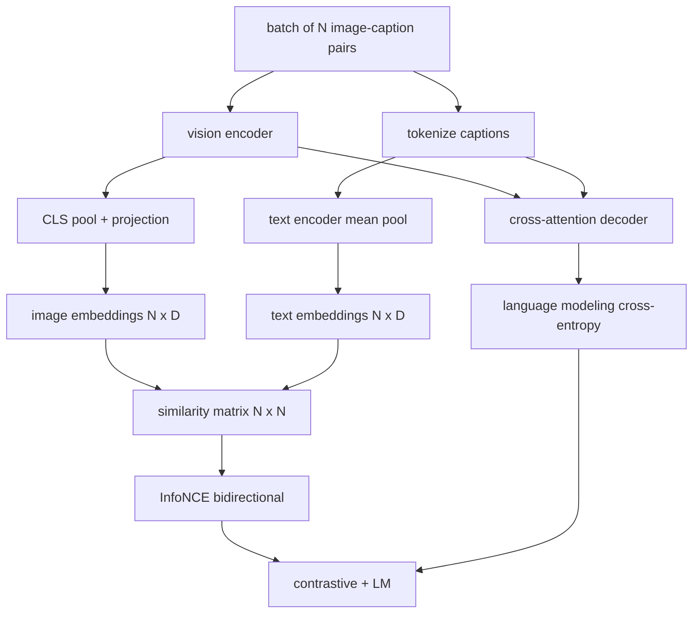

# Vision-Language Pretraining · 视觉-语言预训练

编码器、投影、解码器都接好了，现在把它们一起训练。两个目标驱动学习：一个是对比式图文损失（InfoNCE），在联合嵌入空间里把配对拉近；一个是语言建模损失，要求解码器给每张图写字幕。两者合起来，教会网络两件事：为一条字幕找到对的图，为一张图写出字幕。

> The encoder, projection, and decoder are wired. Now train them together. Two objectives drive learning: a contrastive image-text loss (InfoNCE) that pulls matching pairs together in the joint embedding space, and a language modeling loss that asks the decoder to caption each image. Combined, they teach the network both to find the right image for a caption and to write a caption for the image.

**Type:** Build
**Languages:** Python
**Prerequisites:** Phase 19 lessons 30-37 (Track B foundations)
**Time:** ~90 minutes

## Learning Objectives · 学习目标

- 在一批图像-字幕对上实现 InfoNCE 对比损失。
- 把对比损失与自回归语言建模损失组合起来。
- 合成一个 200 对的模拟（mock）图文语料，不下载任何真实数据集。
- 跑一个 50 步的演示训练循环，观察两个损失都在下降。

> Implement InfoNCE contrastive loss across a batch of image-caption pairs.
> Compose contrastive loss with autoregressive language modeling loss.
> Synthesize a 200-pair mock image-caption corpus with no real dataset download.
> Run a 50-step demo training loop and observe both losses decreasing.

## The Problem · 问题在哪

视觉-语言模型需要两种技能。它必须会排序（rank）：给一条字幕，在许多图里找到对的那张。它必须会生成（generate）：给一张图，写出字幕。只用一种技能预训练，你得到的是半个系统。CLIP 把排序做到了极致，但不会写字幕；GPT-4V 会写字幕，但要靠一个单独的检索头来排序。多目标预训练一次把两种都拿到手。

InfoNCE 负责排序那一半。对一批 N 个配对，模型把 N 个配对成功的当正样本、`N^2 - N` 个错配的当负样本，然后在得到的 `(N, N)` 相似度矩阵上跑交叉熵损失。LM 损失负责生成那一半：以图像为条件的标准下一 token 预测。两个损失都可微，而且能共享编码器、投影器和解码器的权重。

> A vision-language model needs two skills. It must rank: given a caption, find the right image among many. It must generate: given an image, write a caption. ... Multi-objective pretraining gets both in one pass.
> InfoNCE handles the ranking half. For a batch of N pairs, the model treats the N matching pairs as positives and the `N^2 - N` mismatched pairs as negatives, then runs a cross-entropy loss on the resulting `(N, N)` similarity matrix. The LM loss handles the generation half: standard next-token prediction conditioned on the image. Both losses are differentiable and can share the encoder, projector, and decoder weights.

## The Concept · 概念



### InfoNCE in one paragraph · 一段话讲完 InfoNCE

把 N 个图像嵌入按行堆起来，N 个文本嵌入也按行堆起来，两边都做 L2 归一化。算出 `N x N` 矩阵 `S = I T^T / tau`，其中 `tau` 是可学习的温度。对角线上的元素是配对成功的；非对角线是负样本。沿行做交叉熵，目标是让第 `i` 行的最大值落在第 `i` 列。再沿列对称地做一遍。总损失取两者的平均。这就是八行代码的 CLIP 损失。

> Stack the N image embeddings as rows and the N text embeddings as rows. L2-normalize both. Compute the `N x N` matrix `S = I T^T / tau` where `tau` is a learned temperature. ... Apply cross-entropy with the target `argmax` running down the diagonal: row `i` should have its highest entry in column `i`. Do the same symmetrically along columns. The total is the average of the two. This is the CLIP loss in eight lines.

### Temperature matters · 温度很关键

温度 `tau` 控制 softmax 有多尖。太小（比如 `tau = 0.01`），梯度只来自最难的那个负样本，训练噪声大；太大，softmax 被压平，梯度消失。CLIP 把 `tau` 当作参数来学；这里的演示也一样。

> The temperature `tau` controls how peaked the softmax is. Too small (e.g. `tau = 0.01`) and the gradient comes only from the very hardest negative, training is noisy. Too large and the softmax flattens and gradient vanishes. CLIP learns `tau` as a parameter; the demo here does the same.

### Language modeling loss · 语言建模损失

解码器通过交叉注意力消费图像记忆 token，在每个位置预测下一个文本 token。损失是带下一位置目标的标准交叉熵。padding 位置被排除在损失之外。

> The decoder consumes image memory tokens via cross-attention and predicts the next text token at every position. Loss is standard cross-entropy with the next-position target. Padding positions are masked out of the loss.

### Combining the losses · 组合两个损失

`total = contrastive + lm_weight * lm`，其中 `lm_weight` 是一个标量（常取 1.0）。两个损失的梯度都流进编码器和投影器；只有解码器接收 LM 损失的梯度。这就是 CoCa、BLIP 和 SigLIP 风格模型都在用的多任务配方，只是加权各有不同。

> `total = contrastive + lm_weight * lm` where `lm_weight` is a scalar (often 1.0). The two losses share gradients into the encoder and projection; only the decoder receives LM-loss gradient. This is the multi-task recipe that CoCa, BLIP, and SigLIP-style models all use, with various weightings.

| 组件 | 损失面 | 影响范围 |
|------|--------|----------|
| InfoNCE | 联合空间里的配对排序 | 编码器 + 投影 + 文本头 |
| LM | 以图像为条件的 token 预测 | 编码器 + 投影 + 解码器 |
| 合计 | 多任务 | 整个堆叠 |

### Why 50 steps is enough for a demo · 为什么演示 50 步就够

模拟语料是一个由随机图像和随机字幕 id 组成的 200 对合成集。batch size 16 的 50 步 SGD 之后，即使绝对值还高于真实数据模型能达到的水平，两个损失也会明显下降。演示的意义在于确认梯度管线端到端是通的，以及加入 LM 损失不会破坏对比目标的稳定性。

> The mock corpus is a synthetic 200-pair set with random images and random caption ids. After 50 SGD steps with batch size 16, both losses drop visibly even if the absolute values stay above what a real-data model would achieve. The point of the demo is to confirm the gradient plumbing works end to end and that adding the LM loss does not destabilize the contrastive objective.

```figure
ch-infonce-diagonal
```

## Build It · 动手造

`code/main.py` 实现了：

- `MultimodalModel`：组合一个小 ViT 编码器、MLP 投影器、一个微型文本侧编码器（对嵌入 id 做平均池化），以及第 61 课的交叉注意力解码器。
- `info_nce_loss(image_emb, text_emb, temperature)`：双向的 CLIP 风格对比损失。
- `lm_loss(logits, target_ids, padding_id)`：带掩码的下一 token 交叉熵。
- `make_mock_corpus(seed, n_pairs)`：返回 200 个确定性的 (image, caption_ids) 配对。
- 一个训练循环：50 步、batch size 16、Adam 优化器、一个可学习的 log 温度参数。每 5 步打印两个损失。

运行：

```bash
python3 code/main.py
```

输出：对比损失从约 `ln(16) = 2.77` 降到 2.4 附近；LM 损失从随机均匀基线 `ln(512) ≈ 6.24` 降到约 4.7。两个下降共同证明梯度接线正确。真实模型要训几百万步，但动力学是一样的。

> Output: contrastive loss drops from about `ln(16) = 2.77` toward 2.4; LM loss drops from a random-uniform baseline of `ln(512) ≈ 6.24` toward about 4.7. Both decreases prove the gradient is wired correctly. Real models train for millions of steps; the dynamics are the same.

## Use It · 实战用法

以下产品用的就是同一套损失配方：

- **CLIP（2021）。** 只有图文对比，外加一个冻结编码器的字幕探针（probe）。
- **CoCa（2022）。** 图文对比加图像字幕 LM 损失，同在一个模型里。这正是本课构建的模式。
- **BLIP（2022）与 BLIP-2。** 对比加 LM 加图文匹配头。三种损失合体。
- **SigLIP（2023）。** 把 InfoNCE 换成 sigmoid 配对损失；对比的角色相同，函数形式不同。
- **LLaVA 家族。** 两阶段训练：第一阶段是对齐（冻结 LM 上的余弦），第二阶段加入 LM 损失并解冻 LM。第 60 课对应第一阶段，本课对应第二阶段。

> This is the same loss recipe shipped in:
> - **CLIP (2021).** Image-text contrastive only, with a separate frozen-encoder caption probe.
> - **CoCa (2022).** Image-text contrastive plus image-captioning LM loss in one model. The exact pattern this lesson builds.
> - **SigLIP (2023).** Switches InfoNCE for a sigmoid pair loss; same contrastive role, different functional form.
> - **LLaVA family.** Two-stage training where stage one is alignment (cosine on a frozen LM) and stage two adds LM loss with an unfrozen LM. Lesson 60 maps to stage one; this lesson maps to stage two.

## Tests · 测试

`code/test_main.py` 覆盖：

- InfoNCE 损失对图像/文本两个方向对称
- 相似度矩阵是大正数的完美对角阵时，InfoNCE 损失返回 0
- LM 损失正确掩掉 padding 位置
- 模型前向传播无错地产出两个损失
- 5 步训练循环降低合计损失

运行：

```bash
python3 -m unittest code/test_main.py
```

## Exercises · 练习

1. 把 InfoNCE 换成 SigLIP 风格的 sigmoid 配对损失，比较在模拟语料上的收敛情况。

2. 加一个难负例挖掘（hard-negative mining）步骤：每隔一个 batch，从上一个 batch 挑出最难的非对角配对追加进来。训练并观察对比损失是否降得更快。

3. 在联合嵌入之上加一个图文匹配二分类头（对/错：这两者匹配吗？）作为第三种损失，复刻 BLIP 的三头设置。

4. 把模拟语料换成由马尔可夫链采出的字幕 id 序列，其转移矩阵以图像哈希为条件。字幕损失应当降得更低，因为有了真正可学的信号。

5. 分别用 `lm_weight = 0` 和 `lm_weight = 1` 训练同一个模型，比较对比损失；LM 损失不应拖累排序目标。

## Key Terms · 术语表

| 术语 | 含义 |
|------|------|
| InfoNCE | 噪声对比估计（noise contrastive estimation）：在相似度矩阵上做交叉熵 |
| Temperature（温度） | 控制对比 softmax 有多尖的标量 |
| Hard negative（难负例） | 模型觉得难以区分的非对角配对，采样时很有用 |
| LM loss（LM 损失） | 字幕一侧标准的下一 token 交叉熵 |
| Joint embedding space（联合嵌入空间） | 投影之后图像向量与文本向量共同生活的共享空间 |

## Further Reading · 延伸阅读

- CLIP 论文 —— 原始的对比配方。
- CoCa 论文 —— 对比加字幕生成同在一个模型。
- SigLIP 论文 —— sigmoid 配对损失变体，以及它扩展性更好的原因。
