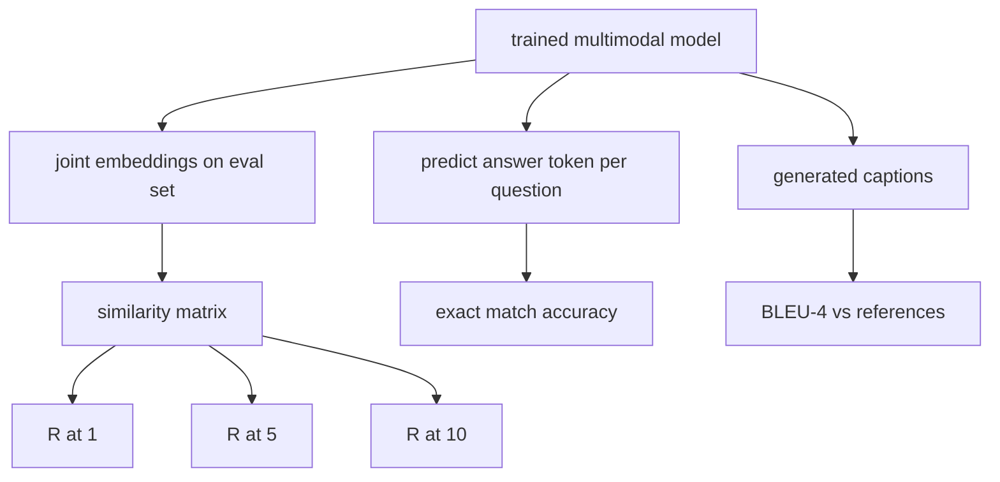

# Multimodal Evaluation · 多模态评测

训练只占循环的一半，另一半是测量。本课用最基础的件搭起三个评测面：图文检索，以 R@1、R@5、R@10 报告；视觉问答（VQA），以精确匹配准确率报告；图像字幕，以 BLEU-4 报告。每个指标都是一个作用在模型输出上的函数，配上一套几秒钟就能跑完的合成评测集。

> Training is half the loop. The other half is measurement. This lesson builds three evaluation surfaces from primitives: image-caption retrieval reported as R@1, R@5, R@10; visual question answering reported as exact match accuracy; and image captioning reported as BLEU-4. Each metric is a function over the model's outputs and a synthetic eval suite that runs in seconds.

**Type:** Build
**Languages:** Python
**Prerequisites:** Phase 19 lessons 58-62 (Track E foundations: encoder, transformer, projection, cross-attention fusion, pretraining)
**Time:** ~90 minutes

## Learning Objectives · 学习目标

- 从图像与字幕嵌入之间的相似度矩阵计算 Recall@K。
- 从把 (image, question) 对映射到固定答案词表的模型计算精确匹配 VQA 准确率。
- 不借助任何外部库，从生成与参考 token 序列计算 BLEU-4。
- 在第 62 课训练出的模型之上，用一套合成评测集跑全部三个评测。

> Compute Recall@K from a similarity matrix between image and caption embeddings.
> Compute exact-match VQA accuracy from a model that maps (image, question) pairs to a fixed answer vocabulary.
> Compute BLEU-4 from generated and reference token sequences without any external library.
> Run all three evals against a synthetic suite built on top of the trained model from lesson 62.

## The Problem · 问题在哪

最诱人的做法是：训练损失一进入平台期，就宣布多模态模型完工。训练损失度量的是在训练分布上的拟合；它不度量模型能不能在一个留出批里给配对排序、能不能回答问题、能不能写出人能接受的字幕。有三个标准评测面：

- **检索（R@1、R@5、R@10）。** 为查询字幕构建联合嵌入，按余弦给评测池里每张图排序，报告匹配的图是否落在 top 1、top 5、top 10。对称的（图到文）形式跑法相同。
- **视觉问答（精确匹配）。** 给定 (image, question)，模型输出一个答案 token。精确匹配每个样本只有一比特信息：预测答案是否等于参考答案。在评测集上取平均。
- **字幕生成（BLEU-4）。** 生成一条字幕，对照参考字幕计算 1-gram 到 4-gram 精确率的几何平均，再加简短惩罚（brevity penalty）。多参考（multi-reference）是标准形式（一张图、多条参考字幕）。

每个指标都是一个薄函数。本课把它们全部用代码造出来，让数学变得具体、评测面保持在你掌控之中。真实基准套件（MS-COCO、VQA v2、GQA、OK-VQA）插进来的就是同样的函数形状。

> The temptation is to declare a multimodal model finished when the training loss plateaus. Training loss measures fit on the training distribution; it does not measure whether the model can rank pairs in a held-out batch, answer a question, or write a caption a human would accept. Three eval surfaces are standard:
> Each metric is a thin function. The lesson builds them all in code so the math is concrete and the surface stays under your control. Real benchmark suites (MS-COCO, VQA v2, GQA, OK-VQA) plug into the same function shapes.

## The Concept · 概念



### Recall@K from a similarity matrix · 从相似度矩阵算 Recall@K

构建图像与字幕嵌入之间的 `(N, N)` 余弦相似度矩阵。对每一行，把各列按相似度降序排序。Recall@K 是「对角列索引落在前 K 位之内」的行所占的比例。对称的 Recall@K（字幕到图）在转置矩阵上计算。两个数都要报告。对 N=100 的评测，R@1 = 0.6 意味着 100 条字幕里有 60 条把正确的图排在了第一名。

> Build the `(N, N)` cosine similarity matrix between image and caption embeddings. For each row, sort the columns by descending similarity. Recall@K is the fraction of rows where the diagonal column index lies within the top K positions. Symmetric Recall@K (caption-to-image) is computed on the transposed matrix. Both numbers are reported. For an N=100 eval, R@1 = 0.6 means 60 of the 100 captions retrieved their correct image as the top match.

### VQA exact match · VQA 精确匹配

对每个 (image, question, answer)：编码图像、嵌入问题、经解码器融合，然后读出下一个 token。预测的 token id 与参考 id 比较，相等即正确。在评测集上取平均。真实 VQA 数据集每个问题带多条人工标注答案，用的是软准确率（soft-accuracy）公式（10 个标注者中至少 3 人一致记 1.0，以下按比例缩放）；本课为了清晰采用单答案精确匹配。

> For each (image, question, answer), encode the image, embed the question, fuse via the decoder, and read out the next token. The predicted token id is compared to the reference id; correct if equal. Average over the eval set. Real VQA datasets ship with multiple human-annotated answers per question and use a soft-accuracy formula (1.0 if at least 3 of 10 annotators agree, scaled below); the lesson uses single-answer exact match for clarity.

### BLEU-4

```text
BLEU-4 = BP * exp(mean(log p1, log p2, log p3, log p4))
```

其中 `p_n` 是改进的 n-gram 精确率（生成的 n-gram 中出现在任一参考里的截断计数，除以生成的 n-gram 总数），`BP` 是简短惩罚：

```text
BP = 1                if generated length > reference length
   = exp(1 - r/g)     otherwise, where r is reference length and g is generated
```

小样本下某些 `p_n` 会是零，所以需要平滑。本实现采用 Chen 和 Cherry 的「method 1」（任何零计数都给分子分母各加 1），这是低计数情形下最安全的默认。

> Smoothing is needed for small samples where some `p_n` is zero. The implementation uses Chen and Cherry "method 1" (add 1 to numerator and denominator for any zero count), which is the safest default for low-count regimes.

### Synthetic eval suite · 合成评测集

一套 50 样本的评测集在内存里构建，沿用第 62 课的模拟语料模式，但用留出的（held-out）种子。评测集由三个列表组成：

- `pairs`：50 个 (image, caption_ids) 配对，用于检索。
- `vqa`：50 个 (image, question_ids, answer_id) 三元组。
- `caps`：50 个 (image, [reference_caption_ids, ...]) 条目，每图最多 3 条参考。

评测集由种子确定性生成，并与训练语料留出分离，所以指标算在模型从未见过的数据上。把评测集持久化成 JSON 留作练习（见下）。

> A 50-sample eval suite is built in memory from the same mock corpus pattern used in lesson 62, with a held-out seed. Three lists make up the suite:
> The suite is deterministic from the seed and held out from the training corpus, so the metrics are computed on data the model never saw. Persisting the suite to JSON is left as an exercise (see below).

| 指标 | 取值范围 | 随机基线（N=50） |
|------|----------|------------------|
| R@1 | 0 到 1 | 0.02 (1 / N) |
| R@5 | 0 到 1 | 0.10 |
| R@10 | 0 到 1 | 0.20 |
| VQA EM | 0 到 1 | 1 / vocab |
| BLEU-4 | 0 到 1 | 小但非零 |

对合成数据上的 50 步训练，这些指标不会高；预期是高于随机基线，演示检查的正是这一点。

> For a 50-step training run on synthetic data, the metrics are not expected to be high; they are expected to be above the random baseline, which is what the demo checks.

```figure
ch-recall-window
```

## Build It · 动手造

`code/main.py` 实现了：

- `recall_at_k(sim_matrix, k)`：对两个方向各返回一个 `[0, 1]` 内的浮点数。
- `vqa_exact_match(predictions, references)`：返回 `int` 相等的均值。
- `bleu4(generated, references, smoothing=True)`：支持多参考。
- `build_eval_suite(seed, n_samples, vocab_size, max_len)`：返回三个确定性的评测列表。
- `evaluate(model, suite)`：跑全部三个指标，返回一个装数字的 `dict`。
- 一个演示：加载第 62 课刚初始化的多模态模型，评测，再训练 50 步后重新评测，打印前后指标。

运行：

```bash
python3 code/main.py
```

输出：前后对比的指标表显示，检索从近随机水平向模型学到的信号爬升，VQA 提升到随机之上，BLEU-4 也在改善（合成数据的结构足以抬高 4-gram 精确率）。

> Output: the before/after metric table shows retrieval improving from near-random toward the model's learned signal, VQA improving above random, and BLEU-4 improving (the synthetic structure is enough for a 4-gram precision lift).

## Use It · 实战用法

每个指标都直接对应一个生产基准：

- **检索。** MS-COCO 5K val、Flickr30K、ImageNet zero-shot 都是在同一张相似度矩阵上的 R@K 问题。把合成评测换成真实文件，函数签名不变。
- **VQA。** VQA v2、GQA、OK-VQA 用同样的精确匹配形状（VQA v2 用软准确率代替单答案 EM）。
- **BLEU-4。** MS-COCO 字幕、NoCaps、Flickr30K 字幕都用 BLEU-4 加 CIDEr 和 METEOR。加 CIDEr 就是多写一个函数。

对真实基准，把 `build_eval_suite` 换成真实加载器，函数体原样保留。这套数学与具体基准无关。

> Each metric maps directly onto a production benchmark:
> For real benchmarks, swap `build_eval_suite` for a real loader and keep the function bodies. The math is benchmark-agnostic.

## Tests · 测试

`code/test_main.py` 覆盖：

- 完美的单位相似度矩阵上 recall@k 返回 1.0，翻转后的矩阵上（k < N）返回 0.0
- recall@k 遵守 `k <= N` 上界
- 生成与某条参考完全一致时 bleu4 返回 1.0
- 词表不相交时 bleu4 返回 0.0
- vqa 精确匹配等于相等配对所占比例
- build_eval_suite 返回预期数量的配对、vqa 条目和字幕条目

运行：

```bash
python3 -m unittest code/test_main.py
```

## Exercises · 练习

1. 给字幕指标加 CIDEr。CIDEr 对 n-gram 用 TF-IDF 加权，会奖励有信息量的 token。

2. 实现软准确率 VQA：每个问题多条人工答案，只要有一条匹配，准确率为 `min(human_count / 3, 1)`。复刻 VQA v2。

3. 给 `bleu4` 加一个 NaN 安全变体，能处理空的生成序列而不崩溃。

4. 在 R@K 之外再算平均倒数排名（MRR）。MRR 对正确项在 top K 之外落在哪敏感；R@K 只对它是否落进 top K 敏感。

5. 在训练中的五个检查点（step 0, 10, 20, 30, 40, 50）对模型跑评测并画出学习曲线。确认指标轨迹与损失轨迹同步。

## Key Terms · 术语表

| 术语 | 含义 |
|------|------|
| R@K | 正确匹配落在 top K 结果之内的查询比例 |
| Exact match（精确匹配） | 最简单的 VQA 打分：预测答案等于参考答案 |
| BLEU-4 | 1- 到 4-gram 精确率的几何平均，带简短惩罚 |
| Multi-reference（多参考） | 字幕指标接受每张图多条参考字幕 |
| Held-out（留出） | 评测集用与训练语料不相交的种子采样 |

## Further Reading · 延伸阅读

- VQA v2 论文 —— 软准确率公式与数据集统计。
- CIDEr 论文 —— TF-IDF 加权的 n-gram 字幕评测。
- BLEU 原始论文（Papineni et al., 2002）—— 各种平滑变体。
- MS-COCO 字幕评测脚本 —— 标准参考实现。
