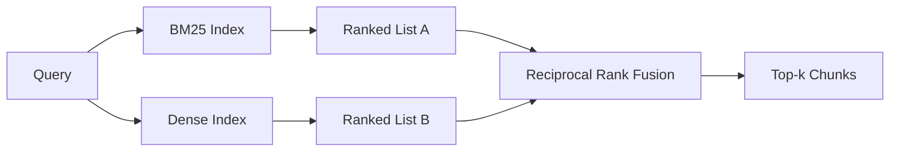

# Hybrid Retrieval with BM25 and Dense Embeddings · BM25 与稠密嵌入混合检索

词法检索与语义检索各自在不同的查询分布上失效。结合倒数排名融合（reciprocal rank fusion，RRF）的混合检索不做插值，而是投票——而投票在每一类查询上都赢。

> Lexical and semantic retrieval fail on opposite query distributions. Hybrid retrieval with reciprocal rank fusion does not interpolate, it votes - and the vote wins on every query class.

**Type:** Build
**Languages:** Python
**Prerequisites:** Phase 11 lessons 04 (embeddings), 06 (RAG); Phase 19 Track B foundations (lessons 20-29); Phase 19 lesson 64 (chunking strategies)
**Time:** ~90 minutes

## Learning Objectives · 学习目标

- 依据 Robertson 与 Sparck Jones 的原始公式从零实现 BM25，包含字段加权（field weighting）、文档长度归一化，以及可调的 `k1` 和 `b`。
- 在确定性 mock 嵌入之上构建稠密检索器（dense retriever），让整个循环离线可跑。
- 严格按照 Cormack、Clarke 与 Buettcher 2009 年发表的公式实现倒数排名融合（reciprocal rank fusion），并解释它为什么压倒分数加权插值。
- 调节 RRF 的 k 常数与每个模态的权重，并在小型测试语料（fixture corpus）上读出其中的权衡。

> Implement BM25 from scratch from the Robertson and Sparck Jones formulation, with field weighting, document length normalization, and tunable k1 and b.
> Build a dense retriever on top of a deterministic mock embedding so the loop runs offline.
> Implement reciprocal rank fusion exactly as Cormack, Clarke, and Buettcher published it in 2009, and explain why it dominates score-weighted interpolation.
> Tune the RRF k constant and the per-modality weights and read the trade-offs on a small fixture corpus.

## The Problem · 问题在哪

当查询携带语料中逐字存在的字面标识符时，词法检索赢。查询 `AbortMultipartOnFail`，BM25 微秒级返回正确的 Go 函数。同一查询做嵌入后，落在三个相似度簇的边界上，稠密检索器会把错误的文件排到第一。

当查询的措辞偏离语料的字面词时，稠密检索赢。一个问「我们怎么处理被取消的上传」的用户，从没敲过 abort 或 multipart 这两个词。BM25 返回「上传大文件」那篇文档块，只因那一页含 uploads 这个词。稠密检索找到的是摘要里提到取消（cancellation）的中止函数。

二者之间的选择不是静态的。查询分布才是变量。生产级 RAG 系统用同一个端点处理两类查询，所以检索必须同时应付两类。这就是混合检索（hybrid retrieval）。合并（merge）这一步是必须做对的部分。

> Lexical search wins when the query carries a literal identifier the corpus contains verbatim. ... Dense search wins when the query is paraphrased away from the corpus's literal tokens. ... The query distribution is the variable. A production RAG system handles both classes from the same endpoint, so retrieval has to handle both at once. That is hybrid retrieval. The merge step is the part that has to be right.

## The Concept · 概念



### BM25 in one paragraph · 一段话讲完 BM25

BM25 给查询-文档对打分的方式是：对每个查询词，把一个逆文档频率（IDF）因子乘上一个饱和的词频（term-frequency）因子，再求和，后者带长度归一化修正。两个旋钮。`k1` 控制词频饱和；默认 1.5 是论文推荐值，没有基准数据不要动它。`b` 控制文档长度有多大分量；默认 0.75 表示长文档会被惩罚，但不是线性惩罚。

IDF 公式用的是平滑化的 Robertson 与 Sparck Jones 定义：`log((N - df + 0.5) / (df + 0.5) + 1)`。log 内部的加一保证了当一个词出现在超过一半的语料中时 IDF 仍为正。在小语料里这一点很重要，因为停用词在技术上可能并不罕见。

字段加权让你告诉 BM25：符号名上的命中比正文里的命中更重要。实现方式是在索引阶段对词数乘一个系数，而不是在打分阶段。这样数学保持不变，也避免了对每个字段单独打分。

> BM25 scores a query-document pair by summing, over query terms, an inverse document frequency factor multiplied by a saturating term-frequency factor that includes a length-normalization correction. Two knobs. `k1` controls term-frequency saturation; the default 1.5 is the published recommendation and you should not move it without a benchmark. `b` controls how much document length matters; the default 0.75 says longer documents are penalized, but not linearly.
> The IDF formula uses the smoothed Robertson and Sparck Jones definition, which is `log((N - df + 0.5) / (df + 0.5) + 1)`. The plus-one inside the log keeps the IDF positive when a term appears in more than half the corpus. This matters in small corpora where stopwords are technically rare.
> Field weighting lets you tell BM25 that a match on the symbol name counts more than a match in the body. Implementation is a multiplier on the term counts during indexing, not at scoring time. That keeps the math identical and avoids a separate score per field.

### Dense retrieval in one paragraph · 一段话讲完稠密检索

用嵌入模型把每个块嵌入成固定维度的向量。查询时嵌入查询，按余弦相似度给每个块排序，返回 top-k。决定质量的是模型这个变量。检索算法本身只有两行：点积和排序。

本课用确定性的基于哈希的嵌入，让你在没有网络调用的情况下读懂融合数学。哈希把按 token 索引的偏移量累加进一个 96 维向量，再归一化。余弦排名跨运行确定，这正是测试套件所要求的。

> Embed each chunk into a fixed-dimension vector with an embedding model. At query time, embed the query, cosine-rank every chunk by similarity, and return the top-k. The model is the variable that decides quality. The retrieval algorithm itself is two lines: dot product and sort.
> This lesson uses a deterministic hash-based embedding so you can read the fusion math without a network call. The hash sums token-keyed offsets into a 96-dimensional vector and normalizes. The cosine ranks are deterministic across runs, which is what the test suite requires.

### Reciprocal rank fusion, the published formula · 倒数排名融合：论文原始公式

两个排序列表。对出现在任一列表中的每个候选，把它的倒数排名（reciprocal rank）贡献加起来。2009 年的论文用 `1 / (k + rank)`，k 默认等于 60。按总分排序。这就是全部算法。

发表的常数 k = 60 并非随意。k = 60 时，排名 1 的贡献是 1 / 61，排名 10 的贡献是 1 / 70。贡献衰减得很慢，深处的候选仍然有票。k 越小，头部结果越占主导。k 越大，贡献曲线越平。

我们的实现里有两个可调旋钮。`k` 常数。以及一对按模态的权重，当你有先验证据表明某个模态在你的语料上更强时，可以借此加权 BM25 或稠密。把排名贡献乘上权重是最简单且有原则的实现：它保持排名衰减的形状，并且不依赖分数量级。

> Two ranked lists. For each candidate that appears in either list, sum its reciprocal-rank contributions. The 2009 paper used `1 / (k + rank)` with k equal to 60 as the default. Sort by total score. That is the whole algorithm.
> The published constant k = 60 is not arbitrary. With k = 60 the rank-1 contribution is 1 / 61 and the rank-10 contribution is 1 / 70. The contribution decays slowly so deep candidates still vote. Smaller k makes the top results dominate. Larger k flattens the contribution curve.
> Two tunable knobs in our implementation. The `k` constant. A pair of per-modality weights so you can boost BM25 or dense when you have prior evidence one is better on your corpus. Multiplying the rank contribution by the weight is the simplest principled implementation; it preserves the rank-decay shape and stays scale-free.

### Why fusion beats score-weighted interpolation · 为什么融合胜过分数加权插值

BM25 分数无上界且依赖语料。余弦相似度有界于 -1 到 1。线性组合 `alpha * bm25 + (1 - alpha) * cosine` 需要按语料调 alpha，而且每次重建索引都会失效。基于排名的融合不会。两个排名在模态之间可比。自 2010 年以来，已发表的 RRF 基线在每一个公开 TREC 赛道上都胜过分数插值。

Vespa 和 Weaviate 文档里关于 RankFusion vs RRF 的讨论，说的是同一个道理。他们得出了同样的结论：除非有非常强的证据支持对分数做插值，否则坚持基于排名。

```figure
rrf-fusion
```

> BM25 scores are unbounded and corpus-dependent. Cosine similarities are bounded in -1 to 1. A linear combination `alpha * bm25 + (1 - alpha) * cosine` requires per-corpus alpha tuning and breaks every time you reindex. The rank-based fusion does not. Two ranks are comparable across modalities. The published RRF baseline beats score-interpolation in every public TREC track since 2010.
> This is the same argument you hear about RankFusion vs RRF in Vespa and Weaviate documentation. They came to the same conclusion: stay rank-based unless you have very strong evidence to interpolate scores.

## Build It · 动手造

`code/main.py` 实现了：

- `tokenize(text)` —— 快速正则分词器。
- `BM25Index` —— 带字段加权，提供 `add` 与 `search`，k1、b 可调。
- `mock_embed`、`DenseIndex` —— 与第 64 课相同的确定性嵌入，保证块与块可比。
- `rrf(rankings, k, weights)` —— 论文原始融合，支持多模态权重。
- `HybridRetriever` —— 组合 BM25 与稠密。
- 一个演示 `main()`：加载小型测试语料，跑三条分别命中各检索器强项与弱项的查询，打印每个模态产生的排名以及融合后的列表。

运行：

```bash
python3 code/main.py
```

把演示输出并排着读。字面标识符查询落在 BM25 第 1、稠密第 4、RRF 第 1。改述查询落在 BM25 第 6、稠密第 1、RRF 第 1。模糊查询落在 BM25 第 3、稠密第 3、RRF 第 1。融合不是平局裁决者；它是在每一类查询上都赢的那个系统。

> Read the demo output side by side. The literal identifier query lands at BM25 rank 1, dense rank 4, RRF rank 1. The paraphrased query lands at BM25 rank 6, dense rank 1, RRF rank 1. The ambiguous query lands at BM25 rank 3, dense rank 3, RRF rank 1. The fusion is not a tie-breaker; it is the system that wins on every query class.

## Tuning the knobs · 调参旋钮

| 旋钮 | 默认值 | 何时调大 | 何时调小 |
|------|---------|----------------|------------------|
| BM25 k1 | 1.5 | 文档里词反复出现，而你想让词频更有分量 | 文档很短，词重复只是噪声 |
| BM25 b | 0.75 | 长文档确实每词信息量更低 | 文档长度与主题无关 |
| RRF k | 60 | 深处的候选应继续投票 | 应让 top-1 占主导 |
| BM25 weight | 1.0 | 语料含字面标识符且查询会匹配它们 | 查询是用户改述的 |
| Dense weight | 1.0 | 查询是改述的 | 查询是字面的 |

调参要在你的留出查询集上重跑第 68 课的评测框架，而不是靠直觉。

> Tune by re-running lesson 68's eval harness on your held-out query set, not by intuition.

## Failure modes the demo will hide · 演示藏不住的失败模式

**词表外 token（out-of-vocabulary）。** BM25 的 IDF 从语料算出，所以只出现在查询里的词贡献为零。稠密嵌入却会给同一个词幻觉出一个向量。对语料外的标识符，稠密模态返回看起来合理但错误的近邻。融合能吸收这一点，因为 BM25 什么都没返回、其排名贡献自动消失——前提是你按文档而不是按块去重。

**停用词霸榜。** 拿「the」这个词去查 BM25，会得到语料上的均匀排名。在索引器里过滤停用词，或者接受高 IDF 词自然占主导的事实。

**模态间内容完全相同。** 如果语料小到 BM25 的 top-1 同时也是稠密的 top-1，RRF 会给出同一个 top-1 和同样的近邻。这是正确行为，不是故障，但它会让融合看起来隐形。在评测里加一对对抗性查询，验证融合真的在起作用。

> **Out-of-vocabulary tokens.** BM25's IDF is computed from the corpus, so terms only in the query contribute zero. Dense embeddings hallucinate a vector for the same term. On out-of-corpus identifiers the dense modality returns plausible-looking but wrong neighbors. The fusion absorbs this because BM25 returns nothing and the rank contribution drops out, but only if you de-duplicate by document, not by chunk.
> **Stop-token domination.** BM25 against the word "the" produces a uniform ranking over the corpus. Filter stop tokens in the indexer or accept that high-IDF terms dominate naturally.
> **Identical content across modalities.** If your corpus is small enough that the top-1 of BM25 is also the top-1 of dense, RRF gives you the same top-1 with the same neighbors. That is correct behavior, not a failure, but it makes the fusion look invisible. Add an adversarial query pair in your eval to verify the fusion is actually working.

## Use It · 实战用法

生产模式：

- 在进程内建 BM25 索引；瓶颈是词频字典，不是向量。
- 把稠密向量放进独立的存储（本课用扁平列表；生产中你会用 HNSW）。
- 两路查询并行跑；融合是对并集的常数时间合并。
- 持久化每个召回命中的模态，让下游重排序器（reranker）能看到是哪个模态投的票。

> Production patterns:
> - Index BM25 in process; the bottleneck is the term-frequency dictionary, not the vectors.
> - Index dense vectors in a separate store (in this lesson we use a flat list; in production you would use HNSW).
> - Run both queries in parallel; the fusion is a constant-time merge over the union.
> - Persist the modality of each retrieved hit so a downstream reranker can see which modality voted for it.

## Ship It · 交付

第 66 课拿本课融合出的 top-k 用交叉编码器重排序。第 68 课用 precision、recall、MRR 和 nDCG 评测整条管线。本课的混合检索器是第 69 课端到端系统的第一级。

> Lesson 66 takes the fused top-k from this lesson and reranks with a cross-encoder. Lesson 68 evaluates the entire pipeline with precision, recall, MRR, and nDCG. The hybrid retriever in this lesson is the first stage of the end-to-end system in lesson 69.

## Exercises · 练习

1. 把 `mock_embed` 换成你供应商的真实模型。重跑演示，报告在改述查询上纯稠密排名的变化。
2. 加第三个模态：单独索引块摘要，作为第三个排序列表参与融合。测量增益。
3. 把 RRF k 在 10、30、60、100、200 上扫描。画出第 68 课的 recall@k 曲线。报告曲线在你语料上峰值处的 k 值。
4. 正确实现 BM25F（每字段长度归一化，而不是乘系数的技巧），在一个符号命中最要紧的语料上做对比。

## Key Terms · 术语表

| 术语 | 人们口头说 | 实际含义 |
|------|-----------------|------------------------|
| BM25 | 「词法检索」 | 用 idf × 饱和 tf × 长度归一化做概率排序 |
| RRF | 「排名融合」 | 对各排序列表求 1 / (k + rank) 之和；k 默认 60 |
| k1 | 「TF 饱和」 | 控制重复的词多快停止加分 |
| b | 「长度惩罚」 | 0 表示忽略文档长度，1 表示完全归一化 |
| Field weighting（字段加权） | 「符号加权」 | 索引时重复 token，以放大该字段的命中 |
| Rank-based vs score-based fusion（基于排名 vs 基于分数的融合） | 「为什么 RRF 胜过线性」 | 排名跨模态可比；分数不可比 |

## Further Reading · 延伸阅读

- Cormack, Clarke, Buettcher, "Reciprocal Rank Fusion outperforms Condorcet and individual rank learning methods", SIGIR 2009
- Robertson, Walker, Beaulieu, Gatford, Payne, "Okapi at TREC-3"（BM25 原始论文）
- [Vespa: Hybrid Retrieval with BM25 and Embeddings](https://docs.vespa.ai/en/tutorials/hybrid-search.html)
- [Weaviate: Hybrid Search](https://weaviate.io/developers/weaviate/search/hybrid)
- Phase 11 lesson 06 —— RAG 基础
- Phase 19 lesson 64 —— 在这里被索引的分块器
- Phase 19 lesson 66 —— 消费融合 top-k 的交叉编码器重排序器
