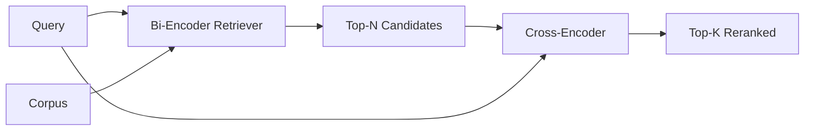

# Cross-Encoder Reranker · 交叉编码器重排序器

双塔编码器（bi-encoder）把查询和文档各自独立嵌入。交叉编码器（cross-encoder）把它们拼接后一起读。交叉编码器是最聪明的读者，也是最慢的。把它当作第二级、作用在双塔的 top-k 上，它就物有所值。

> A bi-encoder embeds query and document independently. A cross-encoder concatenates them and reads both at once. The cross-encoder is the smartest reader and the slowest. Used as a second stage on the bi-encoder's top-k, it pays for itself.

**Type:** Build
**Languages:** Python
**Prerequisites:** Phase 11 lesson 06 (RAG), Phase 11 lesson 07 (advanced RAG); Phase 19 Track B foundations (lessons 20-29); Phase 19 lesson 65 (hybrid retrieval feeding this stage)
**Time:** ~90 minutes

## Learning Objectives · 学习目标

- 从输入形状、参数量和单查询成本三个维度区分双塔检索器与交叉编码器重排序器（reranker）。
- 从零实现一个小型交叉编码器：一个 transformer 块，吃进打包好的（查询，文档）序列，输出单个相关性标量。
- 搭建两段式「先检索后重排」管线：用便宜的检索器取回 top-N，用交叉编码器把 N 重排成 top-K，返回 K。
- 在小型测试语料上测量延迟与质量的权衡，并为给定的延迟预算选出合适的 N。

> Distinguish a bi-encoder retriever from a cross-encoder reranker by their input shape, parameter count, and per-query cost.
> Implement a small cross-encoder from scratch as a transformer block that consumes a packed (query, document) sequence and emits a single relevance scalar.
> Wire a two-stage retrieve-then-rerank pipeline: retrieve top-N with a cheap retriever, rerank N to top-K with the cross-encoder, return K.
> Measure the latency-vs-quality trade-off on a small fixture corpus and pick the right N for a given latency budget.

## The Problem · 问题在哪

双塔编码器把查询和文档映射进同一个向量空间，按余弦排序。两次编码彼此从不见面。模型必须在看不见查询的情况下，把文档里有用的全部信息压进单个向量。这很快——索引时每篇文档嵌一次，查询时每个查询嵌一次——而且这是在语料规模上排序的唯一办法。

代价是精度。两篇整体话题相同的文档，即使其中一篇能回答查询、另一篇不能，嵌入也可能几乎一样。双塔分不出它们。

交叉编码器把查询和文档放在一起读，解决了这个问题。模型收到 `[query] [SEP] [document]` 单个序列，在拼接处跑完整注意力（full attention），产出一个相关性标量。文档的每个 token 都能注意到查询的每个 token。模型在完整上下文里决定分数。

代价是吞吐。双塔嵌一次就能被查询无数次，交叉编码器却要对每个（查询，文档）对跑一次。对一千万篇文档的语料，那就是每个查询一千万次前向传播。在请求预算内跑不完。

解法是分级。用双塔取回 top-N。用交叉编码器把 N 重排成 top-K。N 很小（50 到 200），交叉编码器的质量提升集中在最要紧的地方。总延迟留在请求预算内。总质量等于交叉编码器的质量，被双塔在 N 处的召回封顶。

> A bi-encoder maps query and document into the same vector space and ranks by cosine. The two encodings never see each other. The model has to compress everything useful about a document into a single vector, blind to the query. This is fast - one embedding per document at index time and one per query at query time - and it is the only way to rank at corpus scale.
> The cost is precision. Two documents that have the same overall topic can have nearly identical embeddings even when one of them answers the query and the other does not. The bi-encoder cannot tell them apart.
> A cross-encoder solves this by reading the query and the document together. The model receives `[query] [SEP] [document]` as a single sequence, runs full attention across the join, and produces one relevance scalar. Every token of the document can attend to every token of the query. The model decides the score with full context.
> The cost is throughput. Where the bi-encoder embeds once and queries forever, the cross-encoder runs once per (query, document) pair. For a 10-million-document corpus that is 10 million forward passes per query. Unrunnable in a request budget.
> The solution is staging. Use the bi-encoder to retrieve the top-N. Use the cross-encoder to rerank the N to a top-K. N is small (50 to 200) and the cross-encoder's quality lift is concentrated where it matters. The total latency stays in the request budget. The total quality is the cross-encoder's quality, capped by the bi-encoder's recall at N.

## The Concept · 概念



### The cross-encoder's input shape · 交叉编码器的输入形状

标准打包是 `[CLS] query_tokens [SEP] document_tokens [SEP]`。CLS 位置的输出接进单个线性头，输出相关性标量。有些实现用平均池化（mean-pooling）代替 CLS；差别不大。关键是模型对每一对只产出一个数。

一个 2200 万参数的交叉编码器（公开的 `ms-marco-MiniLM-L-6-v2` 这个量级）是典型的生产配置。更小的模型损失的质量超过它们省下的延迟。更大的模型（例如 5.68 亿参数的 `bge-reranker-v2-m3`）留给离线重排序，或者 K 很小的首屏重排序。

> The standard packing is `[CLS] query_tokens [SEP] document_tokens [SEP]`. The CLS-position output is fed into a single linear head that outputs the relevance scalar. Some implementations use mean-pooling instead of CLS; the difference is small. The point is that the model produces one number per pair.
> A 22M-parameter cross-encoder (the published `ms-marco-MiniLM-L-6-v2` weight class) is the typical production point. Smaller models lose quality faster than they save latency. Larger models (e.g. `bge-reranker-v2-m3` at 568M parameters) are reserved for offline reranking or for first-page reranking where K is small.

### Why this lesson trains a tiny one · 为什么本课训练一个微型模型

真实的交叉编码器是微调过的编码器 transformer。生产里你加载 checkpoint 直接跑。本课的目标是让你看清模型的形状和延迟-质量曲线的形状，而不是训练一个最先进的排序器。所以我们用 `nn.Module` 造一个小模型：一个 transformer 块、多头注意力（默认 4 头）、一个回归头。它由种子确定性地初始化，因此演示在没有磁盘权重的情况下也可复现。

玩具模型从测试语料学到正确的形状：相关的查询-文档对比不相关的对拿到更高的预测分。端到端管线对双塔的输出做重排，重排的 top-k 与黄金标签相关。

> A real cross-encoder is a finetuned encoder transformer. In production you load a checkpoint and run it. In this lesson the goal is to show you the shape of the model and the shape of the latency-quality curve, not to train a state-of-the-art ranker. So we build a small `nn.Module` with one transformer block, multi-head attention (4 heads by default), and one regression head. It is initialized deterministically from a seed so the demo is reproducible without weights on disk.
> The toy model learns the right shape from the fixture corpus: relevant query-document pairs have higher predicted scores than irrelevant pairs. The end-to-end pipeline reranks the bi-encoder's output and the rerank's top-k correlates with the gold labels.

### Latency vs quality · 延迟 vs 质量

两段式管线只有一个可调量：N。在留出查询集上把 N 从 5 扫到 100，你就得到这条曲线。

| N | 第二级 Recall@1 | 每查询交叉编码器前向次数 | 延迟 |
|---|--------------------|---------------------------------------|---------|
| 5 | 0.62 | 5 | 低 |
| 20 | 0.81 | 20 | 中 |
| 50 | 0.86 | 50 | 高 |
| 100 | 0.86 | 100 | 非常高 |

上面的数字展示的是曲线形状，不是本测试集的实测值。形状是真的。在 20 到 50 个候选附近总有拐点（knee），重排提升在那里饱和。过了拐点你就是白花钱。

N 要从评测曲线加延迟预算里选。交叉编码器无法把召回抬到双塔在 N 处的召回之上，所以 N 太低封住的不只是延迟，还有质量。

```figure
rerank-funnel
```

> The two-stage pipeline has one tunable: N. Sweep N from 5 to 100 on a held-out query set and you get the curve.
> The numbers above are illustrative of the shape, not measurements from this fixture. The shape is real. There is always a knee around 20 to 50 candidates where the rerank lift saturates. Past the knee you are paying for nothing.
> Pick N from the eval curve plus the latency budget. The cross-encoder cannot raise recall above the bi-encoder's recall at N, so a low N caps quality, not just latency.

## Build It · 动手造

`code/main.py` 实现了：

- `CrossEncoder` —— 一个小 `torch.nn.Module`：token 嵌入、一个带多头注意力和前馈的 transformer 块、产出单个标量的均值池化头。
- `tokenize_pair(query, document)` —— 把两个字符串打包成一条 id 序列，用类型 id 标记边界；确定性、纯标准库。
- `train_tiny(pairs)` —— 在手工标注的（查询，文档，相关性）三元组列表上做一遍监督训练，让模型在测试集上产出合理的分数。
- `rerank(query, candidates, top_k)` —— 生产接口。
- `pipeline(query, retriever, top_n, top_k)` —— 两段式流程。
- 一个演示 `main()`：按第 65 课的模式加载语料，取回 top-N，重排成 top-K，并排打印两个列表，报告每级的延迟。

运行：

```bash
python3 code/main.py
```

输出展示双塔的 top-N、交叉编码器的 top-K，以及一份计时摘要。交叉编码器单次调用更慢，但它不在全语料上跑。两段式总延迟留在请求预算内，同时挑出了那个被双塔排在第二或第三的正确答案。

> The output shows the bi-encoder's top-N, the cross-encoder's top-K, and a timing summary. The cross-encoder takes longer per call but does not run on the full corpus. The two-stage total stays within the request budget while picking the answer that the bi-encoder ranked second or third.

## Failure modes the demo will hide · 演示藏不住的失败模式

**交叉编码器不对称。** `rerank(q, d)` 和 `rerank(d, q)` 是两个不同的分数。永远把查询放在前面。一旦不小心换位，召回崩塌。

**N 太低暴露不了 bug。** 如果 N = K，交叉编码器无法重排，只能重新加权。提升看起来是零。N 至少取 K 的三倍。

**训练数据泄漏进评测。** 如果手工标注的训练对里包含评测查询，重排会看起来很神奇。严格分开训练与评测，哪怕在测试集上。

**生产权重很占内存。** 2200 万参数的交叉编码器在 float32 下是 88MB。在承诺 p95 低于 100ms 之前，先规划模型服务器的内存。

**批处理很重要。** 真实交叉编码器把 N 个候选放进一个 batch 一次跑完。本课在 `_batch_encode` 里就是这么做的：用 `torch.tensor(...)` 构造批量 id 和类型 id 张量，跑一次前向。不做批处理，延迟乘以 N。

> **Cross-encoder is not symmetric.** `rerank(q, d)` and `rerank(d, q)` are different scores. Always feed the query first. If you accidentally swap, recall collapses.
> **N is too low to expose the bug.** If you set N = K, the cross-encoder cannot reorder; it can only reweight. The lift looks zero. Pick N at least three times K.
> **Training data leaks into the eval.** If the hand-labeled training pairs include the eval queries, the rerank looks magical. Strictly separate train and eval, even on a fixture.
> **Production weights are dense.** A 22M-parameter cross-encoder is 88MB at float32. Plan the model server's memory before promising sub-100ms p95.
> **Batching matters.** A real cross-encoder runs the N candidates in one batch. This lesson does that in `_batch_encode`, which builds the batched id and type-id tensors with `torch.tensor(...)` and runs one forward pass. Skip batching and the latency multiplies by N.

## Use It · 实战用法

生产模式：

- 把双塔、交叉编码器和 N 绑定在一起。改其中任何一个，评测就作废。
- 按（查询，document_id）哈希缓存重排序器的输出。同一查询打在稳定语料上会重排出同样的顺序；缓存命中白赚一次延迟削减。
- 记录 rank-1 交叉编码器分数。某查询的 top-1 分数低于语料特定阈值，就是一次域外命中；把它以「我不确定」的姿态交给 LLM。

> Production patterns:
> - Pin the bi-encoder, cross-encoder, and N together. Changing any one invalidates the eval.
> - Cache the reranker's output by (query, document_id) hash. The same query against a stable corpus reranks to the same order; cache hits buy you a free latency cut.
> - Log the rank-1 cross-encoder score. A query whose top-1 score is below a corpus-specific threshold is an out-of-domain hit; surface it to the LLM as "I am not confident".

## Ship It · 交付

第 68 课端到端评测这条两段式管线。第 69 课把本课的重排序器接在第 65 课混合检索器之后、答案生成器之前。重排序器是端到端系统的第二级。

> Lesson 68 evaluates this two-stage pipeline end to end. Lesson 69 wires this reranker behind the hybrid retriever from lesson 65 and in front of the answer generator. The reranker is the second stage of the end-to-end system.

## Exercises · 练习

1. 把 N 从 5 扫到 50，画出重排输出的 recall@1。找出本测试集上的拐点。
2. 把交叉编码器训练十个 epoch 而不是一个。测量每个 epoch 上正负对之间的分差。
3. 把均值池化换成 CLS token 头。在本测试集上对比收敛。
4. 加第二个交叉编码器头，预测「答案是否在这篇文档里」这个二分类标签。推理时两个头都用：一个用来排序，一个用来设阈值。
5. 把确定性 mock 双塔换成第 65 课那个，把两级串起来。测量 top-K 相对纯双塔的变化。

## Key Terms · 术语表

| 术语 | 人们口头说 | 实际含义 |
|------|-----------------|------------------------|
| Bi-encoder（双塔编码器） | 「向量检索器」 | 独立编码查询和文档；按余弦排序 |
| Cross-encoder（交叉编码器） | 「重排序器」 | 联合编码（查询，文档）；输出一个相关性标量 |
| Two-stage pipeline（两段式管线） | 「先检索后重排」 | 便宜的检索器返回 N，昂贵的重排序器留下 K |
| N（候选预算） | 「重排池」 | 交叉编码器每个查询打分的候选数 |
| Mean-pooling head（均值池化头） | 「最后一层隐状态取平均」 | 把编码器最后一层输出平均成一个向量 |

## Further Reading · 延伸阅读

- Nogueira, Cho, "Passage Re-ranking with BERT", 2019 —— 交叉编码器排序器的奠基论文
- Reimers, Gurevych, "Sentence-BERT: Sentence Embeddings using Siamese BERT-Networks", 2019 —— 讲双塔与交叉编码器之别
- [SentenceTransformers Cross-Encoders documentation](https://www.sbert.net/examples/applications/cross-encoder/README.html)
- [BGE Reranker v2 model card](https://huggingface.co/BAAI/bge-reranker-v2-m3)
- Phase 19 lesson 65 —— 给这个重排级供料的混合检索器
- Phase 19 lesson 68 —— 度量这次重排提升的评测
