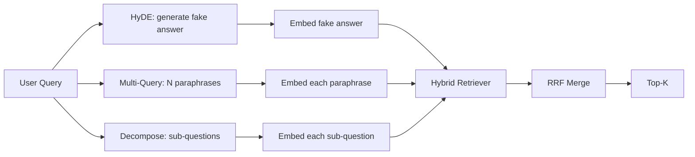

# Query Rewriting: HyDE, Multi-Query, and Decomposition · 查询改写：HyDE、多查询与分解

用户敲下的查询，不是你的检索器想要的那个查询。改写（rewriting）在检索之前架起桥梁，让索引看到的东西更接近答案本来的样子。

> The query the user types is not the query your retriever wants. Rewriting bridges the gap before retrieval, so the index sees something closer to what the answer looks like.

**Type:** Build
**Languages:** Python
**Prerequisites:** Phase 11 lessons 04 (embeddings), 06 (RAG); Phase 19 Track B foundations (lessons 20-29); Phase 19 lessons 64 and 65
**Time:** ~90 minutes

## Learning Objectives · 学习目标

- 实现假设文档嵌入（Hypothetical Document Embeddings，HyDE）：生成一个假答案，嵌入它，用那个向量而不是查询向量去检索。
- 实现多查询扩展（multi-query expansion）：把一个查询改写成 N 条改述（paraphrase），各自检索，用倒数排名融合合并并集。
- 实现查询分解（query decomposition）：把复杂问题拆成子问题，逐个子问题检索，再合并。
- 在测试集上把三种改写器正面比较，并解释每种策略何时赢。
- 接入一个 mock LLM，产出确定性的、贴合测试集的输出，让改写循环离线可跑。

> Implement Hypothetical Document Embeddings (HyDE): generate a fake answer, embed it, retrieve against that vector instead of the query vector.
> Implement multi-query expansion: rewrite one query into N paraphrases, retrieve with each, merge the union by reciprocal rank fusion.
> Implement query decomposition: split a complex question into sub-questions, retrieve per sub-question, merge.
> Compare the three rewriters head to head on a fixture and explain when each strategy wins.
> Wire a mock LLM that produces deterministic, on-fixture outputs so the rewriter loop runs offline.

## The Problem · 问题在哪

用户输入「上传失败、预算也没了的时候，我们团队怎么办？」。语料里有一篇文档写着「AbortMultipartOnFail 会在上传失败时中止进行中的 S3 multipart 上传，并扣减每个 bucket 的重试预算」。查询和文档不共享任何名词短语。BM25 落空。双塔把这篇文档排在第三或第四，因为查询向量落进了嵌入空间里偏爱「被取消任务」那篇文档的区域，而不是「被中止上传」这篇。第 66 课的两段式重排能在正确文档进入 top-N 时把它捞回来；可如果它连 top-N 都没进，重排序器根本看不到它。

修法是在查询碰到检索器之前先改写它。2023 年的论文 "Precise Zero-Shot Dense Retrieval without Relevance Labels"（Gao et al.）提出了 HyDE：让 LLM 写出能回答该查询的文档，嵌入那篇假设文档（hypothetical document），用它的嵌入作为检索向量。假设文档落在嵌入空间的正确区域，因为它是用语料的口吻写的。查询向量不是。

两个表亲技术与 HyDE 配套。多查询扩展（multi-query expansion，微软 GraphRAG 使用的术语）生成查询的 N 条改述，各自检索，然后合并。分解（decomposition，在 2024 年斯坦福 DSPy 工作中以「子查询分解」之名流行开来）把「上传失败、预算也没了的时候我们团队怎么办」拆成两个问题：「上传失败会发生什么」和「重试预算没了会发生什么」。两次检索，一个合并结果，答案的两半都够得着。

本课把三者全部实现，并在同一份测试语料上运行。

> A user types "what does our team do when uploads fail and the budget is gone?". The corpus contains a doc that says "AbortMultipartOnFail aborts an in-flight S3 multipart upload and decrements the per-bucket retry budget when the upload fails". The query and the document do not share a noun phrase. BM25 misses. The bi-encoder ranks the document third or fourth because the query vector lands in a region of the embedding space that prefers the doc about cancelled jobs, not the doc about aborted uploads. The two-stage rerank from lesson 66 can salvage the answer if it sits in the top-N, but if it does not even reach top-N, the reranker never sees it.
> The fix is to rewrite the query before it touches the retriever. The 2023 paper "Precise Zero-Shot Dense Retrieval without Relevance Labels" (Gao et al.) introduced HyDE: ask an LLM to write the document that would answer the query, embed that hypothetical document, and use its embedding as the retrieval vector. The hypothetical document sits in the right region of the embedding space because it is written in the corpus's voice. The query vector did not.
> Two cousin techniques pair with HyDE. Multi-query expansion (the term Microsoft's GraphRAG used) generates N paraphrases of the query and retrieves with each, then merges. Decomposition (popularized as "subquery decomposition" in the 2024 Stanford DSPy work) splits "what does our team do when uploads fail and the budget is gone" into two questions: "what happens when an upload fails" and "what happens when the retry budget is gone". Two retrievals, one merged result, both pieces of the answer reachable.
> This lesson implements all three and runs them against the same fixture corpus.

## The Concept · 概念



### HyDE in detail · HyDE 详解

HyDE 用 LLM 写出的假设文档向量替换用户的查询向量。提示词很短：

```
You are a domain expert. Write a one-paragraph passage that answers the question
below. Use the same vocabulary and phrasing the documentation in this domain would
use. Do not refuse. Do not say you do not know.

Question: {user_query}

Passage:
```

LLM 的答案作为事实性答案是错的，因为 LLM 不了解你的语料。没关系。检索器不在乎事实正确，只在乎 token 分布。假设段落里会出现「abort」「multipart」「bucket」「budget」这些词，因为任何写这个主题的文档段落都会这么说。嵌入那个段落。向量就落在真段落附近。

生产中把假设文档限制在两三句以内。更长的假设收集更多噪声。更短的会丢失 HyDE 需要的词法信号。

> HyDE replaces the user's query vector with an LLM-written hypothetical document vector. The prompt is short:
> The LLM's answer is wrong as a factual answer because the LLM does not know your corpus. That is fine. The retriever does not care about factual correctness, only about token distribution. The hypothetical passage contains the words "abort", "multipart", "bucket", "budget", because that is what a documentation passage on this topic would say. Embed that passage. The vector lands near the real passage.
> In production you cap the hypothetical document to two or three sentences. Longer hypotheticals collect more noise. Shorter ones lose the lexical signal HyDE needs.

### Multi-query expansion in detail · 多查询扩展详解

生成用户查询的 N 条改述。最简单的提示词：

```
Rewrite the following question in {N} different ways. Each rewrite must preserve
the original intent. Number them 1 to {N}. Do not add explanations.
```

对每条改述检索 top-k。用 RRF 合并 N 个排序列表（与第 65 课同一算法）。便宜、可并行、确定。

当用户的措辞只是众多同样合理的问法之一、且任何一条改述都可能问得更好时，多查询赢。当所有改述都同样糟糕——因为原查询以同样的方式糟糕——它就输。

> Generate N paraphrases of the user's query. The simplest prompt:
> Retrieve top-k for each paraphrase. Merge the N ranked lists with RRF (the same algorithm from lesson 65). Cheap, parallel, deterministic.
> Multi-query wins when the user's phrasing is one of many equally valid ways to ask the question, and any of the rewrites would have asked it better. Loses when all rewrites are equally bad because the original was bad in the same way.

### Decomposition in detail · 查询分解详解

单次检索满足不了多面的问题。分解让 LLM 把问题拆成子问题，系统按子问题逐个检索。提示词：

```
The following question may require information from multiple distinct topics.
Decompose it into a list of sub-questions. Each sub-question must be answerable
independently. If the question is already atomic, return it unchanged.

Question: {user_query}
```

逐个子问题检索。合并。对包含并列连词、多从句比较、或两个不相关话题的问题，分解是正确的工具。对原子问题（atomic query）它是错误的工具；此时分解器的职责是原样返回这个唯一的问题，而不是编造假子问题。

> A single retrieval cannot satisfy a multi-faceted question. Decomposition asks the LLM to split the question into sub-questions and the system retrieves per sub-question. The prompt:
> Retrieve per sub-question. Merge. Decomposition is the right tool for questions that contain conjunctions, multi-clause comparisons, or two unrelated topics. Wrong tool for atomic questions; the decomposer's job there is to return the single question and not invent fake sub-questions.

### Why all three exist · 为什么三种并存

三者互补。HyDE 弥合查询-语料之间的 token 差距。多查询覆盖改述方差。分解覆盖多主题查询。生产系统三个都跑，并按查询选策略（第 69 课的端到端系统展示了那个选择器）。

> The three are complementary. HyDE bridges the query-corpus token gap. Multi-query covers paraphrase variance. Decomposition covers multi-topic queries. A production system runs all three and picks the strategy per query (lesson 69's end-to-end system shows the selector).

## The Mock LLM · Mock LLM

本课离线运行。mock LLM 是一张以用户查询为键的小查找表，外加一个给没见过的查询准备的回退（fallback）。查找表包含：

- 每条测试查询：一段写好的假设段落、三条改述和一个分解。
- 未知查询：一个确定性变换：取查询的内容词，经同义词表扩展，返回结果。

要紧的是 mock 的形状，不是数据。生产中你把 mock 换成真实模型调用。检索器不变。

```figure
cd-hyde-vector
```

> The lesson runs offline. The mock LLM is a small lookup table keyed on the user's query, plus a fallback for queries it has not seen. The lookup table contains:
> The shape of the mock is what matters, not the data. In production you swap the mock for a real model call. The retriever does not change.

## Build It · 动手造

`code/main.py` 实现了：

- `MockLLM` —— 上面描述的确定性替身。
- `HyDERewriter` —— 调 LLM 写假设文档，以 `RewriteResult` 返回改写器输出，内含假设文本和检索器应使用的查询。
- `MultiQueryRewriter` —— 调 LLM 要 N 条改述，返回查询列表。
- `DecomposeRewriter` —— 调 LLM 做分解，返回子问题。
- `retrieve_with_rewriter` —— 接收一个改写器和一个检索器，执行改写，融合结果。
- 一个演示：在测试集上跑三个改写器，并打印哪个策略最先返回黄金答案文档。

检索器形状复用自第 65 课（BM25 + 稠密混合）。融合还是那个 RRF。唯一的新形状是改写器接口，它很小。

运行：

```bash
python3 code/main.py
```

输出是每个策略的排名和最后的总结。HyDE 在措辞错位的查询上赢。多查询在改述方差查询上赢。分解在多主题查询上赢。回退（不用改写器）在至少一条查询上输。

> The retriever shape is reused from lesson 65 (hybrid BM25 + dense). The fusion is the same RRF. The only new shape is the rewriter interface, which is small.
> The output is a per-strategy ranking and a final summary. HyDE wins on the phrasing-mismatched query. Multi-query wins on the paraphrase-variance query. Decomposition wins on the multi-topic query. The fallback (no rewriter) loses on at least one of the three.

## Failure modes the demo will hide · 演示藏不住的失败模式

**HyDE 会把语料特定的标识符幻觉错。** 模型编造出一个函数名。假设文本在正确文档上的 BM25 分数崩掉，因为这个编造的名字成了高权重 token，而它并不在索引里。限制假设的长度，并在融合中把 BM25 权重调低。

**多查询的改写全部趋同。** 弱模型产出三条几乎一样的改述。N 次检索返回同一个 top-k。RRF 合并不比单次检索好。在改写提示词里加一条显式的多样性指令，并用 Jaccard 检测重复。

**分解过度拆分。** 分解器把原子问题拆成了列表。各次检索都返回同一文档，但排名下降。合并结果比原始还差。在扇出之前加一道「这些子问题是否足够不同」的检查。

**延迟相乘。** HyDE 花一次 LLM 调用。多查询花一次 LLM 调用生成 N 条改写，然后 N 次检索。分解花一次 LLM 调用做分解，然后 M 次检索。检索可以并行；LLM 调用是下限。

> **HyDE hallucinates corpus-specific identifiers wrong.** The model invents a function name. The hypothetical's BM25 score on the right doc collapses because the invented name is now a high-weight token that does not appear in the index. Cap the hypothetical's length and weight BM25 lower in the fusion.
> **Multi-query rewrites all converge.** A weak model produces three near-identical paraphrases. The N retrievals return the same top-k. The RRF merge is no better than a single retrieval. Add an explicit diversity instruction to the rewrite prompt and detect duplicates by Jaccard.
> **Decomposition over-splits.** The decomposer turns an atomic question into a list. The retrievals all return the same document but with reduced rank. The merge is worse than the original. Detect this with a "are these sub-questions distinct enough" pass before fan-out.
> **Latency multiplies.** HyDE costs one LLM call. Multi-query costs one LLM call to generate N rewrites, then N retrievals. Decomposition costs one LLM call to decompose, then M retrievals. The retrievals run in parallel; the LLM call is the floor.

## Use It · 实战用法

生产模式：

- 按查询长度做逐查询策略选择：原子短查询用多查询，复杂多从句查询用分解，术语密集的查询用 HyDE。
- 按查询哈希缓存改写器的输出。很多查询会重复。
- 三个策略并行全跑，用 RRF 把三份结果集融合成一份。代价是三次 LLM 调用加一次融合；质量是三种策略覆盖面的并集。

> Production patterns:
> - Per-query strategy selection by query length: atomic short queries get multi-query, complex multi-clause queries get decomposition, jargon-heavy queries get HyDE.
> - Cache the rewriter output by query hash. Many queries repeat.
> - Run all three in parallel and fuse the three result sets into one with RRF. The cost is three LLM calls and one fusion; the quality is the union of all three strategies' coverage.

## Ship It · 交付

第 69 课把本课的改写级接在第 65 课检索器和第 66 课重排序器之前。第 68 课评测改写器给检索召回带来的提升。

> Lesson 69 wires this rewriter stage before the retriever from lesson 65 and the reranker from lesson 66. Lesson 68 evaluates the lift the rewriter adds to retrieval recall.

## Exercises · 练习

1. 实现 RAG-Fusion（多查询的 2024 变体）：改写器的改述刻意多样，然后由重排步骤（第 66 课）选出最终列表。
2. 加第四种策略：step-back 提示（让 LLM 给出更一般的问题，先在它上面检索，再收窄）。在测试集上比较。
3. 给分解器加一个「问题是否原子」的头，训练它识别原子查询。测量前后过度拆分率的变化。
4. 把 mock LLM 换成真实模型调用。在你的技术栈上测量每种策略的延迟。
5. 给每条改写加一个置信分。丢弃低于阈值的改写。测量对召回的影响。

## Key Terms · 术语表

| 术语 | 人们口头说 | 实际含义 |
|------|-----------------|------------------------|
| HyDE | 「假文档检索」 | LLM 写出答案；嵌入它并用它检索，而不是用查询 |
| Multi-query（多查询） | 「改述扩展」 | 查询的 N 条改写；检索 N 次，按 RRF 合并 |
| Decomposition（分解） | 「子查询拆分」 | 多主题查询拆成子问题，分别检索 |
| Atomic query（原子查询） | 「单主题」 | 不编造假子问题就无法分解的查询 |
| Step-back | 「把查询抽象化」 | 先问更一般的问题，检索，再收窄 |

## Further Reading · 延伸阅读

- Gao, Ma, Lin, Callan, "Precise Zero-Shot Dense Retrieval without Relevance Labels"（HyDE）, 2023
- Microsoft Research, "Multi-Query Expansion for Retrieval"
- Stanford DSPy, "Subquery Decomposition for Multi-Hop QA"
- [LlamaIndex query transformations documentation](https://docs.llamaindex.ai/en/stable/optimizing/advanced_retrieval/query_transformations/)
- Phase 11 lesson 07 —— 高级 RAG 模式
- Phase 19 lesson 65 —— 这个改写器供料的检索器
- Phase 19 lesson 68 —— 度量改写器提升的评测
