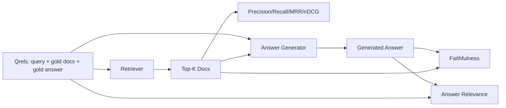

# RAG Evaluation: Precision, Recall, MRR, nDCG, Faithfulness, Answer Relevance · RAG 评测：Precision、Recall、MRR、nDCG、忠实度与答案相关性

如果你不能同时给你的检索和你的答案打分，你就没法交付这个系统。两者不是同一个指标，而同一个提示词会在不同的轴上失败。

> If you cannot grade your retrieval and your answer at the same time, you cannot ship the system. The two are not the same metric and the same prompt fails on different axes.

**Type:** Build
**Languages:** Python
**Prerequisites:** Phase 11 lessons 06 (RAG), 10 (evaluation); Phase 19 Track B foundations (lessons 20-29); Phase 19 lessons 64, 65, 66, 67
**Time:** ~90 minutes

## Learning Objectives · 学习目标

- 从黄金 qrels 计算四个检索指标：precision@k、recall@k、MRR（平均倒数排名，mean reciprocal rank）和 nDCG@k。
- 计算两个答案级指标：忠实度（faithfulness，每条论断都有检索上下文支撑）与答案相关性（answer relevance，答案切题）。
- 构建评测端到端读取的测试 qrels 文件（查询、黄金文档 id、黄金答案文本）。
- 读懂指标数值来定位管线在哪一环失败：检索、排序、生成，还是落地（grounding）。

> Compute four retrieval metrics from gold qrels: precision@k, recall@k, MRR (mean reciprocal rank), and nDCG@k.
> Compute two answer-grade metrics: faithfulness (every claim grounded in retrieved context) and answer relevance (the answer addresses the question).
> Build a fixture qrels file (queries, gold doc ids, gold answer text) that the eval reads end to end.
> Read the metric values to diagnose where a pipeline is failing: retrieval, ranking, generation, or grounding.

## The Problem · 问题在哪

一个 RAG 系统至少有四个活动部件：分块器（chunker）、检索器（retriever）、重排序器（reranker）、生成器（generator）。任何一个都可能是错误答案的元凶。没有逐级指标，你是在盲飞。

用户报告了一个错误答案。是分块器把答案区间切走了？是检索器没把那个块放进 top-k？是重排序器把正确的块挤出了位置一？还是生成器无视了那个块、自己编了一个？只看答案说不出来。你需要：

- 检索指标：给检索器的产出打分。
- 排序指标：给正确块在顺序中的位置打分。
- 忠实度：给生成器是否停留在检索上下文之内打分。
- 答案相关性：给答案是否切题打分。

本课在一份测试 qrels 文件之上把六个指标全部建出来。评测离线且确定；生产中你把 mock 的 LLM 评审（LLM-as-judge）换成真的。

> A RAG system has at least four moving parts: chunker, retriever, reranker, generator. Any of them can be the cause of a wrong answer. Without per-stage metrics you are flying blind.
> A user reports a wrong answer. Is it because the chunker cut the answer span? Is it because the retriever did not include the chunk in top-k? Is it because the reranker pushed the right chunk past position one? Is it because the generator ignored the chunk and made something up? You cannot tell from the answer alone. You need:
> This lesson builds all six on top of a fixture qrels file. The eval is offline and deterministic; in production you swap the mock LLM-as-judge for a real one.

## The Concept · 概念



### Precision@k · Precision@k（精确率@k）

检索器返回的 top-k 文档中，落在黄金集合里的占多少？黄金有三篇，top-3 命中其中两篇、另一篇是错的，则 precision@3 为 2 / 3。当检索到不相关块的成本高时用 precision（生成器会为它浪费 token，或者这个块会污染答案）。

> Of the top-k documents the retriever returned, what fraction are in the gold set? If gold has three documents and the top-3 returns two of them and one wrong one, precision@3 is 2 / 3. Use precision when the cost of an irrelevant retrieved chunk is high (the generator wastes tokens on it, or the chunk poisons the answer).

### Recall@k · Recall@k（召回率@k）

黄金文档中，落入 top-k 的占多少？黄金有三篇，top-5 把三篇全包含，则 recall@5 为 1.0。当漏掉答案的成本高时用 recall（你宁愿多看一个错误块，也不愿彻底错过答案块）。

生产 RAG 里人们最常引用的指标是 recall@k。生成器丢掉不相关块很容易；它无法从没见过的块里发明答案。

> Of the gold documents, what fraction are in the top-k? If gold has three documents and the top-5 contains all three, recall@5 is 1.0. Use recall when the cost of a missed answer is high (you would rather see one extra wrong chunk than miss the answer chunk entirely).
> In production RAG the metric people usually quote is recall@k. Generation can drop irrelevant chunks easily; it cannot invent an answer from a chunk it never saw.

### MRR (Mean Reciprocal Rank) · MRR（平均倒数排名）

对每个查询，在排序列表里找第一篇相关文档的位置。倒数排名是 1 / 位置。在查询集上取平均。MRR 是「检索器把最佳答案放到多靠前」的单数字摘要。

MRR 重重加权位置 1。黄金文档在 rank 1 的查询贡献 1.0。rank 2 贡献 0.5。rank 10 贡献 0.1。这个指标被列表头部主导。

> For each query, find the position of the first relevant document in the ranked list. The reciprocal rank is 1 / position. Mean across the query set. MRR is a single-number summary of how well the retriever puts the best answer at the top.
> MRR weights position-1 heavily. A query where the gold doc is at rank 1 contributes 1.0. Rank 2 contributes 0.5. Rank 10 contributes 0.1. The metric is dominated by the top of the list.

### nDCG@k · nDCG@k

归一化折损累计增益（Normalized Discounted Cumulative Gain）。完整公式给每篇被检索文档一个增益（常见做法：相关为 1，不相关为 0），按位置的对数折损，求和，再除以理想 DCG（你完美排序时会得到的 DCG）。范围 0 到 1。

nDCG 容纳分级相关性：黄金可以写「doc A 是 3，doc B 是 2，doc C 是 1」。MRR 和 recall@k 把一切都压平成二值。当语料里每个查询有多篇部分相关文档时，用 nDCG。

> Normalized Discounted Cumulative Gain. The full formula assigns a gain to each retrieved document (often 1 for relevant, 0 for not), discounts by the log of the position, sums, and divides by the ideal DCG (the DCG you would have if you ranked perfectly). Range 0 to 1.
> nDCG accommodates graded relevance: the gold can say "doc A is 3, doc B is 2, doc C is 1". MRR and recall@k flatten everything to binary. Use nDCG when the corpus has multiple partially-relevant documents per query.

### Faithfulness · 忠实度

对生成答案里的每条论断（claim），检查它是否被检索上下文支撑。标准实现用一个 LLM-as-judge 提示：输入（论断，上下文），返回是或否。指标是通过的论断占比。

忠实度抓住的是生成器凭空发明内容的失败模式。哪怕检索器返回了正确的块，一个会幻觉的生成器就是坏的。忠实度也叫 groundedness、support、attribution。

本课用一个确定性 mock 评审实现忠实度：按阈值检查每条论断的 token 是否与检索上下文重叠。生产中换成真实模型调用。指标的形状不变。

> For each claim in the generated answer, check whether the claim is supported by the retrieved context. The standard implementation uses an LLM-as-judge prompt that takes (claim, context) and returns yes or no. The metric is the fraction of claims that pass.
> Faithfulness catches the generator failure mode where the model invents content. Even if the retriever returned the right chunks, a generator that hallucinates is broken. Faithfulness is also called groundedness, support, attribution.
> This lesson implements faithfulness with a deterministic mock judge that checks whether each claim's tokens overlap the retrieved context by a threshold. In production you swap to a real model call. The shape of the metric is the same.

### Answer relevance · 答案相关性

答案真的切题吗？忠实度问「答案是否落地在上下文里」。答案相关性问「答案是否落地在问题上」。一个忠实但跑题的答案，忠实度高、相关性低。一个简短、切题但无视上下文的答案，相关性高、忠实度低。

标准实现同样用 LLM-as-judge：输入（问题，答案），问答案是否回应了问题。本课实现了一个 token 重叠加评审的替身。

> Does the answer actually address the question? Faithfulness asks "is the answer grounded in the context?". Answer relevance asks "is the answer grounded in the question?". A faithful but off-topic answer scores high on faithfulness and low on relevance. A short, on-topic answer that ignores the context scores high on relevance and low on faithfulness.
> The standard implementation also uses LLM-as-judge: take (question, answer) and ask whether the answer addresses the question. This lesson implements a token-overlap-plus-judge stand-in.

## The fixture qrels · 测试用 qrels

```python
{
  "qid": "q1",
  "query": "what is the abort threshold for multipart uploads",
  "gold_doc_ids": ["d1", "d3"],
  "gold_answer_substring": "three failed parts",
  "graded_relevance": {"d1": 3, "d3": 2},
}
```

每条查询携带：

- 查询字符串，
- 一个黄金文档 id 集合（给 precision / recall / MRR 用），
- 一个分级相关性字典（给 nDCG 用），
- 黄金答案子串（作为参考元数据挂在每条 qrel 上；本课的忠实度是把抽取出的论断拿去对照检索上下文评审，而不是对照这个子串）。

生产中这些靠人工标注。本课附带手工构建的测试集，评测开箱即跑。

```figure
ci-rag-metric-ladder
```

> Each query carries:
> In production you label these. This lesson ships a hand-built fixture so the eval runs out of the box.

## Build It · 动手造

`code/main.py` 实现了：

- `precision_at_k(retrieved, gold, k)` —— 字面定义。
- `recall_at_k(retrieved, gold, k)` —— 字面定义。
- `mean_reciprocal_rank(retrieved_list_of_lists, gold_list)` —— 对查询取平均。
- `ndcg_at_k(retrieved, graded_relevance, k)` —— DCG / IDCG，支持二值或分级增益。
- `extract_claims(answer)` —— 把答案切成句子形状的论断。
- `faithfulness(claims, context_texts, judge)` —— 被判定有支撑的论断占比。
- `answer_relevance(question, answer, judge)` —— 评审答案是否回应了问题。
- `MockJudge` —— 确定性 token 重叠评审，评测离线可跑。
- `evaluate_pipeline(pipeline_fn, qrels, ks)` —— 跑全部指标的编排器。
- 一个演示：让三种管线变体（分块基线、混合检索、混合 + 重排）对着 qrels 跑，打印指标表。

运行：

```bash
python3 code/main.py
```

输出在一张指标表里给出每个变体的 precision@k、recall@k、MRR、nDCG@k、忠实度和答案相关性。混合检索行在 recall 上压过分块基线；重排行在 MRR 上压过混合检索。

> The output shows precision@k, recall@k, MRR, nDCG@k, faithfulness, and answer relevance for each variant in a single metrics table. The hybrid retrieval row beats the chunker baseline on recall; the rerank row beats hybrid on MRR.

## Reading the metrics to diagnose failures · 读指标定位故障

| 症状 | 可能原因 | 该修什么 |
|---------|-------------|-------------|
| recall@k 低、precision@k 低 | 分块器切走了答案，或检索器找不到它 | 分块器边界（第 64 课）或检索器模态（第 65 课） |
| recall@k 尚可、MRR 低 | 正确块在 top-k 里但不在位置 1 | 重排序器（第 66 课） |
| MRR 高、忠实度低 | 尽管上下文正确，生成器仍在编造内容 | 生成提示词；强制「引用否则拒绝」 |
| 忠实度高、相关性低 | 答案有落地但跑题 | 查询改写器（第 67 课）或生成提示词 |
| 四项全高、用户仍然抱怨 | 评测集不具代表性 | 用真实用户查询扩充 qrels |

## Failure modes the demo will hide · 演示藏不住的失败模式

**LLM-as-judge 偏置。** 模型会把自己的输出判得比实际更忠实。评审用与生成器不同的模型家族，或者对样本人工打分。

**Qrels 腐烂。** 语料一变，黄金答案就漂移。2024 年 1 月对 q1 来说是黄金的那篇文档，到 2024 年 10 月就不再是正确答案，因为团队把函数改名了。按季度安排 qrels 评审。

**逐句忠实度漏掉宏观论断。** 每句话都忠实可以通过，而整篇答案的结构却误导人。在自动指标之上加一个样本级的定性评审。

**Recall@k 掩盖逐查询失败。** 90% 的平均召回可以藏住某一类查询永远失败。按查询类别（字面、改述、多主题）给 qrels 切片，分片报告。

> **LLM-as-judge bias.** A model judges its own outputs as more faithful than they are. Use a different model family for the judge than the generator, or hand-grade a sample.
> **Qrels rot.** The gold answers drift as the corpus changes. A doc that was gold for q1 in January 2024 is no longer the right answer in October 2024 because the team renamed the function. Schedule a quarterly qrels review.
> **Faithfulness micro-checks miss macro-claims.** Per-sentence faithfulness can pass while the overall answer's structure misleads. Add a sample-level qualitative review on top of the automated metric.
> **Recall@k masks per-query failures.** A 90% average recall can hide that one query class always misses. Slice the qrels by query class (literal, paraphrased, multi-topic) and report per-slice.

## Use It · 实战用法

生产模式：

- 每次改动检索器或生成器都跑评测。把 recall@k 的回退当成测试失败对待。
- 持久化每条查询的指标轨迹。用户投诉时，查出匹配的 qrels 条目，看它当时是否本可被发现。
- 给 qrels 分层：20 条查询的冒烟集（smoke set）跑在 CI 里；200 条的回归集每夜跑；2000 条的深度集每周跑。

> Production patterns:
> - Run the eval on every retriever or generator change. Treat a recall@k regression like a test failure.
> - Persist the metric trace per query. When a user complains, look up the qrels entry that matches and see whether it would have been caught.
> - Tier the qrels: a smoke set of 20 queries that runs in CI; a regression set of 200 that runs nightly; a deep set of 2000 that runs weekly.

## Ship It · 交付

第 69 课把整条管线（分块器、检索器、重排序器、生成器）接起来，并对端到端系统跑本课评测。

> Lesson 69 wires the entire pipeline (chunker, retriever, reranker, generator) and runs this eval against the end-to-end system.

## Exercises · 练习

1. 加第五个检索指标：hit-rate@k。与 recall@k 对比。解释它们何时不同。
2. 实现分级忠实度：0（无支撑）、1（部分支撑）、2（完全支撑）。相应更新指标。
3. 把 mock 评审换成真实模型调用。在测试集上测量 mock 与真评审的分歧。
4. 加查询类别切片（「literal」「paraphrased」「multi-topic」）。报告分片指标。
5. 加一个「答案长度」指标，并与忠实度做相关。画出曲线。

## Key Terms · 术语表

| 术语 | 人们口头说 | 实际含义 |
|------|-----------------|------------------------|
| Precision@k | 「检索结果中的命中率」 | top-k 中属于黄金文档的比例 |
| Recall@k | 「黄金文档中的命中率」 | 黄金文档落入 top-k 的比例 |
| MRR | 「首个命中的位置」 | 第一篇相关文档的 1 / rank 的平均值 |
| nDCG@k | 「分级排序质量」 | top-k 的 DCG 除以理想 DCG |
| Faithfulness（忠实度） | 「落地性（groundedness）」 | 答案论断被检索上下文支撑的比例 |
| Answer relevance（答案相关性） | 「它切题了吗？」 | 答案是否匹配问题的意图 |
| Qrels | 「黄金标注」 | 查询及其黄金文档与答案的标注集合 |

## Further Reading · 延伸阅读

- Buckley, Voorhees, "Evaluating Evaluation Measure Stability", SIGIR 2000 —— 排序指标的奠基论文
- Jarvelin, Kekalainen, "Cumulated Gain-based Evaluation of IR Techniques" —— nDCG 论文
- [Ragas: Automated Evaluation of RAG Pipelines](https://docs.ragas.io)
- [Anthropic, Introducing Contextual Retrieval](https://www.anthropic.com/engineering/contextual-retrieval) —— 用 1 减 recall@20 给检索打分
- Phase 11 lesson 10 —— 评测框架基础
- Phase 19 lessons 64-67 —— 在这里被评测的组件
- Phase 19 lesson 69 —— 本评测所打分的端到端管线
