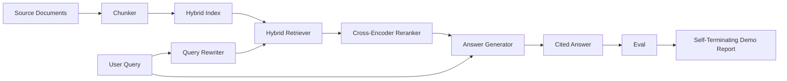

# End-to-End RAG System · 端到端 RAG 系统

六节课的组件。一条管线。一个评测循环。一个自终止的演示。这就是你交付的系统。

> Six lessons of components. One pipeline. One eval loop. One self-terminating demo. This is the system you ship.

**Type:** Build
**Languages:** Python
**Prerequisites:** Phase 11 lessons 06 (RAG), 10 (evaluation); Phase 19 Track B foundations (lessons 20-29); Phase 19 lessons 64, 65, 66, 67, 68
**Time:** ~90 minutes

## Learning Objectives · 学习目标

- 把分块器（chunker）、混合检索器（hybrid retriever）、查询改写器（rewriter）、交叉编码器重排序器（reranker）和答案生成器组装成单条端到端管线。
- 实现一个按块锚点（chunk anchor）为论断标注引用的答案生成器，带低置信即拒答（refuse-on-low-confidence）的回退。
- 对组装好的管线跑第 68 课评测，证明分级构建在每个指标上都胜过同一批组件各自为战。
- 构建一个自终止的 CLI 演示：摄取测试语料，跑固定查询集，以零退出码退出并输出总结报告。

> Compose the chunker, hybrid retriever, query rewriter, cross-encoder reranker, and answer generator into a single end-to-end pipeline.
> Implement an answer generator that cites its claims by chunk anchor, with refuse-on-low-confidence fallback.
> Run the lesson 68 eval against the assembled pipeline and prove the staged build wins on every metric over the same components in isolation.
> Build a self-terminating CLI demo that ingests a fixture corpus, runs a fixed query set, and exits zero with a summary report.

## The Problem · 问题在哪

六个组件各自为战证明不了任何事。分块器可以在语料的 recall@5 上赢，却在系统的 recall@5 上输，因为检索器排不动分块器的产出。重排序器可以在合成候选池上抬 MRR，却在真实双塔候选上失败，因为双塔在重排预算处的召回太低。查询改写器可以在单条查询上把黄金文档顶上来，又在下一条上失败，因为 LLM mock 返回了一个退化的假设文档。

集成测试是：整条管线对着同一份测试 qrels、用同一套指标、由一个把所有东西接在一起的编排器文件端到端跑一遍。这就是本课要造的东西。如果集成管线上的指标压过每级隔离演示的指标，你就证明了系统。

> Six components in isolation prove nothing. The chunker can win on recall@5 against the corpus and lose on the system's recall@5 because the retriever cannot rank what the chunker emits. The reranker can lift MRR on a synthetic candidate pool and fail on real bi-encoder candidates because the bi-encoder's recall at the rerank budget is too low. The query rewriter can promote the gold doc on a single query and break on the next because the LLM mock returns a degenerate hypothetical.
> The integration test is the whole pipeline run end to end against the same fixture qrels, with the same metric, with one orchestrator file that wires everything together. That is what this lesson builds. If the metrics on the integrated pipeline beat the metrics on each stage's isolated demo, you have proven the system.

## The Concept · 概念



### Wiring choices · 接线选择

管线是一张小图。每一级都是一个签名清晰的函数。

| 阶段 | 输入 | 输出 |
|-------|-------|--------|
| 分块器（Chunker） | 文档文本 | Chunk 记录列表 |
| 检索器（Retriever） | 查询字符串 | Top-N Chunk 记录 |
| 改写器（Rewriter，可选） | 查询字符串 | 改写列表 + 假设文档 |
| 重排序器（Reranker） | 查询、候选 | 带交叉编码器分数的 Top-K Chunk 记录 |
| 生成器（Generator） | 查询、top-K Chunk 记录 | 带引用的答案字符串 |

每个签名稳定时，组合就直截了当。本课的 `Pipeline` 类持有五级和一个按序执行它们的 `query` 方法。每一级都可替换：传入不同的分块器、检索器、改写器、重排序器或生成器，管线照样跑。

> The pipeline is a small graph. Each stage is a function with a clear signature.
> The composition is straightforward when each signature is stable. The lesson's `Pipeline` class holds the five stages and a `query` method that runs them in order. Every stage is swappable: pass a different chunker, retriever, rewriter, reranker, or generator and the pipeline still runs.

### Answer generator with citations · 带引用的答案生成器

生成器是最后一级，也是最容易坏的。本课附带一个确定性 mock 生成器，它：

1. 拿到 top-K 重排后的块。
2. 选出至多两个文本与查询内容词重叠最高的块。
3. 输出的答案是「每个入选块取一句话」拼接而成，每句话后面跟一个 `[doc_id:chunk_index]` 锚点。
4. 如果没有块的重叠超过拒答阈值，输出「I do not know」，不带引用。

生产中把 mock 换成真实 LLM 调用，提示词模板：

```
You are answering a question using only the snippets below.
Cite every claim with the anchor in parentheses.
If the snippets do not answer the question, say "I do not know".

Question: {query}

Snippets:
{enumerated chunks with anchors}

Answer:
```

低置信即拒答这条路，正是要记录交叉编码器 rank-1 分数的全部理由。分数低于语料阈值，生成器就拒绝回答。这是对抗幻觉答案的安全阀。

> The generator is the last stage and the easiest to break. The lesson ships a deterministic mock generator that:
> The refuse-on-low-confidence path is the whole reason the cross-encoder rank-1 score is logged. If it sits below the corpus threshold, the generator refuses. This is the safety valve against hallucinated answers.

### The self-terminating demo · 自终止演示

演示把一切端到端跑一遍。它打印一条查询的逐级分解，对四条测试 qrels 跑评测，打印指标表，并在所有第 68 课指标达到演示里设定的阈值时以状态零退出。任何指标低于阈值，演示就以非零状态退出，并给出指名失败指标的消息。

这就是 CI 冒烟测试的形状。管线离线、快、确定。阈值在测试集上刻意收紧，所以六节课里任何一处退化都会让演示失败。

```figure
rag-pipeline-flow
```

> The demo runs everything end to end. It prints a per-stage breakdown of one query, runs the eval over the four fixture qrels, prints a metrics table, and exits with status zero if all the lesson 68 metrics meet the thresholds set in the demo. If any metric is below threshold, the demo exits with a non-zero status and a message naming the failing metric.
> This is the shape a CI smoke test takes. The pipeline runs offline, fast, deterministic. The thresholds are deliberately tight on the fixture so a regression in any of the six lessons fails the demo.

## Build It · 动手造

`code/main.py` 实现了：

- `Chunk` —— 贯穿所有级的记录（在第 64 课的形状上加 chunk_index 和来源 doc_id）。
- `Chunker` —— 从第 64 课选一种策略（默认递归切分）。
- `HybridIndex` —— 打包第 65 课的 BM25 + 稠密 + RRF。
- `Rewriter`（可选）—— 按查询长度和连词是否出现，从第 67 课的 HyDE、多查询、分解中挑一个。
- `Reranker` —— 第 66 课训练好的交叉编码器，用更小的测试训练集，让它几秒内收敛。
- `Generator` —— 带引用和低置信拒答的确定性 mock 生成器。
- `Pipeline` —— 组合五级，`query(question)` 方法返回 `Result(answer, top_k, latency_ms_per_stage)`。
- `run_demo()` —— 摄取语料，跑三条测试查询，跑评测，打印结果，按阈值设置退出码。

运行：

```bash
python3 code/main.py
```

输出是一条打印出来的查询轨迹、完整的评测表和一个最终 pass/fail 状态。在测试集上返回退出码 0。

> The output is one printed query trace, the full eval table, and a final pass/fail status. Returns exit code 0 on the fixture.

## Failure modes the demo will hide · 演示藏不住的失败模式

**分块器边界漂移。** 如果在评测 qrels 标注环节和演示之间换了分块器策略，黄金文档 id 就对不上了。把分块器策略锁进 qrels 文件。演示包含一个写明分块器的头部。

**重排序器训练集泄漏进评测。** 第 66 课的 14 条训练三元组里有与评测查询相像的查询。生产中要严格留出（hold out）评测查询。演示的评测查询刻意与重排训练集不相交。

**Mock 生成器藏住幻觉风险。** mock 不可能幻觉，因为它只输出检索块里的文本。本课注明了这一点，并把生产替换路径指向真实模型。

**没有流式。** 管线在每级结束时返回完整答案。生产系统会流式输出生成器的内容。流式超出范围；无论如何，答案级指标都作用在最终字符串上。

**延迟是离线的。** mock LLM 调用是常数时间。真实 LLM 调用占大头。在请求范围内规划延迟预算；本课的逐级计时只测 CPU 工作。

> **Chunker boundary drift.** If you swap the chunker strategy between the eval qrels labeling pass and the demo, the gold doc ids no longer line up. Lock the chunker strategy in the qrels file. The demo includes a header that names the chunker.
> **Reranker training set leaks into the eval.** The 14 training triples in lesson 66 include queries that resemble the eval queries. In production, hold out the eval queries strictly. The demo's eval queries are deliberately disjoint from the rerank training set.
> **Mock generator hides hallucination risk.** The mock cannot hallucinate because it only emits text from the retrieved chunks. The lesson notes this and points the production swap-in path to a real model.
> **No streaming.** The pipeline returns the full answer at the end of every stage. A production system would stream the generator's output. Streaming is out of scope; the answer-grade metrics work on the final string either way.
> **Latency is offline.** The mock LLM calls are constant time. Real LLM calls dominate. Plan a latency budget in the request scope; the lesson's per-stage timing only measures CPU work.

## Use It · 实战用法

生产模式：

- 管线文件放在单一编排器之下，各级接口显式。不要把接线散落在仓库各处。
- 每次触碰某一级的合并之前先跑评测。评测掉了，合并就不落地。
- 持久化每次 CI 运行的指标轨迹，以便把回退归因到某次级别替换。
- 加一个 20 条查询的冒烟集（回归集的子集），30 秒内跑完；完整回归集每夜跑。

> Production patterns:
> - Ship the pipeline file under one orchestrator with explicit stage interfaces. Avoid spreading the wiring across the repo.
> - Run the eval before every merge that touches a stage. If the eval drops, the merge does not land.
> - Persist the metric trace per CI run so you can attribute regressions to a stage swap.
> - Add a smoke set of 20 queries (subset of the regression set) that runs in under 30 seconds; the full regression set runs nightly.

## Ship It · 交付

本课的管线文件就是 Phase 19 Track F 后续课程所假设的形状。后续课程会在它之上加入摄取自动化、增量重建索引、遥测和一个服务层。检索、重排、改写和评测这几半在这里已经完整。

> The pipeline file in this lesson is the shape the rest of Phase 19's Track F lessons assume. Subsequent lessons would add ingestion automation, incremental re-index, telemetry, and a serving layer on top. The retrieval, rerank, rewrite, and eval halves are complete here.

## Exercises · 练习

1. 在改写器内部加一个逐查询策略选择器：用第 67 课的启发式（长度、连词、术语比率）挑 HyDE、多查询或分解。
2. 给生成器加一个藏在环境变量开关背后的真实 LLM 调用。默认用 mock。测量延迟差。
3. 扩展演示，接受 `--corpus path` 标志来加载真实语料。重跑评测和阈值检查。
4. 给分块器加一个 `--strategy` 标志。测量每种策略对端到端召回的贡献。
5. 加一个流式生成器接口并接进评测。确认忠实度算在最终字符串上而不是流式前缀上。

## Key Terms · 术语表

| 术语 | 人们口头说 | 实际含义 |
|------|-----------------|------------------------|
| Pipeline（管线） | 「RAG 管线」 | 从摄取到带引用答案的组合各级 |
| Citation anchor（引用锚点） | 「来源链接」 | 挂在每条论断上的 (doc_id, chunk_index) 引用 |
| Refuse-on-low-confidence（低置信拒答） | 「I do not know」 | 重排序器 top-1 分数低于阈值时，生成器不给出答案 |
| Smoke set（冒烟集） | 「CI 评测」 | 每次 PR 检查都会跑的最小 qrels 子集 |
| Stage interface（级接口） | 「函数签名」 | 每个管线级稳定的输入与输出类型 |

## Further Reading · 延伸阅读

- [Anthropic, Building search and retrieval](https://www.anthropic.com/news/contextual-retrieval)
- [Pinterest, MCP internal search](https://medium.com/pinterest-engineering) —— 生产架构参考
- [Ragas: Automated Evaluation of RAG Pipelines](https://docs.ragas.io)
- Phase 11 lesson 06 —— RAG 基础
- Phase 19 lessons 64-68 —— 在这里被组装的组件
