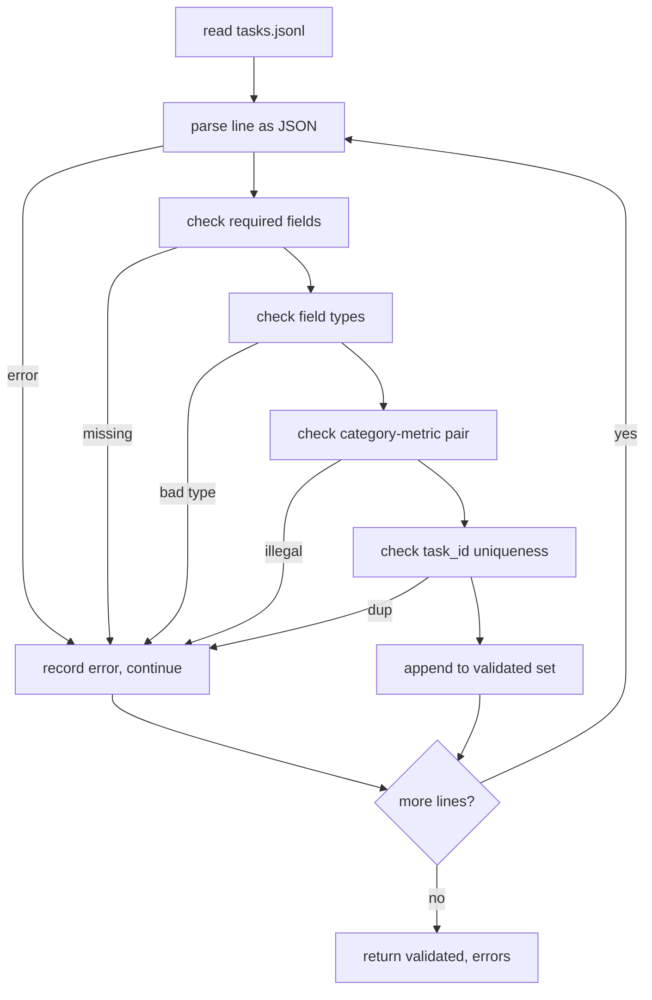

# Task Spec Format · 任务规格格式

评测框架的好坏，取决于它的任务遵守什么样的契约。在你写下第一个打分函数之前，先冻结 JSONL 的形状和指标词表。

> An eval harness is only as good as the contract its tasks honour. Freeze the JSONL shape and the metric vocabulary before you write a single scoring function.

**Type:** Build
**Languages:** Python
**Prerequisites:** Phase 19 Track B foundations
**Time:** ~90 min

## Learning objectives · 学习目标

- 定义一个 JSONL 任务记录 schema，用一个形状覆盖算术、多选、代码执行、分类和自由文本摘要。
- 钉死一个封闭的指标名词表（vocabulary），让下游课程（71-73）可以按单个字段分发。
- 把 few-shot 示例和后处理规则规定为任务的一部分而不是运行器的一部分，让同一提示词在不同模型上产出同一目标。
- 实现一个严格校验器，在畸形记录到达运行器之前就拒收。
- 交付一套 10 任务测试集，覆盖规格的每条分支，让校验器有真东西可嚼。

> Define a JSONL task record schema that covers arithmetic, multiple-choice, code execution, classification, and free-text summarisation in one shape.
> Pin a closed vocabulary of metric names so downstream lessons (71-73) can dispatch on a single field.
> Specify few-shot examples and post-processing rules as part of the task, not the runner, so the same prompt produces the same target across models.
> Implement a strict validator that rejects malformed records before they reach the runner.
> Ship a 10-task fixture set that exercises every branch of the spec so the validator has something real to chew on.

```figure
ci-task-spec-gate
```

## Why a frozen spec · 为什么要冻结规格

研究代码库积累评测脚本的速度比积累测试快。六个月下来，每个 notebook 有自己的 JSON 形状，每个指标被重复实现两遍，任何东西都无法跨运行比较。修法很无聊。选定一个 schema。写一个校验器。其余全部拒收。这就是本课做的事。

这个形状借鉴了 BIG-bench、HELM 和 lm-eval 风格框架的想法，但字段名是我们自己的。每个字段只有一个所有者。运行器读任务。指标读目标。后处理步骤归一化生成结果。没有字段可以在管线中途被改动。

> A research codebase will accumulate eval scripts faster than it accumulates tests. Six months in, every notebook has its own JSON shape, every metric is reimplemented twice, and nothing can be compared across runs. The fix is boring. Pick a schema. Write a validator. Reject everything else. That is what this lesson does.
> The shape borrows ideas from BIG-bench, HELM, and lm-eval style harnesses, but the field names are ours. Every field has a single owner. The runner reads the task. The metric reads the targets. The post-process step normalises the generation. No field is mutable mid-pipeline.

## The record shape · 记录形状

一个任务是单行上的 JSON 对象。框架读取 `tasks.jsonl` 并逐行独立校验。坏行中止那条记录，而不是整个运行。

```json
{
  "task_id": "arith_001",
  "category": "arithmetic",
  "prompt": "Compute the result. Question: 17 + 24\nAnswer:",
  "targets": ["41"],
  "metric_name": "exact_match",
  "few_shot_examples": [
    {"prompt": "Question: 2 + 2\nAnswer:", "completion": "4"}
  ],
  "post_process": "strip_whitespace",
  "metadata": {"difficulty": "easy"}
}
```

必填字段是 `task_id`、`category`、`prompt`、`targets`、`metric_name`、`post_process`。`few_shot_examples` 和 `metadata` 可选。未知的顶层字段判校验失败。

> A task is a JSON object on a single line. The harness reads `tasks.jsonl` and validates each line independently. A bad line aborts that record, not the run.
> The required fields are `task_id`, `category`, `prompt`, `targets`, `metric_name`, `post_process`. `few_shot_examples` and `metadata` are optional. Unknown top-level fields fail validation.

## Field rules · 字段规则

`task_id` 是不含空白的字符串。校验器强制它在整个文件内唯一。

`category` 取 `arithmetic`、`mcq`、`code_exec`、`classification`、`summary` 之一。category 约束哪一对 metric 和 post-process 是合法的。`code_exec` 任务必须用 `metric_name = code_exec`；`mcq` 任务必须用 `metric_name = exact_match` 且目标为单个字母。

`prompt` 是非空字符串。校验器禁止尾部空白，并拒收 prompt 正文里已经内嵌 few-shot 块的记录。few-shot 的渲染发生在运行器里，不是作者手里。

`targets` 是非空字符串列表。对 `exact_match`，任一元素匹配即算命中。对 `f1` 和 `rouge_l`，得分最高的目标胜出。对 `mcq`，列表恰好持有一个元素。

`metric_name` 取 `exact_match`、`f1`、`bleu_4`、`rouge_l`、`accuracy`、`code_exec` 之一。词表封闭。新指标需要新课程和这里的新条目。

`few_shot_examples` 是 `{prompt, completion}` 对的列表。校验器把列表上限设为八条，保证提示词有界。

`post_process` 取 `none`、`strip_whitespace`、`lower`、`extract_letter`、`extract_code_block`、`extract_first_line` 之一。每条规则都有单一确定的行为。校验器禁止组合规则。

> `task_id` is a string with no whitespace. The validator enforces uniqueness across the file.
> `category` is one of `arithmetic`, `mcq`, `code_exec`, `classification`, `summary`. The category constrains which metric and post-process pair is legal. A `code_exec` task must use `metric_name = code_exec` and a `mcq` task must use `metric_name = exact_match` against a single-letter target.
> `prompt` is a non-empty string. The validator forbids trailing whitespace and rejects records that already contain a few-shot block in the prompt body. Few-shot rendering happens in the runner, not the author.
> `targets` is a non-empty list of strings. For `exact_match`, any element matching counts. For `f1` and `rouge_l`, the highest-scoring target wins. For `mcq`, the list holds exactly one element.
> `metric_name` is one of `exact_match`, `f1`, `bleu_4`, `rouge_l`, `accuracy`, `code_exec`. The vocabulary is closed. A new metric requires a new lesson and a new entry here.
> `few_shot_examples` is a list of `{prompt, completion}` pairs. The validator caps the list at eight entries to keep prompts bounded.
> `post_process` is one of `none`, `strip_whitespace`, `lower`, `extract_letter`, `extract_code_block`, `extract_first_line`. Each rule has a single deterministic behaviour. The validator forbids combining rules.

## Validator behaviour · 校验器行为



校验器返回两个列表：通过校验的记录，以及带出错行、被违反规则和出错字段的错误记录。错误列表非空时运行器拒绝启动，除非显式设置 `--allow-bad-tasks` 标志。

> The validator returns two lists: validated records and error records with the offending line, the violated rule, and the field at fault. The runner refuses to start if the error list is non-empty unless an explicit `--allow-bad-tasks` flag is set.

## Few-shot rendering · Few-shot 渲染

运行器把 few-shot 示例拼接在提示词前面，用空行分隔。所有模型走同一条代码路径，所以唯一的方差来源就是模型本身。作者只写一次示例，而不是每个供应商写一次。

```python
def render(task):
    parts = []
    for ex in task.get("few_shot_examples", []):
        parts.append(ex["prompt"] + " " + ex["completion"])
    parts.append(task["prompt"])
    return "\n\n".join(parts)
```

> The runner concatenates few-shot examples in front of the prompt with a blank line separator. The same code path runs for every model, so the only source of variance is the model itself. Authors write examples once, not once per provider.

## Post-process rules · 后处理规则

后处理步骤在生成之后、指标之前运行。它是确定性的且无状态。

- `none` 原样返回字符串。
- `strip_whitespace` 去掉首尾空白。
- `lower` 把字符串变成小写。
- `extract_letter` 返回第一个匹配 `[A-E]` 的字符，用于 MCQ。
- `extract_code_block` 返回第一个三反引号围栏块的正文，用于代码执行。
- `extract_first_line` 返回第一个非空行，用于摘要分类。

需要这份列表之外规则的任务，属于新课程。

> The post-process step runs after generation, before the metric. It is deterministic and stateless.
> A task that needs a rule outside this list belongs in a new lesson.

## What this lesson does not do · 本课不做什么

它不打分。它不调用模型。它不运行代码。那些在第 71、72 和 75 课。本课冻结它们全部遵守的契约。

10 任务测试集覆盖两道算术、两道 MCQ、两道代码执行、两道分类和两道摘要题。校验器对全部 10 条通过。另一个测试文件（`tasks_bad.jsonl`）把每条规则都触犯一遍，校验器恰好返回对应数量的错误。

> It does not score. It does not call a model. It does not run code. Those come in lessons 71, 72, and 75. This lesson freezes the contract that all of them honour.
> The 10-task fixture covers two arithmetic items, two MCQ items, two code-exec items, two classification items, and two summarisation items. The validator passes on all 10. A separate fixture (`tasks_bad.jsonl`) trips every rule and the validator returns exactly that many errors.

## How to read the code · 如何读代码

`main.py` 定义了 `TaskSpec`、`validate_task`、`validate_file` 和一个 CLI 入口。测试加载器是 `load_fixtures`。渲染和后处理辅助函数与校验放在一起，这样第 75 课的运行器只需导入一个模块。

从上到下读 `main.py`。然后读 `code/tests/test_spec.py`。测试钉死了每一条校验规则和每一个后处理行为。`main.py` 底部的演示校验附带的测试集并打印摘要。

> `main.py` defines `TaskSpec`, `validate_task`, `validate_file`, and a CLI entry point. The fixture loader is `load_fixtures`. The render and post-process helpers live next to validation so the runner in lesson 75 imports a single module.
> Read `main.py` top to bottom. Then read `code/tests/test_spec.py`. The tests pin every validation rule and every post-process behaviour. The demo at the bottom of `main.py` validates the bundled fixture and prints a summary.

## Going further · 更进一步

真实评测套件长出新类目的方式，和 schema 长出新列的方式一样。清醒的做法是：拒绝新增类目，除非同时新增一个指标、一条后处理规则和至少一个测试任务。把规格当作数据库迁移来对待。每次改动都被评审、版本化并附带测试。本课的校验器就是那道闸门。

> Real eval suites grow categories the way schemas grow columns. The sober move is to refuse to add a category without also adding a metric, a post-process rule, and at least one fixture task. Treat the spec like a database migration. Every change is reviewed, versioned, and accompanied by tests. The validator in this lesson is the gate.
