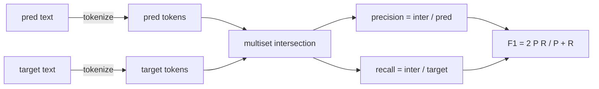
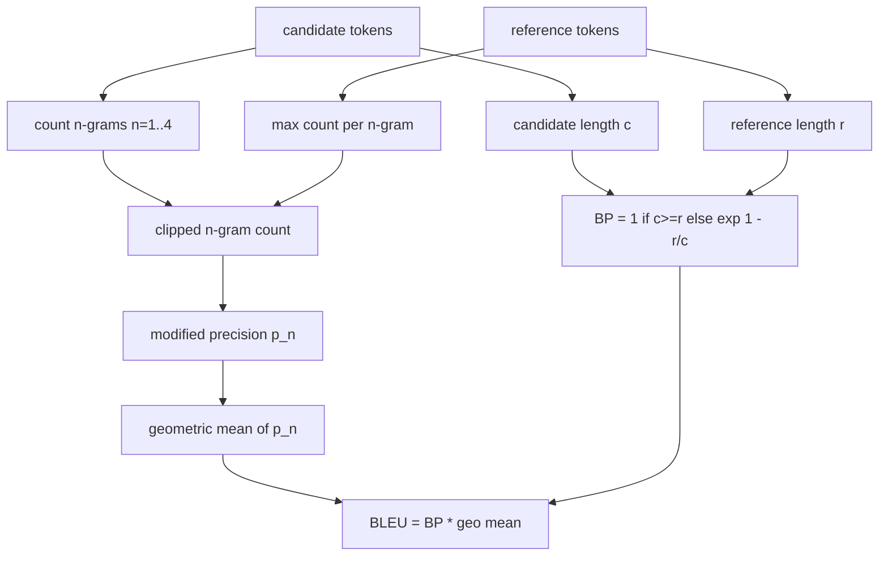

# Classical Metrics · 经典评测指标

> BLEU、ROUGE-L、F1、exact-match、accuracy——五个至今仍撑起绝大多数已发表 LLM 评测数字的指标。从第一性原理逐个实现它们，你才知道每个数字到底意味着什么。
>
> BLEU, ROUGE-L, F1, exact-match, accuracy. Five metrics that still account for most published LLM eval numbers. Implement each from first principles so you know what the number means.

**Type:** Build
**Languages:** Python
**Prerequisites:** Phase 19 Track B foundations, lesson 70
**Time:** ~90 min

## Learning objectives · 学习目标

- 用明确的分词（tokenisation）规则实现 token 级 exact-match、F1 与 accuracy。
- 从零实现 BLEU-4：改进 n-gram 精确率（modified n-gram precision）、n=1 到 4 的几何平均、长度惩罚（brevity penalty）。
- 用最长公共子序列（LCS）实现 ROUGE-L，并用 F-beta 组合精确率与召回率。
- 按第 70 课的 `metric_name` 字段分发，让 runner 保持与具体指标无关（metric-agnostic）。
- 用人工算例（worked examples）得出的参考向量钉死行为，而不是取自第三方库。

```figure
cd-bleu-overlap
```

## Why reimplement · 为什么要重新实现

你会读到一篇论文报告 BLEU 28.3，另一篇报告 BLEU 0.283。你会发现两个库给出的 ROUGE-L 分数相差十分，只因一个库先转小写再截断、另一个不做。摆脱困惑最快的办法，是自己把这些指标写一遍，然后能指出哪一行决定了 tokenizer、哪一行加了平滑。在那之后，跨论文比较数字就变成读指标配置，而不是争论哪个库对。

标准库加 numpy 就够了。BLEU 是计数加一个截断（clamp）；ROUGE-L 是动态规划；F1 是 token 上的多重集合求交。最难的部分是选定一个 tokenizer 并坚持用它。

> You will read papers that report BLEU 28.3 and another that reports BLEU 0.283. You will find ROUGE-L scores that differ by ten points across two libraries because one truncates to lowercase and the other does not. The fastest way to stop being confused is to write the metrics yourself, then point at the line where the tokenizer is decided and the line where the smoothing is applied. After that, comparing numbers across papers becomes a matter of reading the metric setup, not arguing about libraries.
> Stdlib plus numpy is enough. BLEU is counting and a clamp. ROUGE-L is dynamic programming. F1 is a set intersection on tokens. The hardest part is choosing a tokenizer and committing to it.

---

## Tokenisation · 分词

Tokenizer 就是 `re.findall(r"\w+", text.lower())`：转小写、取字母数字串、丢掉标点。本课每个指标都用这一个 tokenizer，runner 无权另选。一旦换了 tokenizer，你跑的就是另一个 benchmark。

```python
TOKEN_RE = re.compile(r"\w+", re.UNICODE)
def tokenize(text):
    return TOKEN_RE.findall(text.lower())
```

这是刻意为之的简化。生产环境还要操心 CJK、缩写和代码标识符。本课的要点是：tokenizer 是一份契约（contract），不是一个可随便拧的旋钮。

> The tokenizer is `re.findall(r"\w+", text.lower())`. Lowercase, alphanumeric runs, drop punctuation. Every metric in this lesson uses this exact tokenizer. The runner does not get to choose. If you swap tokenizers, you are running a different benchmark.
> This is a deliberate simplification. Production setups will care about CJK, contractions, and code identifiers. The point of the lesson is that the tokenizer is a contract, not a knob.

---

## Exact match · 精确匹配

```python
def exact_match(pred, targets):
    return float(any(pred.strip() == t.strip() for t in targets))
```

每个任务返回 1.0 或 0.0，数据集层面取平均。它是算术、选择题（MCQ）和短文本分类任务的主力指标。

> It returns 1.0 or 0.0 per task. The aggregate over a dataset is the mean. This is the workhorse for arithmetic, MCQ, and short classification tasks.

---

## Token-level F1 · token 级 F1

先为预测和目标各建一个 token 多重集合（multiset）。精确率 = 交集大小除以预测的 multiset 大小；召回率 = 同一个交集除以目标的 multiset 大小；F1 是二者的调和平均。实现会处理空预测和空目标的边界情况。



对多目标任务，我们在目标列表上取最大的 F1。这与文献中广泛报告的 SQuAD 式行为一致。

> Set up the token multiset for prediction and target. Precision is the multiset intersection divided by the multiset of the prediction. Recall is the same intersection divided by the multiset of the target. F1 is the harmonic mean. The implementation handles the empty-prediction and empty-target edge cases.
> For multi-target tasks, we take the best F1 over the target list. That matches the SQuAD-style behaviour widely reported in the literature.

---

## BLEU-4

BLEU 是机器翻译的标志性指标，在摘要任务里也仍然常见。我们采用语料级（corpus-level）BLEU-4：带标准长度惩罚（brevity penalty），并对改进 n-gram 计数做加一平滑（additive-one smoothing），这样单个 4-gram 缺失不会把分数直接打到零。

对每个候选-参考对，分别计算 n=1、2、3、4 的改进 n-gram 精确率。改进精确率把候选的 n-gram 计数按该 n-gram 在所有参考中的最大出现次数截断，候选无法靠重复同一个短语刷分。四个精确率取几何平均，再套上长度惩罚。



平滑规则用的是 Lin 和 Och 所谓的 method 1：取对数之前，给每个 n-gram 精确率的分子和分母各加一。这样当参考里没有匹配的 4-gram 时可以避免 `log 0`，且在长候选上仍接近未平滑的值。

> BLEU is the canonical machine-translation metric and it still shows up in summarisation work. ... For each candidate-reference pair, we count modified n-gram precision for n equals 1, 2, 3, 4. Modified precision clips the candidate n-gram count by the maximum count of that n-gram in any reference, so a candidate cannot inflate by repeating one phrase. ... The smoothing rule is the one Lin and Och called method 1: add one to both numerator and denominator of every n-gram precision before taking the log. This avoids `log 0` when a reference has no matching 4-gram and stays close to the unsmoothed value on long candidates.

---

## ROUGE-L

ROUGE-L 比较候选与参考 token 序列的最长公共子序列（LCS）。LCS 能捕捉词序又不要求连续，这正是它成为摘要任务默认指标的原因。我们用标准动态规划表计算 LCS 长度，然后召回率 = `lcs / reference length`，精确率 = `lcs / candidate length`，再用 F-beta 组合——beta 等于 1 时就是对称的 F1 形式。

```python
def lcs_length(a, b):
    n, m = len(a), len(b)
    dp = numpy.zeros((n + 1, m + 1), dtype=int)
    for i in range(n):
        for j in range(m):
            if a[i] == b[j]:
                dp[i+1, j+1] = dp[i, j] + 1
            else:
                dp[i+1, j+1] = max(dp[i+1, j], dp[i, j+1])
    return int(dp[n, m])
```

用 numpy 表格是为了让实现可读；纯 Python 列表同样可行。选择 ROUGE-L 的任务要为每个任务支付 O(n m) 的开销。对典型的摘要长度，这仍在一毫秒以内。

> ROUGE-L compares the longest common subsequence of the candidate and reference token sequences. The LCS captures word order without forcing contiguity, which is why it is the default summarisation metric. ... The numpy table makes the implementation legible; pure Python lists would work too. Tasks that opt into ROUGE-L pay the O(n m) cost per task.

---

## Accuracy · 准确率

对多目标分类任务，accuracy 退化为对单个归一化目标做 exact-match。我们把它暴露成独立函数，这样分发器可以按 `metric_name` 分发，runner 内部不必做字符串比较。

> For multi-target classification tasks, accuracy reduces to exact-match against a single normalised target. We expose it as a separate function so the dispatcher can dispatch on `metric_name` without going through string comparisons inside the runner.

---

## Dispatch contract · 分发契约

唯一入口是 `score(metric_name, prediction, targets)`，返回 `[0, 1]` 内的浮点数。runner 不根据指标名分支：它把调用转交出去，然后写下结果。这个接口就是第 75 课用来对接第 70 课任务规格的面。

```python
def score(metric_name, pred, targets):
    if metric_name == "exact_match":
        return exact_match(pred, targets)
    if metric_name == "f1":
        return max(f1_score(pred, t) for t in targets)
    if metric_name == "bleu_4":
        return max(bleu4(pred, t) for t in targets)
    if metric_name == "rouge_l":
        return max(rouge_l(pred, t) for t in targets)
    if metric_name == "accuracy":
        return accuracy(pred, targets)
    raise ValueError(f"unknown metric_name: {metric_name}")
```

`code_exec` 在第 72 课处理，并将在那里接入分发器。

> The single entry point is `score(metric_name, prediction, targets)`. It returns a float in `[0, 1]`. The runner does not branch on metric name. It hands the call off and writes the result. This is the surface that lesson 75 will glue to the task spec from lesson 70.
> `code_exec` is handled in lesson 72 and slotted into the dispatcher there.

---

## What this lesson does not do · 本课不做什么

它不调用模型。它不做第 70 课后处理规则之外的任何生成结果归一化。它不算置信区间。它不做 BLEURT 或 BERTScore（那些需要模型，属于另一课）。本课给的是地基：五个指标、一个 tokenizer、一张分发表。

> It does not call a model. It does not normalise generations beyond what the post-process rules from lesson 70 already did. It does not compute confidence intervals. It does not do BLEURT or BERTScore (those need a model and live in a different lesson). The point is the floor: five metrics, one tokenizer, one dispatch table.

---

## How to read the code · 如何读代码

`main.py` 把每个指标定义成自由函数，外加分发器。参考向量放在文件底部的 `_reference_examples` 块里。demo 对八个例子跑一遍分发器，并打印每个指标的分数。`code/tests/test_metrics.py` 里的测试钉死参考向量，并压遍所有边界情况（空预测、空参考、无共同 token、完全匹配、重复短语截断）。

从上到下读 `main.py`，函数按复杂度排列。exact_match 和 accuracy 各只有一行；F1 六行；BLEU 和 ROUGE-L 是重头戏，内含关于平滑规则和 LCS 递推式的详细注释。

> `main.py` defines each metric as a free function plus the dispatcher. The reference vectors live in the `_reference_examples` block at the bottom of the file. ... The tests in `code/tests/test_metrics.py` pin the reference vectors and stress every edge case (empty prediction, empty reference, no shared tokens, exact match, repeated phrase clipping).
> Read `main.py` top to bottom. The functions are ordered by complexity. ... BLEU and ROUGE-L are the heavy parts and they include detailed comments on the smoothing rule and the LCS recurrence.

---

## Going further · 延伸

经典指标必要但不充分：它们奖励表面重叠、看不见语义。等你信得过这个经典地基之后，修补办法是在其上叠加基于模型的指标（BLEURT、BERTScore、GEval）。那是后面某节课的事。现在：让这五个指标跑通、用测试钉死，你就拥有一套可审计、快速、可复现的指标栈。

> The classical metrics are necessary, not sufficient. They reward surface overlap and miss meaning. The fix is to layer model-based metrics on top (BLEURT, BERTScore, GEval) once you trust the classical floor. That is a later lesson. For now: make these five work, pin them with tests, and you have a metric stack that is auditable, fast, and reproducible.
