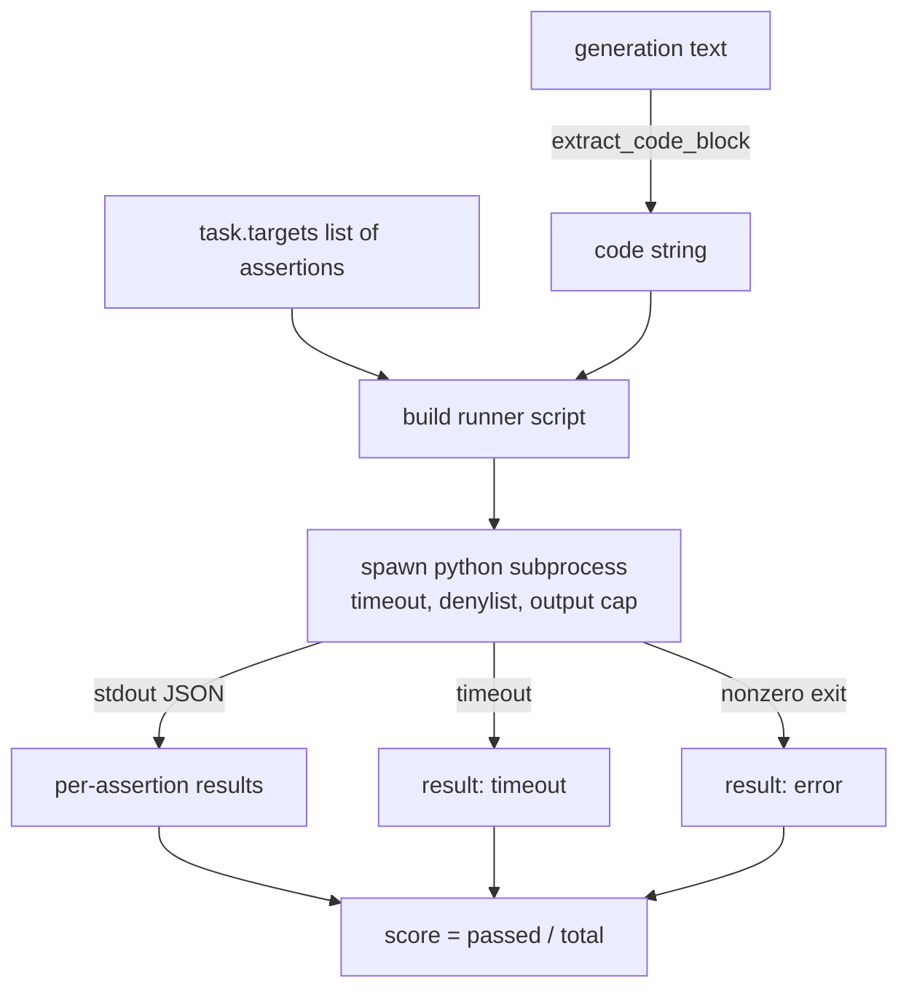
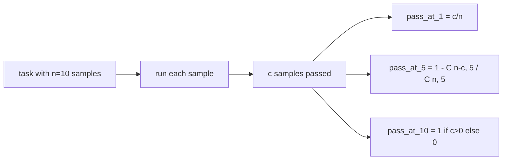

# Code Exec Metric · 代码执行指标

> 生成代码对不对，要看它能不能通过测试。评测框架（eval harness）必须能抽取代码、在不弄垮宿主机的前提下运行它、并诚实地统计通过率。本课就搭建这个能力面。
>
> Generated code is right when it passes the tests. The eval harness has to extract code, run it without crashing the host, and tally pass-rates honestly. This lesson builds that surface.

**Type:** Build
**Languages:** Python
**Prerequisites:** Phase 19 Track B foundations, lessons 70 and 71
**Time:** ~90 min

## Learning objectives · 学习目标

- 从自由格式的生成文本中抽取代码块，方式与第 70 课的后处理规则保持一致。
- 在隔离子进程（subprocess）里执行候选代码，带真实时间超时（wall-clock timeout）、输出上限和 import 黑名单（denylist）。
- 把任务得分定义为：候选代码通过给定断言（assertion）字符串的比例。
- 对从一个模型采样多个生成的任务，计算 pass-at-k。
- 把沙箱崩溃、语法错误和超时当作一等失败模式，给出 runner 可记录的、彼此区分的退出码。

```figure
sandbox-runner
```

## Why an isolated subprocess · 为什么要隔离子进程

内联的 `exec` 既是安全隐患也是稳定性隐患。一句生成的 `while True: pass` 会让评测永远卡死；一句生成的 `import shutil; shutil.rmtree('/')` 的灾难程度和它听起来一模一样。修复办法是：为每个候选拉起一个全新的 Python 解释器，把代码从 stdin 传进去，把断言结果写到 stdout，一旦超时就杀掉进程。宿主评测进程继续运行。

HumanEval、MBPP、BigCodeBench、LiveCodeBench 这类真实评测都用子进程沙箱，有些还在其上叠加 Docker。我们停在子进程这一层是有理由的：它可移植、纯标准库，而且能接住教育评测里真正要紧的失败模式。生产部署还会加 seccomp、网络隔离和只读文件系统；那门「加固」课不属于本 track。

> Inline `exec` is a security and stability hazard. A generated `while True: pass` blocks the eval forever. A generated `import shutil; shutil.rmtree('/')` is exactly as catastrophic as it sounds. The fix is to spawn a fresh Python interpreter per candidate, pass the code on stdin, write the assertion results to stdout, and kill the process if it overruns. The host eval process keeps running.
> Real evals like HumanEval, MBPP, BigCodeBench, and LiveCodeBench all use a subprocess sandbox. ... We stop at the subprocess for a reason: it is portable, it is stdlib, and it catches the failure modes that matter for educational eval.

---

## The shape of a code-exec task · code_exec 任务的形状

一个 `code_exec` 任务把断言字符串放在 `targets` 里。runner 从生成文本中抽出一个 fenced 代码块，围绕它搭建测试 harness，然后运行。



得分是 `[0, 1]` 内的分数：三个断言过两个，得分 0.667。无论哪里失败，runner 返回的形状都一样：子进程崩溃被映射成归一化的错误码，而不是让 Python traceback 一路冒泡到 harness。

> The score is a fraction in `[0, 1]`. A task with three assertions where two pass scores 0.667. The runner returns the same shape no matter what fails: the subprocess crashes are mapped to a normalised error code, not a Python traceback bubbling up to the harness.

---

## The denylist · 导入黑名单

黑名单基于 import。运行候选代码之前，runner 脚本会把危险模块的 import 改写成一个直接抛出 `ImportError("denied")` 的桩（stub）。清单刻意保守：`os.system`、`subprocess`、`socket`、`requests`、`urllib`、`urllib.request`、`urllib.error`、`urllib.parse`、`ctypes`、`shutil`、`http.client`、`asyncio.subprocess`。

我们不想假装它刀枪不入。存心对抗的代码总能逃出 Python 里任何进程内沙箱。黑名单只是兜底；真正承重的是 wall-clock 超时和输出上限。

```python
DENIED = {
    "os.system": True,
    "subprocess": True,
    "socket": True,
    "shutil": True,
    "requests": True,
    "urllib": True,
    "ctypes": True,
}
```

我们在候选前面拼上 `import sys` 和一个把 `os.system` 猴子补丁成抛异常的守卫，以此包裹候选代码。完整模板在 `main.py` 里。

> The denylist is import-based. Before running candidate code, the runner script rewrites imports of dangerous modules to a stub that raises `ImportError("denied")`. ... We do not pretend this is bulletproof. Determined adversarial code can escape any in-process sandbox in Python. The denylist is a backstop. The wall-clock timeout and the output cap are the load-bearing controls.
> We wrap the candidate by prepending `import sys` and a guard that monkey-patches `os.system` to raise. The full template is in `main.py`.

---

## Wall-clock timeout · 真实时间超时

每个子进程默认有 3 秒 wall-clock 预算。runner 用 `subprocess.run(..., timeout=t)`；超时触发时捕获 `TimeoutExpired`、杀掉进程、为该任务记录 `timeout` 退出原因。该任务得分记零。runner 继续跑下一个。

超时可以通过 `task.metadata.timeout_s` 按任务配置。长时间的单测可以申请更多时间；第 70 课的校验器把上限压在 30 秒，保证测试套件有界。

> Every subprocess gets a default budget of three wall-clock seconds. The runner uses `subprocess.run(..., timeout=t)`. If the timeout fires, the runner catches `TimeoutExpired`, kills the process, and records a `timeout` exit reason for the task. The score for that task is zero. The runner moves on.
> The timeout is configurable per task through `task.metadata.timeout_s`. Long-running unit tests can ask for more; the validator from lesson 70 caps the value at thirty seconds to keep the suite bounded.

---

## Output cap · 输出上限

子进程可能刷爆 stdout、耗尽宿主内存。runner 把 stdout 流式写入一个缓冲区，累计一超过 256 KB 就杀掉子进程。结果记为 `exit_code = error`，详情字符串为 `"output overflow"`。实践中它出现的场景是：生成代码不小心写出了一个会打印的死循环。

> The subprocess can flood stdout, exhausting host memory. The runner streams stdout into a buffer and kills the child as soon as the running total crosses 256 KB. The result is recorded as `exit_code = error` with the detail string `"output overflow"`. This shows up in practice when a generation accidentally writes an infinite loop that prints.

---

## Pass-at-k

Pass-at-k 是 HumanEval 等工作使用的无偏估计量。给定每个任务 `n` 个独立样本、其中 `c` 个通过，从这 `n` 个里抽 `k` 个、至少含一个通过解的概率是：

```
pass_at_k(n, c, k) = 1 - C(n - c, k) / C(n, k)
```

当 `n - c < k` 时分子无定义，此时值取 `1`。实现直接处理这个边界情况。我们暴露 `pass_at_k(n, c, k)`，供第 74 课的排行榜层使用。

> Pass-at-k is the unbiased estimator used by HumanEval and friends. Given `n` independent samples per task and `c` of them passing, the probability that a sample of size `k` from the `n` contains at least one passing solution is:
> When `n - c < k` the numerator is undefined and the value is `1`. The implementation handles the edge case directly. We expose `pass_at_k(n, c, k)` for use by the leaderboard layer in lesson 74.



---

## Exit codes · 退出码

runner 对每个任务返回五种结果之一：

- `pass`：所有断言通过。
- `assertion_fail`：代码跑起来了，但至少一个断言失败。
- `syntax_error`：代码没能 import，或抛了 SyntaxError。
- `timeout`：wall-clock 时间耗尽。
- `error`：其他任何崩溃，包括黑名单命中和输出溢出（溢出会带详情字符串 `"output overflow"`）。

得分仍然是分数。退出码是元数据：下游课程可以自行决定把超时计为零还是计为缺失数据。

> The runner returns one of five outcomes per task:
> `pass` when every assertion passed. `assertion_fail` when the code ran but at least one assertion failed. `syntax_error` when the code did not import or had a SyntaxError. `timeout` when the wall clock expired. `error` for any other crash, including denylist hits and output overflow (overflow surfaces with detail `"output overflow"`).
> The score is still a fraction. The exit code is metadata. Downstream lessons can decide whether to count a timeout as zero or as missing data.

---

## What this lesson does not do · 本课不做什么

它不给你一个真正的沙箱。它不运行来自开放互联网的不可信代码。它不处理文件 I/O、网络调用这类有状态任务——那些需要容器或 microVM。本课的要点是契约：一个隔离子进程、一张黑名单、一个超时、一个输出上限、一套干净的退出码词汇表，以及 pass-at-k 数学。

> It does not give you a real sandbox. It does not run untrusted code from the open web. It does not handle stateful tasks like file I/O or network calls. Those need a container or a microVM. The point of this lesson is the contract: an isolated subprocess, a denylist, a timeout, an output cap, a clean exit-code vocabulary, and pass-at-k math.

---

## How to read the code · 如何读代码

`main.py` 定义了 `extract_code`、`run_candidate`、`score_code_exec` 和 `pass_at_k`。子进程 runner 脚本以字符串形式构造，通过 `-c` 传给一个全新的 Python 解释器。`code/tests/test_exec.py` 里的测试覆盖四种退出码，并用取自 HumanEval 风格的人工算例检验 pass-at-k。

从上到下读 `main.py`。runner 模板是承重件：盯着那段断言循环看，直到你能预测出它写回父进程的 JSON 信封长什么样。

> `main.py` defines `extract_code`, `run_candidate`, `score_code_exec`, and `pass_at_k`. The subprocess runner script is built as a string and passed as `-c` to a fresh Python interpreter. The tests in `code/tests/test_exec.py` exercise the four exit codes plus pass-at-k against worked examples drawn from the HumanEval style.
> Read `main.py` top to bottom. The runner template is the load-bearing piece. Stare at the assertion loop until you can predict the JSON envelope it writes back to the parent process.

---

## Going further · 延伸

子进程形态跑通之后，下一个关注点是可移植性。不同 Python 版本在 Windows 上处理 SIGKILL 的方式不同；最干净的解法是把 runner 放进 Docker 镜像。再下一步是把断言字符串换成真正的单元测试文件，让评测与生产 CI 做的事对齐。到那一步就别再把断言字符串叫「测试」了——它们是玩具测试，失败模式也是玩具级的。

> Once the subprocess shape works, the next concern is portability. Different Python versions handle SIGKILL differently on Windows. The cleanest fix is to put the runner in a Docker image. The next thing after that is replacing assertion strings with real unit test files so the eval matches what production CI does. Stop calling assertion strings tests at that point; they are toy tests and they have toy failure modes.
