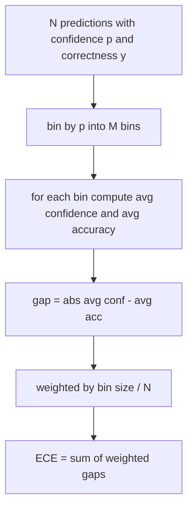
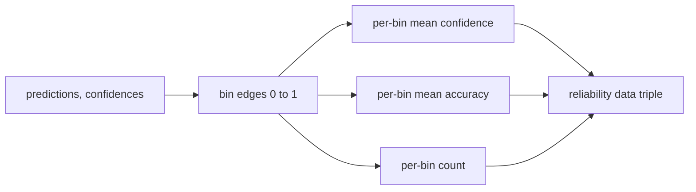

# Perplexity and Calibration · 困惑度与校准

> 如果你的模型在一千个回答上都自称「90% 置信」，却只答对了六百个，那它就没有被校准好。校准（calibration）是可信评测的一半；另一半是困惑度（perplexity），它告诉你模型是否认为 held-out 文本本身说得通。
>
> If your model says 90 percent confident on a thousand answers and gets six hundred right, it is not well calibrated. Calibration is half of trustworthy eval. The other half is perplexity, which tells you whether the model thinks the held-out text is plausible at all.

**Type:** Build
**Languages:** Python
**Prerequisites:** Phase 19 Track B foundations, lessons 70 and 71
**Time:** ~90 min

## Learning objectives · 学习目标

- 从模型适配器（adapter）提供的 token 负对数概率出发，在 held-out 语料上计算 token 级困惑度（perplexity）。
- 从分箱（binning）后的预测概率，计算分类或多选题评测的期望校准误差（ECE）。
- 计算 Brier 分数（对正确性指示变量的均方误差），并解释它何时做到了 ECE 做不到的事。
- 构建绘制「置信度-准确率」曲线所需的可靠性图（reliability diagram）数据。
- 把三者接入评测 harness，让 runner 能把 `perplexity`、`ece`、`brier` 数字挂到模型报告上。

```figure
cd-reliability-diagram
```

## What perplexity tells you · 困惑度告诉你什么

困惑度是每个 token 平均负对数似然的指数化。越低越好。困惑度为 1 意味着模型给每个真实 token 的概率都是 1；困惑度等于词表大小意味着模型是均匀分布、什么也没学到。真实数字落在两者之间：2026 年的强 base 模型在 WikiText-103 上大约 8 到 12；差的模型在同一段文本上是 50 起步。

harness 自己不算对数概率，那来自模型 adapter。harness 只做聚合：输入一列逐 token 的负对数概率、一列每个序列的 token 数，返回语料级困惑度。

```python
def perplexity(neg_log_probs, token_counts):
    total_nll = sum(neg_log_probs)
    total_tokens = sum(token_counts)
    return math.exp(total_nll / total_tokens)
```

实现处理零 token 的边界情况，并断言负对数概率非负。一个常见错误是忘了取负：adapter 返回 `log p` 而不是 `-log p`，会得到小于 1 的困惑度——这不可能。函数会把这种情况当作违反契约抓住。

> Perplexity is the exponentiated average negative log-likelihood per token. Lower is better. A perplexity of one means the model assigns probability one to every actual token. A perplexity of the vocabulary size means the model is uniform and learnt nothing. Real numbers fall in between: a strong 2026 base model on WikiText-103 sits around eight to twelve. A bad one on the same text sits at fifty plus.
> The harness does not compute log-probabilities itself. Those come from the model adapter. The harness aggregates: it takes a list of per-token log-probabilities, a list of token counts per sequence, and returns corpus perplexity.
> A common mistake is to forget the negation: an adapter that returns `log p` instead of `-log p` produces a perplexity below one, which is impossible. The function catches that as a contract violation.

---

## What ECE measures · ECE 度量什么

期望校准误差（expected calibration error）按置信度把预测分进固定数量的箱（bin），再测量每个箱内置信度与准确率之间的平均差距，并按箱大小加权。



标准做法是在 `[0, 1]` 上取十个等宽箱。实现支持任意正整数箱数。我们暴露 `bins` 参数，让 runner 可以在发表论文惯例（10）与对比惯例（15）之间选择。

ECE 受箱数和样本量影响而有偏。十个箱、一百个预测时，你分不清 0.02 的 ECE 和随机噪声。实现除了 ECE 还返回非空箱的数量，这样样本太少时 runner 可以拒绝只报一个数字。

> Expected calibration error groups predictions by their confidence into a fixed number of bins, then measures the average gap between confidence and accuracy across bins, weighted by bin size.
> The standard formulation uses ten equal-width bins on `[0, 1]`. The implementation supports any positive integer count. We expose a `bins` parameter so the runner can choose between the publishing convention (10) and the comparison convention (15).
> ECE is biased by bin count and sample size. With ten bins and a hundred predictions, you cannot distinguish 0.02 ECE from random noise. The implementation returns the number of populated bins along with the ECE so the runner can refuse to report a single number on too few samples.

---

## What Brier score does that ECE does not · Brier 分数补了 ECE 的什么

ECE 只关心平均差距。一个模型可以在一半的箱上过度自信、另一半的箱上信心不足，整体 ECE 很低、局部校准却很差。Brier 分数逐预测测量对真实结果的平方误差，因此直接惩罚这种铺开。

对二值结果，Brier 是 `mean((p_i - y_i)^2)`。它可以分解为可靠性（reliability）、分辨力（resolution）和不确定性（uncertainty）。我们同时计算分数和分解：runner 报告标量，把分解记进日志给仪表盘。

> ECE only cares about average gaps. A model that is overconfident on half the bins and underconfident on the other half can have low ECE while being poorly calibrated locally. The Brier score measures squared error against the true outcome per prediction, so it penalises spread directly.
> For binary outcomes, Brier is `mean((p_i - y_i)^2)`. It decomposes into reliability, resolution, and uncertainty. We compute the score and the decomposition. The runner reports the scalar but logs the decomposition for the dashboard.

```python
def brier(p, y):
    return float(np.mean((p - y) ** 2))
```

---

## Reliability diagram data · 可靠性图数据

可靠性图（reliability diagram）把每个箱内的预测置信度对经验准确率作图。对角线就是完美校准。函数返回三个数组：每箱平均置信度、每箱平均准确率、每箱计数。绘图代码在下游；本课停在数据形状上。



返回的元组正是调用方画图、或计算自定义 ECE 变体（adaptive ECE、sweep ECE 等）所需的东西。我们返回 numpy 数组，下游代码不必再转换。

> A reliability diagram plots predicted confidence against empirical accuracy in each bin. The diagonal is perfect calibration. The function returns three arrays: per-bin average confidence, per-bin average accuracy, and per-bin count. The plotting code lives downstream; this lesson stops at the data shape.
> The returned tuple is what a calling layer needs to draw the plot or compute a custom ECE variant (adaptive ECE, sweep ECE, etc.). We return numpy arrays so downstream code does not have to convert.

---

## Confidence sources · 置信度从哪来

harness 不假设置信度来自 softmax。它接受每个预测任意 `[0, 1]` 内的数字。对多选题，自然的置信度是「选项对数似然上的 softmax」；对自由文本，是模型自报的概率、或平均对数似然的指数化。评测只消费这个数字；它从哪来是 adapter 的事。

> The harness does not assume confidence comes from softmax. It accepts any number in `[0, 1]` per prediction. For multiple-choice tasks the natural confidence is `softmax over option log-likelihoods`. For free-text the natural confidence is the model's self-reported probability or the exponential of the average log-likelihood. The eval just consumes the number. Where it comes from is the adapter's job.

---

## Edge cases · 边界情况

- 全部预测错误：ECE 等于平均置信度，Brier 很高，困惑度就是模型对这段文本的看法。
- 全部预测正确且高置信：ECE 接近零，Brier 接近零。
- 完全不确定的预测器（p=0.5）：ECE 是 0.5 减准确率，Brier 是 0.25 减一个修正项。
- 空输入：ECE、Brier、reliability 返回 `0.0`（或全零数组）；零 token 情况下困惑度返回 `NaN`。这些路径都不发警告；runner 检查数值，自行决定上报还是跳过。

这些情况都烤进了测试。真实模型在真实 benchmark 上不会撞上它们，但有 bug 的 adapter 或太小的样本会，而 runner 不应该崩溃。

> All predictions wrong: ECE is the average confidence, Brier is high, perplexity is whatever the model thinks of the text.
> All predictions correct with high confidence: ECE near zero, Brier near zero.
> Perfectly uncertain predictor at p=0.5: ECE is 0.5 minus accuracy, Brier is 0.25 minus a correction term.
> Empty input: ECE, Brier, and reliability return `0.0` (or zero-filled arrays). Perplexity returns `NaN` for the zero-token case. None of these paths emit a warning; the runner inspects the values and decides whether to report or skip.
> These cases are baked into the tests. A real model on a real benchmark will not hit them, but a buggy adapter or a tiny sample will, and the runner should not crash.

---

## Dispatch · 分发

校准不是像 F1 那样的逐任务指标，而是逐模型报告。runner 在整个评测过程中累积 `(confidence, correct)` 对，最后一次性计算 ECE、Brier 和可靠性数据。困惑度在一段 held-out 文本语料上计算，与逐任务打分分开。

接口是：

```python
report = CalibrationReport.from_predictions(confidences, correct)
report.ece          # float
report.brier        # float
report.reliability  # tuple of three numpy arrays
report.populated_bins  # int
```

`PerplexityResult.from_token_nll(neg_log_probs, token_counts)` 返回困惑度和每 token 平均负对数似然。

> Calibration is not a per-task metric like F1. It is a per-model report. The runner accumulates `(confidence, correct)` pairs across the entire eval and computes ECE, Brier, and reliability data once. Perplexity is computed over a held-out text corpus, separate from the task-by-task scoring.
> `PerplexityResult.from_token_nll(neg_log_probs, token_counts)` returns the perplexity and the average negative log-likelihood per token.

---

## What this lesson does not do · 本课不做什么

它不调用模型。它不实现 softmax。它不从输出 token 估计置信度，那是 adapter 的事。它不做温度缩放（temperature scaling）或 Platt 缩放；那些是事后修正，属于另一课。本课的要点是让三个数字（困惑度、ECE、Brier）可信且可复现。

> It does not call a model. It does not implement softmax. It does not estimate confidence from output tokens; that is the adapter's job. It does not do temperature scaling or Platt scaling; those are post-hoc fixes that live in a different lesson. The point of this lesson is to make the three numbers (perplexity, ECE, Brier) trustworthy and reproducible.

---

## How to read the code · 如何读代码

`main.py` 定义了 `perplexity`、`expected_calibration_error`、`brier_score`、`reliability_diagram`，以及 `CalibrationReport` / `PerplexityResult` 两个 dataclass。demo 在真值已知的合成预测上运行：一个校准良好的模型、一个过度自信的、一个信心不足的。`code/tests/test_calibration.py` 里的测试钉死所有边界情况，以及合成预测器的参考值。

从上到下读 `main.py`，函数顺序从标量到向量再到报告。每个函数都有一段简短的 docstring，写明数学与契约。

> `main.py` defines `perplexity`, `expected_calibration_error`, `brier_score`, `reliability_diagram`, and the `CalibrationReport` / `PerplexityResult` dataclasses. The demo runs on synthetic predictions where the ground truth is known: a well-calibrated model, an overconfident one, and an underconfident one. The tests in `code/tests/test_calibration.py` pin every edge case plus reference values for the synthetic predictors.
> Read `main.py` top to bottom. The function ordering goes scalar to vector to report. Each function has a short docstring with the math and the contract.

---

## Going further · 延伸

校准是已发表评测里最被忽视的轴。大多数排行榜只报一个 accuracy 数字就完事。accuracy 赢、Brier 输的模型，作为生产部署反而不如那个 accuracy 低几分、但能可靠报告自身不确定性的模型。校准管道就位之后，在一段 held-out 验证切片上加温度缩放、重算 ECE、看着差距缩小。那是另一课的内容，但地基在这里。

> Calibration is the most ignored axis in published eval. Most leaderboards report a single accuracy number and call it done. A model that wins on accuracy and loses on Brier is a worse production deployment than a model that scores a few points lower on accuracy but reliably reports its uncertainty. Once you have the calibration plumbing in place, add temperature scaling on a held-out validation slice, recompute ECE, and watch the gap shrink. That is a separate lesson, but the floor lives here.
