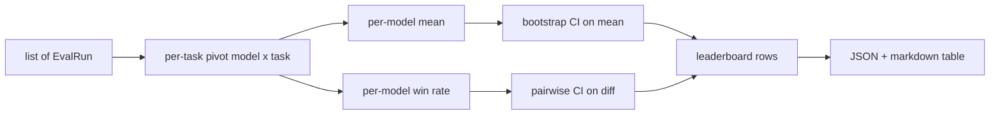
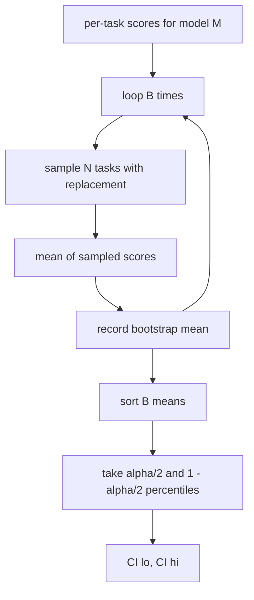

# Leaderboard Aggregation · 排行榜聚合

> 逐任务分数容易。跨异构任务的逐模型排名更难。而在只有一千个预测的排行榜上谈统计显著性，是所有人都跳过的部分。本课不跳。
>
> Per-task scores are easy. Per-model rankings across heterogeneous tasks are harder. Statistical significance on a thousand-prediction leaderboard is the part everyone skips. This lesson does not skip it.

**Type:** Build
**Languages:** Python
**Prerequisites:** Phase 19 Track B foundations, lessons 70, 71, 73
**Time:** ~90 min

## Learning objectives · 学习目标

- 把多模型、多任务的逐任务分数聚合成整洁的逐模型行（row）。
- 归一化异构分数，让 pass rate 和 BLEU 值不会过度影响聚合结果。
- 分别按均值和胜率（win-rate）给模型排名，并解释各自何时才是正确的摘要。
- 对每个模型的平均分和成对差值计算 bootstrap 置信区间。
- 把排行榜输出为 JSON 报告和 markdown 表格，供第 75 课的 runner 粘贴进 CI 评论。

```figure
ci-leaderboard-ci
```

## The shape of input · 输入的形状

聚合器消费一列 `EvalRun` 记录：

```python
@dataclass
class EvalRun:
    model_id: str
    task_id: str
    metric_name: str
    score: float          # in [0, 1]
    category: str
```

第 75 课的 runner 为每个 `(model, task)` 对产出一条记录。聚合器不关心分数是怎么来的，它假设归一化已经完成：每个分数都在 `[0, 1]` 内。

> The aggregator consumes a list of `EvalRun` records:
> The runner in lesson 75 emits one record per `(model, task)` pair. The aggregator does not care how the score was produced. It expects normalisation to already have happened: every score is in `[0, 1]`.

---

## The output · 输出

产出三张表：



排行榜行包含：`model_id`、`mean_score`、`mean_ci_lo`、`mean_ci_hi`、`win_rate`、`tasks_completed`，以及一个可选的 `categories` 映射，存放按类别的均值。

> Three tables come out:
> The leaderboard row contains: `model_id`, `mean_score`, `mean_ci_lo`, `mean_ci_hi`, `win_rate`, `tasks_completed`, and an optional `categories` map for per-category mean.

---

## Normalisation · 归一化

如果一个任务在 `[0, 1]` 内打分、另一个在 `[0, 100]` 内，后者会悄悄支配均值。聚合器校验每个输入分数都落在 `[0, 1]` 内，否则拒绝这次运行。修复在上游：指标本该返回分数。第 71 到 73 课都在执行这份契约。

> If one task scores in `[0, 1]` and another in `[0, 100]`, the second silently dominates the mean. The aggregator validates that every input score sits in `[0, 1]` and refuses the run otherwise. The fix lives upstream: the metric should already return a fraction. Lessons 71 to 73 enforce that contract.

---

## Mean and win-rate · 均值与胜率

两种排名方案服务不同的目标。

均值是一模型逐任务分数的平均。它是排行榜报告的头条数字。它对离群值和任务不均衡敏感。

胜率统计一个模型在同一任务上击败其他所有模型的频率。每个任务由得分最高的模型赢（平局各计一半）。胜率 = 赢的任务数 ÷ 该模型有分数的任务数。它对离群值和量纲差异不那么敏感，但损失信息。

```python
def win_rate(model_id, runs_by_task, all_models):
    wins, total = 0, 0
    for task_id, runs in runs_by_task.items():
        scores = {r.model_id: r.score for r in runs if r.model_id in all_models}
        if model_id not in scores:
            continue
        total += 1
        best = max(scores.values())
        if scores[model_id] >= best:
            wins += 1
    return wins / total if total else 0.0
```

harness 两个都报。第 75 课的 runner 默认按均值排名；胜率的 markdown 列就在那里，用户偏好即可用。

> The two ranking schemes serve different goals.
> Mean score is the average of per-task scores for one model. It is the headline number leaderboards report. It is sensitive to outliers and to task imbalance.
> Win-rate counts how often a model beats every other model on the same task. For each task, the model with the highest score wins (ties split). Win rate equals wins divided by the number of tasks where the model has a score. It is less sensitive to outliers and to scale differences but loses information.
> The harness reports both. The runner in lesson 75 ranks by mean by default; the markdown column for win-rate is right there in case the user prefers it.

---

## Bootstrap confidence intervals · bootstrap 置信区间

逐模型均值带有一个置信区间，通过对任务做 bootstrap 重采样估计。我们按有放回方式重采样任务 id、在重采样集合上算均值、重复 `B` 次、取 `alpha` 水平的百分位区间。



成对比较时，我们对逐任务差值 `score_A - score_B` 做 bootstrap、取百分位区间、再报告。用户看区间是否排除零：排除则在 alpha 水平上差异显著；不排除则排行榜视两个模型为平手。

底层工具（`bootstrap_mean_ci`、`bootstrap_pairwise_diff`）默认 `B=1000`；公开聚合器（`aggregate`、`pairwise_diffs`）默认 `b=500`，好让 demo 和测试保持快速。默认 alpha 是 0.05。本课的 bootstrap 纯 numpy，不用 scipy。

> Per-model means come with a confidence interval estimated by bootstrap resampling over tasks. We resample task ids with replacement, compute the mean over the resampled set, repeat `B` times, and take the percentile interval at level `alpha`.
> For pairwise comparisons we bootstrap the per-task difference `score_A - score_B`, take the percentile interval, and report it. The user reads off whether the interval excludes zero. If it does, the difference is significant at level alpha. If it does not, the leaderboard treats the models as tied.
> The low-level helpers (`bootstrap_mean_ci`, `bootstrap_pairwise_diff`) default to `B=1000`; the public aggregators (`aggregate`, `pairwise_diffs`) default to `b=500` so the demo and tests stay quick. The default alpha is 0.05. The lesson keeps the bootstrap pure numpy, no scipy.

---

## Categories · 类别

如果 `EvalRun.category` 有值，聚合器还会报告按类别的均值。这就是每个排行榜上写着 `math`、`reasoning`、`code`、`safety` 的那一列。它让 runner 看出某个模型总体不错但代码很弱——这是头条均值隐藏掉的信息。

> If `EvalRun.category` is set, the aggregator also reports per-category mean. This is the column on every leaderboard that says `math`, `reasoning`, `code`, `safety`. It lets the runner spot whether a model is good overall but weak in code, which is information the headline mean hides.

---

## Markdown rendering · markdown 渲染

排行榜渲染成 markdown 表：

```text
| Rank | Model | Mean | 95% CI | Win rate | Tasks |
|------|-------|------|--------|----------|-------|
| 1    | gpt   | 0.78 | 0.74-0.82 | 0.62 | 50 |
| 2    | claude| 0.75 | 0.71-0.79 | 0.34 | 50 |
| 3    | random| 0.10 | 0.07-0.13 | 0.04 | 50 |
```

表格按均值分数排序。CI 渲染到两位小数。过长的模型 id 截断到 20 个字符。

> The leaderboard is rendered as a markdown table:
> The table is sorted by mean score. The CI is rendered to two decimals. Long model ids are truncated to twenty characters.

---

## What this lesson does not do · 本课不做什么

它不运行模型。它不调用指标层。它不实现 adaptive ECE 或其他校准变体，那是第 73 课。它不实现任务加权——这里每个任务等权。生产排行榜会给任务加权；我们通过 `weight` 字段把钩子留 open，但聚合器忽略它。需要的话在后续课里加。

> It does not run models. It does not call the metric layer. It does not implement adaptive ECE or other calibration variants; those are lesson 73. It does not implement task weighting. Every task counts the same here. Production leaderboards weight tasks; we leave that hook open through the `weight` field but ignore it in the aggregator. Add weighting in a follow-up lesson if you need it.

---

## How to read the code · 如何读代码

`main.py` 定义了 `EvalRun`、`LeaderboardRow`、`aggregate`、`bootstrap_mean_ci`、`bootstrap_pairwise_diff` 和 `render_markdown`。demo 构建一个三模型、十二任务的合成套件，做聚合，并打印排行榜和成对差值表。`code/tests/test_leaderboard.py` 里的测试钉死 bootstrap、markdown 渲染、胜率边界情况和空输入行为。

从上到下读 `main.py`：先是数据形状（EvalRun、LeaderboardRow），然后是聚合器，然后是 bootstrap，最后是渲染。每个函数的契约都很聚焦。

> `main.py` defines `EvalRun`, `LeaderboardRow`, `aggregate`, `bootstrap_mean_ci`, `bootstrap_pairwise_diff`, and `render_markdown`. The demo builds a synthetic suite of three models and twelve tasks, aggregates, and prints the leaderboard plus the pairwise diff table. The tests in `code/tests/test_leaderboard.py` pin the bootstrap, the markdown rendering, the win-rate edge cases, and the empty-input behaviour.
> Read `main.py` top to bottom. The data shape (EvalRun, LeaderboardRow) comes first, the aggregator next, the bootstrap third, the rendering last. Each function has a focused contract.

---

## Going further · 延伸

自然的下一步是配对任务（paired-task）显著性，代替非配对 bootstrap。如果模型 A 和 B 跑的是同一百个任务，正确的检验是逐任务差值上的配对 bootstrap——我们已经实现了。再往后，你会需要一个尊重任务家族（task family）的层次 bootstrap（数学题之间并不相互独立；一个算术错误模式会同时影响其中十道）。那是后续课。本课的要点是把地基做对，让评测报出一个你敢辩护的数字。

> The natural next step is paired-task significance instead of unpaired bootstrap. If model A and B both ran the same hundred tasks, the appropriate test is the paired bootstrap on task-by-task differences, which we implement. Beyond that, you want a hierarchical bootstrap that respects task families (math problems are not independent from each other; an arithmetic error pattern affects ten of them). That is a follow-up. The point of this lesson is to get the floor right so the eval reports a number you can defend.
