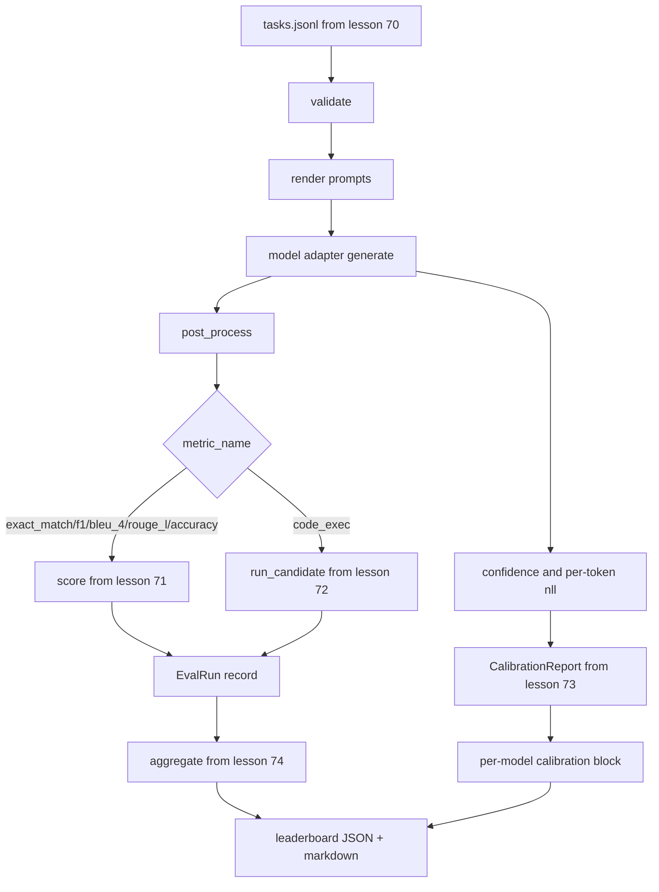

# End-to-End Eval Runner · 端到端评测 Runner

> 五节课的管道，一节课把它们粘起来。runner 读取第 70 课的任务规格、通过 adapter 调用模型、用第 71 和 72 课打分、挂上第 73 课的校准报告、输出第 74 课的排行榜。demo 会自行终止。
>
> Five lessons of plumbing, one lesson to glue them. The runner reads the task spec from lesson 70, calls a model through an adapter, scores with lessons 71 and 72, attaches the calibration report from lesson 73, and emits the leaderboard from lesson 74. Demo self-terminates.

**Type:** Build
**Languages:** Python
**Prerequisites:** Phase 19 Track B foundations, lessons 70 through 74
**Time:** ~90 min

## Learning objectives · 学习目标

- 定义一个 `ModelAdapter` 接口：任何模型（mock、本地、API）都能用一个很小的方法面满足它。
- 在一个 fixture JSONL 文件上运行评测，跨 worker 池并行执行任务。
- 在一次遍历中组合指标层（exact_match、F1、BLEU-4、ROUGE-L、code_exec）与校准层。
- 产出逐模型 `EvalRun` 记录，并直接喂给排行榜聚合器。
- 同时输出 JSON 报告和 markdown 表格；干净运行以退出码 0 自行终止，校验或运行时失败则以非零码退出。

```figure
eval-grid
```

## The pipeline · 管道



runner 是集成点。第 70 到 74 课各自拥有一个模块，由 runner 组合起来。runner 不重复那些模块里的任何逻辑——它是 import 它们。

> The runner is the integration point. Each lesson 70 through 74 owns one module that the runner composes. The runner does not duplicate any logic from those modules: it imports them.

---

## The adapter interface · adapter 接口

adapter 是 runner 与任何模型之间的接缝。这个接口刻意很小。

```python
class ModelAdapter:
    model_id: str

    def generate(self, prompt: str, task: TaskSpec) -> Generation: ...
```

`Generation` 是一个 dataclass，包含：

- `text`：模型的自由格式输出
- `confidence`：`[0, 1]` 内的浮点数，表示模型对答案的自报概率
- `token_nll`：可选，生成 token 的负对数似然之和
- `token_count`：可选，生成 token 的数量

runner 里的 mock adapter 有三种口味：`RuleBasedAdapter`（确定性、近乎完美）、`NoisyAdapter`（过度自信、常常出错）和 `BiasedAdapter`（一个类别很强、另一个类别很糟）。demo 让三者都跑第 70 课的 fixture。

> The adapter is the seam between the runner and any model. The interface is intentionally small.
> `Generation` is a dataclass with:
> `text`: the model's free-form output. `confidence`: a float in `[0, 1]` representing the model's self-reported probability for the answer. `token_nll`: optional sum of negative log-likelihoods over the generated tokens. `token_count`: optional number of generated tokens.
> Mock adapters in the runner provide three flavours: `RuleBasedAdapter` (deterministic, near-perfect), `NoisyAdapter` (overconfident, often wrong), and `BiasedAdapter` (good at one category, terrible at another). The demo runs all three over the lesson 70 fixture.

---

## Parallel execution · 并行执行

runner 用 `concurrent.futures.ThreadPoolExecutor` 为每个模型并行跑任务。worker 数默认取 8 和任务数中的较小者。线程就足够了，因为真实模型调用的瓶颈是网络 I/O。code-exec 路径在任务内部自己 spawn 子进程，executor 只负责调度这次等待。

为了测试的确定性，runner 暴露 `run_eval(adapters, tasks, parallel=False)`，让测试可以钉死执行顺序。

> The runner uses `concurrent.futures.ThreadPoolExecutor` to run tasks in parallel per model. The worker count defaults to the smaller of eight and the task count. Threads are sufficient because the bottleneck for real model calls is network I/O. The code-exec path spawns its own subprocess inside the task and the executor only schedules the wait.
> For deterministic tests, the runner exposes `run_eval(adapters, tasks, parallel=False)` so tests can pin the execution order.

---

## The single-pass scoring loop · 单遍打分循环

对每个任务：

1. 渲染 prompt（few-shot 前缀加上 prompt 正文）。
2. 调用 adapter，并为这次调用计时。
3. 按任务规则对生成结果做后处理。
4. 分发到指标层。
5. 用分数和指标元数据构建 `EvalRun` 记录。
6. 把 `(confidence, correct)` 对追加进校准缓冲。

`correct` 信号对 exact-match 式指标（`exact_match`、`accuracy`、`code_exec`）取 `score >= 1.0`，对分级指标取 `score >= 0.5`。阈值写在 `_correct_from_score` 里，runner 不暴露公开的覆盖入口。

> For each task:
> 1. Render the prompt (few-shot prefix plus the prompt body). 2. Call the adapter and time the call. 3. Post-process the generation per the task's rule. 4. Dispatch to the metric layer. 5. Build an `EvalRun` record with the score and metric metadata. 6. Append the `(confidence, correct)` pair to the calibration buffer.
> The `correct` signal is `score >= 1.0` for exact_match-style metrics (`exact_match`, `accuracy`, `code_exec`) and `score >= 0.5` for graded metrics. The threshold lives in `_correct_from_score` and the runner does not expose a public override.

---

## Aggregation · 聚合

每个任务都有结果之后，runner 调用第 74 课的 `aggregate` 和 `pairwise_diffs`，以及第 73 课的 `CalibrationReport.from_predictions`。输出是单个 JSON 信封：

```json
{
  "leaderboard": [...],
  "pairwise": [...],
  "calibration": {
    "model_id_a": {"ece": 0.04, "brier": 0.10, "populated_bins": 8, ...},
    ...
  },
  "summary": {
    "tasks": 10,
    "models": 3,
    "wall_seconds": 1.2
  }
}
```

runner 还把一张 markdown 表写到 stdout，用户可以把结果粘进 PR review。

> After every task has a result, the runner calls `aggregate` and `pairwise_diffs` from lesson 74 and `CalibrationReport.from_predictions` from lesson 73. The output is a single JSON envelope:
> The runner also writes a markdown table to stdout so the user can paste the result into a PR review.

---

## Self-terminating demo · 自终止 demo

demo 让三个 mock adapter 跑第 70 课的十个 fixture 任务。wall time 应当在十秒以内。干净运行的退出码是 0。

干净运行的判据是：

- 每个任务都通过了第 70 课的校验。
- 每个任务都用第 71、72 课打了分。
- 第 73 课的校准报告无错聚合。
- 排行榜把 rule-based adapter 严格排在 random adapter 之上。

任何一条被破坏，runner 就以非零码退出，并在 JSON 信封里给出结构化错误。

> The demo runs three mock adapters over the ten fixture tasks from lesson 70. Wall time should sit under ten seconds. The exit code is zero on a clean run.
> The clean-run criteria are:
> Every task validated under lesson 70. Every task scored under lessons 71 and 72. The calibration report aggregated under lesson 73 without errors. The leaderboard ranked the rule-based adapter strictly above the random adapter.
> If any of those break, the runner exits non-zero with a structured error in the JSON envelope.

---

## What this lesson does not do · 本课不做什么

它不调用真实模型。它不实现 API key 流程或限流处理。它不实现流式或部分生成；adapter 每次调用返回一个生成。它不做重试或缓存。这些关注点都住在 adapter 层；runner 与指标无关（metric-agnostic）、与提供商无关（provider-agnostic）。

> It does not call a real model. It does not implement an API key flow or rate-limit handling. It does not implement streaming or partial generation; the adapter returns one generation per call. It does not do retries or caching. Those concerns live at the adapter layer; the runner is metric-agnostic and provider-agnostic.

---

## How to read the code · 如何读代码

`main.py` 是集成处。它通过一个按相对路径解析兄弟模块的 `_load_sibling` 小工具，从其他五课的模块 import。dataclass `Generation`、`EvalReport` 和 `ModelAdapter` 在本地定义。mock adapter 在文件底部。

从上到下读 `main.py`：先略读 import，然后看 `run_eval`，再看 `_score_one`，最后是 adapter。文件末尾的 demo 是入口。

`code/tests/test_runner.py` 里的测试钉死 adapter 接口、单遍循环、并行与串行的等价性、校准缓冲和 JSON 信封形状。

> `main.py` is the integration. It imports from the other five lesson modules through a small `_load_sibling` helper that resolves them by relative path. The dataclasses `Generation`, `EvalReport`, and `ModelAdapter` are defined locally. The mock adapters are at the bottom of the file.
> Read `main.py` top to bottom. Skim the imports, then look at `run_eval`, then `_score_one`, then the adapters. The demo at the end is the entry point.
> The tests in `code/tests/test_runner.py` pin the adapter interface, the single-pass loop, the parallel-vs-sequential equivalence, the calibration buffer, and the JSON envelope shape.

---

## Going further · 延伸

这个 runner 是地板。生产评测系统会再加：以 `(task_id, model_id, model_version)` 为键的结果缓存、记录每次运行美元与 token 成本的账本、对限流做退避的重试层、面向 pass-at-k 任务的采样策略、面向长套件的流式输出格式。每一项都是单一关注点，包在 runner 外面，而不必改动指标层或聚合层。这个分离正是契约的意义所在。

mock 跑通之后，再为真实提供商加一个 adapter。挑一个有免费额度的，写三十行胶水代码，看排行榜亮起来。然后加第二家提供商，让 harness 去干活。

> This runner is the floor. A production eval system adds: a results cache keyed by `(task_id, model_id, model_version)`, a cost ledger that tracks dollars and tokens per run, a retry layer that backs off on rate limits, a sampling policy for pass-at-k tasks, and a streaming output format for long suites. Each of those is a single concern that wraps the runner without changing the metric or aggregation layers. That separation is the point of the contract.
> Add an adapter for a real provider after you have the mocks working. Pick one with a free tier, write thirty lines of glue, watch the leaderboard light up. Then add the second provider and let the harness do the work.
