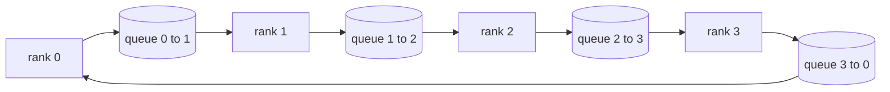

# Collective Ops From Scratch · 从零实现集合通信

> 支撑分布式训练的四个集合通信（collective ops）是 allreduce、broadcast、allgather 和 reduce_scatter。训练框架提供的其他所有原语都是它们的包装。在 `multiprocessing.Queue` 网格上把它们实现一次、对照参考实现验证，本 track 的其余部分就只是管道工程。
>
> The four collective operations that hold distributed training together are allreduce, broadcast, allgather, and reduce_scatter. Every other primitive a training framework offers is a wrapper around these. Build them once over a `multiprocessing.Queue` mesh, verify them against a reference implementation, and the rest of the track becomes plumbing.

**Type:** Build
**Languages:** Python
**Prerequisites:** Phase 19 Track C lessons 42-49
**Time:** ~90 min

## Learning Objectives · 学习目标

- 用两遍（reduce-scatter 然后 allgather）实现 ring allreduce，并证明每 rank 通信量是每元素 2(N-1)/N 字节。
- 在 `multiprocessing.Queue` 的点对点发送之上构建 broadcast、allgather 和 reduce_scatter。
- 对相同输入、相同 world size，用 `torch.distributed` 的 gloo 参考实现验证每个原语。
- 能依据集群形状、延迟下限（latency floor）和带宽上限（bandwidth ceiling）为 ring 与 tree 的选择辩护。

## The Problem · 问题在哪

对 N 个 rank 做朴素 allreduce：把整个张量发给 root N 次、再广播回来 N 次。每 rank 带宽按 O(N) 扩展，root 成为瓶颈，wall-clock 下限是最慢链路乘 N。Ring allreduce 把它压平成 2(N-1) 个大小为 T/N 的块，每 rank 字节数降到 2T(N-1)/N，与集群规模无关。Tree allreduce 在小 N、高延迟链路上赢，因为深度是 log2(N) 跳而不是 2(N-1)。给集群形状选错拓扑，最慢的那块 GPU 就决定步时（step time）。

本 track 里你将读到的每个分布式训练框架都依赖这四个原语。PyTorch DDP 用每个参数桶一次 allreduce 来同步梯度。ZeRO 用 reduce_scatter 分片优化器状态、用 allgather 广播更新后的参数。FSDP 把完整 forward 变成 allgather 加 reduce_scatter。流水线并行的跨 stage 组激活需要 broadcast。如果实现不了这四个集合通信，你就无法推理训练为什么卡住、梯度不匹配为什么出现在 rank 3、为什么换拓扑后流水线气泡翻倍。

> A naive allreduce over N ranks sends N times the tensor to a root and broadcasts N times back. Bandwidth scales as O(N) per rank, the root becomes a bottleneck, and the wall-clock floor is the slowest link times N. Ring allreduce flattens that into 2(N-1) chunks of size T/N, so per-rank bytes drop to 2T(N-1)/N independent of cluster size. Tree allreduce wins on small N and high-latency links because depth is log2(N) hops instead of 2(N-1). Pick the wrong topology for the cluster shape and the slowest GPU dictates step time.
> Every distributed training framework you will read this track depends on these four primitives. PyTorch DDP synchronises gradients with one allreduce per parameter bucket. ZeRO shards optimiser state by reduce_scatter and broadcasts updated parameters by allgather. FSDP turns the full forward into allgather plus reduce_scatter. Pipeline parallel needs broadcast for activations across stage groups. If you cannot implement the four collectives, you cannot reason about why training stalls, why the gradient mismatch shows up at rank 3, or why the pipeline bubble doubles when you swap topologies.

---

## The Concept · 概念



### Ring allreduce in two passes · 两遍 ring allreduce

把张量切成 N 个等块，索引 0..N-1，每个 rank 拥有等于自己 rank 的块索引。第 1 遍 reduce-scatter 跑 N-1 步：第 s 步，rank r 把块 (r - s) mod N 发给 rank (r + 1) mod N，并从 rank (r - 1) mod N 收到块 (r - s - 1) mod N，把收到的块累加进本地副本。N-1 步之后，rank r 拥有块 r 的完整和。第 2 遍 allgather 再跑 N-1 步，把已完成的块沿环轮转，直到每个 rank 持有每个块的完整和。

| 原语 | 每 rank 字节 | 步数 | 使用场景 |
|------|-------------|------|----------|
| Ring allreduce | 2T(N-1)/N | 2(N-1) | T 大、链路粗的同构集群 |
| Tree allreduce | T log2(N) | 2 log2(N) | T 小或高延迟链路 |
| Broadcast | T | log2(N) 树 | 参数初始化、标量配置 |
| Allgather | T(N-1)/N | N-1 | 分片 forward、ZeRO unshard |
| Reduce_scatter | T(N-1)/N | N-1 | ZeRO 梯度分片 |

> Split the tensor into N equal chunks indexed 0..N-1. Each rank owns chunk index equal to its rank. Pass 1, reduce-scatter, runs N-1 steps. At step s, rank r sends chunk (r - s) mod N to rank (r + 1) mod N and receives chunk (r - s - 1) mod N from rank (r - 1) mod N, accumulating the received chunk into its local copy. After N-1 steps, rank r owns the full sum for chunk r. Pass 2, allgather, runs another N-1 steps and rotates the finished chunks around the ring until every rank holds the full sum for every chunk.

---

### Queue mesh as a stand-in for NCCL · 用队列网格代替 NCCL

NCCL 跑在 PCIe 和 NVLink 上，reduction 由硬件卸载。CPU 上没有这些。每条环边一个 `multiprocessing.Queue`，给你单生产者、单消费者的有序点对点投递。reduction 发生在用户空间，你要付 Python 开销，但线上的模式（wire pattern）与 NCCL ring allreduce 完全一致。先在队列版本上把正确性想清楚，集群上的行为自然跟随。

> NCCL runs over PCIe and NVLink with hardware-offloaded reductions. On CPU you do not have that. A `multiprocessing.Queue` per ring edge gives you ordered point-to-point delivery with a single producer and single consumer. The reduction happens in user space, so you pay Python overhead, but the wire pattern is identical to NCCL ring allreduce. Reason about correctness on the queue version and the cluster behaviour follows.

---

### Verify against gloo · 对照 gloo 验证

每个原语都带一个单元测试：相同张量、相同 world size 下，与以 gloo 后端初始化的 `torch.distributed` 输出做比较。如果你的 ring allreduce 与 gloo 的偏差超过 float32 epsilon，测试就失败。对照参考实现做验证没有商量余地；没有它，原语看起来一直正确——直到某次真实训练的第 10000 步。

> Every primitive lands with a unit test that compares its output against `torch.distributed` initialised with the gloo backend on the same tensor across the same world size. If your ring allreduce diverges from gloo by more than float32 epsilon, the test fails. Verification against a reference implementation is non-negotiable; without it the primitive looks correct until step 10000 of a real training run.

```figure
ci-ring-allreduce
```

---

## Build It · 动手造

`code/main.py` 实现：

- `Mesh` 类：把 N 个 `multiprocessing.Queue` 接成一个环，并为每个 rank 暴露 `send(dst, tensor)` 和 `recv(src)`。
- `ring_allreduce(mesh, rank, world_size, tensor)`：运行两遍算法。
- `broadcast(mesh, rank, world_size, tensor, src)`：走对数树。
- `allgather(mesh, rank, world_size, tensor)`：用 N-1 次轮转。
- `reduce_scatter(mesh, rank, world_size, tensor)`：即 allreduce 的前半段。
- `_gloo_reference(op, world_size, tensor)`：把相同输入喂给带 gloo 的 `torch.distributed`，做字节级相等的比较。

运行：

```bash
python3 code/main.py
```

输出：一张逐原语验证表，比较队列网格与 gloo 的输出；随后是一个逐 rank 字节计数器，证明 2T(N-1)/N 的扩展规律。

> `code/main.py` implements: a `Mesh` class that wires N `multiprocessing.Queue` instances into a ring, `ring_allreduce`, `broadcast`, `allgather`, `reduce_scatter`, and `_gloo_reference(op, world_size, tensor)` that runs the same input through `torch.distributed` with gloo for byte-equal comparison.
> Output: per-primitive verification table comparing queue-mesh and gloo outputs, followed by a per-rank byte counter that proves the 2T(N-1)/N scaling.

---

## Production patterns in the wild · 生产中的模式

三个模式把这些原语加固到可上线的程度。

**allreduce 前先把梯度装桶（bucket）。** 一个 1B 参数模型有几万个梯度张量。每个张量一次 allreduce，就要把延迟下限付 N 次。DDP 把梯度装进约 25 MB 的桶，每桶发一次 allreduce；小张量搭上了大张量的车。没有装桶，延迟开销会主导整个 step。

**让通信与计算重叠。** backward 按逆序逐层算梯度。最后一层的梯度一就绪，就立刻发起它的 allreduce，同时下一层继续计算。PyTorch DDP 用 bucket-ready 钩子接线。网络有余裕时，重叠能把可见通信时间砍半。

**按消息大小选 ring 或 tree，不靠信仰。** NCCL 自带拓扑探测器：大于约 1 MB 的消息选 ring，小于则选 tree。交叉点是带宽对延迟：超过 1 MB，带宽项 2T(N-1)/N 主导，ring 赢；低于 1 MB，log2(N) 跳数赢。把拓扑写死，就会在错误的消息尺寸上损失吞吐。

> **Bucket gradients before allreduce.** A 1B-parameter model has tens of thousands of gradient tensors. One allreduce per tensor pays the latency floor N times. DDP buckets gradients into ~25 MB chunks and issues one allreduce per bucket; the small tensors ride on the back of the big ones. Without bucketing the latency overhead dominates the step.
> **Overlap communication with computation.** Backward computes gradients layer by layer in reverse order. The moment the last layer's gradient is ready, kick off its allreduce while the next layer keeps computing. PyTorch DDP wires this with bucket-ready hooks. The overlap halves visible communication time when the network has slack.
> **Pick ring or tree by message size, not religion.** NCCL ships a topology detector that picks ring for messages above ~1 MB and tree below. The crossover is bandwidth-versus-latency: above 1 MB, the bandwidth term 2T(N-1)/N dominates and ring wins; below 1 MB, the log2(N) hop count wins. Hard-coding one topology costs throughput on the wrong message size.

---

## Use It · 实战用法

生产模式：

- **PyTorch DDP。** backward 之后对分桶梯度调用 `dist.all_reduce`。桶大小可调；默认 25 MB 对 100Gbit 以太网是合理的。
- **DeepSpeed ZeRO。** 用 reduce_scatter 分片梯度，forward 之前用 allgather 重建完整参数。本课的原语正是 ZeRO 发出的那些调用。
- **FSDP。** forward 从 allgather 开始把层 unshard，计算之后用 reduce_scatter 归约并丢弃 unshard。同样的原语，不同的调度。

> **PyTorch DDP.** Calls `dist.all_reduce` on bucketed gradients after backward. The bucket size is tunable; default 25 MB is reasonable for 100Gbit Ethernet.
> **DeepSpeed ZeRO.** Issues reduce_scatter to shard gradients and allgather to reconstruct full parameters before forward. The lesson's primitives are exactly the calls ZeRO makes.
> **FSDP.** Forward begins with allgather to unshard the layer, computes, then reduces with reduce_scatter and discards the unshard. Same primitives, different schedule.

---

## Ship It · 交付

在第 77-81 课使用这些队列网格原语。第 77 课把 allreduce 接进 DDP。第 78 课把 reduce_scatter 接进 ZeRO。第 79 课把 broadcast 接进流水线激活。第 81 课把四个原语组合成端到端 demo。

> Use the queue-mesh primitives in lessons 77-81. Lesson 77 wires allreduce into DDP. Lesson 78 wires reduce_scatter into ZeRO. Lesson 79 wires broadcast into pipeline activations. Lesson 81 composes all four into the end-to-end demo.

---

## Exercises · 练习

1. 加一个 tree allreduce 变体，并按消息大小在 ring 和 tree 之间切换。实测交叉点。
2. 加一个 `recv_timeout_ms`，让卡住的 rank 抛出 deadline 错误，而不是永远挂起。
3. 把 `multiprocessing.Queue` 换成 TCP socket 重写这四个原语。同样的测试，真实的线缆。
4. 加一个带宽插桩钩子，把每 rank 字节计数器记录到 JSONL。
5. 在 4 个 rank 上对比 ring 与 tree 在 1KB、1MB、16MB 张量上的 wall-clock 时间。用数据为交叉点辩护。

---

## Key Terms · 术语表

| 术语 | 人们怎么说 | 实际含义 |
|------|-----------|----------|
| Allreduce | "跨 rank 求和" | 调用结束后每个 rank 持有相同的归约结果张量 |
| Ring | "快拓扑" | N-1 个大小为 T/N 的块沿环流动两圈 |
| Tree | "对数拓扑" | 归约沿二叉树进行；深度是 log2(N) 跳 |
| Allgather | "拼接分片" | 每个 rank 最终拿到其他所有 rank 的分片 |
| Reduce_scatter | "拆分求和" | 每个 rank 最终只拿到一个块的和 |
| Bucket | "融合小张量" | 把 N 次小 allreduce 合并成一次大的 |

---

## Further Reading · 延伸阅读

- [PyTorch Distributed: NCCL collectives](https://pytorch.org/docs/stable/distributed.html#collective-functions)
- [Horovod ring allreduce paper](https://arxiv.org/abs/1802.05799)
- [NCCL topology and algorithm selection](https://docs.nvidia.com/deeplearning/nccl/user-guide/docs/index.html)
- [Patarasuk and Yuan, Bandwidth optimal allreduce algorithms](https://www.cs.fsu.edu/~xyuan/paper/09jpdc.pdf)
- Phase 10 Lesson 05 - 分布式训练概览
- Phase 19 Lesson 77 - 在这些原语之上接线的 DDP
