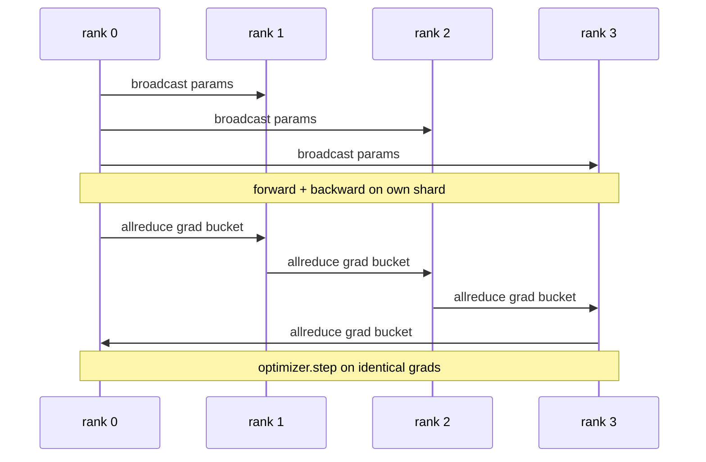

# Data Parallel DDP From Scratch · 从零实现数据并行 DDP

> DistributedDataParallel 是架在 allreduce 之上的一个钩子。包住一个模型、从 rank 0 广播初始参数让每个 rank 从相同状态出发、给每个参数装一个 backward 钩子去发起梯度的 allreduce——剩下的就是梯度下降。整个模式只有 200 行。
>
> DistributedDataParallel is a hook on top of allreduce. Wrap a model, broadcast the initial parameters from rank 0 so every rank starts identical, install a backward hook on every parameter that issues an allreduce of the gradient, and the rest is gradient descent. The whole pattern is 200 lines.

**Type:** Build
**Languages:** Python
**Prerequisites:** Phase 19 Track C lessons 42-49
**Time:** ~90 min

## Learning Objectives · 学习目标

- 接出一个 `DistributedDataParallel` 形状的包装器：广播初始参数，并在 backward 之后对梯度做 allreduce。
- 用 `torch.multiprocessing.spawn` 在 gloo 后端和基于文件的 rendezvous 上拉起 N 个 CPU rank。
- 用「同一模型、同一数据」的串行训练做逐步参数等价对拍，证明梯度同步的正确性。
- 能为装桶（bucket，梯度融合）与重叠（overlap，backward 期间通信）辩护——正是这两个改动把能跑的 DDP 变成生产级 DDP。

## The Problem · 问题在哪

一个 1B 参数、带 12 GB 激活的模型塞不进一张消费级 GPU。就算塞得下，训练也要几周。数据并行把 batch 切到 N 个 rank：每个 rank 在自己的分片上做前向和反向，每一步把所有 rank 的梯度求和，让 N 个副本保持一致。优化器拿求和后的梯度去步进。

没有梯度同步，N 个副本到第 2 步就分道扬镳。模型不再是「一个在更多数据上训练的模型」，而是 N 个恰好共享初始权重的独立模型。梯度同步做得很糟（每个参数一次 allreduce、无重叠、无装桶）时，网络成为瓶颈，GPU 干等网线。DDP 的手艺就是把梯度同步做到相对计算近乎免费。PyTorch DDP 的标准做法是装桶梯度、让 allreduce 与下一层的 backward 重叠、在 NVLink 上用 NCCL。这三件事我们都能在 CPU 上用 gloo 做到，并学到同样的教训。

> A 1-billion-parameter model with 12 GB of activations does not fit on one consumer GPU. Even when it fits, training takes weeks. Data parallel splits the batch across N ranks, each rank computes the forward and backward on its shard, and at every step every rank's gradients are summed so all N copies stay identical. The summed gradient is what the optimiser steps on.
> Without gradient sync, the N replicas diverge by step 2. The model is not "one model trained on more data" anymore, it is N separate models that happen to share initial weights. With gradient sync done badly (one allreduce per parameter, no overlap, no bucketing) the network is the bottleneck and the GPUs idle waiting for the wire. The craft of DDP is making the gradient sync nearly free relative to compute. The canonical PyTorch DDP achieves that by bucketing gradients, overlapping allreduce with the next layer's backward, and using NCCL on NVLink. We can do all three on CPU with gloo and learn the same lessons.

---

## The Concept · 概念



### The three operations DDP needs · DDP 需要的三种操作

| 阶段 | 集合通信 | 原因 |
|------|----------|------|
| 初始化 | 从 rank 0 broadcast | 每个 rank 从相同的参数出发 |
| backward 之后 | 对每个梯度 allreduce | 优化器步进的是平均梯度 |
| 偶尔 | broadcast buffers | Batchnorm 运行统计量保持同步 |

### Why mean and not sum · 为什么取平均而不是求和

Allreduce-SUM 除以 world_size 得到平均梯度。均值对 world_size 不变：在 1 个 rank 上调好的学习率，换到 4 个 rank 依然有效，因为每步的梯度量级不变。不除的 Allreduce-SUM 逼你每换一次集群规模就重调学习率。DDP 包住 SUM 再除；本课照做。

> Allreduce-SUM divided by world_size gives the mean gradient. The mean is invariant to world_size: a learning rate tuned at one rank works at four ranks because the per-step gradient magnitude does not change. Allreduce-SUM without the division forces you to retune the learning rate every time you change cluster size. DDP wraps the SUM and divides; do the same in the lesson.

---

### Why bucket gradients · 为什么要装桶

一个 transformer 有几千个参数张量。每个张量一次 allreduce，就要把 gloo 延迟下限付几千次。DDP 把梯度按约 25 MB 分桶，每桶发一次 allreduce。线上移动的总字节数一样，但延迟被摊到了整桶上。对本课的微型模型，我们把所有东西装进一个桶；能迁移下去的是这个结构。

> A transformer has thousands of parameter tensors. One allreduce per tensor pays the gloo latency floor thousands of times. DDP groups gradients into ~25 MB buckets and issues one allreduce per bucket. The same total bytes move across the wire but the latency is amortised over the bucket. For the lesson's tiny model we group everything into one bucket; the structure is what carries across.

---

### Why pin the seed · 为什么要钉住种子

每个 rank 为打乱数据要调 `torch.manual_seed(seed + rank)`，而为参数初始化要调 `torch.manual_seed(seed)`。共享同一个种子意味着每个 rank 看到相同的 batch 顺序（数据并行失效）；参数用 rank 相关种子则初始参数相差 float epsilon，梯度同步再也无法让副本一致。种子模式搞错，参数等价测试在第 1 步就挂。

> Every rank must call `torch.manual_seed(seed + rank)` for shuffling but `torch.manual_seed(seed)` for parameter init. A single shared seed means every rank sees the same batch order (defeating data parallel); a rank-specific seed for params means initial parameters disagree by float epsilon and gradient sync no longer makes the replicas identical. Get the seed pattern right or the test for parameter equivalence fails on step 1.

```figure
ci-ddp-grad-sync
```

---

## Build It · 动手造

`code/main.py` 实现：

- `MiniMLP`：一个 3 层 MLP，小到几秒内能收敛，大到足以暴露接线问题。
- `DistributedDataParallel(model, world_size)`：构造时广播参数，返回一个包装器，其 `sync_grads` 把累积的 allreduce-sum 梯度除以 world_size。
- `worker(rank, world_size, ...)`：完整训练循环，含基于 gloo 的 `torch.distributed` 初始化、forward、backward、sync、step。
- `_reference_single_process_loop(...)`：在单个 rank 上用同一模型、同一数据串行训练，供测试在每个 step 之后做字节级相等的参数对拍。

运行：

```bash
python3 code/main.py
```

输出：一张逐步训练表，比较单进程的 loss 与参数校验和同 4 rank DDP 运行。两条路径产出精确到 float epsilon 相同的 loss 曲线，证明梯度同步是正确的。

> `code/main.py` implements: `MiniMLP`; `DistributedDataParallel(model, world_size)` that broadcasts params at construct time and returns a wrapper whose `sync_grads` divides accumulated allreduce-summed grads by world_size; `worker(rank, world_size, ...)` with the full training loop; and `_reference_single_process_loop(...)` used by the test for byte-equal parameter equivalence after each step.
> Output: a per-step training table comparing single-process loss and parameter checksum to the DDP run on 4 ranks. The two paths produce identical loss curves to float epsilon, proving the gradient sync is correct.

---

## Production patterns in the wild · 生产中的模式

三个模式把 DDP 加固到可上线的程度。

**找出未使用的参数。** 有些 forward 路径会条件性跳过参数（early exit、mixture-of-experts 路由）。被跳过的参数没有梯度，但 DDP 的 bucket-ready 钩子仍在等它们，allreduce 就死锁。`find_unused_parameters=True` 让 DDP 在归约前先检查哪些参数拿到了梯度。代价是每步一次图遍历，所以 forward 不分叉就别开。

**静态图优化。** 当 forward 跨步稳定时，`static_graph=True` 让 DDP 预先算好桶调度。规模化时这个优化有分量：每步省几毫秒，10000 步累积下来很可观。

**梯度累积要小心。** 跨 K 个 microbatch 累积梯度、期间不同步，是 10 倍吞吐的提升。DDP 提供 `no_sync()` 上下文管理器来暂停 backward 后的 allreduce。忘了套这个管理器，你就白白 allreduce K 次，吞吐跌回地面。

> **Find unused parameters.** Some forward paths skip parameters conditionally (early exit, mixture-of-experts router). The skipped parameters have no gradient, but DDP's bucket-ready hook still waits for them and the allreduce deadlocks. `find_unused_parameters=True` tells DDP to look at which params got gradients before reducing. The cost is a graph walk per step, so leave it off unless your forward branches.
> **Static graph optimisation.** When the forward is stable across steps, `static_graph=True` lets DDP precompute the bucket schedule. The optimisation matters at scale: precomputing saves a few ms per step which compounds across 10000 steps.
> **Gradient accumulation needs care.** Accumulating gradients over K microbatches without syncing each microbatch is a 10x throughput win. DDP exposes `no_sync()` as a context manager that pauses the post-backward allreduce. Forget the manager and you allreduce K times for nothing; the throughput drops to the floor.

---

## Use It · 实战用法

生产模式：

- **PyTorch DDP。** 标准实现。`torch.nn.parallel.DistributedDataParallel(model)` 接好装桶、重叠和 no_sync 上下文。
- **HuggingFace Accelerate。** 加了一个启动器，处理 `torchrun` 环境变量和模型包装。底层还是同一个 DDP。
- **Megatron-LM 数据并行。** 把 DDP 与张量并行结合用于大模型；其中数据并行那部分还是 backward 后 allreduce 的同一模式。

> **PyTorch DDP.** The canonical implementation. `torch.nn.parallel.DistributedDataParallel(model)` wires bucketing, overlap, and the no_sync context.
> **HuggingFace Accelerate.** Adds a launcher that handles `torchrun` env vars and the model wrap. Same DDP under the hood.
> **Megatron-LM data parallel.** Combines DDP with tensor parallel for large models; the data-parallel piece is the same allreduce-after-backward pattern.

---

## Ship It · 交付

第 78 课（ZeRO 分片）把逐参数 allreduce 换成 reduce_scatter，让每个 rank 只存优化器状态的 1/N 分片。第 81 课把 DDP 与 ZeRO 组合进端到端 demo。

> Lesson 78 (ZeRO sharding) replaces the per-parameter allreduce with reduce_scatter so each rank only stores its shard of the optimiser state. Lesson 81 composes DDP with ZeRO into the end-to-end demo.

---

## Exercises · 练习

1. 加可配置大小的梯度桶，在更深的模型上测量相对「每参数一次 allreduce」的加速。
2. 把 `no_sync()` 实现为上下文管理器，验证跨 K 个 microbatch 的梯度累积与单进程基线一致。
3. 加一个 `find_unused_parameters` 模式，让 forward 有时跳过 MLP 的某一层；不开这个 flag 时运行应当死锁。
4. 把 gloo 换成仅用 `torch.distributed.barrier()` 的同步，体会基于 allreduce 与基于 barrier 的同步之间的差别。
5. 测量 batch size 为 1、16、256 时梯度同步开销占步时间的比例，并解释这个扩展规律。

---

## Key Terms · 术语表

| 术语 | 人们怎么说 | 实际含义 |
|------|-----------|----------|
| DDP | "数据并行" | 每步广播参数、allreduce 梯度的包装器 |
| Bucket | "融合梯度" | 把 N 次小 allreduce 合并成一次大的 |
| Overlap | "藏住通信" | 在后面的层还在算 backward 时就发起 allreduce |
| no_sync | "累积" | 为梯度累积跳过 backward 后的 allreduce |
| find_unused | "分叉的 forward" | 归约前检测没拿到梯度的参数 |

---

## Further Reading · 延伸阅读

- [PyTorch DistributedDataParallel docs](https://pytorch.org/docs/stable/generated/torch.nn.parallel.DistributedDataParallel.html)
- [PyTorch DDP internals tutorial](https://pytorch.org/tutorials/intermediate/ddp_tutorial.html)
- [Li et al, PyTorch Distributed: Experiences on Accelerating Data Parallel Training](https://arxiv.org/abs/2006.15704)
- Phase 19 Lesson 76 - DDP 所依赖的集合通信原语
- Phase 19 Lesson 78 - ZeRO 分片用 reduce_scatter 取代逐参数 allreduce
