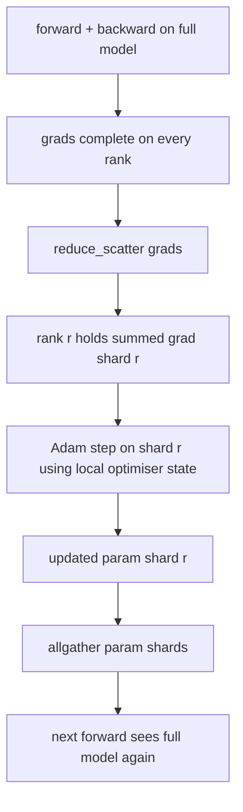

# ZeRO Optimizer State Sharding · ZeRO 优化器状态分片

> Adam 给每个参数存两个矩估计，都是 float32。一个 7B 参数模型带着 56 GB 的优化器状态。ZeRO stage 1 把它分片到 N 个 rank 上，每个 rank 拥有 1/N 的优化器。本地步进之后，更新过的参数分片广播回来，每个 rank 重建完整模型，下一步开始。收益是训练栈里最大单笔内存分配的线性下降。
>
> Adam stores two moment estimates per parameter, both in float32. A 7B-parameter model carries 56 GB of optimiser state. ZeRO stage 1 shards that across N ranks; each rank owns 1/N of the optimiser. After the local step the updated parameter shards broadcast back, every rank reconstructs the full model, and the next step begins. The win is a linear memory drop on the largest single allocation in the training stack.

**Type:** Build
**Languages:** Python
**Prerequisites:** Phase 19 Track C lessons 42-49
**Time:** ~90 min

## Learning Objectives · 学习目标

- 把优化器状态（一阶矩、二阶矩、fp32 master 副本）分片到 N 个 rank，每个 rank 拥有 1/N。
- 用 reduce_scatter 让每个 rank 只收到自己分片的梯度和，再用 allgather 把更新后的参数分片广播回去。
- 对 stage 1、stage 2、stage 3 相对 vanilla DDP 计算内存节省表。
- 能依据模型规模和带宽预算，为 stage 1 vs stage 2 vs stage 3 的选择辩护。

## The Problem · 问题在哪

Vanilla DDP 复制一切：参数、梯度和优化器状态在每个 rank 上都是全量。对一个 fp16 的 7B 参数模型，这意味着每 rank 14 GB 参数、14 GB 梯度和 28 GB 优化器状态。优化器状态是最大的一项，也是最容易分片的，因为只有 step 会碰它，forward 和 backward 都不碰。

ZeRO stage 1 分片优化器状态。每个 rank 持有 1/N 的 Adam 矩。backward 之后，不再 allreduce 完整梯度再本地步进，ZeRO 改用 reduce_scatter，让每个 rank 只收到自己分片的梯度和。该 rank 对自己那份 master 参数分片应用优化器步进。然后更新过的参数分片 allgather 回来，每个 rank 又有了完整模型可供下一次 forward。优化器内存降为 1/N。每步的线上流量与 DDP 相同：一次 reduce_scatter 加一次 allgather，按带宽等于一次 allreduce。内存赢，吞吐不丢。

> Vanilla DDP replicates everything: parameters, gradients, and optimiser state are present in full on every rank. For a 7B-parameter model in fp16 that means 14 GB of parameters, 14 GB of gradients, and 28 GB of optimiser state per rank. The optimiser state is the largest term and the easiest to shard because it is only touched during the step, not during forward or backward.
> ZeRO stage 1 shards the optimiser state. Each rank holds 1/N of the Adam moments. After backward, instead of allreducing the full gradient and stepping locally, ZeRO reduce_scatters so each rank receives only its shard's summed gradient. The rank applies the optimiser step to its shard of the master parameters. The updated parameter shards then allgather back so every rank has the full model for the next forward. The optimiser memory drops by N. The wire traffic per step is the same as DDP: one reduce_scatter plus one allgather equals one allreduce by bandwidth. Memory wins, throughput holds.

---

## The Concept · 概念



### Stages of ZeRO · ZeRO 的各个 stage

| 阶段 | 分片什么 | 每 rank 内存 | 每步通信 |
|------|----------|--------------|----------|
| DDP | 无 | params + grads + optim | 1x allreduce |
| ZeRO-1 | 优化器状态 | params + grads + optim/N | 1x reduce_scatter + 1x allgather |
| ZeRO-2 | optim + grads | params + grads/N + optim/N | 1x reduce_scatter + 1x allgather |
| ZeRO-3 | optim + grads + params | params/N + grads/N + optim/N | 每层 1x allgather + 每层 1x reduce_scatter |

Stage 1 是最便宜的收益，因为优化器状态主导预算。Stage 2 需要梯度分片累积逻辑，但带宽相同。Stage 3（FSDP）为每次 forward 和 backward 支付逐层通信，换来参数分片的内存下降。本课完整实现 stage 1。

> Stage 1 is the cheapest win because optimiser state dominates the budget. Stage 2 needs gradient-shard accumulation logic but the bandwidth is the same. Stage 3 (FSDP) pays per-layer comm for every forward and backward, gaining the parameter-shard memory drop. The lesson implements stage 1 in full.

---

### The memory math, real numbers · 内存账，真实数字

对一个用 Adam、混合精度训练的 P 参数模型：

| 项目 | Vanilla | ZeRO-1 | 原因 |
|------|---------|--------|------|
| fp16 参数 | 2P bytes | 2P bytes | forward 需要 |
| fp16 梯度 | 2P bytes | 2P bytes | backward 需要 |
| fp32 master 副本 | 4P bytes | 4P/N bytes | 只有优化器用它 |
| fp32 一阶矩 | 4P bytes | 4P/N bytes | 只有优化器用它 |
| fp32 二阶矩 | 4P bytes | 4P/N bytes | 只有优化器用它 |
| 合计 | 16P bytes | 4P + 12P/N bytes |   |

N=8 时：vanilla 16P，ZeRO-1 5.5P，降 65%。N=64 时：vanilla 16P，ZeRO-1 4.19P，降 74%。

> At N=8: vanilla 16P, ZeRO-1 5.5P, a 65% drop. At N=64: vanilla 16P, ZeRO-1 4.19P, a 74% drop.

---

### Why reduce_scatter beats allreduce-then-shard · 为什么 reduce_scatter 胜过先 allreduce 再丢弃

Allreduce 让每个 rank 都拿到完整的梯度求和。如果你只需要分片 r，那被归约出来的 (N-1)/N 梯度在 rank r 上就浪费了。Reduce_scatter 恰好投递每个 rank 拥有的那个分片；每 rank 字节数与 allreduce 相同（因为 allreduce 就是 reduce_scatter + allgather），只是后半段被稍后的参数分片 allgather 替代。净线上流量与 DDP 一致，内存则被除。

> Allreduce gives every rank the full summed gradient. If you only need shard r, the (N-1)/N of the gradient that was reduced is wasted on rank r. Reduce_scatter delivers exactly the shard each rank owns; the per-rank bytes are the same as allreduce (since allreduce is reduce_scatter + allgather) but the second half is replaced by the parameter-shard allgather later. Net wire is identical to DDP, memory is divided.

```figure
cd-zero-shard
```

---

## Build It · 动手造

`code/main.py` 实现：

- `flatten_params(module)` 与 `unflatten_into(module, flat)`：把模型参数打包成一个连续张量、再解包回去。扁平布局让按 rank 分片成为一个简单的切片。
- `ZeroOptimizer(model, world_size, rank, lr)`：持有该 rank 的 master 副本分片和 Adam 矩。
- `step()`：对扁平梯度跑 reduce_scatter，对该 rank 的分片应用 Adam，再把更新后的参数 allgather 回来。
- 一个 demo：训练 3 层 MLP 20 步，打印每步内存预算，并排一个 vanilla DDP 基线。

运行：

```bash
python3 code/main.py
```

输出：逐步 loss，以及一张内存表，显示 ZeRO-1 在每个 rank 上只持有 1/N 的优化器状态，对比 DDP 的全量副本。

> `code/main.py` implements: `flatten_params(module)` and `unflatten_into(module, flat)` that pack a model's parameters into one contiguous tensor and unpack back; `ZeroOptimizer(model, world_size, rank, lr)` that owns the rank's shard of the master copy and Adam moments; `step()` that runs reduce_scatter on the flat gradient, applies Adam to the rank's shard, and allgathers the updated parameters back; and a demo that trains a 3-layer MLP for 20 steps.
> Output: per-step loss and the memory table that shows ZeRO-1 holds 1/N of the optimiser state on each rank versus DDP's full copy.

---

## Production patterns in the wild · 生产中的模式

三个模式把 ZeRO 加固到可上线的程度。

**分片 checkpoint 很重要。** ZeRO-1 的优化器状态分散在各 rank 上；checkpoint 必须记录哪个 rank 拥有哪一部分。第 80 课构建分片 checkpoint 清单，让 ZeRO 运行能在相同 world size 上恢复。没有它，保存的状态在重启时读不回来。

**混合精度才是重点。** ZeRO 是一种混合精度技术；被分片的正是 fp32 master 副本。不开混合精度跑 ZeRO，等于为 fp32 master 付内存税，却拿不到 fp16 forward 的相应收益。生产运行总是把 ZeRO 与 autocast 或 bf16 权重配对。

**Stage 1 是近乎免费的收益。** 按带宽计，通信与 DDP 完全一致；内存节省随 N 线性增长；唯一的成本是优化器分片的簿记。生产栈默认用 stage 1，除非参数分片内存也成了问题，那时用 stage 2 或 3 拿通信换内存。

> **Sharded checkpointing matters.** ZeRO-1's optimiser state is split across ranks; the checkpoint has to record which rank owns what. Lesson 80 builds the sharded checkpoint manifest that resumes a ZeRO run on the same world size. Without it the saved state is unreadable at restart.
> **Mixed precision is the point.** ZeRO is a mixed-precision technique; the fp32 master copy is what is sharded. Running ZeRO without mixed precision pays the memory tax on the fp32 master without the corresponding fp16 forward win. Production runs always pair ZeRO with autocast or bf16 weights.
> **Stage 1 is a near-free win.** The comm is identical to DDP by bandwidth. The memory savings are linear in N. The only cost is the bookkeeping for the optimiser shard. Production stacks default to stage 1 unless the parameter shard memory is also a problem; then stage 2 or 3 trades comm for memory.

---

## Use It · 实战用法

生产模式：

- **DeepSpeed ZeRO。** 参考实现。`deepspeed_config.json` 选择 stage 1/2/3 和分区大小。
- **PyTorch FSDP。** PyTorch 原生的等价物。`ShardingStrategy.SHARD_GRAD_OP` 是 ZeRO-2；`FULL_SHARD` 是 ZeRO-3。
- **HuggingFace Accelerate。** 用统一配置包住 DeepSpeed 和 FSDP。

> **DeepSpeed ZeRO.** The reference implementation. `deepspeed_config.json` selects stage 1/2/3 and partition sizes.
> **PyTorch FSDP.** The PyTorch-native equivalent. `ShardingStrategy.SHARD_GRAD_OP` is ZeRO-2; `FULL_SHARD` is ZeRO-3.
> **HuggingFace Accelerate.** Wraps both DeepSpeed and FSDP under a uniform config.

---

## Ship It · 交付

第 79 课（流水线并行）是正交的分片轴：不是把优化器状态跨 rank 分片，而是把层跨 rank 分片。第 81 课在端到端 demo 上组合 DDP + ZeRO。

> Lesson 79 (pipeline parallel) is the orthogonal sharding axis: instead of sharding optimiser state across the same model, pipeline shards layers across ranks. Lesson 81 composes DDP + ZeRO on the end-to-end demo.

---

## Exercises · 练习

1. 扩展到 ZeRO-2，分片梯度：每个 rank 只存自己分片的梯度，做法是 backward 之后把非分片部分清零。
2. 加一个内存分析器，在 rank 0 上打印实际 fp32 字节用量，与公式预测对比。
3. 测量 vanilla DDP 与 ZeRO-1 的每步 wall-clock 时间，分解为 forward、backward、comm。
4. 在 ZeRO-1 下实现梯度裁剪：L2 范数必须通过对本地范数平方做 allreduce、跨所有分片计算。
5. 实现一个用 allreduce 代替 reduce_scatter 的「naive ZeRO」，测量线上时间差。用数字为 reduce_scatter 的选择辩护。

---

## Key Terms · 术语表

| 术语 | 人们怎么说 | 实际含义 |
|------|-----------|----------|
| ZeRO-1 | "分片优化器" | 每个 rank 持有 1/N 的 fp32 master + Adam 矩 |
| ZeRO-2 | "梯度也分片" | 每个 rank 还会在 reduce_scatter 后丢弃非分片梯度 |
| ZeRO-3 | "分片参数" | 每个 rank 持有 1/N 的 fp16 参数；forward 逐层 allgather |
| Master copy | "fp32 权重" | 优化器所更新的高精度参数副本 |
| Reduce_scatter | "拆分求和" | 只向每个 rank 投递它自己分片的梯度和 |

---

## Further Reading · 延伸阅读

- [Rajbhandari et al, ZeRO: Memory Optimizations Toward Training Trillion Parameter Models](https://arxiv.org/abs/1910.02054)
- [DeepSpeed ZeRO documentation](https://www.deepspeed.ai/tutorials/zero/)
- [PyTorch FSDP documentation](https://pytorch.org/docs/stable/fsdp.html)
- Phase 19 Lesson 76 - 本课所依赖的 reduce_scatter 与 allgather
- Phase 19 Lesson 80 - ZeRO 状态必须使用的分片 checkpoint
