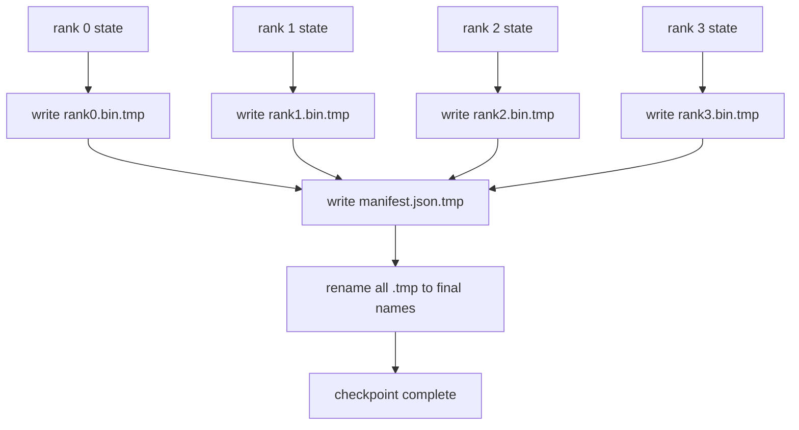

# Sharded Checkpoint and Atomic Resume · 分片检查点与原子恢复

> 一个 70B 参数的训练任务每隔几小时就会被节点故障暂停一次。检查点格式决定了你损失的是 30 分钟还是 30 小时。分片检查点（sharded checkpoint）让每个 rank 并行写入自己的分片（shard），并用一份清单文件（manifest）记录归属关系。恢复时每个 rank 从自己的文件加载分片，在同一 world size 上重建状态，优化器继续迭代，仿佛什么都没发生过。原子写入（atomic write）保证写到一半的检查点不会毒害下一次恢复。

> A 70B-parameter training job is paused by a node failure every few hours. The checkpoint format decides whether you lose 30 minutes or 30 hours. A sharded checkpoint writes every rank's shard in parallel and records ownership in a manifest. Resume loads each rank's shard from its own file, reconstructs the state on the same world size, and the optimiser steps as if nothing happened. Atomic write keeps a half-finished checkpoint from poisoning the next resume.

**类型（Type）:** 构建（Build）
**语言（Languages）:** Python
**先修（Prerequisites）:** Phase 19 Track C 第 42-49 课
**时间（Time）:** ~90 分钟

## Learning Objectives · 学习目标

- 把一个多 rank 检查点保存为每个 rank 一个分片文件，外加一份记录「哪个 rank 拥有什么」的 manifest。
- 使用原子写入模式（先写临时路径再重命名），让写到一半的崩溃永远不会产出半成品检查点。
- 从 manifest 恢复，在每个 rank 上同时验证 fp16 参数与 ZeRO 优化器状态逐字节相等。
- 针对 manifest 模式（schema）的三种失败模式进行防御：world size 变化、分片数量不匹配、部分写入。

> Save a multi-rank checkpoint as a per-rank shard file plus a manifest that records which rank owns what.
> Use the atomic write pattern (write to a temp path then rename) so a crash mid-write never produces a half-finished checkpoint.
> Resume from the manifest, verifying byte-equal state for both fp16 parameters and the ZeRO optimiser state on every rank.
> Defend the manifest schema against the three failure modes: world-size change, shard count mismatch, and partial write.

## The Problem · 问题

朴素检查点把全部参数和优化器状态读进 rank 0，gather 起来，写成一个文件。对一个 70B 模型，这是 1.1 TB 的状态要挤过单个 rank 的网络端口。这次写入会阻塞其他所有 rank，因为它们在空等 gather。IO 带宽是最慢那张 GPU 的网络链路，而不是聚合带宽。在真实集群上，gather 再写入这一步可能比之前一小时的训练还久，也就是说这个任务一天都存不出一个检查点。

分片检查点把模式反过来：每个 rank 并行地把自己的分片写进自己的文件。manifest 记录哪个 rank 拥有哪个分片，恢复时就能把每个分片放回它来的地方。聚合写入带宽随集群规模扩展。一个经单个 rank 要写 4 小时的 1 TB 检查点，经 64 个 rank 只需 4 分钟。另外 manifest 还给了你一份「不兼容恢复」的契约：world size 变化可被检测，部分写入可被检测，加载路径可以大声失败，而不是悄悄用陈旧数据继续跑。

> A vanilla checkpoint reads all parameters and optimiser state into rank 0, gathers, and writes a single file. For a 70B model that is 1.1 TB of state through one rank's network port. ... On a real cluster the gather-then-write step can take longer than the previous training hour, which means the job ships less than one checkpoint per training day.
> Sharded checkpoints flip the pattern: every rank writes its own shard to its own file in parallel. ... A 1 TB checkpoint that took 4 hours through one rank takes 4 minutes through 64 ranks. Plus the manifest gives you a contract for incompatible resumes: world-size change is detectable, partial writes are detectable, and the load path can fail loudly rather than silently using stale data.

## The Concept · 概念



### Manifest schema · Manifest 模式

```json
{
  "world_size": 4,
  "step": 1234,
  "wall_clock_seconds": 4521,
  "shards": [
    {"rank": 0, "path": "rank0.bin", "sha256": "...", "param_shard_offset": 0, "param_shard_numel": 65536},
    {"rank": 1, "path": "rank1.bin", "sha256": "...", "param_shard_offset": 65536, "param_shard_numel": 65536}
  ],
  "schema_version": 1
}
```

有三个字段是承重的。`world_size` 让不同规模上的恢复大声失败，而不是悄悄损坏。每个分片的 `sha256` 抓得住部分写入或损坏的写入。每个分片的 `param_shard_offset` 和 `param_shard_numel` 让加载器在正确位置重建扁平参数张量。

> Three fields are load-bearing. `world_size` makes a resume on a different size loudly fail rather than silently corrupt. `sha256` per shard catches partial or corrupted writes. `param_shard_offset` and `param_shard_numel` per shard let the loader reconstruct the flat parameter tensor at the correct position.

### Atomic write · 原子写入

标准模式：把每个分片写到 `<name>.tmp`，把 manifest 写到 `manifest.json.tmp`，逐个 fsync，然后 rename。同一文件系统内的 POSIX rename 是原子的：要么新文件完整在场，要么还是旧文件。在最后一次 rename 之前崩溃，留下的活动检查点仍是上一个完整的。没有原子写入的话，一次崩溃可能留下一个残缺分片加一份指向它的 manifest，恢复时就把优化器状态加载坏了。

> The standard pattern: write every shard to `<name>.tmp`, write the manifest to `manifest.json.tmp`, fsync each, then rename. POSIX rename within the same filesystem is atomic; either the new file is fully present or the old one is. A crash before the final rename leaves the previous checkpoint as the live one. Without atomic write a crash can leave a partial shard with a present manifest that points at it, and the load corrupts the optimiser state on resume.

### Three failure modes the schema must defend against · schema 必须防御的三种失败模式

| 失败 | 症状 | 防御 |
|---------|---------|---------|
| world size 变化 | 拿 N=4 的 manifest 在 N=8 上恢复 | manifest 中 world_size 不匹配，大声失败 |
| 分片数量不匹配 | 恢复时看到的 rank*.bin 文件比 manifest 里的分片少 | 枚举分片，逐一验证存在 |
| 部分写入 | 分片文件在刷盘中途被截断 | 加载时做 sha256 校验 |

每种防御都把坏加载提前拒绝；另一条路是静默损坏，等 100 步之后 loss 变成 NaN 才暴露出来。

> Each defence rejects the bad load early; the alternative is silent corruption that surfaces 100 steps later when loss goes to NaN.

### Why per-rank files, not one big file · 为什么每个 rank 一个文件，而不是一个大文件

用 `O_APPEND` 对一个文件并发写，在 POSIX 上对字节对齐的写入是可行的，但实际上一个分片内部的偏移会跨 MB 级区域，锁开销占满全场。每 rank 一个文件没有争用，而且在底层文件系统是并行文件系统（Lustre、GPFS）时还能吃到条带化的红利。生产级技术栈（DeepSpeed、FSDP、NeMo）都因此使用每 rank 一个文件。

> Concurrent write to one file via `O_APPEND` works on POSIX for byte-aligned writes, but in practice the offsets within one shard span MB-sized regions and the locking dominates. Per-rank files have no contention and benefit from striping when the underlying filesystem is parallel (Lustre, GPFS). Production stacks (DeepSpeed, FSDP, NeMo) all use per-rank files for that reason.

```figure
ci-sharded-checkpoint
```

## Build It · 动手造

`code/main.py` 实现了：

- `ShardManifest` 数据类（dataclass），包含上述 schema 外加 `to_json`/`from_json`。
- `save_sharded(state_dict_per_rank, dir, step)`：用「先写临时文件再 rename」的原子模式把每个 rank 的二进制状态写进各自的文件，然后写 manifest。
- `load_sharded(dir, expected_world_size)`：读 manifest，校验每个分片的 sha256，返回每个 rank 的状态字典。
- 一个往返测试：构建每 rank 状态，保存，加载，断言逐字节相等。

运行：

```bash
python3 code/main.py
```

输出：写出 4 个分片文件加 manifest，然后重新加载并做逐字节相等校验。

> - `ShardManifest` dataclass with the schema above plus `to_json`/`from_json`.
> - `save_sharded(state_dict_per_rank, dir, step)` that writes every rank's binary state to its own file using the atomic temp-then-rename pattern, then writes the manifest.
> - `load_sharded(dir, expected_world_size)` that reads the manifest, verifies each shard's sha256, and returns per-rank state dicts.
> - A round-trip test: build per-rank state, save, load, assert byte-equal.
> Output: 4 shard files plus manifest written, then reloaded with byte-equal verification.

## Production patterns in the wild · 生产环境的实战模式

三种模式把检查点加固到可以上线的程度。

**异步写入。** 生产级技术栈把检查点写入放到单独的线程或进程上，训练照常继续。卡点在下一个检查点：上一次保存完成之前，不要开始下一次保存。DeepSpeed 的 `async_io` 旗标干的就是这件事。本课保持写入同步，让每一步清晰可见。

**先落本地快盘，再异步上传。** 先写到本地 NVMe（快），再异步上传到 S3 或 GCS。两级模式让集群内恢复用的检查点保持快速，同时把一份持久副本送出集群归档。manifest 记本地路径；上传 manifest 记远端路径。

**轮换很重要。** 生产训练保留最近 K 个检查点（通常 3-5 个），轮换掉最旧的。没有轮换，磁盘会在训练中途写满，下一个检查点就失败了。有了轮换，下一次保存先删最旧的，释放出预算。

> **Async write.** Production stacks issue the checkpoint write on a separate thread or process so training continues. The barrier is at next checkpoint: do not start the next save until the previous one is complete. DeepSpeed's `async_io` flag does exactly this. ... **Local fast disk first, then async upload.** Write to local NVMe (fast) then async-upload to S3 or GCS. The two-tier pattern keeps the in-cluster checkpoint fast for resume while shipping a durable copy off-cluster for archive. ... **Rotation matters.** Production runs keep the last K checkpoints (typically 3-5) and rotate the oldest. Without rotation the disk fills mid-run and the next checkpoint fails. With rotation the next save deletes the oldest first, freeing the budget.

## Use It · 实战用法

生产级实现：

- **DeepSpeed checkpointing.** `deepspeed.save_checkpoint(tag=step)` 写每 rank 文件和一个指向活动 tag 的 `latest` 文件。
- **PyTorch FSDP checkpointing.** `torch.distributed.checkpoint` 用一个决定每 rank 布局的 `Planner` 保存分片状态。
- **NeMo.** 用统一的 `save_to_checkpoint` API 封装 DeepSpeed 和 FSDP，并附加元数据。

> - **DeepSpeed checkpointing.** `deepspeed.save_checkpoint(tag=step)` writes per-rank files and a `latest` file pointing at the active tag.
> - **PyTorch FSDP checkpointing.** `torch.distributed.checkpoint` saves sharded state with a `Planner` that decides per-rank layout.
> - **NeMo.** Wraps DeepSpeed and FSDP with a uniform `save_to_checkpoint` API that adds metadata.

## Ship It · 交付

第 81 课对端到端 DDP+ZeRO 训练保存一个分片检查点，并在同一 world size 上重新加载，证明恢复契约成立。

> Lesson 81 saves a sharded checkpoint of the end-to-end DDP+ZeRO run and reloads it on the same world size to prove the resume contract holds.

## Exercises · 练习

1. 加异步写入：在线程里启动保存，训练继续。上一次保存完成前阻塞下一次保存。
2. 加 `last_5_steps` 轮换：保留最近 5 个检查点，保存新的之前先删最旧的。
3. 给内层循环的重新加载加一条只做 CRC 的快速校验路径（轮换把某个检查点滚成新的活动检查点时，不必跑完整 sha256）。
4. 加跨 world size 加载：通过读 manifest、拼接、重新分片，把分片从 N=4 重均衡到 N=8。
5. 加上传到一个假 S3（另一个目录），并写上传 manifest。为两级存储策略辩护。

> Add async write: kick off the save in a thread and let training continue. Block the next save until the previous one completes. ... Add a `last_5_steps` rotation: keep the 5 most recent checkpoints, delete the oldest before saving a new one. ... Add a CRC-only fast verification path for the inner-loop reload (rotation rolls a checkpoint into being the new active one without full sha256). ... Add a cross-world-size load: shard rebalance from N=4 to N=8 by reading the manifest, concatenating, and re-sharding. ... Add an upload to a fake S3 (a second directory) and write the upload manifest. Defend the two-tier storage policy.

## Key Terms · 术语表

| 术语 | 人们常说 | 实际含义 |
|------|----------------|------------------------|
| Sharded checkpoint | 「按 rank 分片保存」 | 每个 rank 并行写自己的分片文件 |
| Manifest | 「索引」 | 记录分片路径、偏移和 sha256 的 JSON 文件 |
| Atomic write | 「先 tmp 再 rename」 | 先写 .tmp 再做 POSIX rename，崩溃时旧文件仍在岗 |
| Partial write | 「被截断的分片」 | 写入中途崩溃产出损坏分片；靠 sha256 抓住 |
| Rotation | 「保留最近 K 个」 | 写新检查点前删最旧的，给磁盘占用设上界 |

## Further Reading · 延伸阅读

- [DeepSpeed checkpointing](https://deepspeed.readthedocs.io/en/latest/model-checkpointing.html)
- [PyTorch torch.distributed.checkpoint](https://pytorch.org/docs/stable/distributed.checkpoint.html)
- [POSIX rename atomicity](https://pubs.opengroup.org/onlinepubs/9699919799/functions/rename.html)
- Phase 19 Lesson 78 —— 本检查点为之量身设计的 ZeRO 状态
- Phase 19 Lesson 81 —— 端到端 demo 会把保存的状态做一次往返
