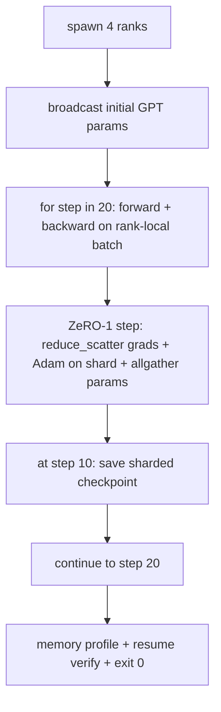

# End-to-End Distributed Training · 端到端分布式训练

> 第 76 到 80 课各自造了一块零件。这一课是总装：一个微型 GPT 在 4 个模拟 rank 上训练，用 DDP 做梯度同步，用 ZeRO-1 做优化器状态分片，在 halfway 时刻落一个分片检查点。demo 跑 20 步，自行终止，打印一条 loss 曲线加一份内存画像，并写出一个可恢复的检查点。

> Lessons 76 through 80 each built one piece. This is the assembly: a tiny GPT trained across 4 simulated ranks with DDP for gradient sync, ZeRO-1 for optimiser-state sharding, and a sharded checkpoint at the halfway mark. The demo runs 20 steps, self-terminates, prints a loss curve plus a memory profile, and writes a resumable checkpoint.

**类型（Type）:** 构建（Build）
**语言（Languages）:** Python
**先修（Prerequisites）:** Phase 19 Track C 第 42-49 课
**时间（Time）:** ~90 分钟

## Learning Objectives · 学习目标

- 把 DDP（第 77 课）+ ZeRO-1（第 78 课）+ 分片检查点（第 80 课）组合成一个训练循环。
- 在一个小型合成语料上，跨 4 个模拟 rank 把一个 2 层 transformer 语言模型训练 20 步。
- 打印逐步 loss 表、每 rank 内存画像，以及一份在同一 world size 上可逐字节恢复的检查点 manifest。
- 论证这个组合：每个零件在之前的课程里都可独立测试，本课证明它们可以组合。

> Compose DDP (lesson 77) plus ZeRO-1 (lesson 78) plus sharded checkpoints (lesson 80) into one training loop.
> Train a 2-layer transformer language model on a small synthetic corpus for 20 steps across 4 simulated ranks.
> Print a per-step loss table, a per-rank memory profile, and a checkpoint manifest that resumes byte-equal on the same world size.
> Defend the composition: each piece is independently testable in earlier lessons and this lesson proves they compose.

## The Problem · 问题

毕业项目（capstone）就是「零件拼得上」的证明。第 76 课实现了集合通信（collectives）。第 77 课把它们包成 DDP。第 78 课用 reduce_scatter 分片优化器状态。第 79 课分析了流水线。第 80 课保存了分片检查点。每一课都独立成立、自带测试。真实训练是一次运行同时用上所有原语；组合错了，loss 就发散，检查点就拒绝恢复，或者每 rank 内存在本该缩小时反而增长。

本课跑端到端 demo 并验证四个不变量：(a) 20 步内 loss 在浮点噪声范围内单调下降；(b) 每一步所有 rank 持有相同的参数范数；(c) 每 rank 优化器内存等于 ZeRO-1 公式 12P/N 字节；(d) 第 10 步的检查点在重启时逐字节恢复。demo 自行终止：20 步、一条命令、退出码 0。

> A capstone is the proof that the pieces fit together. Lesson 76 implemented collectives. Lesson 77 wrapped them into DDP. Lesson 78 sharded optimiser state with reduce_scatter. Lesson 79 analysed pipeline. Lesson 80 saved a sharded checkpoint. Each lesson stood alone with its own test. A real training run uses every primitive at once; if the composition is wrong, the loss diverges, the checkpoint refuses to resume, or the per-rank memory grows when it should shrink.
> This lesson runs the end-to-end demo and verifies four invariants: (a) the loss decreases monotonically across the 20 steps within float noise, (b) every rank holds the same parameter norm at every step, (c) the per-rank optimiser memory equals the ZeRO-1 formula 12P/N bytes, and (d) the checkpoint at step 10 reloads byte-equal at restart.

## The Concept · 概念



### The mini GPT · 迷你 GPT

模型故意做小：2 个 transformer block，embed 维度 32，4 个注意力头，词表 64，序列长度 16，批量 4。几千个参数。足够大，能检验每一个接线决策（多头注意力走标准的带掩码路径；LayerNorm 有需要同步的权重；LM head 是投回词表的独立线性投影）。又足够小，4 个 CPU rank 跑 20 步几秒就能结束。

> The model is small on purpose: 2 transformer blocks, embed dim 32, 4 attention heads, vocab 64, sequence length 16, batch 4. A few thousand parameters. Big enough to exercise every wiring decision (multi-head attention runs the standard masked path; LayerNorm has weights to sync; the LM head is a separate linear projection back to the vocab). Small enough that 20 steps on 4 CPU ranks finish in seconds.

### The composition rules · 组合规则

| 零件 | 它负责什么 | 它留给训练循环什么 |
|--------------|--------------|----------------------------|
| DDP broadcast | 初始参数同步 | 构造时一次调用 |
| ZeRO-1 step | 梯度同步、主副本更新、参数广播 | 每步一次调用，替代 optimiser.step |
| Sharded checkpoint | 持久化每 rank 状态、带 sha256 的 manifest | rank 0 上调用，状态经 allgather 收集 |
| Training loop | 前向、反向、loss 记录 | 按顺序调用上面三件 |

训练循环不需要知道 reduce_scatter 或 rendezvous 文件。ZeRO 和检查点模块暴露窄接口，由循环来组合。

> The loop does not know about reduce_scatter or rendezvous files. The ZeRO and checkpoint modules expose narrow interfaces that the loop composes.

### Why a tiny GPT and not just an MLP · 为什么是迷你 GPT 而不只是 MLP

第 77 课的 MLP 足以验证梯度同步。迷你 GPT 多了三样东西：词表上独立的 LM head（本课为清晰起见不共享权重（untied）；完整 GPT 通常把 head 与 token embedding 绑定共享）、softmax+交叉熵作为损失（比 MSE 多出许多数值边界情况）、非对称前向（先 embedding，再每层 attention，再 MLP）。毕业项目还停在 MLP 上，就暴露不出组合能否正确处理 LayerNorm 或 embedding 层的梯度形状。

> The MLP from lesson 77 was sufficient to verify gradient sync. A tiny GPT adds three things: a separate LM head over the vocab (in this lesson, untied for clarity; full GPT typically ties the head to the token embedding), softmax+cross-entropy as the loss (more numerical edge cases than MSE), and an asymmetric forward (embeddings then attention then MLP per layer). Sticking with an MLP for the capstone would hide whether the composition handles LayerNorm or the embedding layer's grad shape correctly.

### Self-terminating means exit 0 · 自行终止就是退出码 0

循环跑固定 20 步然后退出。没有 `while True`，没有人工干预，不依赖外部状态恢复。一个可以无人值守放着跑、结束时留下完整日志的毕业项目，才证明系统接线正确。任何零件死锁，demo 就永不返回，测试装置会抓到它。

> The loop runs a fixed 20 steps and exits. No `while True`, no human intervention, no resume from external state. A capstone you can leave running unattended and find a complete log when it finishes is a capstone that proves the system is wired correctly. If any piece deadlocks the demo never returns and the test rig catches it.

```figure
ci-distributed-assembly
```

## Build It · 动手造

`code/main.py` 实现了：

- `MiniGPT`：2 层 transformer，带掩码自注意力，LM head 独立。
- `make_corpus(seed, total_tokens)`：确定性的下一 token 预测数据。
- `_train_worker`：每个 rank 派生一个；广播初始参数，跑训练循环，调用 ZeRO 步，在第 10 步写分片检查点。
- `verify_resume`：主运行结束后，在进程内重新加载第 10 步检查点，断言保存的 master 分片与内存快照逐字节一致。
- `main`：编排整个 demo，打印 loss 表、内存画像和校验结果。

运行：

```bash
python3 code/main.py
```

输出：一张 20 行的 loss 表、一份 4 行的每 rank 内存画像、一份检查点 manifest，成功时还有一行 "RESUME VERIFIED"。

> - `MiniGPT`: 2-layer transformer with masked self-attention and a separate LM head.
> - `make_corpus(seed, total_tokens)`: deterministic next-token-prediction data.
> - `_train_worker`: spawned per rank; broadcasts init params, runs the loop, calls ZeRO step, writes the sharded checkpoint at step 10.
> - `verify_resume`: after the main run, reloads the step-10 checkpoint in-process and asserts the saved master shards match the in-memory snapshot byte-for-byte.
> Output: a 20-row loss table, a 4-row per-rank memory profile, a checkpoint manifest, and a "RESUME VERIFIED" line on success.

## Production patterns in the wild · 生产环境的实战模式

三种模式把组合补齐到真实运行的水平。

**每 K 分钟存一次检查点，而不是每 K 步。** 步耗时随序列长度和微批次数量波动。10 分钟一次的检查点节奏，不管模型多大都能接住等量的计算。本课为了简单用按步计数；生产用按墙钟计时。

**尽早发现发散。** 生产训练在 backward 后加 NaN 守卫和 loss 尖峰检测器；如果 loss 一步跳升超过 2 倍，就回滚到上一个检查点，而不是让优化器冲进退化状态。本课的 loss 曲线很平，守卫派不上用场，但钩子留着。

**跨 rank 聚合内存画像。** 真实运行中每 rank 内存因 rank 而异（拥有最大流水线阶段的 rank 持有更多激活）。生产同时记录跨 rank 的最大值和均值；本课打印每 rank 数值，让你亲眼看到公式对得上。

> **Checkpoint every K minutes, not every K steps.** Step time varies with seq length and microbatch count. A 10-minute checkpoint cadence catches the same compute regardless of model size. The lesson uses step-based for simplicity; production uses wall-clock-based. ... **Detect divergence early.** Production runs add a NaN guard after backward and a loss-spike detector; if loss jumps by more than 2x in one step, roll back to the previous checkpoint instead of letting the optimiser march into a degenerate state. ... **Aggregate the memory profile across ranks.** Per-rank memory differs by rank in real runs (rank with the largest pipeline stage holds more activations). Production logs the max across ranks plus the mean; the lesson prints per-rank to show the formula matches.

## Use It · 实战用法

生产级实现：

- **DeepSpeed.** 用一份配置组合 DDP + ZeRO + 流水线 + 激活检查点。本课的组合就是微缩版的 DeepSpeed 形态。
- **PyTorch FSDP.** 原生等价物。`FullyShardedDataParallel` 配 `ShardingStrategy.SHARD_GRAD_OP` 就是 ZeRO-2。
- **NeMo 与 Megatron-LM.** 为超大规模模型再加张量并行；除此之外组合形态相同。

> - **DeepSpeed.** Combines DDP + ZeRO + pipeline + activation checkpointing under one config. The lesson's composition is the DeepSpeed shape in miniature.
> - **PyTorch FSDP.** The native equivalent. `FullyShardedDataParallel` with `ShardingStrategy.SHARD_GRAD_OP` is ZeRO-2.
> - **NeMo and Megatron-LM.** Add tensor parallel for the very largest models; otherwise the composition is the same shape.

## Ship It · 交付

整条 track 到此收尾。这 6 课合起来，就是一个真实团队在上 DeepSpeed 之前会自建的分布式训练子系统：抽象已对 gloo 验证过，失败模式也都演练过。要把这套组合搬上真实集群，请去 Phase 17（基础设施与生产）。

> The full track ends here. The 6 lessons together are the distributed-training subsystem a real team would build before adopting DeepSpeed; the abstraction has been proven against gloo and the failure modes have been exercised. Phase 17 (infrastructure and production) is the place to take this to a real cluster.

## Exercises · 练习

1. 加注意力头的张量并行切分，验证 loss 与单 rank 基线一致。两个 rank：每 rank 一半的头，注意力输出做 allreduce。
2. 加跨 4 个微批次的梯度累积，证明该梯度等于一个大批量的梯度。
3. 加一条真正从第 10 步恢复并继续训练到第 20 步的路径，且最终 loss 与原运行一致。
4. 加指标导出（loss、梯度范数、步耗时）到 JSONL，让训练可以在事后可视化。
5. 加一个在 loss 尖峰时回滚到上一检查点的 NaN 守卫，并用一步的 LR 乘子制造一次尖峰来演练回滚。

> Add a tensor-parallel split of the attention head and verify the loss matches the single-rank baseline. Two ranks: half the heads per rank, allreduce of the attention output. ... Add gradient accumulation across 4 microbatches and prove the gradient equals the gradient of one big batch. ... Add a resume-from-step-10 path that actually continues training to step 20 and produces the same final loss as the original run. ... Add a metrics export (loss, grad norm, step time) to JSONL so the run can be visualised after the fact. ... Add a NaN guard that rolls back to the previous checkpoint on a loss spike, and force a spike with a one-step LR multiplier to exercise the rollback.

## Key Terms · 术语表

| 术语 | 人们常说 | 实际含义 |
|------|----------------|------------------------|
| End-to-end | 「全部接起来」 | 一次运行组合所有零件，而不是每个零件各做一次单元测试 |
| Memory profile | 「每 rank 的 GB 数」 | 每个 rank 上参数、梯度、优化器状态占用的字节数 |
| Resume contract | 「能存能读」 | 检查点往返之后每 rank 状态逐字节相等 |
| Self-terminating | 「有界运行」 | 步数固定、完成即退出码 0、无需人工介入 |

## Further Reading · 延伸阅读

- [DeepSpeed end-to-end training tutorial](https://www.deepspeed.ai/getting-started/)
- [PyTorch FSDP advanced tutorial](https://pytorch.org/tutorials/intermediate/FSDP_advanced_tutorial.html)
- [Megatron-LM training script reference](https://github.com/NVIDIA/Megatron-LM)
- Phase 19 Lessons 76-80 —— 本课组合的每一个零件
- Phase 17 —— 把这套组合搬上真实集群
