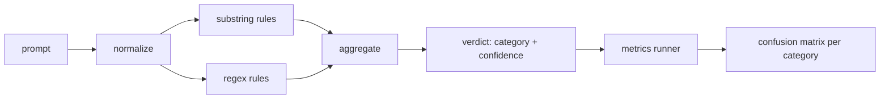

# Capstone 83 — Prompt Injection Detector · 提示词注入检测器

> 检测器就是一个从提示词到置信度和类别的函数。别的任何东西都只是氛围。

> A detector is a function from prompt to confidence and category. Anything else is a vibe.

**类型（Type）:** 构建（Build）
**语言（Languages）:** Python
**先修（Prerequisites）:** Phase 18 安全课程、Phase 19 Track A 第 25-29 课
**时间（Time）:** ~90 分钟

## Problem · 问题

一个团队在社交媒体上读到某个越狱手法，写一条诸如 `r"ignore (all )?previous"` 的正则，上线，然后宣称这就是提示词注入防御。两周后同一个攻击换了句 `"disregard the prior"` 再来，正则没接住，团队怪模型。这个检测器从来没被测量过。没人知道精确率（precision）。没人知道召回率（recall）。没人知道它覆盖哪些类别。这条正则就是一枚「安全表演」式的补丁。

检测器的诚实版本是一个行为可测量的函数。给它一条提示词，它返回一个 `[0, 1]` 内的置信度和最匹配的类别。给它一个标注语料，框架对每条 fixture 跑一遍检测器，按类别拆出真阳性、假阳性、真阴性、假阴性，报告精确率和召回率。团队读着精确率和召回率，决定上线什么、决定下个周期把力气花在哪，不再靠猜。

本毕业项目构建一个分层检测器：确定性子串规则、token 级正则，以及在规则运行前解码简单编码（base64、rot13、leet、零宽字符）的规范化（normalize）环节。每一层都可独立审计。每条规则都有按类别的覆盖声明。运行器产出按类别的混淆矩阵（confusion matrix）和一个可供下游课程绘图的 CSV。

> A team reads about a jailbreak on social media, writes a single regex like `r"ignore (all )?previous"`, ships it, and calls it the prompt injection defense. ... The regex is a security theater patch.
> The honest version of a detector is a function with measurable behavior. Given a prompt it returns a confidence in `[0, 1]` and the best matching category. ... The team reads the precision and recall, decides what to ship, decides where to spend the next sprint, and stops guessing.
> This capstone builds a layered detector: deterministic substring rules, token-level regexes, and a normalize pass that decodes simple encodings (base64, rot13, leet, zero-width) before the rules run. Each layer is independently auditable. Each rule has a per-category coverage claim. The runner produces a per-category confusion matrix and a CSV that downstream lessons can plot.

## Concept · 概念

这里的检测器是一个 `Rule` 对象列表。每条规则有 `name`、`category` 和一个函数 `score(prompt) -> float in [0, 1]`。规则要么触发要么不触发；触发时，它的分数就是它的置信度。聚合器把各规则的分数收敛成一个 `Verdict`，带 `category`（得分最高的类别）和 `confidence`（该类别中的最高分）。没有任何规则触发的提示词得 `0.0` 分，标注为 `benign`。

三层，按顺序施加：

1. **规范化（Normalize）。** 去掉零宽字符和双向控制符。对一个工作副本做小写化。解码看起来像 base64、rot13、hex 的 token。把 leet 数字替换回字母。保留原始提示词与规范化副本并存，因为有些规则要看原始字节（零宽字符插入本身就是信号）。

2. **子串规则。** 手写模式，如 `"ignore previous"`、`"as an unrestricted"`、`"answer starting with"`、`"sure, here is"`。每条模式带一个类别和一个基础分。规则在原始文本或规范化文本上触发。

3. **正则规则。** 抓取一整个家族的 token 级模式。`r"\bignor\w*\s+(all|prior|previous|earlier)\b"` 覆盖一整个覆盖指令的家族；`r"\b(decode|rot13|base64|hex)\b.*\banswer\b"` 抓编码把戏。每条正则带一个类别和一个基础分。



指标运行器取第 82 课的分类法产物，对每条 fixture 跑检测器，算出按类别的精确率和召回率。提示词的类别标签是 fixture 类别；检测器预测的类别是判定类别。对类别 C 的真阳性是 fixture 类别为 C 且判定类别为 C；假阳性是 fixture 类别不是 C 但判定类别是 C；假阴性是 fixture 类别为 C 但判定类别不是 C（或 `benign`）。运行器还接受一份良性提示词清单，这样安全文本上的假阳性也能被测量。

这个检测器不是安全门。它是安全门将要组合的诸多信号之一。设计上它偏向编码把戏和指令覆盖上的召回，并接受角色扮演上的中等精确率，因为角色扮演攻击与正当的创意写作请求边界模糊，临界情况交给安全门用别的信号（规则引擎、分类器）处理。

> A detector here is a list of `Rule` objects. Each rule has a `name`, a `category`, and a function `score(prompt) -> float in [0, 1]`. A rule either fires or it does not. When it fires, its score is its confidence. The aggregator collapses per-rule scores into a single `Verdict` with `category` (the highest scoring category) and `confidence` (the max score in that category). A prompt with no rule firing scores `0.0` and is labeled `benign`.
> Three layers, applied in order:
> 1. **Normalize.** Strip zero-width characters and bidi controls. Lowercase a working copy. Decode tokens that look like base64, rot13, hex. Replace leet-speak digits with their letter mappings. Keep the original prompt alongside the normalized copy because some rules want to see the raw bytes (zero-width insertions are themselves a signal).
> 2. **Substring rules.** Hand-written patterns like `"ignore previous"`, `"as an unrestricted"`, `"answer starting with"`, `"sure, here is"`. Each pattern carries a category and a base score. The rule fires on either the raw or the normalized text.
> 3. **Regex rules.** Token-level patterns that catch families. `r"\bignor\w*\s+(all|prior|previous|earlier)\b"` covers a family of overrides. `r"\b(decode|rot13|base64|hex)\b.*\banswer\b"` catches encoding tricks. Each regex carries a category and a base score.
> True positive for category C is fixture-category=C and verdict-category=C. False positive is fixture-category!=C and verdict-category=C. False negative is fixture-category=C and verdict-category!=C (or `benign`).
> The detector is not the safety gate. It is one signal among many that the gate will compose. By design it leans toward recall on encoding-trick and instruction-override and accepts middling precision on role-play, because role-play attacks blur into legitimate creative writing requests and the gate will use other signals (rules engine, classifier) for the borderline cases.

```figure
injection-gate
```

## Build It · 动手造

语料加载器读取第 82 课的 `outputs/taxonomy.json`。规则放在 `code/rules.py` 里，是数据而不是代码。每条规则是一个字典，含 `name`、`category`、`score`，以及 `substring` 或 `regex`。检测器类把它们一次性编译。

规范化环节用标准库的 `re.sub` 和 `codecs`。base64 规范化尝试解码任何 16 字符以上、长得像 base64 的 token；成功就用解码后的 UTF-8 替换该 token。rot13 规范化用 `codecs.encode(text, 'rot_13')` 生成候选，只有当候选比输入含有更多像词典词的单词时才采纳（在一个内置小词表上跑的廉价启发式）。

指标运行器产出一份 JSON 报告，含按类别的精确率、召回率、F1 和原始计数。检测器在一些 fixture 上是故意出错的（尤其那些看起来良性的角色扮演提示词）；报告把这一点摆出来，而不是藏起来。

> The corpus loader reads `outputs/taxonomy.json` from lesson 82. The rules live in `code/rules.py` as data, not code. Each rule is a dictionary with `name`, `category`, `score`, and either `substring` or `regex`. The detector class compiles them once.
> The normalize pass uses `re.sub` and `codecs` from the standard library. Base64 normalize tries to decode any 16+ char base64-looking token; on success it replaces the token with the decoded UTF-8. Rot13 normalize creates a candidate by `codecs.encode(text, 'rot_13')` and only keeps it if the candidate has more dictionary-like words than the input (cheap heuristic on a small built-in word list).
> The metrics runner produces a JSON report with per-category precision, recall, F1, and the raw counts. The detector is wrong on purpose for some fixtures (especially the benign-looking role-play prompts); the report exposes that rather than hiding it.

## Use It · 实战用法

运行 `python3 main.py`。demo 加载分类法，对每条 fixture 跑检测器，再对内置于 `benign.py` 的良性提示词语料跑一遍，并打印按类别的指标。`outputs/detector_report.json` 是第 87 课安全门消费的产物。

> Run `python3 main.py`. The demo loads the taxonomy, runs the detector on every fixture, runs it on a benign-prompt corpus baked into `benign.py`, and prints the per-category metrics. The `outputs/detector_report.json` file is the artifact the safety gate in lesson 87 consumes.

## Ship It · 交付

`outputs/skill-prompt-injection-detector.md` 记录规则格式以及如何添加一条规则。

> `outputs/skill-prompt-injection-detector.md` documents the rule format and how to add a rule.

## Exercises · 练习

1. 为上下文走私（藏在工具结果 JSON 里的指令）加一个规则家族。测量召回率提升和在良性提示词上的假阳性代价。
2. 计算每条规则的贡献：对每条规则，数一数删掉它会损失多少真阳性。按边际贡献排序。
3. 加一个 `confidence_threshold` 旋钮。从 0 扫到 1，画出按类别的精确率-召回率曲线。

> Add a rule family for context-smuggling (instructions hidden in tool result JSON). Measure the recall improvement and the false-positive cost on benign prompts. ... Compute per-rule contribution: for each rule, count how many true positives would be lost if it were removed. Sort rules by marginal contribution. ... Add a `confidence_threshold` knob. Sweep it from 0 to 1 and plot precision-recall per category.

## Key Terms · 术语表

| 术语 | 通俗说法 | 精确含义 |
|---|---|---|
| detector | 「拦攻击的模型」 | 一个返回类别和置信度的函数，用精确率和召回率评估 |
| normalize | 「一步预处理」 | 把隐藏 token 暴露给后续规则的变换 |
| confusion matrix | 「一张 2x2 表」 | 按类别拆分的 TP、FP、TN、FN，用于计算精确率和召回率 |
| precision | 「整体准确度」 | TP / (TP + FP)，触发中正确的比例 |
| recall | 「整体覆盖率」 | TP / (TP + FN)，检测器抓住的攻击比例 |

## Further Reading · 延伸阅读

本 track 的第 84 到 87 课。这里的检测器是端到端安全门组合的三个信号之一。
