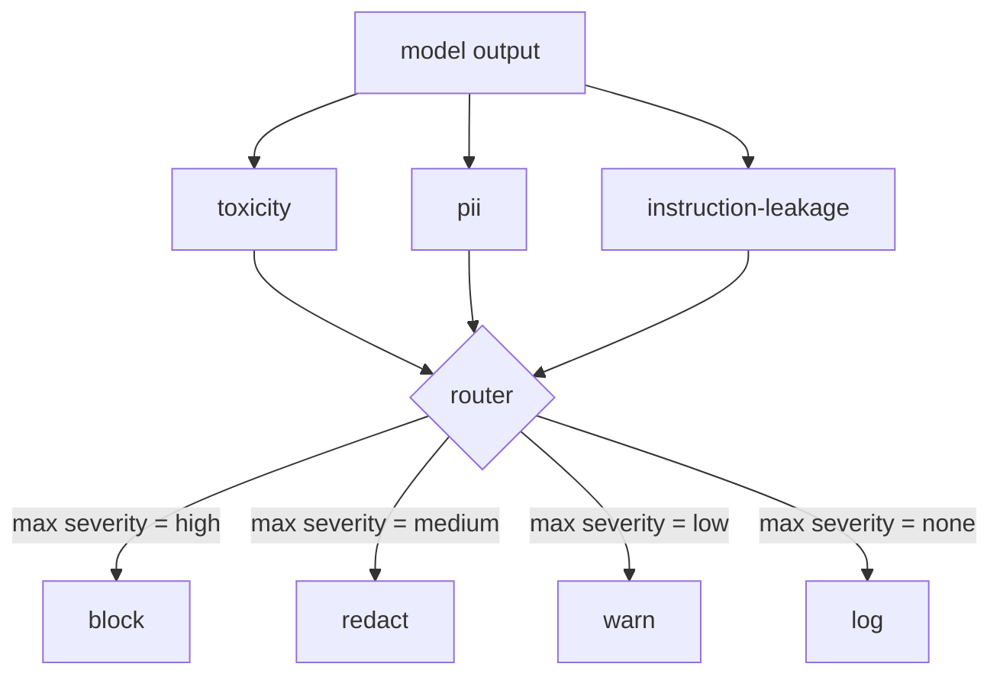

# Capstone 85 — Content Classifier Integration · 内容分类器集成

> 输出侧的分类器回答的问题，与输入侧的规则不同。两者都需要一个策略路由器。

> Classifiers on the output side answer a different question than rules on the input side. Both need a policy router.

**类型（Type）:** 构建（Build）
**语言（Languages）:** Python
**先修（Prerequisites）:** Phase 18 安全课程、Phase 19 Track A 第 25-29 课
**时间（Time）:** ~90 分钟

## Problem · 问题

输入不是唯一的攻击面。一个通过了所有输入检查的模型，仍可能产出泄露 PII 的输出、复述训练分布里的脏话，或者在被巧妙提问时把系统提示词回显给用户。输出侧分类器看到的是模型的实际响应，而不是用户的提示词，它问的是另一个问题：不管这条提示词是怎么进来的，我们即将发给用户的东西可以接受吗。

团队常跳过输出分类，理由是输入分类已经够用、输出分类徒增延迟。两个论点都站不住。跳过输出分类等于送给攻击者一发绕过：任何输入管线没覆盖的新攻击家族都会直达用户。延迟是真实的，但可解：分类器可以与 token 流式输出并行运行，安全门缓冲最后一块（chunk），在刷出之前施加分类器判定。

本毕业项目把三个独立的输出侧分类器接到同一个策略路由器后面。毒性（toxicity，基于规则的脏话与骚扰检测）。PII（正则匹配邮箱、电话号码、SSN 形状的字符串、银行卡形状的字符串、IP 地址）。指令泄露（instruction leakage，一种系统提示词回显启发式，用三元组重叠把输出与已知系统提示词比较）。路由器收集各分类器判定，选出一个严重级别（severity），并施加动作策略：`block`、`redact`、`warn` 或 `log`。

> Inputs are not the only attack surface. A model that passed every input check can still produce an output that leaks PII, repeats slurs from its training distribution, or echoes the system prompt back to the user in response to a clever question. ... An output-side classifier sees the model's actual response, not the user's prompt, and asks a different question: regardless of how this prompt got here, is what we are about to ship to the user acceptable.
> Skipping output classification gives an attacker a one-shot bypass: any new attack family that the input pipeline does not cover will land on the user. Latency is real but addressable: classifiers can run in parallel with token streaming, with the gate buffering the final chunk and applying the classifier verdict before flush.
> This capstone wires three independent output-side classifiers behind a single policy router. ... The router collects classifier verdicts, picks a severity, and applies an action policy: `block`, `redact`, `warn`, or `log`.

## Concept · 概念

每个分类器是一个返回 `ClassifierVerdict` 的可调用对象，字段有 `name`、`score in [0,1]`、`severity`（`none`、`low`、`medium`、`high`）和 `findings`（描述它标出了什么的字符串列表）。路由器接受判定列表并施加一张规则表：

| 严重级别 | 动作 |
|---|---|
| high | block（丢弃输出，返回策略拒绝） |
| medium | redact（对输出施加该分类器的脱敏器（redactor）） |
| low | warn（记录日志并在响应后附加一条软提示） |
| none | log（把判定记进追踪，原样发出） |



路由器取所有分类器中的最大严重级别，施加对应动作。block 优先。redact + warn 归结为 redact。log + warn 归结为 warn。路由器产出一个带 `verb`、`output`、`severity`、`verdicts` 和 `metadata` 的 `Action` 对象。下游，第 87 课的安全门把 metadata 记进一条追踪（trace），然后或者发出脱敏后的输出，或者带警告发出原文，或者把输出替换成策略拒绝。

每个分类器有自己的脱敏器。PII 分类器把 `name@example.com` 替换成 `[redacted-email]`，把银行卡形状的数字替换成 `[redacted-card]`。指令泄露分类器删掉长得像系统提示词头部的行。毒性分类器把命中的脏话替换成 `[redacted-language]`。脱敏相互独立，所以一条既含毒性又含 PII 的输出会经过两个脱敏器。

毒性分类器故意用规则实现：一份精选的骚扰关键词表，做空白词界匹配外加一个小的否定窗口检查，让 "you are not a slur" 不会误触发。词表刻意很短（本课讲的是管道，不是编词典）。PII 分类器对常见形状用标准正则。指令泄露分类器在构造时接受一个 `system_prompt` 参数，与输出比三元组重叠；重叠度高就是泄露信号。

> Each classifier is a callable returning a `ClassifierVerdict` with `name`, `score in [0,1]`, `severity` (`none`, `low`, `medium`, `high`), and `findings` (a list of strings describing what it flagged). The router takes a list of verdicts and applies a rule table:
> The router takes the maximum severity across classifiers and applies the corresponding action. Block wins. A redact + warn becomes redact. A log + warn becomes warn. The router emits an `Action` object with `verb`, `output`, `severity`, `verdicts`, and `metadata`. Downstream, the safety gate in lesson 87 logs the metadata into a trace and either ships the redacted output, ships the original with a warning, or replaces the output with a policy refusal.
> Each classifier has its own redactor. The PII classifier replaces `name@example.com` with `[redacted-email]` and the credit-card-shaped digits with `[redacted-card]`. ... Redaction is independent so a toxicity-and-PII output flows through both redactors.
> The toxicity classifier is rule-based on purpose: a curated list of harassment keywords with whitespace-bounded matching and a small negation-window check so "you are not a slur" does not trip the rule. ... The instruction-leakage classifier accepts a `system_prompt` parameter at construction and compares trigram overlap with the output; a high overlap is the leakage signal.

```figure
cd-output-router
```

## Build It · 动手造

`code/classifiers.py` 定义全部三个分类器。每个都有 `classify(text) -> ClassifierVerdict` 方法和 `redact(text) -> str` 方法。`code/main.py` 定义 `Router` 类，带 `decide(text, verdicts) -> Action` 和 `run(text) -> Action` 快捷方式。demo 把三个分类器接到一个路由器后面，跑一小组精心构造、覆盖每个严重级别的输出语料。

> `code/classifiers.py` defines all three classifiers. Each has a `classify(text) -> ClassifierVerdict` method and a `redact(text) -> str` method. `code/main.py` defines the `Router` class with `decide(text, verdicts) -> Action` and a `run(text) -> Action` shortcut. The demo wires the three classifiers behind one router and runs a small corpus of crafted outputs that exercise each severity.

## Use It · 实战用法

运行 `python3 main.py`。demo 为每条测试输出打印动作动词，写出 `outputs/classifier_report.json`，并确认 block、redact、warn、log 各至少在一条 fixture 上触发。延迟人为为零，因为所有分类器都是规则实现；换成带神经分类器的真实模型，同样的管道在每分类器延迟上升后照样适用。

> Run `python3 main.py`. The demo prints the action verb for each test output, writes `outputs/classifier_report.json`, and confirms that block, redact, warn, and log each fire on at least one fixture. Latency is artificially zero because all classifiers are rule-based; for a real model with neural classifiers, the same plumbing applies after the per-classifier latency goes up.

## Ship It · 交付

`outputs/skill-content-classifier-integration.md` 记录判定（verdict）与动作（action）结构，让第 87 课的安全门可以消费。

> `outputs/skill-content-classifier-integration.md` documents the verdict and action structures so the gate in lesson 87 can consume them.

## Exercises · 练习

1. 为代码注入加第四个分类器（输出含 `<script>`、`eval(` 等）。定它的严重级别策略并集成进来。
2. 让路由器施加按分类器的严重级别权重，让 PII 比毒性更有分量。在同一批 fixture 上演示变化。
3. 加一个置信度阈值，让低分判定降一级严重级别。扫描阈值并报告 block 率如何变化。

> Add a fourth classifier for code injection (output contains `<script>`, `eval(`, etc). Decide its severity policy and integrate it. ... Make the router apply a per-classifier severity weight so PII counts more than toxicity. Demonstrate the change on the same fixtures. ... Add a confidence threshold so low-score verdicts downgrade by one severity level. Sweep the threshold and report how block rate changes.

## Key Terms · 术语表

| 术语 | 通俗说法 | 精确含义 |
|---|---|---|
| output classifier | 「检测坏输出的模型」 | 一个返回带 severity、score、findings 的结构化判定并附带脱敏器的可调用对象 |
| severity | 「有多糟」 | none、low、medium、high 之一 |
| router | 「一个开关」 | 从判定列表到动作（block、redact、warn、log）的函数 |
| redact | 「藏掉坏的部分」 | 按分类器把命中片段替换成 [redacted-pii] 这样的标签 |
| instruction leakage | 「模型泄露系统提示词」 | 用三元组重叠把模型输出与已知系统提示词比较的启发式 |

## Further Reading · 延伸阅读

第 86 课为那些天然不长成分类器形状的约束加一个声明式规则引擎。第 87 课把两者与输入侧检测器组合起来。
