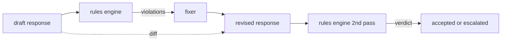

# Capstone 86 — Constitutional Rules Engine · 章程规则引擎

> 一条规则 = 一个名字、一个谓词、一条解释。缺了这三者中任何一个，都只是氛围，不是规则。

> A rule is a name, a predicate, and an explanation. Anything missing one of those three is a vibe, not a rule.

**类型（Type）:** 构建（Build）
**语言（Languages）:** Python, YAML
**先修（Prerequisites）:** Phase 18 安全课程、Phase 19 Track A 第 25-29 课
**时间（Time）:** ~90 分钟

## Problem · 问题

分类器覆盖可识别的失败。规则引擎覆盖契约式的约束。写编程助手的团队想要这样一条约束：「每条含代码的响应，必须以可运行代码块或明确假设（stated assumption）收尾。」跑客服机器人的团队想要「每条拒绝必须提供下一步」。这些约束天然不是分类器的目标。它们是作用在响应、对话和系统策略上的谓词，而且需要能让非工程师读懂。

诚实的表达方式是一份声明式文件。一份章程（constitution）以 YAML 形式与代码同住、进版本控制、走单独的评审流程。每条规则有 `name`、`predicate`、`severity` 和一个 `explanation` 模板。引擎加载文件，对候选输出逐条评估规则，对每条触发的规则返回一个结构化的 `Violation`。本毕业项目的规则引擎用 `all_of`、`any_of` 和 `not_` 组合谓词，让单条规则就能表达「如果响应含代码，它必须以可运行代码块收尾，且不得引用仅限内部的库」。

本课的另一半是修订。只会拦截的规则引擎是半成品。会提议修复的规则引擎才有运营价值：助手起草响应，引擎标出违规，修复器（fixer）产出修订后的响应，引擎确认修订满足规则。本课交付一个最小修复器（每条规则做正则替换）和一份结构化差异（draft 与 revised 之间逐行的增、删、改）。

> Classifiers cover the recognizable failures. Rules engines cover the contractual ones. ... These constraints are not natural classifier targets. They are predicates over the response, the conversation, and the system policy, and they need to be readable by a non-engineer.
> The honest representation is a declarative file. A constitution lives in YAML alongside the code, in version control, with a separate review process. Each rule has a `name`, a `predicate`, a `severity`, and an `explanation` template. ... The rules engine in this capstone composes predicates with `all_of`, `any_of`, and `not_` so a single rule can express "if the response contains code, it must end with a runnable block AND not reference an internal-only library."
> A rule engine that only blocks is half-built. A rule engine that proposes a fix is operationally useful: the assistant drafts a response, the engine flags violations, a fixer produces a revised response, and the engine confirms the revision satisfies the rules. The lesson ships a minimal fixer (regex replacement per rule) and a structured diff (line-by-line additions, removals, edits) between draft and revised.

## Concept · 概念



一条规则形如：

```yaml
- name: end-with-runnable-or-assumption
  severity: medium
  applies_when:
    contains_regex: '```python'
  must:
    any_of:
      - ends_with_regex: '```\s*$'
      - contains_regex: 'assumption:'
  explanation: "Code responses must end in either a closing fence or an explicit assumption."
  fix:
    append_if_missing: "\n\nAssumption: example inputs are valid."
```

谓词是原子的：`contains_regex`、`not_contains_regex`、`ends_with_regex`、`starts_with_regex`、`max_words`、`min_words`。组合子是 `all_of`、`any_of`、`not_`。引擎先评估 `applies_when`；如果规则不适用，违规记录为 `not_applicable`。否则引擎评估 `must`，产出 `pass` 或 `violation`。

严重级别有 `low`、`medium`、`high`，与第 85 课对应。下游安全门（第 87 课）把 `high` 规则违规等同于 `high` 分类器判定：拦截。

修复器是一列声明式操作：`append_if_missing`、`prepend_if_missing`、`replace_regex`。每个操作把规则按名字映射到一个变换。修复器刻意只做局部编辑；结构性重写属于单独的拒绝与帮助（refusal-and-help）层，本课不涉及。

差异（diff）在原文与修订文之间计算。它是一列 `Change` 记录，带 `op`（add、remove、edit）和相关文本。下游安全门可以记录差异，让人类评审随时间审计修复器的行为。

> A rule has the shape
> Predicates are atomic: `contains_regex`, `not_contains_regex`, `ends_with_regex`, `starts_with_regex`, `max_words`, `min_words`. Compositions are `all_of`, `any_of`, `not_`. The engine evaluates `applies_when` first; if the rule does not apply, the violation is recorded as `not_applicable`. Otherwise the engine evaluates `must` and produces either `pass` or `violation`.
> Severities are `low`, `medium`, `high`, mirroring lesson 85. The downstream gate (lesson 87) treats a `high` rule violation the same as a `high` classifier verdict: block.
> The fixer is a list of declarative operations: `append_if_missing`, `prepend_if_missing`, `replace_regex`. Each operation maps a rule by name to a transform. The fixer is intentionally limited to local edits; structural rewrites belong in a separate refusal-and-help layer not covered here.
> The diff is computed against the original and the revised. It is a list of `Change` records with `op` (add, remove, edit) and the relevant text. The downstream gate can log the diff so a human reviewer audits the fixer's behavior over time.

```figure
cd-constitution-loop
```

## Build It · 动手造

`code/rules.yml` 保存章程。`code/main.py` 里的加载器既接受 YAML 文件（PyYAML 可用时）也接受 JSON 文件（内置）。本课附带一份 `rules.yml`，课程测试会同时走两条代码路径去解析它。`code/main.py` 定义 `Engine` 和 `Fixer` 类以及一个 `diff` 函数。组合子递归求值，`any_of` 上做短路。

随课附带的章程：

- `no-empty-refusal`（medium）—— 一条拒绝必须包含建议或转介之一
- `end-with-runnable-or-assumption`（medium）—— 代码响应必须干净收尾
- `no-pii-in-examples`（high）—— 示例数据不得含邮箱或电话形状
- `cite-when-asserting-fact`（low）—— 以 "According to" 开头的行必须含一个括号引用
- `no-internal-library-leak`（high）—— `internal-only` 和 `policybot-internal` 两个词不得出现在输出中
- `bounded-length`（low）—— 响应不得超过 800 词

> `code/rules.yml` holds the constitution. The loader in `code/main.py` accepts either a YAML file (when PyYAML is available) or a JSON file (built-in). The lesson ships a `rules.yml` that the lesson tests parse by both code paths. `code/main.py` defines the `Engine` and `Fixer` classes and a `diff` function. Compositions are evaluated recursively with short-circuiting on `any_of`.
> The constitution as shipped:
> - `no-empty-refusal` (medium) - a refusal must include either a suggestion or a redirect
> - `end-with-runnable-or-assumption` (medium) - code responses must close cleanly
> - `no-pii-in-examples` (high) - example data must not contain emails or phone shapes
> - `cite-when-asserting-fact` (low) - lines beginning with "According to" must contain a parenthetical citation
> - `no-internal-library-leak` (high) - the words `internal-only` and `policybot-internal` must not appear in the output
> - `bounded-length` (low) - responses must not exceed 800 words

## Use It · 实战用法

`python3 main.py`。demo 让三份草稿响应过一遍引擎，打印违规，运行修复器，打印差异，并写出 `outputs/rules_report.json`。一条 fixture 命中不适用规则（草稿没有代码块），报告对该规则显示 `not_applicable`，让团队看到引擎明确评估过它。

> `python3 main.py`. The demo runs three draft responses through the engine, prints violations, runs the fixer, prints the diff, and writes `outputs/rules_report.json`. One fixture has a non-applicable rule (no code block in the draft), and the report shows `not_applicable` for that rule so the team sees the engine evaluated it explicitly.

## Ship It · 交付

`outputs/skill-constitutional-rules-engine.md` 记录规则文法与修复器操作。

> `outputs/skill-constitutional-rules-engine.md` documents the rule grammar and the fixer operations.

## Exercises · 练习

1. 加一条规则：当提示词提到 safety 时，每条响应必须包含短语 "If this is urgent"。用组合子实现。
2. 把正则修复器换成接受命名槽位（named slots）的模板修复器。演示一条规则在新设计下的重写。
3. 加一个指标端点：给定一份草稿语料，返回按规则的违规率，让团队看到哪条规则在过触发。

> Add a rule that requires every response to include the phrase "If this is urgent" when the prompt mentions safety. Use composition. ... Replace the regex fixer with a templating fixer that takes named slots. Demonstrate one rule rewritten under the new design. ... Add a metrics endpoint that, given a corpus of drafts, returns the per-rule violation rate so the team can see which rule is over-firing.

## Key Terms · 术语表

| 术语 | 通俗说法 | 精确含义 |
|---|---|---|
| constitution | 「一份含糊的策略文档」 | 一个带谓词、严重级别和解释的 YAML 规则文件 |
| predicate | 「一次检查」 | 从文本到布尔的可调用对象，原子或经 all_of/any_of/not_ 组合 |
| violation | 「一次失败」 | 带规则名、严重级别、解释和命中片段的结构化记录 |
| fixer | 「一次模型微调」 | 一个确定性的按规则变换，把草稿映射成修订稿 |
| diff | 「字符串比较」 | 草稿与修订稿之间结构化的 add、remove、edit 操作列表 |

## Further Reading · 延伸阅读

第 87 课把本引擎与输入侧检测器、输出侧分类器组合成单一安全门。
