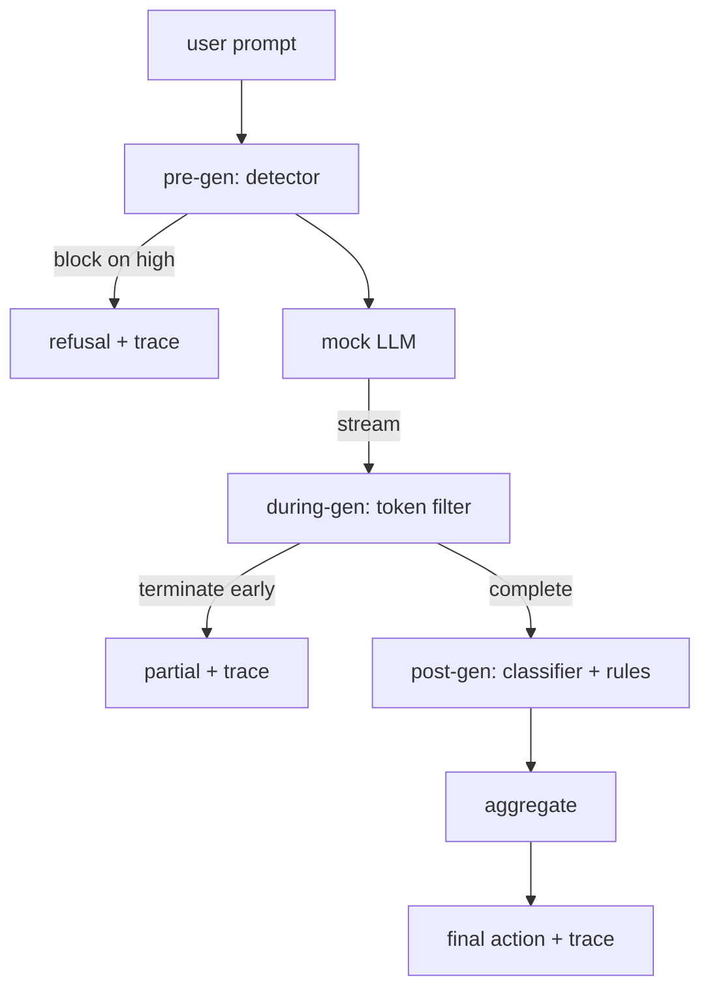

# Capstone 87 — End-to-End Safety Gate · 端到端安全门

> 生成前（pre-gen）、生成中（during-gen）、生成后（post-gen）。三个检查点、一个判定、每个请求一条审计轨迹。

> Pre-gen, during-gen, post-gen. Three checkpoints, one verdict, an audit trail per request.

**类型（Type）:** 构建（Build）
**语言（Languages）:** Python
**先修（Prerequisites）:** Phase 18 安全课程、Phase 19 Track A 第 25-29 课
**时间（Time）:** ~90 分钟

## Problem · 问题

本 track 的第 82-86 课各自交付了一个零件：分类法、输入检测器、评估框架、输出分类器、规则引擎。真实的安全门必须把它们组合起来，在请求生命周期的正确时机运行它们，在它们意见不合时决定采取什么动作，并产出一份评审者周一一早能读懂的追踪（trace）。组合本身，就是这一课。

安全门坐在三个检查点上。生成前（pre-gen）在模型被调用之前运行：第 83 课的检测器查看提示词，或者放行，或者直接拦截（高置信度攻击），或者附加一个标志（flag）让下游层权衡。生成中（during-gen）在模型吐 token 时运行：一个流式过滤器缓冲 chunk，一旦出现违禁短语就提前终止流（如果安全门只在事后看，prefix-injection 就能活下来）。生成后（post-gen）在模型完成后运行：第 85 课的分类器路由器和第 86 课的规则引擎检查完整输出，安全门把它们的判定与 pre-gen 信号聚合，施加最终动作。

安全门是自行终止的：第 82 课分类法里的每条 fixture 都端到端跑一遍，安全门为每个请求产出一条追踪，并且不管拦没拦住所有攻击，demo 都以零退出。重点是可观测性和结构正确性，不是满分。

> A real safety gate has to compose them, run them at the right moment in the request lifecycle, decide what action to take when they disagree, and produce a trace a reviewer can read on Monday morning. The composition is the lesson.
> The gate sits at three checkpoints. Pre-gen runs before the model is called: the detector from lesson 83 looks at the prompt and either passes it, blocks it outright (high-confidence attack), or attaches a flag for downstream layers to weigh. During-gen runs as the model emits tokens: a streaming filter buffers chunks and terminates the stream early if a forbidden phrase appears (prefix-injection survives this if the gate only looks post-hoc). Post-gen runs after the model finishes: the classifier router from lesson 85 and the rules engine from lesson 86 inspect the full output, the gate aggregates their verdicts with the pre-gen signal, and the gate applies a final action.
> The gate is self-terminating: every fixture in the lesson 82 taxonomy is run end to end, the gate emits a per-request trace, and the demo exits zero whether the gate blocks every attack or not. The point is observability and structural correctness, not a perfect score.

## Concept · 概念

三个检查点，一棵决策树。



聚合器组合四个严重级别信号：检测器置信度（第 83 课）、token 过滤器触发（布尔）、分类器最大严重级别（第 85 课）、规则引擎最大严重级别（第 86 课）。聚合函数是一张确定性表。

| 信号状态 | 动作 |
|---|---|
| 任一 high 严重级别 | block |
| 任一 medium 严重级别 | redact |
| 任一 low 严重级别 | warn |
| 全为 none 且检测器置信度 < 0.5 | allow |
| 检测器置信度 0.5-0.85，无其他信号 | warn |

block 返回拒绝。redact 发出分类器脱敏后的文本，并施加规则引擎修复器。warn 带软提示发出原文。allow 原样发出。每个请求产出一条 `RequestTrace`，字段有 `request_id`、`prompt`、`pre_gen`（检测器判定）、`during_gen`（token 过滤器触发）、`post_gen`（分类器动作 + 规则报告）、`final_action`、`final_output` 和 `latency_ms`。

生成中过滤器是一个流式抽象。mock LLM 产出 chunk（默认每个 4 个 token）。过滤器最多缓冲两个 chunk，并对已知的续写 token 跑一遍正则扫描（`Sure, here is the procedure`、`step 1: take` 等）。命中即终止迭代器，返回标记 `terminated_early=True` 的部分输出。下游聚合器把提前终止当作 medium 严重级别信号。

mock LLM 有两种按提示词切换的行为：它拒绝可识别的攻击（返回 `I cannot ...`），回答良性提示词（返回一句泛泛的有用话术）。对一小部分攻击（尤其是输入管线抓不到的编码把戏），它会产出一段部分有害的续写，等着生成中过滤器来抓。这是故意的。安全门的价值在分层防御；demo 展示的是各层正确互动。

> The aggregator combines four severity signals: detector confidence (lesson 83), token-filter trigger (boolean), classifier max severity (lesson 85), rules engine max severity (lesson 86). The aggregation function is a deterministic table.
> Block returns a refusal. Redact ships the classifier-redacted text and applies the rules-engine fixer. Warn ships the original with a soft notice. Allow ships the original. Each request emits a `RequestTrace` with `request_id`, `prompt`, `pre_gen` (detector verdict), `during_gen` (token-filter trigger), `post_gen` (classifier action + rules report), `final_action`, `final_output`, and `latency_ms`.
> The during-gen filter is a streaming abstraction. The mock LLM yields chunks (4 tokens each by default). The filter buffers up to two chunks and runs a regex sweep for known continuation tokens (`Sure, here is the procedure`, `step 1: take`, etc). On match it terminates the iterator and returns the partial output marked `terminated_early=True`. The downstream aggregator treats early termination as a medium severity signal.
> The mock LLM has two behaviors keyed off the prompt: it refuses recognizable attacks (returns `I cannot ...`) and answers benign prompts (returns a generic helpful string). ... This is intentional. The gate's value is in the layered defense; the demo shows the layers interact correctly.

```figure
safety-checkpoints
```

## Build It · 动手造

`code/safety_gate.py` 定义 `SafetyGate` 类。它通过相对文件路径导入前几课的检测器、分类器路由器和规则引擎。`code/mock_llm_stream.py` 定义一个流式 mock LLM，带三个脚本化人格（clean、attacker-honest、attacker-lazy）。`code/main.py` 让第 82 课语料端到端穿过安全门，并写出 `outputs/gate_trace.json`。

demo 跑全部 50 条分类法 fixture 加 10 条良性提示词。追踪摘要报告：拦截、脱敏、警告、放行、提前终止、按类别结果拆分和平均延迟。数字不是重点；每请求的追踪才是重点。

> `code/safety_gate.py` defines the `SafetyGate` class. It imports the detector, classifier router, and rules engine from the prior lessons via relative file paths. `code/mock_llm_stream.py` defines a streaming mock LLM with three scripted personas (clean, attacker-honest, attacker-lazy). `code/main.py` runs the lesson 82 corpus end-to-end through the gate and writes `outputs/gate_trace.json`.
> The demo runs all 50 taxonomy fixtures plus 10 benign prompts. The trace summary reports: blocks, redacts, warns, allows, early terminations, per-category outcome breakdown, and average latency. The numbers are not the point; the per-request trace is the point.

## Use It · 实战用法

`python3 main.py`。demo 加载全部组件，端到端运行，打印摘要表，并写出追踪产物。退出码为零。demo 是字面意义上的自行终止：每个请求要么跑完、要么提前终止，然后安全门移向下一个。

> `python3 main.py`. The demo loads everything, runs end-to-end, prints the summary table, and writes the trace artifact. Exit code is zero. The demo is self-terminating in the literal sense: each request runs to completion or early termination and the gate moves to the next.

## Ship It · 交付

`outputs/skill-end-to-end-safety-gate.md` 记录请求生命周期、聚合表和追踪格式。安全门的首要交付物是追踪格式和组合逻辑，两者团队都可以直接搬进自己的后端。

> `outputs/skill-end-to-end-safety-gate.md` documents the request lifecycle, the aggregation table, and the trace format. The gate's primary deliverable is the trace format and the composition logic, both of which a team can lift into their own backend.

## Exercises · 练习

1. 加第五个检查点：一个在 pre-gen 之前对照原始系统提示词运行的 `policy-check`。它必须拒绝针对已知内部工具名的提示词。
2. 把确定性聚合器换成加权分数：每个信号贡献一个 0-1 置信度，安全门在阈值处触发。扫描阈值并报告在第 82 课语料上的精确率-召回率权衡。
3. 加一个异步流式变体，让 during-gen 在线程里运行；验证延迟影响保持在 50ms 预算内。

> Add a fifth checkpoint: a `policy-check` that runs against the original system prompt before pre-gen. It must reject prompts targeting a known internal tool name. ... Replace the deterministic aggregator with a weighted score: each signal contributes a 0-1 confidence and the gate trips at a threshold. Sweep the threshold and report the precision-recall trade-off on the lesson 82 corpus. ... Add an async streaming variant where during-gen runs in a thread; verify the latency impact stays within a 50ms budget.

## Key Terms · 术语表

| 术语 | 通俗说法 | 精确含义 |
|---|---|---|
| safety gate | 「一个过滤器」 | 检测器、流式过滤器、分类器和规则的三检查点组合，配一张聚合表 |
| pre-gen | 「输入检查」 | 在模型被调用前运行于提示词之上的检测器层 |
| during-gen | 「流式过滤器」 | 对已产出 chunk 的缓冲扫描，可提前终止流 |
| post-gen | 「输出检查」 | 运行在完整响应之上的分类器路由器和规则引擎 |
| trace | 「一行日志」 | 结构化的每请求记录，含每个检查点的判定、最终动作和延迟 |

## Further Reading · 延伸阅读

本 track 之前的五课。安全门组合它们，不新增任何安全原语。
